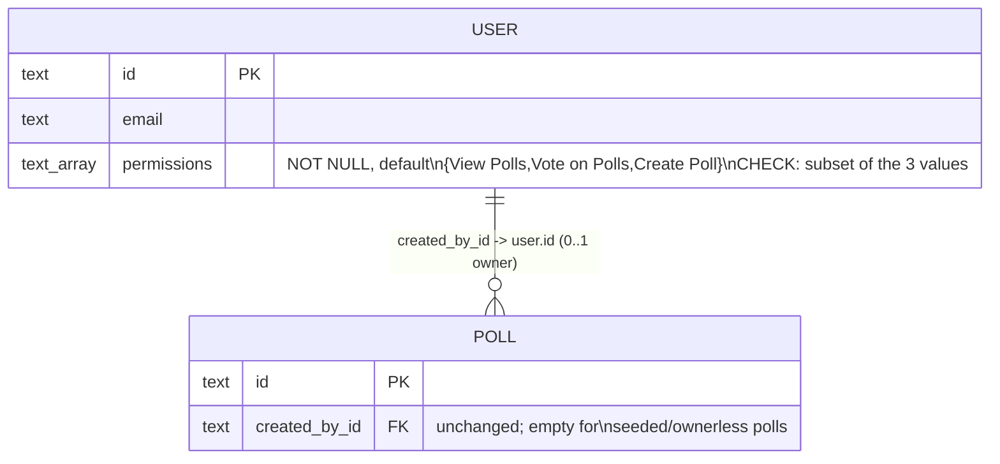

# Data Model: User Permissions (025)

One column changes shape; nothing else in the schema moves. No backfill step (requirements doc,
"No Data Migration Necessary").

## `user` (existing table, `src/db/schema.ts`)

| Field | Type | Notes |
|---|---|---|
| `permissions` (**new**) | `text[]`, `NOT NULL`, `DEFAULT ARRAY['View Polls','Vote on Polls','Create Poll']` | `CHECK (permissions <@ ARRAY['View Polls','Vote on Polls','Create Poll']::text[])` (R2) — any subset, any order, `{}` included. Not declared to BetterAuth (its adapter cannot store arrays); read alongside the session on a cache miss (R1). |

TypeScript side (`src/polls/service.ts`): a `Permission` union —

```ts
type Permission = "View Polls" | "Vote on Polls" | "Create Poll";
```

— matching the stored strings verbatim (including the embedded spaces), so no translation layer
sits between storage and code.

**Derived, never stored**: `Administrator`. Unchanged — `isAdminEmail(email, config)` still derives
it from `ENV_ADMINS` on every request (`src/config.ts:213`, `src/polls/service.ts:742`). An
admin's `Administrator` status implies every one of the three stored grants regardless of what (if
anything) is actually stored on their row.

Existing rows: the column default back-fills every pre-existing user at migration time with no
separate data step, per the requirements doc's Assumptions.

## `polls` (existing table — unchanged)

`created_by_id` already exists (`src/db/schema.ts:95`) and is already populated on poll creation.
025 changes how this fact is *used* — it becomes the predicate for `canActOnPoll` (R3) — not how or
when it is written. A poll with an empty `created_by_id` (seeded/old data) is manageable only by an
admin, since `canActOnPoll`'s ownership comparison can never match an empty value.

## `user_polls` (existing table — one new relation value; fix.md FIX04)

`relation` is plain `text`, so no migration: `UserPollRelation` gains `"linked"`, written by
`POST /api/me/polls/:pid/link` when a signed-in user opens the shared link of a link-only private
poll they did not create. `privateTab()` now lists polls related by `created`, `invited`, `voted`,
`bookmarked` or `linked`. Like the other relations, a `linked` row goes when its poll is deleted.

## Relationship



(Carried over from `architecture/025-user-permissions/architecture.md` §3, unchanged by this plan.)

## State / lifecycle

No new lifecycle. The three stored grants are static booleans-in-an-array, not a state machine —
there is no transition logic, only presence/absence checks (`hasPermission`, R5/R6) and the two
composite predicates `canReachAdmin` / `canActOnPoll` (R3). The existing poll-state machine (`024`'s
wizard rules, `pollStateBeforeEditUpdate`, etc.) is untouched; ownership is an orthogonal, additional
gate checked alongside it, never inside it.
