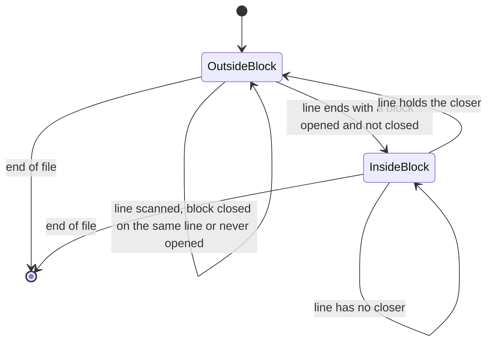

# Data Model: File Manifest Script

No database, no schema change, no stored state. Everything below lives in memory for the length of one
run, except the report files, which are the output (see [contracts/reports.md](contracts/reports.md)).

## Entities

### Project
The folder named by the argument.

| Field | Meaning | Rule |
|---|---|---|
| `directory` | absolute path | resolved from `INIT_CWD` (else the working folder); must be a folder inside a git work tree (FR-001, FR-002) |
| `manifestsDirectory` | `<directory>/manifests` | created if missing; the only place the run writes |

### ListedFile
One path git reports.

| Field | Type | Rule |
|---|---|---|
| `path` | string | relative to the project, forward slashes, as git prints it |
| `group` | `"tracked"` \| `"untracked"` \| `"ignored"` | exactly one; from which of the three git calls returned it |

- The three lists never overlap: a tracked file that matches an ignore rule is `tracked`, because the
  ignored call lists only untracked files.
- A path whose first component is `node_modules`, `node-modules` or `manifests` is dropped before anything
  else (FR-004).
- When the file system is case-insensitive, two listed paths with the same lower-cased spelling are one
  file; the first listed (tracked, then untracked, then ignored) is kept (FR-018), and the later spelling becomes a `SkippedEntry` with the reason `duplicate (differs only in letter case)`.

### SkippedEntry
A listed path that could not be counted. Console only; never written to a manifest.

| Field | Values |
|---|---|
| `path` | as listed |
| `reason` | `missing`, `symlink`, `directory`, `not a file`, `unreadable (<system code>)`, or `duplicate (differs only in letter case)` |

`counted + skipped = listed` after the exclusions (SC-002).

### Measure
What one file contributes. A file is exactly one of two kinds.

| Kind | Fields | Rule |
|---|---|---|
| Text | `lines`, optional `commentLines` | `lines` per FR-008; `commentLines` present only when the extension has a comment syntax (FR-009) |
| Binary | `bytes` | the file size; no lines, no comment lines |

### MeasuredFile
A `ListedFile` that was counted, with its `Measure`.

| Field | Type | Rule |
|---|---|---|
| `path` | string | as listed (spelling on disk for the top-level name when folded) |
| `group` | as above | |
| `fileType` | string | `extensionOf(name)`: lower-cased extension with its dot; `(none)` when `path.extname` is empty or only a dot, which includes names such as `.gitignore` and `file.` |
| `topDirectory` | string | first path component; `.` for a file at the project root |
| `measure` | Measure | |

### Row
One line of a table.

| Field | Meaning |
|---|---|
| `fileType` | the group-by value |
| `directory`, `status` | only in `directories.md`; `status` is `.gitignored`, `committed` or `untracked` (mapped from `ignored`, `tracked`, `untracked`) |
| `files` | number of measured files in the row |
| `lines` | sum of text lines in the row, or empty when the row has no text file |
| `commentLines` | sum of comment lines, or empty when no file in the row has a comment syntax |
| `bytes` | sum of binary sizes, or empty when the row has no binary file |

The `**Total**` row sums each column over the rows above it and always shows numbers, `0` where nothing
contributes (FR-011).

### Report
A file name and the table text built from a filter over the `MeasuredFile` list.

| Report | Filter |
|---|---|
| `overall.md` | all |
| `not-gitignored.md` | `group` is `tracked` or `untracked` |
| `gitignored.md` | `group` is `ignored` |
| `directories.md` | all, grouped by `topDirectory`, `status`, `fileType` |
| `dist.md` | `path` starts with `dist/` |
| `public.md` | `path` starts with `dist/public/` |
| `assets.md` | `path` starts with `dist/public/assets/` |
| `src.md` | `path` starts with `src/` |
| `tests.md` | `path` starts with `tests/` |

The last five are produced only when the filter matches at least one measured file (FR-014). The first
four are always produced, with a header row and a `**Total**` row of zeros when the filter matches nothing.

### CommentSyntax
A value in the table keyed by extension.

| Field | Type | Rule |
|---|---|---|
| `lineMarkers` | string[] | a marker starts a comment that ends with the line |
| `blocks` | `{open, close}[]` | an open marker starts a comment that runs to the close marker, across lines |

The table is the FR-009 table; an extension that is not a key has no syntax and no comment count.

### RunFolder
`manifests/YYYY-MM-DD_HH-mm-ss`, or the same with `-2`, `-3`, ... appended until it is new. Local time of
the start. Created non-recursively so the name is claimed atomically (R9).

## State: the comment scanner

One state is carried from line to line while a text file in a recognised language is scanned.

Within a line, `hasComment` and `hasCode` start as (`InsideBlock`, `false`). Scanning left to right, a
closer ends the block, a line marker ends the line as comment, a block opener starts a block, and any other
non-blank character sets `hasCode`. The line is a comment line when `hasComment && !hasCode`.

## Validation rules, by source

| Rule | Source | Where checked |
|---|---|---|
| exactly one argument; a folder; a git work tree | FR-001, FR-002 | `parseArguments`, then `git rev-parse` |
| excluded top-level folders | FR-004 | `isExcludedPath` |
| not a readable regular file is skipped | FR-005 | `readAndMeasure` |
| `(none)` and lower-casing | FR-006 | `extensionOf` |
| zero byte in 8,000 | FR-007 | `isBinary` |
| line rule | FR-008 | `countLines` |
| comment rule and syntax table | FR-009 | `countCommentLines` |
| unique run folder | FR-010 | `createRunFolder` |
| single table, `**Total**` last | FR-011 | `renderTable`, `summarize*` |
| encoding, endings, escaping | FR-017 | `renderTable` |
| case folding | FR-018 | `detectCaseInsensitive`, `dedupeAndFold` |
