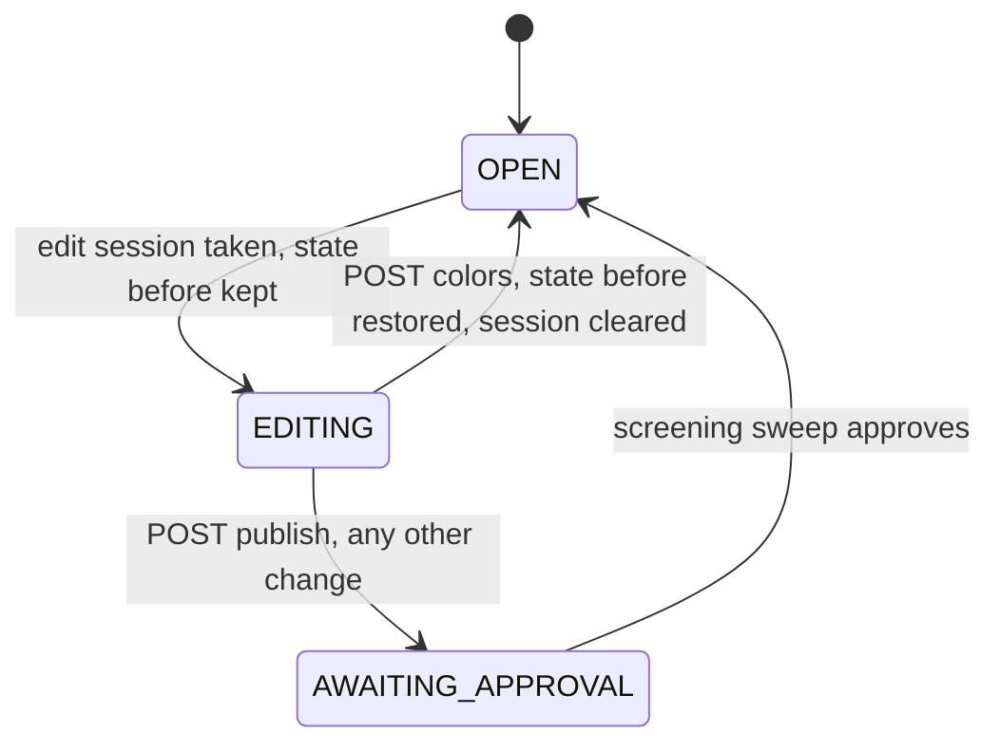

# Data Model: Manual Bar Colors

No table, column or index is added and no migration is run. The only stored change is one optional property on each element of `polls.choices` (`jsonb`). Everything else below lives in memory for the length of a request or an open card.

## Entities

### Palette entry (server constant)

| Field | Type | Rule |
|---|---|---|
| `name` | string | shown in the picker, and the swatch's accessible name and tooltip |
| `hex` | string | `#RRGGBB`, upper case |

The palette is one ordered array in `src/polls/barPalette.ts`, 18 entries, in picker order (spec Assumptions). It is sent to the browser as `barPalette` in `/api/config`. It is separate from `RESULTS_PALETTE_ENTRIES` in `pollCard.js` (the automatic colours: a 14-colour base list that `expandPalette` repeats to the poll's choice limit).

### Choice (extended)

| Field | Type | Rule |
|---|---|---|
| `id` | string (uuid) | reissued on every save of choices, as today |
| `label` | string | unique within the poll, at most `CHOICE_LABEL_MAX` characters |
| `position` | number | 0-based display order |
| `color` | string, optional | `#RRGGBB` upper case; **absent means Automatic**; never `null` in storage |

The same optional property rides on `PollChoiceJson` (`src/db/schema.ts`) and on the projection's choice (`src/polls/versions.ts`). A stored `color` is drawn whatever the palette holds today; a value that is not a six-digit hex is drawn as Automatic.

### Colour entry (in a request)

An element of the `colors` list:

| Value | Meaning |
|---|---|
| `null` | Automatic |
| a palette hex (any letter case) | accepted, stored in the palette's spelling |
| a hex the poll already stores on one of its choices | accepted, kept as stored |
| anything else | refused, `400`, nothing saved |

The list has exactly one entry per choice, in the same order as `labels` (or as the stored choices when there are no labels).

### Wizard colour state (browser, per open card)

| Field | Type | Rule |
|---|---|---|
| `wizard.colors` | object `{label: hex}` | only labels that have a colour; started from the poll's stored choices for an existing poll; pruned to the labels still in the Choices box when the Colors step is opened |
| derived list | array | `choiceLines(state).map((l) => wizard.colors[l.trim()] ?? null)`, sent as `colors` |

### Resolved bar colour (browser, per render)

For each choice in display (percentage) order, one of three sources, and whether the palette index advances:

| Choice | Colour drawn | Palette index |
|---|---|---|
| has a valid `color` and reads as yes or no | `color` | not advanced |
| has a valid `color`, otherwise | `color` | advanced |
| no valid `color`, reads as yes or no | the Yes or No colour | not advanced |
| no valid `color`, otherwise | the palette entry at the index | advanced |

Track, ink and dark-mode colours are derived on demand from whichever colour is drawn, and cached by hex.

## Validation rules, by source

| Rule | Spec | Where |
|---|---|---|
| list length equals the choice count | FR-009, FR-010 | `replaceChoices`, `applyChoiceColors` |
| entry is `null`, a palette colour or a stored colour | FR-009 | `checkedColor` |
| hex compared without regard to letter case, stored upper case | FR-009 | `normalizeColor` |
| colour paired with its label before empty labels are dropped | FR-009 | `replaceChoices` |
| `labels` without `colors` means no colours | FR-009 | `replaceChoices` |
| `colors` alone changes colours only, never ids, labels, positions or votes | FR-010 | `applyChoiceColors` |
| colours route needs the session, a poll with votes, creator or administrator | FR-010 | the new route |
| a stored value that is not `#RRGGBB` draws as Automatic | FR-016 | `pollCard.js` |

## State transitions

The colours route moves no poll to a new state; it undoes the edit session's:

The state before the session may be `OPEN`, `WAITING TO OPEN`, `CLOSED` or `REJECTED`; the route restores whichever was stashed in `pollStateBeforeEditUpdate`.
