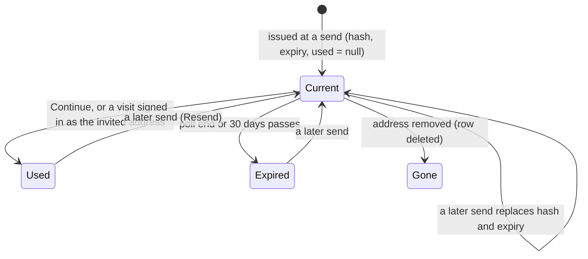

# Data Model: Single-Email Invitation

One additive migration, `011-invitation-tokens`. No new table, no backfill, no new setting.

## `poll_invitations` (existing) — three new columns

| Column | Type | Meaning |
|---|---|---|
| `token_hash` | `text`, null | `hashToken(token)` (SHA-256, `base64url`) of the newest invitation sign-in token; null when no email with a token has been sent (OAuth mode, rows from before this feature, not yet sent). |
| `token_expires_at` | `timestamptz`, null | The earlier of the poll's `end_at` and 30 days after the send. |
| `token_used_at` | `timestamptz`, null | When the token signed someone in, or was used up by a visit already signed in as the invited address. |

- Index: `create unique index "poll_invitations_token_hash" on "poll_invitations" ("token_hash") where "token_hash" is not null`.
- `src/db/schema.ts` `PollInvitationTable` gains the three fields as `NullableTimestamp` / `string | null`.
- The token itself is never stored, logged or returned by any route (FR-005).

## Derived: can a token sign in?

A token `t` presented with poll id `p` **can sign in** when a row exists with `poll_id = p` and `token_hash = hashToken(t)` and:

- `token_used_at is null`, and
- `token_expires_at > now()`, and
- the poll's `poll_state` is not `CLOSED` or `ARCHIVED`, and
- the poll is still Private and Invitation Only.

Otherwise the link behaves as `/?PID=
` (FR-015); a missing or invalid `p` is the invalid-link case (FR-016).

## Token life

- A replaced token no longer matches any row; its link still carries `PID`, so it falls back to `/?PID=` (IN2).
- `invitation_history` (address added back, R15 of Poll Invitations) is unchanged: it keeps no token, so an address added back gets a token only with its next email (UA5).
- Deleting an account (`deleteAccount.ts`) needs no change: the account's invitation rows and their tokens go with the existing deletion.

## `user` (existing, BetterAuth)

No column change. Continue may create a row (`email` = the invited address, `name` = `""`, `status` = `pending` until the session hook activates it), records `terms_version` / `terms_accepted_at` through `recordAgreement`, and `emailVerified` becomes true through the magic-link verification (clarification 2026-10-27).

## Rate-limit rule (BetterAuth `rateLimit` table, existing)

A fourth custom rule key, `RATE_LIMITED.redeemInvitation = "/redeem-invitation"`, with `emailRateLimit(config)`, consumed only after the token and Terms checks pass (research R6).
