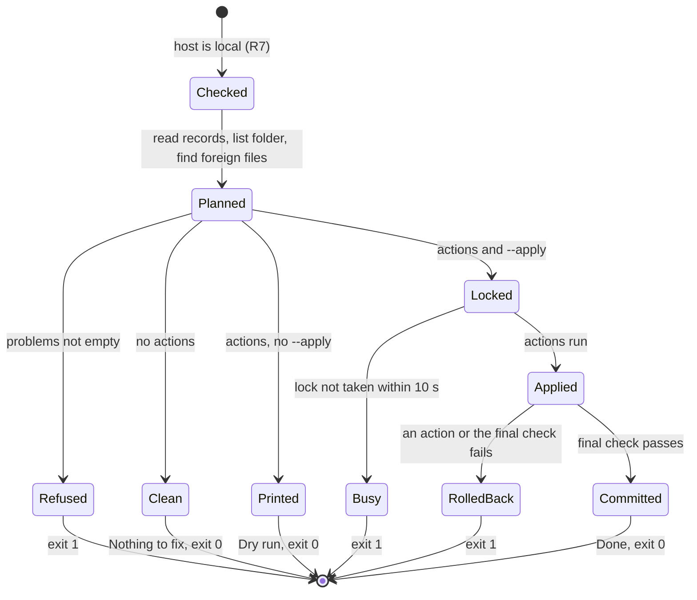

# Data Model: Branch Migration Merge

No stored data changes: no migration, no new table, no new column. The script reads and writes Kysely's existing
`kysely_migration` table (R1) and, through the migrations it runs, whatever those migrations change.
Everything below is in memory, inside one run of `devScripts/fix-migrations.ts`.

## MigrationRecord (a row of `kysely_migration`)

| Field | Type | Notes |
|---|---|---|
| `name` | string | Primary key; `NNN-<suffix>` for this project's migrations |
| `timestamp` | string | ISO date string written by Kysely; orders the records (ties broken by `name`) |

Read in time order (R1). Changed only inside the repair transaction: renamed (F2), deleted (F1), inserted (F3).

## FolderMigration

| Field | Type | Notes |
|---|---|---|
| `name` | string | Key of `migrations` in this folder's `src/db/migrations/index.ts` |
| `up` | `(db) => Promise<void>` | Applies the change |
| `down` | `(db) => Promise<void>` (optional) | Undoes it |

## ForeignMigration

A migration found in a sibling folder for an unknown record (R6).

| Field | Type | Notes |
|---|---|---|
| `name` | string | The unknown record's name |
| `file` | string | Absolute path of the sibling file used |
| `folders` | string[] | Every sibling folder holding an identical copy |

## Action

A union, one per planned change:

| Kind | Fields | Failure it repairs | Effect |
|---|---|---|---|
| `rename` | `from`, `to` | F2 | `update kysely_migration set name = to where name = from` |
| `rollback` | `name`, `file` | F1 | the foreign migration's `down`, then the record is deleted |
| `apply` | `name`, `timestamp`, `before` | F3 | the folder migration's `up`, then a record with that `timestamp` (R5); `before` names the record whose timestamp it takes, for the output line |

## Problem

| Field | Type | Notes |
|---|---|---|
| `name` | string | The record or migration concerned |
| `reason` | string | One of: `duplicate record`; `<n> folder migrations end in -<suffix>`; `no folder beside this one has <name>.ts`; `the folders beside this one disagree on <name>.ts`; `<name>.ts has no down()`; a final-check failure (R4) |

## Plan

| Field | Type | Notes |
|---|---|---|
| `actions` | Action[] | Renames, then rollbacks (newest record first), then applies (name order) (R4) |
| `problems` | Problem[] | Non-empty → nothing is written, exit 1 |

### Life of a run

