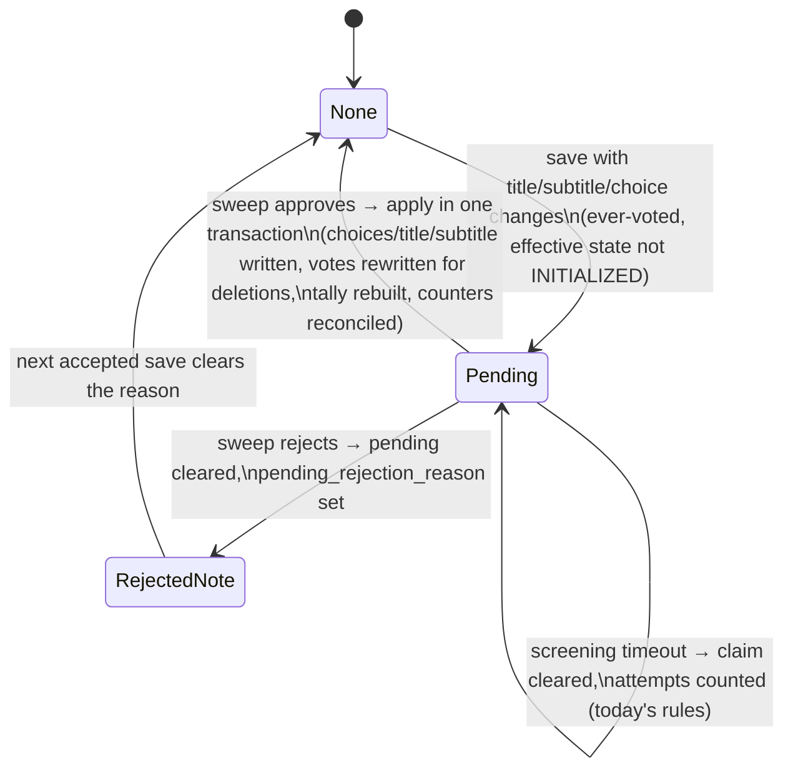

# Data Model: Editing an Open Poll Without Interrupting Voting

One additive migration, `014-pending-update`. No table is created and no existing column changes type.

## polls — two new columns

| Column | Type | Meaning |
|---|---|---|
| `pending_update` | `jsonb`, nullable | The saved-but-not-yet-approved content of an ever-voted poll. `NULL` means nothing is pending. At most one pending update exists per poll (a save while one is set is refused with `PENDING_REVIEW`). |
| `pending_rejection_reason` | `text`, nullable | The screener's verdict when a pending update was rejected. Cleared by the next accepted save and by an approved pending update. |

Domain fields: `pendingUpdate`, `pendingRejectionReason` on the `Poll` interface (`src/polls/store.ts:124-173`), mapped in the field-to-column map (`store.ts:273-275` pattern). Both join `NON_CONTENT_FIELDS`' complement — setting or clearing `pending_update` is **not** a content change for voters (the served content is unchanged until apply), so writes that only touch these two fields must not bump `content_version`; they are added to `NON_CONTENT_FIELDS` (`store.ts:284-290`). The apply itself writes `choices`/`title`/`subtitle`, which bumps the version as any content write does.

### `pending_update` shape

```json
{
  "title": "optional new title",
  "subtitle": "optional new subtitle",
  "choices": [
    { "id": "existing-uuid", "label": "kept label", "position": 0, "color": "#AABBCC" },
    { "id": "new-uuid-minted-at-save", "label": "added label", "position": 7 }
  ]
}
```

- Every key is optional; at least one is present (otherwise nothing was pending and the save applied immediately).
- `choices`, when present, is the **complete** resulting list from `mergeChoices` (research R3): survivors keep their stored `id`, `label` and `position`; additions carry ids minted at save time and positions after the last survivor. Deletions are implicit: a stored choice id absent from this list is deleted at apply (research R4).
- The shape is validated at save time; the sweep applies it without re-validation except the screening verdict.

## Lifecycle of a pending update



While `Pending`: the poll keeps serving its stored (pre-save) content; `editModeFor` answers `INELIGIBLE (PENDING_REVIEW)`; `/publish` answers `409 PENDING_REVIEW`. The poll's own `pollState` is never written by the pending machinery (FR-025) — a poll that closes meanwhile stays closed and still receives the approved content.

## Claim columns (reused, unchanged)

`poll_approval_timestamp` and `poll_acceptability_screening_attempts` serve the pending pool exactly as they serve `AWAITING APPROVAL` today: `claimNextForApproval` (`store.ts:855-879`) claims from both pools (they are disjoint — a pending update exists only on a poll that kept its own state), and `recoverCrashedApprovalClaim` (`store.ts:841-853`) recovers both.

## votes — rewrite semantics on deletion (no schema change)

Applying a pending update whose choice list drops ids rewrites, in the apply transaction:

- `votes.choice_ids`: each deleted id is removed (`array_remove`) from every row of the poll that contains it. A row left as `'{}'` is the existing "not voted" convention (invitee placeholders already use it): `computeResults` excludes it from `totalVoted` (`service.ts:304-320`) and the consumer's Final-vote upsert accepts a new vote over an empty row (`consumer.ts:85-104`), so the voter may vote again.
- `vote_history`: untouched (append-only history keeps deleted ids).
- `line_graph_tally` / `line_graph_selection`: rebuilt in-transaction by `rebuildLineGraphTally(trx, pid)`.
- `user_polls`: untouched; the `voted` relation records participation.
- After commit: `reconcile([pid])` recomputes `cnt:<pid>` from `votes` and zeroes stale fields; `forgetTabs` for the rewritten rows' emails.

## Projection (in-memory/cache, no schema change)

`projectPoll` (`src/polls/versions.ts:24-40`) publishes the **effective** state: `poll_state === 'EDITING' ? poll_state_before_edit_update ?? 'INITIALIZED' : poll_state`. No projection field is added; voter-facing readers (vote path, poll card, deltas) need no change.

## Edit-session response (API payload, no schema change)

The grant adds `choiceCounts: Record<choiceId, number>`, read from the live counters (`cnt:<pid>` after `rebuildIfMissing`) at session start. Held client-side for the session's life; feeds the deletion confirmation only.

## Admin list row (API payload, no schema change)

`adminListRow` adds `pendingUpdate: boolean` and `pendingRejectionReason: string | null`.
