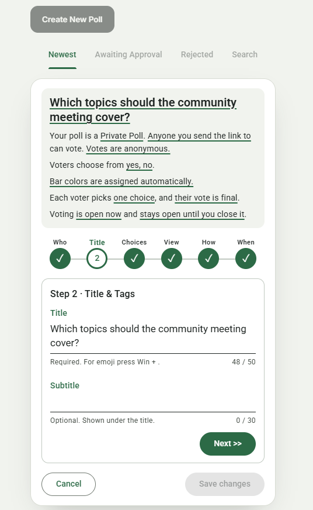

# Overview: `specs/20261029-225209-EDITING-POLL-AVAILABLE`

## Document History

| Record | Value |
|---|---|
| Feature directory | `specs/20261029-225209-EDITING-POLL-AVAILABLE` |
| Tweak file created | 2026-10-30 22:00 |
| Last updated | 2026-10-31 19:41 |

Legend: `[ ]` open · `[X]` Resolved · `[-]` Resolved (manually)  
(or accepted as-is) by the developer.
Tick `Run Tests` to have this tweak's automated tests written and run; leave it empty (the default) to postpone the run.

"Next" always returns the first `[ ]` item below.

The developer is expected to create the individual tweak requirements in this file, and then run the `/speckit-tweak` command to have the AI implement them, one at a time.  
Each tweak requirement initially carries an empty checkbox; tick it when the item is resolved or consciously accepted.  

# Tweaks

## TWEAK01 Admin Header EDITING Status  
[X] Resolved  
[ ] Run Tests  

"1. Creator: open the Admin Poll Card on the open, voted poll (edit session taken; admin header shows EDITING)."  

The admin header does not show the "EDITING" status as expected.

### RECOMMENDATION

The wizard face has never had a state header: `renderWizard` (`src/public/adminCard.js:2034`) builds the summary, circles, step panel and footer only;  
"Poll State Is: \<state\>" is built only by `buildReadOnlyHeader` (`src/public/adminCard.js:2238`), the read-only face.  
So the creator who holds the edit session sees the wizard, never a state line — this predates the feature (the 024 wizard replaced the old edit face), and the raw `EDITING` state is visible only on the read-only card, e.g. in another admin tab's list.  
The feature's contracts (C1–C8) do not require an EDITING indicator in the wizard; only quickstart.md step 1's parenthetical claims it.  

- **Option A** _(recommended)_: Correct the quickstart.  
  Reword quickstart.md Scenario 1 step 1 to what the UI does: the creator's card opens the wizard (no state header);  
  the poll's raw state becomes EDITING, visible as "Poll State Is: EDITING" on the read-only card in a second admin tab.  
  - Pros: documentation-only; matches the specified contracts and the 024 wizard design, where the creator's card words the poll by its stashed state.  
  - Cons: the creator still has no on-card confirmation that the edit session is held.  
  - Tests: none (doc-only change; nothing a test can observe).  

- **Option B**: Add an EDITING state line to the wizard face.  
  In `renderWizard`, for an existing poll, insert a `card-state` line ("Poll State Is: EDITING") above the summary;  
  add a client test in tests/client-admin-wizard.test.ts asserting it appears while the wizard is open on an existing poll and not on a new poll's wizard;  
  extend contracts/ui-contracts.md with the new element.  
  - Pros: gives the creator visible confirmation the session is taken; makes the quickstart step true as written.  
  - Cons: new UI beyond the feature's contracts; the wizard deliberately words the poll by its stashed state (R1), so a raw-EDITING line mixes the two readings.  
  - Tests would be written but not run (`Run Tests` not ticked).  

Recommended: **Option A** — the quickstart sentence is stale, not the UI;  
the EDITING state is the session lock's internal state, and the creator's own card deliberately reads the stashed state everywhere else.  

2026-10-31 (recorded by /speckit-tweak "Next")  

### ACCEPTED RECOMMENDATION

**Option C** (developer's own): Option B, but styled as the existing "Your poll is no longer being edited in this tab." message (reference: `dontTrack\edit-message.jpg`).  

What changed:  

- `src/public/adminCard.js`:  
  - `requestEdit` shows the existing status-line banner (`.card-status-line` — the same element and look as the "no longer being edited" notice) once the edit session is granted on an existing poll: "Your poll is being edited in this tab. Poll State Is: EDITING.";  
    it survives step changes, since the status element rides every `renderWizard`.  
  - `leaveWizard` clears the status line, so Save, Save changes, Publish and Cancel all remove the banner;  
    `loseSession` does not pass through `leaveWizard`, so its "no longer being edited" notice still replaces the banner, and transient errors ("Could not save.") overwrite it as before.  
  - A new poll's wizard shows no banner (`existing` is false).  

- Tests (written, **not run** — `Run Tests` not ticked):  
  - tests/client-admin-wizard.test.ts, new describe "the editing banner on an existing poll's wizard (TWEAK01)":  
    - shows the banner text while the wizard is open on an existing poll and hides it again after Cancel;  
    - shows no banner on a new poll's wizard.  
  - `npx tsc --noEmit` passes; the jsdom suite itself was postponed, so the tweak is unverified by a run.  

- Artifacts:  
  - specs/20261029-225209-EDITING-POLL-AVAILABLE/contracts/ui-contracts.md — new **C9** describing the banner;  
  - specs/20261029-225209-EDITING-POLL-AVAILABLE/quickstart.md — Scenario 1 step 1's parenthetical now names the banner instead of "admin header shows EDITING".  

Resolution: Option C accepted by "Accept option c" with the reference screenshot, 2026-10-31.

## TWEAK02 Voter And Vote Counts  
[X] Resolved  
[ ] Run Tests  

While testing we realized that for Multiple Choice polls, the text:
"Votes <number>"  

Is actually the Voter Count.

Anywhere that "Votes <number>" appears 
change it to "Voters <number>" 

On the Admin Poll Card, change "Vote Count <number>" to "Voter Count <number>".  
And for multiple-choice polls, add a line for "Vote Count <number>", which represents the total number of votes cast across all choices. 

On the Poll Results page for Multiple Choice polls,  
add a line under the 
"<number> participants voted" line
that reads "<number> votes cast".

### RECOMMENDATION

The "Votes \<number\>" surfaces are the poll card's totals line (`src/public/pollCard.js:1059`, "\<n\> vote(s)" from `totalVoted`, which counts participants — its own FIX022 comment says so) and the line graph's legend total (`src/public/lineGraph.js:129`, the same `totalVoted`).  
Both become "\<n\> voter(s)".  
The admin search panel's "Vote count" field label (`src/public/admin.html:153`) filters the same voter count, so it becomes "Voter count" (the `name` attributes stay, so `readSearchForm()` is untouched).  

- Admin Poll Card (`src/public/adminCard.js:2347`): "Vote Count" becomes "Voter Count" (`current.voteCount`, the poll row's voter counter);  
  for a Multiple-Choice poll a "Vote Count" line follows it, from a new `voteTotal` on the admin list row.  
- Server: a batched `voteTotals(db, pids)` in `src/polls/store.ts` (beside `pollsEverVoted`) sums `cardinality(choice_ids)` over `votes` grouped by poll;  
  both admin list routes call it for their Multiple-Choice rows, and `adminListRow` carries `voteTotal` on those rows only.  
- Poll Results page: `GET /api/admin/polls/:pid/results` adds `choiceMode` to its body;  
  `admin-results.html` gains a hidden line under `#resultsTotals`, and `src/public/adminResults.js` fills it with "\<n\> votes cast" (sum of the per-choice counts it already receives) for Multiple-Choice polls only.  

Tests (written, **not run** — `Run Tests` not ticked):  

- Pins updated to the new wording: tests/line-graph-ui.test.ts ("4 votes"/"5 votes" legend pins), tests/client-maximized.test.ts and tests/client-home.test.ts (".poll-totals" pins), tests/client-admin-wizard.test.ts and tests/client-admin-invitees.test.ts (the counts-panel label lists).  
- New assertions: the admin list row's `voteTotal` on a Multiple-Choice poll;  
  the results route's `choiceMode`;  
  the admin card's "Voter Count" + "Vote Count" pair on a Multiple-Choice poll with votes.  

Artifacts: postman/openapi.json (`voteTotal` on the admin row, `choiceMode` on the results response).  
No feature-spec artifact describes these labels, so spec/plan/tasks stay as they are.  

2026-10-31 (recorded by /speckit-tweak "Next")  

### ACCEPTED RECOMMENDATION

Applied as recommended (single recommendation, applied by "Next"'s automatic Accept).  

- `src/public/pollCard.js` — the card's totals line reads "\<n\> voter(s)" (was "vote(s)");  
  "· N not yet voted" unchanged.  
- `src/public/lineGraph.js` — the legend total reads "\<n\> voter(s)".  
- `src/public/admin.html` — the search panel's "Vote count" label is now "Voter count";  
  ids and `name` attributes unchanged.  
- `src/public/adminCard.js` — the counts panel leads with "Voter Count" (`voteCount`);  
  a Multiple-Choice poll adds "Vote Count" from the row's new `voteTotal`.  
- `src/polls/store.ts` — new `voteTotals(db, pids)`: one aggregate summing `cardinality(choice_ids)` over `votes`, grouped by poll.  
- `src/routes/pollsApi.ts` — both admin list routes call it for their Multiple-Choice rows and `adminListRow` carries `voteTotal` on those rows only;  
  `GET /api/admin/polls/:pid/results` adds `choiceMode`.  
- `src/public/admin-results.html` + `src/public/adminResults.js` — a "\<n\> votes cast" line under "\<n\> participants voted", shown on Multiple-Choice polls only, derived as the sum of the per-choice counts.  
- `README.md` — the line-graph legend sentence says "total voter count".  

Tests: **postponed (Run Tests not ticked); written, not run** — the tweak is unverified by a run.  

- New: polls-admin-crud ("carries voteTotal … on multiple-choice rows only"), polls-admin-participants ("GET results names the choice mode …"), client-admin-wizard ("shows Voter Count and, on a multiple-choice poll, the Vote Count of selections").  
- Pins updated to the new wording: line-graph-ui (legend "N voters"), client-home and client-maximized (".poll-totals" "N voter(s)"), client-admin-wizard and client-admin-invitees (counts-panel label lists).  
- `npx tsc --noEmit` passes and `postman/openapi.json` parses.  

Artifacts: postman/openapi.json — `voteTotal` on the admin poll row schema, `choiceMode` on the PollResults schema.  

Resolution applied 2026-10-31.

## TWEAK03 Voters Wording By Choice Mode  
[X] Resolved  
[ ] Run Tests  

We would like to make a change to the previous TWEAK02.  
Only use "<number> voters" when the poll is multiple-choice; otherwise, use "<number> votes".

### RECOMMENDATION

The "\<number\> voters" pattern appears on exactly two surfaces, both from TWEAK02:  
the poll card's totals line (`src/public/pollCard.js:1059`) and the line graph's legend total (`src/public/lineGraph.js:129`).  
Both read `totalVoted` of one specific poll, so each can choose its noun per poll:  
"voters" when `choiceMode === "Multiple-Choice Poll"`, "votes" otherwise (on a single-choice poll the two counts are the same number).  

- `pollCard.js` already holds the poll object (`poll.choiceMode`);  
  the line graph reads the mode through the card its mount context already carries (`ctx.card.detail().choiceMode`), the same seam it uses for `resultColors()`, so a mode change rides the card's own content refresh.  

Left as TWEAK02 set them, because they do not use the "\<number\> voters" pattern:  

- the Admin Poll Card's "Voter Count"/"Vote Count" labelled fields, which TWEAK02 specified per surface and which are exact in both modes;  
- the admin search panel's "Voter count" label, one form filtering polls of both modes at once, so it cannot vary per poll;  
- the Poll Results page's "\<n\> participants voted" / "\<n\> votes cast" pair.  

Tests (written, **not run** — `Run Tests` not ticked):  

- The TWEAK02 pins sit on single-choice fixtures, so they revert to the original wording:  
  tests/client-home.test.ts and tests/client-maximized.test.ts (".poll-totals" "N vote(s)"), tests/line-graph-ui.test.ts (legend "4 votes"/"5 votes").  
- New assertions on a Multiple-Choice poll: the card's totals line says "voters" (client-home) and the legend total says "voters" (line-graph-ui).  

Artifacts: README.md's legend sentence ("the total voter count") becomes mode-neutral.  
No API change, so postman/openapi.json stays as it is;  
no feature-spec artifact names these labels.  

2026-10-31 (recorded by /speckit-tweak "Next")  

### ACCEPTED RECOMMENDATION

Applied as recommended (single recommendation, applied by "Next"'s automatic Accept).  

- `src/public/pollCard.js` — the card's totals line chooses its noun per poll:  
  "\<n\> voter(s)" when `poll.choiceMode === "Multiple-Choice Poll"`, "\<n\> vote(s)" otherwise.  
- `src/public/lineGraph.js` — the legend total does the same, reading the mode from `ctx.card.detail().choiceMode` (the card its mount context already carries);  
  with no card it says "votes".  
- Unchanged, as the recommendation grounds: the Admin Poll Card's "Voter Count"/"Vote Count" fields, the admin search panel's "Voter count" label, and the Poll Results page's lines.  
- `README.md` — the legend sentence now reads "the total count of votes (of voters, on a multiple-choice poll, …)".  

Tests: **postponed (Run Tests not ticked); written, not run** — the tweak is unverified by a run.  

- Pins reverted to "votes" on the single-choice fixtures: tests/client-home.test.ts ("1 vote"), tests/client-maximized.test.ts ("0 votes"/"1 vote"), tests/line-graph-ui.test.ts ("4 votes"/"5 votes").  
- New: client-home "counts voters on the totals line of a multiple-choice poll only (TWEAK03)" ("2 voters");  
  line-graph-ui "counts the legend total in voters on a multiple-choice poll (TWEAK03)" ("4 voters").  
- `npx tsc --noEmit` passes.  

Artifacts: none beyond README.md — no API change, so postman/openapi.json is untouched.  

Resolution applied 2026-10-31.

## TWEAK04 <short title here>  
[ ] Resolved  
[ ] Run Tests  
tweak requirements...  
