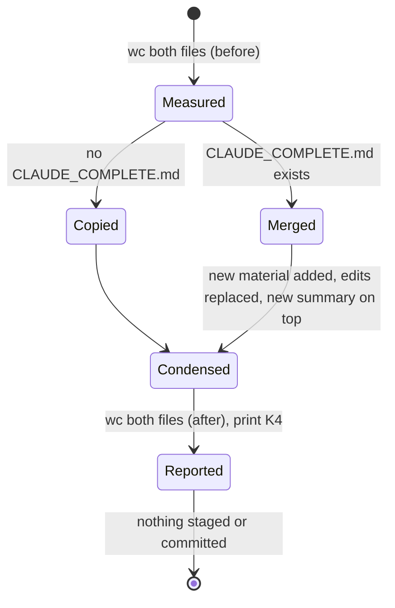

# Data Model: Concise CLAUDE.md

No application data, table, migration or setting is involved. The data are four Markdown files and one git
reference.

## Instruction file — `CLAUDE.md` (repository root, committed)

| Part | Content | Written by |
|---|---|---|
| Header | What the file is; names `CLAUDE_COMPLETE.md` once, in backticks; no `@` import, no instruction to read it (FR-003) | the command |
| SPECKIT block (`<!-- SPECKIT START -->` … `<!-- SPECKIT END -->`) | The current plan's path, its artifacts in one sentence, its "Decisions that are easy to get wrong" | shipped `/speckit-plan` step 4 and the agent-context hook (any form, R5); then the command |
| Project Overview, Layout, Commands | Condensed from today's sections | the command; hand edits allowed |
| Configuration rules | A few lines: `ENV_*` only, `loadConfig` validates once, intervals in ms except the minutes setting, templates git-ignored, production secrets in the console, the table in `.claude/rules/environment.md` | the command |
| Cross-feature invariants | One line each: a rule a change in one area could break elsewhere, naming the file or test that enforces it | the command (adds from a new feature's decisions, FR-011) |
| Architecture Notes | Cookie policy and the Cookie Use test, `postman/openapi.json` in sync, auth-phase constraint | the command |
| Spec Kit line | Spec Kit uses the PowerShell scripts | the command |

Absent by rule (FR-004): earlier features' summaries, the Spec Kit Workflow list, the Environment Variables table.

## Complete file — `CLAUDE_COMPLETE.md` (repository root, committed)

| Part | Content | Rule |
|---|---|---|
| Everything of today's `CLAUDE.md` | Verbatim on the first run (R3), SPECKIT markers included | Never loaded automatically |
| Feature chain (inside its SPECKIT markers) | Every feature's full summary, newest first; the newest opens with the "read the current plan" sentence, each older one with "The preceding feature is" | New summaries go on top; existing ones keep their text, except the previous newest entry's opening, which becomes "The preceding feature is" (Q1, R5) |
| Other sections | As in today's `CLAUDE.md`, kept current | Added text goes to its matching section (nearest fitting one when none matches); edited text replaces its counterpart; text the developer removed from `CLAUDE.md` since the previous run is removed here too, except when `CLAUDE_COMPLETE.md` has uncommitted changes (R4) |

## Settings rule file — `.claude/rules/environment.md` (committed)

| Part | Content |
|---|---|
| Frontmatter | `paths:` — `src/config.ts`, `.do/app.yaml`, `launch.json.example`, `devScripts.example/**`, `tests/config.test.ts` (R7) |
| Body | The Environment Variables table and its closing paragraph, verbatim from today's `CLAUDE.md`; a setting added later to `CLAUDE.md` is carried here and to `CLAUDE_COMPLETE.md` (FR-011) |

## Baseline — a git reference (not stored)

| Field | Source | Use |
|---|---|---|
| Baseline commit | `git log -1 --format=%H -- CLAUDE_COMPLETE.md` | `CLAUDE.md` at this commit is the concise text the previous run left |
| New material | `git diff <baseline> -- CLAUDE.md` (working tree) | Classified per hunk (R4); always checked against `CLAUDE_COMPLETE.md` before adding |

None on the first run (no `CLAUDE_COMPLETE.md`): the copy of R3 applies instead.

## Size report — printed, not stored

| Field | Source |
|---|---|
| Lines, before and after, per file | `wc -l` |
| Estimated tokens, before and after, per file | `wc -m` ÷ 4, rounded to the nearest 100 (R6) |

## State transitions of a run

