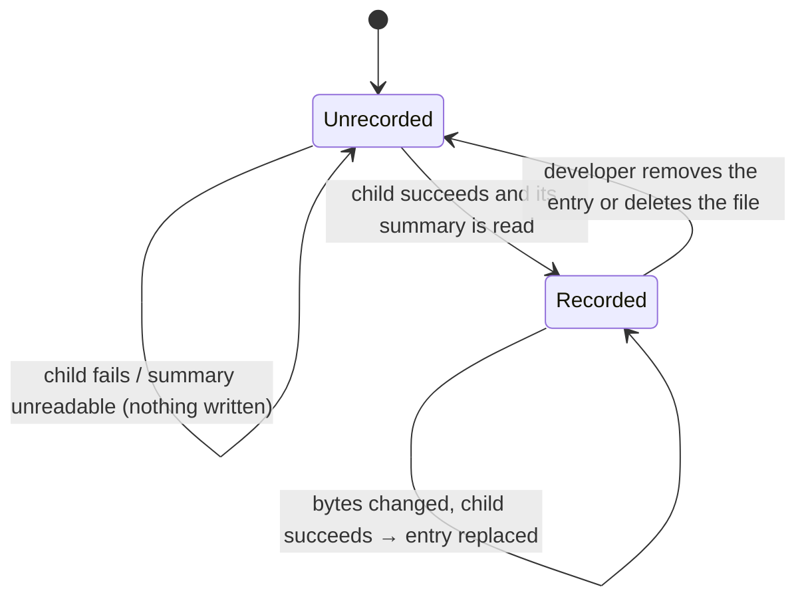

# Data Model: Populate All Polls

No database change: no table, column or migration. The polls and votes written are exactly those the existing
single-file script writes. The only new stored data is a local JSON file.

## Population history — `devScripts/populate/populate-all-polls-history.json`

Git-ignored (by `devScripts/populate/*`), local to the developer's machine, read and written only by
`populate-all-polls.ts`.

```json
{
  "entries": [
    {
      "database": "postgres://postgres@localhost:5432/app01",
      "file": "dancing-with-the-stars.json",
      "sha256": "3f1c…e9",
      "pollId": "6c0d1c2e-…",
      "outcome": "created",
      "votesWritten": 41230,
      "populatedAt": "2026-11-01T17:45:12.345Z"
    }
  ]
}
```

| Field | Type | Rule |
|---|---|---|
| `database` | string | `ENV_DATABASE_URL` with the password removed (R7); never holds a password |
| `file` | string | the data file's name only, no folder |
| `sha256` | string | 64 lower-case hex digits over the file's bytes at population time (R6) |
| `pollId` | string | from the child's `[populate] Done: poll <id> …` line |
| `outcome` | `"created"` \| `"refreshed"` | from the same line |
| `votesWritten` | integer ≥ 0 | from the child's `Votes written:` line, grouping commas removed |
| `populatedAt` | string | ISO 8601 UTC (`Date.prototype.toISOString()`), when the child finished |

**Identity and uniqueness**: at most one entry per (`database`, `file`) (clarification 1). A new success for the
same pair replaces the old entry.

**Skip rule**: a file is skipped when an entry has the same `database`, the same `file` and the same `sha256`.
Same `database` and `file` with another `sha256` → populated again, entry replaced. Another `database` →
populated, new entry.

**Lifecycle**:



**Validity on read**: the file must parse as JSON and be an object with an `entries` array; otherwise the run
stops before any file (FR-021). A missing file is `{ "entries": [] }`. Entries are not validated field by field:
the file is the script's own output.

**Write**: after each success, the whole object is written to `<path>.tmp` and renamed over the file (R8).

## In-memory result of one file (not stored)

`readPopulateResult` (R5) returns one of:

- `{ ok: true, pollId, outcome, votesWritten }` → an entry is written;
- `{ ok: false, message }` → the file is listed as failed with `message`.

The run keeps `populated`, `skipped` and a list of `{ file, message }` failures for the closing summary.
