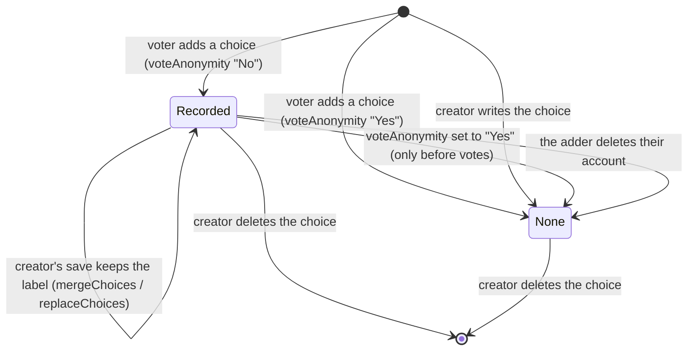

# Data Model: Voters Add Choices to a Private Poll

One additive migration, `015-voters-add-choices`; one optional key inside an existing JSON column; no backfill.

## polls.voters_add_choices (new column)

| Column | Type | Default | Poll field | Content field |
|---|---|---|---|---|
| `voters_add_choices` | `boolean not null` | `false` | `votersAddChoices` | yes (bumps `content_version`) |

- Meaningful only for `poll_visibility = 'Private Poll'`; `validatePollFields` refuses `true` on a Public poll.
- Changeable whether or not the poll has votes (`UPDATE_FIELDS`).
- Every existing row reads `false` (SC-006).
- Down: `alter table "polls" drop column "voters_add_choices"`.

## polls.choices element (existing JSON, one new optional key)

```ts
interface Choice {
  id: string;        // minted with randomUUID() on addition
  label: string;     // trimmed, ≤ WIZARD_CHOICE_MAX (40) for an addition
  position: number;  // max stored position + 1 for an addition
  color?: string;    // absent for an addition (Automatic)
  addedBy?: string;  // user id of the voter who added it; only on polls with voteAnonymity "No"
}
```

- `addedBy` never appears in `PollProjection`, the Trending/Newest objects, search documents or exports.
- Admin rows and detail add a derived `addedByName` (from `user.name`) per choice; it is not stored.
- `choice_labels` (text) is rewritten with `choices`, as on every choice write.

### addedBy lifecycle



## Validation of an addition (in order)

| # | Rule | Status | Code |
|---|---|---|---|
| 1 | trimmed label is not empty | 400 | `EMPTY_CHOICE` |
| 2 | length ≤ 40 (UTF-16 units) | 400 | `CHOICE_TOO_LONG` |
| 3 | no `\p{Cc}`, U+200B–U+200F, U+202A–U+202E, U+2066–U+2069 | 400 | `CHOICE_CHARACTERS` |
| 4 | no stored label equal under `normalizedChoiceKey` | 409 | `DUPLICATE_CHOICE` |
| 5 | fewer than `ENV_MAX_CHOICES` choices | 409 | `CHOICES_FULL` |
| 6 | screening verdict empty (in time) | 422 / 503 | `UNACCEPTABLE_LANGUAGE` / `SCREENING_UNAVAILABLE` |

Rules 1–5 are `validateAddedChoice`, run on the poll as read; screening follows; then the transaction runs the state
checks and rules 4–5 again under the row lock (research R5–R8).
`normalizedChoiceKey(s) = s.trim().replace(/\s+/g, " ").toLowerCase()`.

## Nothing else changes

- No vote, counter, tally or user-poll row is written by an addition (FR-018).
- The edit-session columns are unchanged; `baseChoiceIds` travels on the save request only (research R10).
