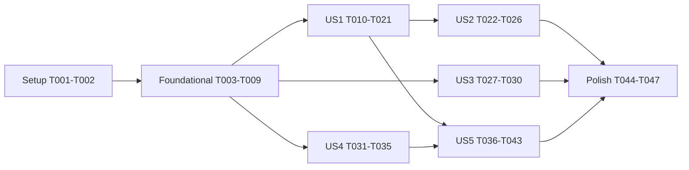

---

description: "Task list for Voters Add Choices to a Private Poll"
---

# Tasks: Voters Add Choices to a Private Poll

**Input**: Design documents from `specs/20261101-181626-USER-ADD-CHOICES/`

**Prerequisites**: plan.md, spec.md, research.md (R1–R12), data-model.md, contracts/api.md (A1–A5), contracts/ui-contracts.md (C1–C5), quickstart.md

**Tests**: included. The plan (R12) and the constitution (Principle IV, tests as documentation) call for them, as every feature in this repository has.

**Organization**: tasks are grouped by user story, so each story can be built and checked on its own.

## Format: `[ID] [P?] [Story] Description`

- **[P]**: can run in parallel (different files, no dependency on an unfinished task)
- **[Story]**: US1–US5 from spec.md
- New code carries no comment that cites a requirement, finding or task id (Constitution VI)

---

## Phase 1: Setup (Shared Infrastructure)

- [X] T001 Create migration `src/db/migrations/015-voters-add-choices.ts`: `up` adds `polls.voters_add_choices boolean not null default false`; `down` drops it (data-model.md)
- [X] T002 Register `"015-voters-add-choices"` in `src/db/migrations/index.ts` and add `voters_add_choices: Generated<boolean>` to `polls` in `src/db/schema.ts`; add `addedBy?: string` to the `PollChoiceJson` type there

---

## Phase 2: Foundational (Blocking Prerequisites)

**Purpose**: the setting exists end to end, and the shared limit and projection are in place, before any story uses them

- [X] T003 In `src/polls/store.ts`, add `votersAddChoices: boolean` to `Poll` and `addedBy?: string` to `Choice`. Map it in `rowToPoll`, `FIELD_TO_COLUMN` (`votersAddChoices: "voters_add_choices"`) and `newRow`. Keep it out of `NON_CONTENT_FIELDS` (R1)
- [X] T004 In `src/polls/service.ts`, default `votersAddChoices: false` in `createDefaultPoll` and `duplicatePoll`. Export `WIZARD_CHOICE_MAX = 40` beside `CHOICE_LABEL_MAX`. Add the `votersAddChoices` block to `validatePollFields`: `400 "votersAddChoices must be true or false."` for a non-boolean, and `400 "Only a private poll can let voters add choices."` when `true` and the resulting visibility is Public (R1, R6, A5)
- [X] T005 In `src/polls/versions.ts`, add `votersAddChoices` to `PollProjection` and `projectPoll`. Map `choices` to exactly `{ id, label, position, color? }`, so `addedBy` is never projected (R9, A3)
- [X] T006 [P] In `src/routes/api.ts` `/api/config`, add `wizardChoiceMax: WIZARD_CHOICE_MAX` (A2)
- [X] T007 In `src/routes/pollsApi.ts`, add `"votersAddChoices"` to `UPDATE_FIELDS` and `votersAddChoices` to `adminListRow` (A4, A5)
- [X] T008 [P] In `src/public/deltaClient.js` `toPollDetail`, copy `votersAddChoices` and `pollSharingMode` (A3)
- [X] T009 [P] Add `votersAddChoices: false` to the poll fixtures in `tests/helpers/poll-fixtures.ts`, and in `tests/refresh-deltas.test.ts` assert that the projection carries `votersAddChoices` (there is no migration-list test to extend)

**Checkpoint**: `npx tsc --noEmit` passes and `npm test` is green with the setting stored, projected and editable through the API.

---

## Phase 3: User Story 1 - A voter adds a missing choice (Priority: P1) 🎯 MVP

**Goal**: an eligible voter adds a choice from the voting face; it shows at once on their card, and on others' cards after a refresh.

**Independent Test**: quickstart.md scenario 3, with the setting turned on in psql or through the API.

### Tests for User Story 1

- [X] T010 [P] [US1] Create `tests/add-choice.test.ts` with route tests for A1:
  - 200 answer shape: the new choice is last, has no `color`, and the answer carries no `addedBy`.
  - `content_version` is bumped, and `poll:<pid>` serves the new choice.
  - 401 for a guest, `no-vote-permission`, `ADD_CHOICES_OFF` (setting off and Public poll), and ban, invitation and voter-limit refusals; the creator is admitted.
  - `FINAL_VOTE_CAST` after a vote on a Final-Vote poll, but the creator is admitted.
  - `POLL_EDITING` while an edit session is held, `PENDING_REVIEW`, and `NOT_OPEN` for WAITING TO OPEN and CLOSED. `NOT_OPEN` comes before any validation or screening refusal (e.g. an empty label on a CLOSED poll).
  - After an addition, a second voter's tab refresh (`POST /api/tabs/shared-with-you/refresh` with the versions it last saw) returns the new choice.
  - `EMPTY_CHOICE`, and `CHOICES_FULL` at `maxChoices`.
  - Two concurrent additions at `maxChoices - 1` leave exactly `maxChoices`.
  - A vote straight after an addition is not `too-soon`, and a second addition within the interval is `429 too-soon`.
- [X] T011 [P] [US1] Create `tests/client-add-choice.test.ts` (jsdom):
  - Button visibility per C1: each condition false hides it (lacking `View Polls` included), guests never see it, and the creator keeps it after a final vote via `ownPoll`.
  - A press prefetches `GET /api/me/polls/:pid`, and the card keeps its vote counts and bars after applying the answer. A failure shows `Couldn't load the latest choices. Try again.`; a full poll shows the full-poll message. Neither opens the dialog.
  - The dialog opens with focus in the field and `0 / 40`. Enter saves. Escape and Cancel close and return focus to the button.
  - On success the new choice is last and unselected, and the earlier selection is kept.
  - Nothing is logged to the console.

### Implementation for User Story 1

- [X] T012 [P] [US1] In `src/load/floors.ts`, change `enforceFloor(kind, bucket = kind)` so `bucket` names only the cache key (`floor:<bucket>:<s|ip>`), while the interval, burst and 429 body stay those of `kind` (R3)
- [X] T013 [P] [US1] In `src/polls/userPolls.ts`, have `overlay()` read `polls.created_by_id` for the pids and set `ownPoll: true` for the caller's own polls. It takes the caller's user id as a new parameter; update its callers in `src/routes/tabsApi.ts`. In `src/public/deltaClient.js` `toPollDetail`, copy `ownPoll` from the overlay entry (A3)
- [X] T014 [US1] In `src/polls/service.ts`, add `normalizedChoiceKey(s)` (trim, runs of white space to one space, lower case) and `validateAddedChoice(poll, rawLabel, config)`. It returns the trimmed label, or throws a `ChoiceError(status, message, code)` for `EMPTY_CHOICE` and `CHOICES_FULL` with the A1 messages. US2 adds the other rules in their data-model order (R6)
- [X] T015 [US1] In `src/votes/votePath.ts`, add and export `assertMayAddChoice(deps, poll, caller)`, which throws `VoteError`. It refuses `ADD_CHOICES_OFF` (Public or setting off), then calls `assertEligible` with `isNewVoter` = the caller has no vote yet, then refuses `FINAL_VOTE_CAST` for a Final-Vote poll the caller voted on (`hasVotedBefore`) unless `created_by_id` is the caller (R4)
- [X] T016 [US1] In `src/polls/store.ts`, add `appendChoice(deps, pid, label, addedBy)`. In one transaction it:
  1. Locks the row with `select … for update`.
  2. Refuses raw `EDITING` (`POLL_EDITING`), a set `pending_update` (`PENDING_REVIEW`) and any state but OPEN (`NOT_OPEN`, with the vote path's wording).
  3. Re-checks the duplicate (`normalizedChoiceKey`) and `CHOICES_FULL`.
  4. Appends `{ id: randomUUID(), label, position: max + 1, ...(addedBy ? { addedBy } : {}) }`.
  5. Writes `choices` and `choice_labels`.
  6. Calls `bumpContentVersion`.

  It returns the projected choices and the new `contentVersion` (R5, R7)
- [X] T017 [US1] In `src/routes/pollsApi.ts` `createVoteRouter`, add `POST /api/polls/:pid/choices`, behind `shedding.withKind("vote")` and `floors.enforceFloor("vote", "choice")`. It:
  1. Resolves the caller with `callerEmail`: `401 "Sign in to add a choice"` if none.
  2. Checks `Vote on Polls` with `holdsPermission` (`403 no-vote-permission`), then `View Polls` the same way (`404`, as `GET /api/me/polls/:pid` answers without it); an Administrator passes both.
  3. Answers `404` when the poll is missing or not viewable (`checkViewEligibility`).
  4. Pre-checks the read poll's raw state (`POLL_EDITING`, `PENDING_REVIEW`, `NOT_OPEN`, as `appendChoice` does), so the state is always the first answer. Then it runs `assertMayAddChoice`, then `validateAddedChoice`, then `appendChoice` (passing `addedBy` = the caller's id when `voteAnonymity === "No"`).
  5. Maps `ChoiceError`/`VoteError` to `{ error, code }`.
  6. Logs `[choices] Added choice to poll <pid> (<n> choices)` or `[choices] Refused choice for poll <pid>: <code>`, with no address (A1)
- [X] T018 [P] [US1] Create `src/public/addChoiceDialog.js`, exposing `window.AddChoiceDialog.open({ choices, maxLength, onSave })`. It builds `.modal-backdrop` > `.modal.add-choice-dialog[role=dialog][aria-modal=true]` titled `Add Choice`, with an outlined field, an `.m3-field-counter` showing `<n> / <max>`, a supporting/error line (`aria-live="polite"`), and Save and Cancel. It traps focus, Enter saves, Escape and Cancel close, focus returns to the opener, and Save is disabled while the trimmed text is empty or a save is in flight. `onSave(label)` resolves `{ ok }` or `{ error }`, and the error shows under the field, keeping the text (C3)
- [X] T019 [P] [US1] Create `src/public/add-choice-m3.css`, using M3 tokens only. It covers the dialog layout, the field and counter, error colour, and `.add-choice-btn` as an M3 outlined button (`white-space:nowrap`). Make the voting face's `.actions` row a three-column grid (`auto 1fr auto`) with the button centred, keeping the row's height at every width (C1, C3)
- [X] T020 [US1] In `src/public/pollCard.js`:
  - Add `.add-choice-btn` to the voting face's `.actions` markup, between `.back-btn` and `.submit-vote-btn`.
  - Add `mayAddChoice(poll)` per C1, re-run on every `applyPoll`.
  - Wire the press per C2: busy state, `GET /api/me/polls/:pid`, then turn the answer's `poll`, `counts` and `overlay` into a card detail as `tabs.js` `mountLinkedPoll` does (`DeltaClient.createTabState()` + `DeltaClient.toPollDetail`) and pass that detail to `applyPoll`. Show the full-poll message (`poll.choices.length >= maxChoices`) or the failure message in the card's message area, otherwise call `AddChoiceDialog.open`.
  - Make `onSave` POST A1 and, on 200, apply the returned `choices` keeping `pendingSelection` (C2, C4).
- [X] T021 [US1] In `src/public/index.html`, load `add-choice-m3.css` after `tabs-modal-m3.css` and `addChoiceDialog.js` before `pollCard.js`. Add `add-choice-m3.css` to `LAYER_ORDER` and to the `index.html` allowlist in `tests/m3-assets.test.ts`. Add `addChoiceDialog.js` to the scripts the client test helper loads for `tests/client-add-choice.test.ts`

**Checkpoint**: T010 and T011 pass, and quickstart scenarios 3, 5, 6 and 7 behave as written.

---

## Phase 4: User Story 2 - A voter is told why a choice was refused (Priority: P1)

**Goal**: every invalid choice is refused with its own message in the dialog, the text is kept, and nothing is added.

**Independent Test**: quickstart.md scenario 4.

### Tests for User Story 2

- [X] T022 [P] [US2] Extend `tests/add-choice.test.ts`:
  - `CHOICE_TOO_LONG` at 41 UTF-16 units, while 40 is accepted.
  - `CHOICE_CHARACTERS` for `\n`, `\t`, U+0007, U+200B, U+202E and U+2066, while emoji and non-Latin scripts are accepted.
  - `DUPLICATE_CHOICE` for `pizza` and `  Pizza  ` and `Deep  dish` against `Pizza` and `Deep dish`, both before and under the lock.
  - `UNACCEPTABLE_LANGUAGE` for a deny-listed term.
  - `SCREENING_UNAVAILABLE` when the screener times out (stub `screenWithTimeout` with `vi.spyOn`).
  - In every case the poll is unchanged and `content_version` is not bumped.
- [X] T023 [P] [US2] Extend `tests/client-add-choice.test.ts`:
  - The field stops at 40 characters, a paste is cut to fit with line breaks turned into spaces, and the counter reads `40 / 40`.
  - Typing a listed choice (ignoring case and spacing) shows `This poll already has that choice.` and disables Save.
  - Each A1 refusal's `error` shows under the field with the text kept; `429` shows `Please wait a moment and try again.`

### Implementation for User Story 2

- [X] T024 [US2] In `src/polls/service.ts` `validateAddedChoice`, add the rules in data-model order: `CHOICE_TOO_LONG` (above `WIZARD_CHOICE_MAX`), `CHOICE_CHARACTERS` (`/[\p{Cc}​-‏‪-‮⁦-⁩]/u`) and `DUPLICATE_CHOICE` (`normalizedChoiceKey`), with the A1 messages (R6)
- [X] T025 [US2] In the A1 route in `src/routes/pollsApi.ts`, after `validateAddedChoice` and before `appendChoice`, call `screenWithTimeout(localScreener, { title: "", subtitle: "", choiceLabels: [label] }, config.screeningCallTimeoutMs)`. A verdict maps to `422 UNACCEPTABLE_LANGUAGE`; `ScreeningTimeoutError` or a throw maps to `503 SCREENING_UNAVAILABLE`, logged `[choices] Screening failed for poll <pid>: <reason>` (R8)
- [X] T026 [US2] In `src/public/addChoiceDialog.js`:
  - Cut pastes to `maxLength`, turning line breaks into spaces.
  - Check duplicates against `choices` with the same normalization, showing the message and disabling Save.
  - Map a `429` from `onSave` to `Please wait a moment and try again.` (C3).

**Checkpoint**: T022 and T023 pass, and quickstart scenario 4 behaves as written.

---

## Phase 5: User Story 3 - The creator chooses whether voters may add choices (Priority: P2)

**Goal**: the Edit Poll Card offers `Voters may add choices` for Private polls, off by default and changeable after votes.

**Independent Test**: quickstart.md scenarios 1 and 2.

### Tests for User Story 3

- [X] T027 [P] [US3] Extend `tests/client-admin-wizard.test.ts`:
  - The switch is in Step 5 only when `who !== "public"`, is off for a new poll, and is enabled on a voted poll.
  - `votersAddChoices` is sent on save and publish.
  - The summary shows `Voters may add choices: Yes|No` for Private polls.
  - The new-poll choice limit reads `runtime.wizardChoiceMax`.
- [X] T028 [P] [US3] In `tests/polls-pending-update.test.ts` (which covers `/api/admin/polls/:pid/publish` in UPDATE mode), add:
  - `votersAddChoices` saves on a voted Private poll and bumps `content_version`.
  - `true` on a Public poll is refused with `400`.
  - A non-boolean is refused with `400`.

### Implementation for User Story 3

- [X] T029 [US3] In `src/public/adminCard.js`:
  - Replace the local `WIZARD_CHOICE_MAX` with `runtime.wizardChoiceMax` (from `/api/config`).
  - Add the `Voters may add choices` M3 switch to `buildStep5()` when `wizard.who !== "public"`.
  - Carry it in `pollAnswers`/`wizardBase`, the dirty check and `wizardFields`.
  - Let `canChange("votersAddChoices")` allow it after votes, and add the summary line (C5).
- [X] T030 [US3] In `src/public/adminCard.js` `wizardFields`, send `votersAddChoices: false` when the poll is switched to Public, so the save is not refused (A5)

**Checkpoint**: T027 and T028 pass, and quickstart scenarios 1 and 2 behave as written.

---

## Phase 6: User Story 4 - The creator's save keeps choices voters added meanwhile (Priority: P2)

**Goal**: a creator's save deletes only what the creator removed.

**Independent Test**: quickstart.md scenario 9.

### Tests for User Story 4

- [X] T031 [P] [US4] Add tests for `/publish` and `/save` with `baseChoiceIds`:
  - Stored `[X, Y, Z]`, base `[X, Y]`, submitted `[X, Y, W]` gives `[X, Y, Z, W]`, keeping Z's id, votes and colour in UPDATE mode (ever voted).
  - Stored `[X, Y, Z]`, base `[X, Y]`, submitted `[X]` gives `[X, Z]`.
  - Without `baseChoiceIds`, today's result.
  - A combined list above `maxChoices` is refused with the existing `400`.
  - The same on a never-voted poll (`replaceChoices`).

  Put them in `tests/admin-choices-added-since.test.ts`.
- [X] T032 [P] [US4] Extend `tests/client-admin-wizard.test.ts`: every save or publish that sends `labels` also sends `baseChoiceIds` = the ids of `session.poll.choices`

### Implementation for User Story 4

- [X] T033 [US4] In `src/polls/service.ts`, add `withChoicesAddedSince(poll, labels, colors, baseChoiceIds)`. It returns `{ labels, colors }` with every stored choice whose id is not in `baseChoiceIds` appended (its label and colour) when its label is not already submitted. `baseChoiceIds` that is not an array of strings leaves the input unchanged (R10)
- [X] T034 [US4] In `src/routes/pollsApi.ts`, the `/publish` and `/save` handlers apply `withChoicesAddedSince` to `labels`/`colors` before `mergeChoices`/`replaceChoices` when `labels` is present, and strip `baseChoiceIds` from the body before `validatePollFields` (A5)
- [X] T035 [US4] In `src/public/adminCard.js`, add `baseChoiceIds: session.poll.choices.map((c) => c.id)` to every save and publish request that carries `labels` (C5)

**Checkpoint**: T031 and T032 pass, and quickstart scenario 9 behaves as written.

---

## Phase 7: User Story 5 - The creator sees who added a choice (Priority: P3)

**Goal**: on polls without anonymous voting, the Edit Poll Card names the voter who added each choice; nothing is recorded on anonymous polls, and account deletion clears the record.

**Independent Test**: quickstart.md scenarios 8 and 10.

### Tests for User Story 5

- [X] T036 [P] [US5] Extend `tests/add-choice.test.ts`:
  - `addedBy` is stored for a non-anonymous poll and absent for an anonymous one.
  - `addedBy` never appears in the A1 answer, `GET /api/me/polls/:pid`, tab rows or the Trending/Newest objects.
  - The admin list and detail carry `addedByName`.
  - A creator save keeps `addedBy` on a surviving label, in both `mergeChoices` and `replaceChoices`.
  - Setting `voteAnonymity` to `"Yes"` on a never-voted poll drops every `addedBy`.
- [X] T037 [P] [US5] Extend `tests/account-deletion.test.ts`: deleting the adder's account removes `addedBy` from that poll's choices, keeps the choice, and leaves `content_version` unchanged
- [X] T038 [P] [US5] Extend `tests/client-admin-wizard.test.ts`: Step 3 lists `Added by <name>` for choices with `addedByName` and nothing for the others

### Implementation for User Story 5

- [X] T039 [US5] In `src/polls/service.ts`:
  - `mergeChoices` survivors and `replaceChoices` entries keep the stored `addedBy` of a choice whose trimmed label matches.
  - `validatePollFields` removes every `addedBy` from `choices` when `voteAnonymity` becomes `"Yes"` (R9).
- [X] T040 [US5] In `src/routes/pollsApi.ts`, add `addedByName` to each choice that has `addedBy` in `adminListRow` and `buildAdminPollDetail`. Look the names up per request from `user.name` for the ids on the page, as `creatorEmails()` does, and use `null` for an id with no user (A4)
- [X] T041 [US5] In `src/legal/deleteAccount.ts` `removeInOneTransaction`, rewrite `polls.choices` for every poll holding an element with `addedBy` equal to the user's id, removing that key, with no content bump (R9)
- [X] T042 [US5] In `src/public/adminCard.js` Step 3 (Choices), under the Choices textbox, list `Added by <name>` per choice with `addedByName`, in choice order; a choice whose `addedByName` is missing shows no line (C5)
- [X] T043 [P] [US5] In `src/public/privacy.html`, add one sentence to the section on what is stored: on a poll without anonymous voting, the poll keeps which account added a choice, shown only to the poll's creator, and removed when that account is deleted (FR-021)

**Checkpoint**: T036–T038 pass, and quickstart scenarios 8 and 10 behave as written.

---

## Phase 8: Polish & Cross-Cutting Concerns

- [X] T044 [P] In `postman/openapi.json`, add A1 (request, 200, every refusal code) and the A2–A5 field changes
- [X] T045 Run `npx tsc --noEmit` and `npm test`; fix any regression
- [X] T046 Walk quickstart.md scenarios 1–10 against `npm run dev`; scenario 3 is also the check of SC-001 (the choice on the card within 2 s of Save)
- [X] T047 [P] After implementation, update `README.md` (adding a choice to a Private poll, the setting) and `ARCHITECTURE.md` (the add-choice path: route, row-locked append, projection without `addedBy`), per the constitution's Documentation Deliverables
- [X] T048 TWEAK01: an added choice reaches every tab's copy of the poll (`opts.onChoicesAdded` in `src/public/pollCard.js`, `applyAddedChoices` and `patchRetained({ added })` in `src/public/tabs.js`), so a vote for it keeps it on the card; test in `tests/client-add-choice.test.ts`
- [X] T049 TWEAK02 (temporary diagnostic, remove once the bug is found): each voting-side row reads `<label> (<count>)`, label and tooltip, in `renderVotingOptions` / `rebuildData` of `src/public/pollCard.js`; asserted in `tests/client-add-choice.test.ts`
- [X] T050 TWEAK04: the "Delete choices with votes?" dialog's "Keep choices" button reads "Cancel" (`askToDeleteChoices` in `src/public/adminCard.js`, behaviour unchanged); `tests/client-admin-wizard.test.ts` and EDITING-POLL-AVAILABLE's `contracts/ui-contracts.md` and `quickstart.md` follow
- [X] T051 TWEAK05: `sessionReady()` in `src/public/tabs.js` defers reading `unsubscribe` (`setTimeout(() => unsubscribe(), 0)`), so a subscriber called at once by `Session.subscribe` no longer throws "Cannot access 'unsubscribe' before initialization" and stays registered; test in `tests/client-home.test.ts`

---

## Dependencies & Execution Order

- **Setup (T001–T002)** → **Foundational (T003–T009)** → user stories.
- **US1** depends on Foundational only. It is the MVP.
- **US2** extends US1's `validateAddedChoice`, route and dialog (T014, T017, T018).
- **US3** depends on Foundational only, and can run beside US1.
- **US4** depends on Foundational only. Its effect is visible only once US1 exists.
- **US5** depends on US1 (T016, T017 write `addedBy`) and US4's route edits for the save tests (T034).
- **Polish** comes last.



### Within each story

The tests are written first and fail. Then service, then store, then route, then client.

## Parallel Opportunities

- Foundational: T006, T008 and T009 run beside T003–T005 and T007.
- US1: T010, T011, T012, T013, T018 and T019 touch different files.
- US2: T022 and T023 together.
- US3 can run beside US1. T027 and T028 together.
- US4: T031 and T032 together.
- US5: T036, T037, T038 and T043 together.
- Polish: T044 and T047 together.

### Parallel example: User Story 1

```text
T010 tests/add-choice.test.ts        T011 tests/client-add-choice.test.ts
T012 src/load/floors.ts              T013 src/polls/userPolls.ts
T018 src/public/addChoiceDialog.js   T019 src/public/add-choice-m3.css
```

## Implementation Strategy

1. **MVP**: Setup, Foundational, then US1. A voter can add a choice to a poll whose setting was turned on by API or psql.
2. Add US2, refusals, so the feature can be shown to anyone.
3. Add US3, the creator's switch, which makes the feature usable without psql.
4. Add US4, protection of voters' choices against the creator's save.
5. Add US5, attribution, with the privacy wording and the account-deletion clean-up.
6. Polish: OpenAPI, the full test run, the quickstart, then README.md and ARCHITECTURE.md.
