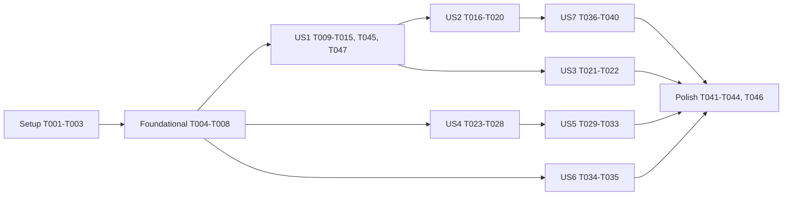

---

description: "Task list for Human Check Before Sign-In, and Search Engine Indexing of Public Polls"
---

# Tasks: Human Check Before Sign-In, and Search Engine Indexing of Public Polls

**Input**: Design documents from `specs/20261102-144053-FCAPTCHA-AND-SEO/`

**Prerequisites**: plan.md, spec.md, research.md (R1–R15), data-model.md, contracts/api.md (A1–A6), contracts/ui-contracts.md (C1–C5), quickstart.md

**Tests**: included. The plan (R15) and the constitution (Principle IV, tests as documentation) call for them, as every feature in this repository has.

**Organization**: tasks are grouped by user story, so each story can be built and checked on its own.

## Format: `[ID] [P?] [Story] Description`

- **[P]**: can run in parallel (different files, no dependency on an unfinished task)
- **[Story]**: US1–US7 from spec.md
- New code carries no comment that cites a requirement, finding or task id (Constitution VI)

---

## Phase 1: Setup (Shared Infrastructure)

- [X] T001 Create `fcaptcha-server/package.json` (`"private": true`, `"engines": {"node": ">=22"}`, dependencies `@webdecoy/fcaptcha` and `@webdecoy/fcaptcha-client` at exactly `1.46.1`, a `start` script that runs the package's standalone server) and `fcaptcha-server/package-lock.json` (`npm install` in that folder). Confirm from the installed package the path of the standalone `server.js`, that it serves `/fcaptcha.js`, `/health`, `/api/token/verify`, and the env var that points it at the client script (`FCAPTCHA_CLIENT_PATH`); record what was confirmed in `research.md` R1 (R1, R8)
- [X] T002 [P] In `.do/app.yaml`, add the service `fcaptcha` (`source_dir: fcaptcha-server`, `environment_slug: node-js`, `run_command: npm start`, `http_port: 8080`, `health_check.http_path: /health`, autoscaling 1–3 on CPU 70, envs `ENV_FCAPTCHA_PORT`, `ENV_FCAPTCHA_SECRET` and `ENV_FCAPTCHA_VERIFY_SECRET` as `type: SECRET` placeholders, `ENV_FCAPTCHA_SITE_KEYS`, `ENV_FCAPTCHA_ALLOWED_HOSTNAMES` (the production host), `ENV_FCAPTCHA_REDIS_URL` bound to the Valkey cluster on database 1, each mapped by `fcaptcha-server/start.js` to FCaptcha's own name), and an `ingress.rules` block: prefix `/fcaptcha` → `fcaptcha` (prefix not preserved), prefix `/` → `web`. On `web`, add `ENV_FCAPTCHA_ENABLED`, `ENV_FCAPTCHA_URL: ${fcaptcha.PRIVATE_URL}`, `ENV_FCAPTCHA_SITE_KEY`, `ENV_FCAPTCHA_VERIFY_SECRET` (`type: SECRET` placeholder) (R1, R2, R8)
- [X] T003 [P] Add the four `ENV_FCAPTCHA_*` rows to the table in `.claude/rules/environment.md` (dev default: off / unset), and the same four, commented out, to `launch.json.example` and `devScripts.example/launch-dev.ps1` (R8)

---

## Phase 2: Foundational (Blocking Prerequisites)

**Purpose**: settings, the verify client and the health counter that US1, US2 and US7 share

- [X] T004 In `src/config.ts`, add `humanCheck: { url: string; siteKey: string; verifySecret: string } | null` to `AppConfig`. `ENV_FCAPTCHA_ENABLED` `"1"` turns it on; then `ENV_FCAPTCHA_URL` (via `originVar`-style `new URL` validation), `ENV_FCAPTCHA_SITE_KEY` and `ENV_FCAPTCHA_VERIFY_SECRET` are each required, a missing one throwing `ConfigError` naming it. Unset → `null`, recorded with `read.none(...)` as the other defaults are (R8)
- [X] T005 [P] Extend `tests/config.test.ts`: off by default; on with all three → the object; on with each one missing → `ConfigError` naming it; an invalid URL → `ConfigError`
- [X] T006 Create `src/auth/humanCheck.ts` exporting `HUMAN_CHECK_ACTIONS` (`"login" | "create-account" | "invite"`), `clientAddressOf(req)` (`do-connecting-ip` header if present, else `req.ip`) and `createHumanCheck(settings, publicOrigin, fetchImpl = fetch)` returning `{ verify(token, accepted, clientIp): Promise<"valid" | "invalid" | "unreachable">, isReachable(): Promise<boolean> }`. `verify` POSTs `{ token, secret, remoteip }` to `<url>/api/token/verify` with a 3 s `AbortSignal.timeout`: `valid` needs 200, `valid: true`, `hostname` equal to `new URL(publicOrigin).hostname` and `action` in `accepted`; a network error, timeout or 5xx is `unreachable`; anything else `invalid`. `isReachable` GETs `<url>/health` with a 1 s timeout. A one-line comment links FCaptcha's INSTALLATION.md token-verify section (R4, R5, R6)
- [X] T007 In `src/server.ts`, widen `AppContext.abuse` to `{ ipVoteCap: number; humanCheckSkipped: number }` (initialised to 0), add `humanCheck: ReturnType<typeof createHumanCheck> | null` to `AppContext` (built when `config.humanCheck` is set), and widen `HealthDeps.abuseCounts` in `src/routes/healthz.ts` to match (data-model.md, A3)
- [X] T008 [P] In `src/routes/api.ts` `/api/config`, add `humanCheck: config.humanCheck ? { siteKey: config.humanCheck.siteKey, endpoint: "/fcaptcha" } : null` (A2)

**Checkpoint**: `npx tsc --noEmit` and `npm test` pass; nothing visible has changed.

---

## Phase 3: User Story 1 - A person passes the human check before signing in (Priority: P1) 🎯 MVP

**Goal**: `/login`, `/create-account` (form mode) and `/invite` open on the check; passing it draws the page's own card in place.

**Independent Test**: with `/api/config` carrying `humanCheck`, a jsdom page shows only the check card, and a simulated widget success draws the login card, whose link request carries `X-Human-Check`.

### Tests for User Story 1

- [X] T009 [P] [US1] Create `tests/client-human-check.test.ts` (jsdom, a stub `/fcaptcha/fcaptcha.js` that renders a fake widget and exposes its callbacks):
  - `/login`: only the "Vote protection" card, with the widget's `data-action="login"`, the widget theme `light` (the site's scheme), `data-endpoint="/fcaptcha"`, the "What this safeguard checks." link to `/privacy#bot-check` and a `role="status"` line; no `#login-form` or provider button
  - widget success → the login card is drawn at the same `location.href`; the link request carries `X-Human-Check: <token>`; a second request carries none
  - `/create-account` gets `data-action="create-account"`; opened with `?token=` it shows no check; `/invite` gets `data-action="invite"`
  - `humanCheck: null` → the page's card at once, no script loaded
  - provider buttons (`both` mode) send the header on `POST /api/auth/sign-in/social`
- [X] T045 [US1] Extend `tests/client-human-check.test.ts`: on the check view the widget's checkbox is the first focusable element after the header, Tab and Space operate it, and each result (passed, failed, unavailable) is written to the `role="status"` line (SC-008)

### Implementation for User Story 1

- [X] T010 [P] [US1] Create `src/public/humanCheck.js` exposing `window.HumanCheck = { gate(main, action, render), headers(), refused(body) }` per C1/C2: `gate` reads `/api/config` `humanCheck`; null → `render()`; otherwise mounts the check card with `CardShell.mount` (title "Vote protection"), loads `/fcaptcha/fcaptcha.js` once, renders the widget with the attributes above, and on its success callback keeps the token in a closure variable and calls `render()`. `headers()` returns `{ "X-Human-Check": token }` and clears the token, or `{}`. `refused(body)` is `body && body.code === "challenge-required"` (R7)
- [X] T011 [P] [US1] Create `src/public/human-check-m3.css` (M3 tokens only, no literal font sizes): the widget centred in the card, the status line, the link line; the card keeps its width at phone and desktop sizes
- [X] T012 [US1] In `src/public/loginCard.js`, wrap `render` in `HumanCheck.gate(main, "login", render)`, and spread `HumanCheck.headers()` into the headers of the link request (`renderNative`) and of `startSignin(provider)`
- [X] T013 [P] [US1] In `src/public/createAccountCard.js`, wrap `startForm` (not `renderToken`) in `HumanCheck.gate(main, "create-account", …)`, and spread `HumanCheck.headers()` into the form's `POST /api/auth/create-account` and any provider start
- [X] T014 [P] [US1] In `src/public/inviteCard.js`, wrap the card's render in `HumanCheck.gate(main, "invite", …)`, and spread `HumanCheck.headers()` into `startSignin(provider, pid)` and `POST /api/invitations/redeem`
- [X] T015 [US1] In `src/public/login.html`, `create-account.html` and `invite.html`, load `human-check-m3.css` after `card-shell-m3.css` and `humanCheck.js` after `cardShell.js`. Add `human-check-m3.css` to `LAYER_ORDER` and to those three pages in `tests/m3-assets.test.ts`, and `humanCheck.js` to the scripts the client test helper loads for these pages
- [X] T047 [US1] In `src/public/login.html`, `create-account.html` and `invite.html`, put `<noscript><p class="card-shell-status">Signing in needs JavaScript.</p></noscript>` inside `#card-root`; assert it in `tests/seo.test.ts` from the served HTML of the three pages (spec Edge Cases)

**Checkpoint**: US1 works with the check on; the server does not yet require the header.

---

## Phase 4: User Story 2 - An automated client cannot start a sign-in without passing (Priority: P1)

**Goal**: every sign-in start route refuses a missing or bad pass before doing anything else.

**Independent Test**: `tests/human-check.test.ts` with `verify` stubbed.

### Tests for User Story 2

- [X] T016 [P] [US2] Create `tests/human-check.test.ts` (`startTestContext` with the check on and `fetchImpl` stubbed to answer FCaptcha's verify and health):
  - for `request-login-link`, `create-account` (no token), `invitations/redeem`, `sign-in/social`, `sign-in/oauth2`: no header → `400 challenge-required` and no email captured; `valid: false` → 400; foreign `hostname` → 400; `action` not accepted by the route (e.g. `invite` on create-account, `login` on redeem) → 400; a valid pass → the route's usual answer
  - the check runs before the honeypot, rate limit and allowlist (a refused request consumes no rate-limit slot)
  - `create-account` with `token`, `GET /api/auth/verify`, `POST /api/auth/confirm-signin` and a provider callback need no header
  - the check off → every route behaves as today with no header
  - each refusal logs `[human-check] Refused <route> (<masked ip>)` with no token or email

### Implementation for User Story 2

- [X] T017 [US2] In `src/auth/humanCheck.ts`, add `requireHumanCheck(humanCheck, accepted: HumanCheckAction[])`: an Express middleware that passes when `humanCheck` is null; otherwise reads `X-Human-Check`, calls `verify(token, accepted, clientAddressOf(req))`, and on `invalid` (or no header) answers `400 { error: "Please complete the human check.", code: "challenge-required" }` with the log line above; on `valid` calls `next()` (A1). US7 adds the unreachable branch
- [X] T018 [US2] In `src/routes/api.ts`, mount `requireHumanCheck(humanCheck, ["login"])` on `POST /api/auth/request-login-link`, `["invite"]` on `POST /api/invitations/redeem`, and on `POST /api/auth/create-account` a wrapper that skips the check when `req.body.token` is a string and otherwise applies `["create-account"]`; each runs ahead of the route's existing checks (R4)
- [X] T019 [US2] In `src/server.ts`, mount `requireHumanCheck(humanCheck, ["login", "create-account", "invite"])` on `POST /api/auth/sign-in/social` and `POST /api/auth/sign-in/oauth2`, before BetterAuth's handler (it reads only the header, so BetterAuth's body stays unread) (R3)
- [X] T020 [US2] In `src/public/loginCard.js`, `createAccountCard.js` and `inviteCard.js`, when a sign-in start answer satisfies `HumanCheck.refused(body)`, keep the typed values (email, stay-signed-in, terms box) and call `HumanCheck.gate` again, redrawing the card with those values once passed (C2). Extend `tests/client-human-check.test.ts` for it

**Checkpoint**: US1 + US2 make the MVP: the check is shown and enforced.

---

## Phase 5: User Story 3 - A person who fails the check is told plainly and can try again (Priority: P2)

**Goal**: FR-009's message, Try again, and the support address after three failures; no lock-out.

**Independent Test**: jsdom, fake widget error callbacks.

- [X] T021 [P] [US3] Extend `tests/client-human-check.test.ts`: an error callback shows "We couldn't confirm you're a person. Please try again." in the status line and a Try again button that redraws the widget; the third consecutive failure adds "If this keeps happening, write to support@crowdpoll.vote."; an expired callback shows the widget again with no failure counted; a success resets the count
- [X] T022 [US3] In `src/public/humanCheck.js`, handle the widget's error and expired callbacks per C1, with the failure count held per page visit

---

## Phase 6: User Story 4 - A search engine finds and indexes public polls (Priority: P2)

**Goal**: `/robots.txt`, `/sitemap.xml` and a crawlable `/poll/:pid`, plus head tags on every public page.

**Independent Test**: `tests/seo.test.ts` with supertest, no scripts.

### Tests for User Story 4

- [X] T023 [P] [US4] Create `tests/seo.test.ts`:
  - `/robots.txt` holds exactly the A5 rules and `Sitemap: <ENV_PUBLIC_ORIGIN>/sitemap.xml`
  - `/sitemap.xml` lists `/` and public OPEN, CLOSED and EDITING-from-OPEN polls with `<lastmod>` (`closed_at` else `launched_at`), and none of private, WAITING TO OPEN, AWAITING APPROVAL, REJECTED, ARCHIVED, INITIALIZED; with the part limit lowered by a test-only parameter, it becomes a `sitemapindex` and `/sitemap-2.xml` holds the rest; a missing part is 404; the answer is cached (a new poll appears only after the cache key is cleared)
  - `/poll/<public open pid>` as a guest: `<title>`, description, canonical, `og:*`, `twitter:card`, JSON-LD `Question` with every choice, `data-poll-page`, and `#poll-summary` with title, description, each choice and its percentage, and the vote count
  - a title and choice containing `<script>` and `"` appear escaped in the HTML and cannot close the JSON-LD script
  - `/poll/<private>`, `/poll/<rejected>`, `/poll/<deleted>`, `/poll/zzz` → 404 with the same body; signed in → `302 /?PID=<pid>`
  - the page holds no creator, `addedBy` or voter
  - `/`, `/privacy`, `/terms` carry canonical links; `/login` and `/profile` carry `noindex`

### Implementation for User Story 4

- [X] T024 [P] [US4] In `src/polls/access.ts`, beside `mayViewResults`, add `isIndexable(row)` and `indexablePolls(db)` (id, `closed_at`, `launched_at`) with the data-model.md predicate, ordered by id (R10)
- [X] T025 [P] [US4] Create `src/seo/pollPage.ts`: `renderPollPage(indexHtml, poll, counts, origin)` returning `index.html` with the C3 head tags replacing `<title>CrowdPoll</title>`, `data-poll-page` on `<body>`, and `<article id="poll-summary">` inserted after `<main class="all-markets">`; uses `escapeHtml` from `src/email/templates.ts` for HTML and escapes `<` as `<` in the JSON-LD. A one-line comment links schema.org/Question (R9)
- [X] T026 [US4] Create `src/routes/seo.ts` `createSeoRouter(context)`: `GET /robots.txt`; `GET /sitemap.xml` and `GET /sitemap-:n.xml` built from `indexablePolls`, cached 5 minutes under `seo:sitemap` / `seo:sitemap:<n>`, `Cache-Control: public, max-age=300`, split at 50,000 (a comment links sitemaps.org/protocol.html); `GET /poll/:pid`: signed in → `302 /?PID=<pid>`, guest with `mayViewResults(deps, undefined, pid)` and `isIndexable(row)` → `renderPollPage` with the row's projection and `readOrRebuildCounts`, else 404 "Not found". Mount it in `src/server.ts` after `shedding.shedOther` and before the pages router (R9, R12, A5)
- [X] T027 [P] [US4] In `src/routes/assets.ts`, give `sendPage` an optional `canonicalPath`, inserting `<link rel="canonical" href="<origin><path>">` before `</head>`; in `src/routes/pages.ts`, pass `/`, `/privacy`, `/terms` for `index.html`, `privacy.html`, `terms.html` (R13)
- [X] T028 [P] [US4] Head tags per C4: in `src/public/index.html`, `privacy.html`, `terms.html` set the titles and add `<meta name="description">`; add `<meta name="robots" content="noindex">` to `login.html`, `create-account.html`, `invite.html`, `confirm-signin.html`, `accept-terms.html`, `profile.html`, `admin.html`, `admin-results.html`, `not-authorized.html`

**Checkpoint**: crawlers can read every indexable poll without scripts.

---

## Phase 7: User Story 5 - A guest opening a public poll's link sees the poll (Priority: P2)

**Goal**: `/?PID=` for an indexable poll and `/poll/:pid` both end on the live card, maximized, for a guest.

**Independent Test**: jsdom on `/poll/<pid>` with a stubbed A4 answer; supertest for the redirect.

### Tests for User Story 5

- [X] T029 [P] [US5] Extend `tests/seo.test.ts`: `GET /api/polls/<indexable>/card` as a guest → the A4 shape with the guest overlay; private, unpublished, malformed → 404; `/?PID=<indexable>` as a guest → `302 /poll/<pid>`; `/?PID=<private>` → `302 /login?PID=<pid>`; signed in → unchanged
- [X] T030 [P] [US5] Add to `tests/client-home.test.ts`: a guest page with `data-poll-page` opens Trending, fetches `/api/polls/<pid>/card`, mounts and maximizes the card, and removes `#poll-summary`; a failed fetch keeps the summary and shows "This poll could not be opened."

### Implementation for User Story 5

- [X] T031 [US5] In `src/routes/tabsApi.ts`, add `GET /api/polls/:pid/card` (shed as `refresh`, no session): `parsePid`, the row, `mayViewResults(deps, undefined, pid)` and `isIndexable(row)` else 404; answer `{ poll: projectPoll(row), counts, overlay: { voted: false, bookmarked: false, mayWatch: false, voteBlockedReason: null } }` (R11, A4)
- [X] T032 [US5] In `src/routes/pages.ts` `GET /`, for a guest with a valid `PID` whose row `isIndexable`, redirect to `/poll/<pid>` instead of `/login?PID=<pid>` (A6)
- [X] T033 [US5] In `src/public/tabs.js`, when `document.body.dataset.pollPage` holds a poll id and the visitor is a guest, select Trending, fetch `/api/polls/<pid>/card`, mount it as `mountLinkedPoll` does (`DeltaClient.createTabState`, `grid.mountRetained`), maximize it and remove `#poll-summary`; on failure keep the summary and show the notice (C3)

---

## Phase 8: User Story 6 - Visitors can read what the human check measures (Priority: P3)

- [X] T034 [P] [US6] In `src/public/privacy.html`, add `<section id="bot-check">` "Bot check" after `#cookies` with the C5 content, and one line in the "In short" summary pointing to it; the Cookie Use table is unchanged (R14)
- [X] T035 [P] [US6] Extend `tests/legal-pages.test.ts`: `/privacy` holds `#bot-check` naming the measurements, "at most one hour", and "never" shared; `tests/cookie-use-list.test.ts` still passes unchanged with the check on

---

## Phase 9: User Story 7 - The operator runs the human check and sees when it is unavailable (Priority: P3)

**Goal**: fail open only when FCaptcha is unreachable, counted and logged; the page falls back after 10 s.

### Tests for User Story 7

- [X] T036 [P] [US7] Extend `tests/human-check.test.ts`: verify times out / network error / 5xx with a pass → the request proceeds, `abuse.humanCheckSkipped` grows by one, `/healthz` reports it, and `[human-check] Skipped: service unreachable (<masked ip>)` is logged; no header with health unreachable → proceeds and counts; no header with health reachable → 400; `valid: false` while health is down → still 400
- [X] T037 [P] [US7] Extend `tests/client-human-check.test.ts` with fake timers: the widget script never loads → after 10 s "The human check is unavailable right now" and the page's card, whose request carries no header; a load error does the same at once; a later `challenge-required` answer shows the check again
- [X] T038 [P] [US7] Create `tests/fcaptcha.integration.test.ts`, skipped unless `FCAPTCHA_TEST_URL` and `FCAPTCHA_TEST_VERIFY_SECRET` are set: `createHumanCheck` against the real server answers `invalid` for a made-up token and `true` for `isReachable()`

### Implementation for User Story 7

- [X] T039 [US7] In `requireHumanCheck` (`src/auth/humanCheck.ts`), add: `unreachable` → increment `abuse.humanCheckSkipped`, log the skip line, `next()`; no header → `isReachable()` false → the same, true → refuse. Pass `abuse` in from `src/server.ts` and `src/routes/api.ts` (R5)
- [X] T040 [US7] In `src/public/humanCheck.js`, start a 10 s timer when the widget script is requested; on timeout or the script's `error` event, show "The human check is unavailable right now." and call `render()` with no token; `console.warn` once, with no token or address (C1, FR-012a)
- [X] T048 [US7] Create `src/routes/fcaptchaDevProxy.ts`, mounted in `src/server.ts` only when the check is on and `ENV_PUBLIC_ORIGIN` is on `localhost`: forward `/fcaptcha/*` to `ENV_FCAPTCHA_URL` with the prefix removed (method, query, body, `Content-Type`, `Origin`, `Referer`), standing in locally for the ingress; `502` when FCaptcha cannot be reached. Tests in `tests/human-check.test.ts`: forwarded on a localhost origin, `404` and no call on the production origin

---

## Phase 10: Polish & Cross-Cutting Concerns

- [X] T041 [P] In `postman/openapi.json`, document the `X-Human-Check` header and the `400 challenge-required` response on the five A1 routes, `humanCheck` in `/api/config` (A2), `humanCheckSkipped` in `/healthz` (A3), `GET /api/polls/{pid}/card` (A4); `tests/openapi-contract.test.ts` passes
- [X] T042 Run `npx tsc --noEmit` and `npm test`; fix any regression
- [ ] T043 Deploy to a staging app and walk quickstart.md scenarios 1–15 and checks D1–D5; check the check view's contrast and focus visibility in light and dark (SC-008); D3 confirms the client-address header; scenario 1 timed against SC-002
- [ ] T046 After T043's check D3 has confirmed the client-address header, set FCaptcha's trusted header (`TRUSTED_PROXIES` / trusted-header setting) to it and turn its IP binding on in `.do/app.yaml` (`fcaptcha` envs), record the confirmed header name in `research.md` R6, redeploy, and repeat quickstart.md scenarios 1, 4 and 5 (FR-011)
- [X] T044 [P] After implementation, update `README.md` (the human check at sign-in, the `fcaptcha` service and its settings, robots/sitemap/poll pages) and `ARCHITECTURE.md` (the second service and ingress, the check and fail-open path, the poll page path), per the constitution's Documentation Deliverables

---

## Dependencies & Execution Order

- **Setup (T001–T003)** → **Foundational (T004–T008)** → user stories.
- **US1** depends on Foundational. **US2** depends on US1's client module (T010) for T020, and on T006 for the middleware.
- **US3** depends on US1 (T010).
- **US4** depends on Foundational only (the test context). It can run beside US1–US3.
- **US5** depends on US4 (T024 `isIndexable`, T026 `/poll/:pid`).
- **US6** depends on nothing but the check card's link (T010) to be useful; it can run any time.
- **US7** depends on US2 (T017) and US1 (T010).
- **Polish** comes last.
- T045–T047 were added after analysis; their position, not their number, gives the order.



### Within each story

The tests are written first and fail; then server, then client.

## Parallel Opportunities

- Setup: T002 and T003 beside T001.
- Foundational: T005 and T008 beside T006–T007.
- US1: T009, T010, T011, T013, T014 touch different files; T045 follows T009 and T047 follows T015.
- US4 (T023–T028) runs beside US1–US3, by a second developer; within it T024, T025, T027, T028 together.
- US6 any time.
- US7: T036, T037, T038 together.
- Polish: T041 and T044 together; T046 follows T043.

### Parallel example: User Story 1

```text
T009 tests/client-human-check.test.ts    T010 src/public/humanCheck.js
T011 src/public/human-check-m3.css       T013 src/public/createAccountCard.js
T014 src/public/inviteCard.js
```

## Implementation Strategy

1. **MVP**: Setup, Foundational, US1 and US2: the check is shown and enforced (with the check on in staging).
2. Add US3 (failure messages) and US7 (fail open, health counter, 10 s fallback) before turning the check on in production.
3. Add US6, the Privacy Policy section, also before production.
4. US4 and US5, SEO, can ship independently, before or after the check.
5. Polish: OpenAPI, the full test run, the staging walk-through, then README.md and ARCHITECTURE.md.
