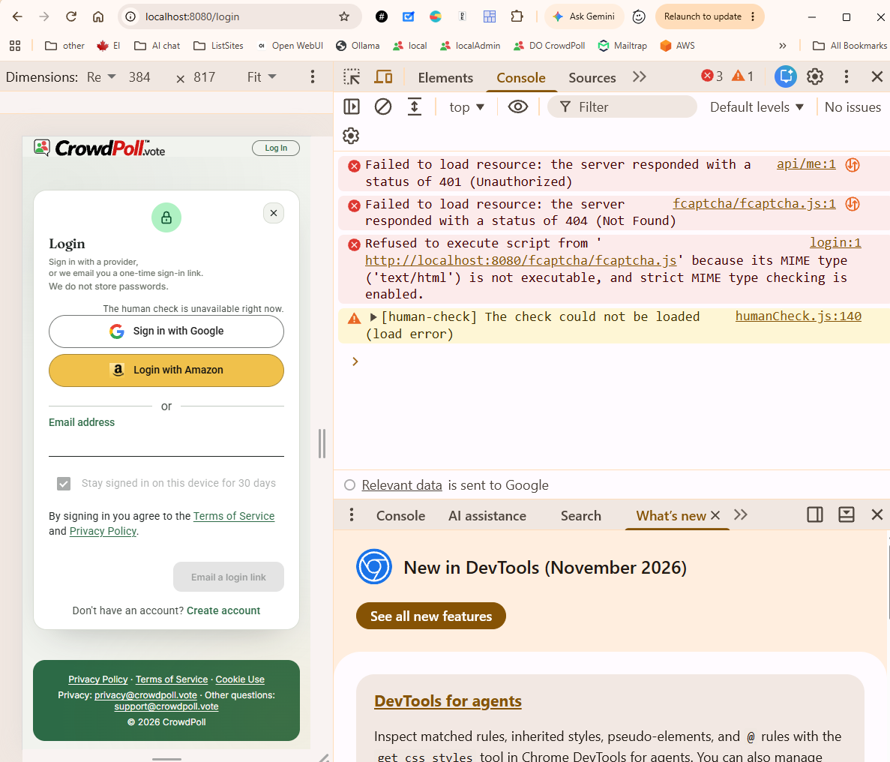
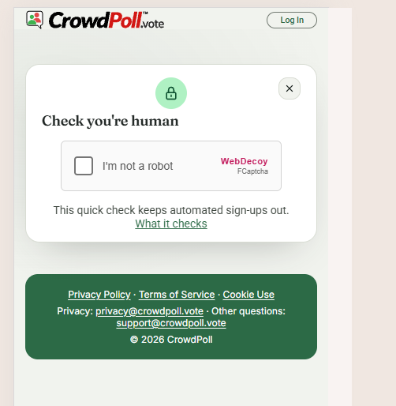
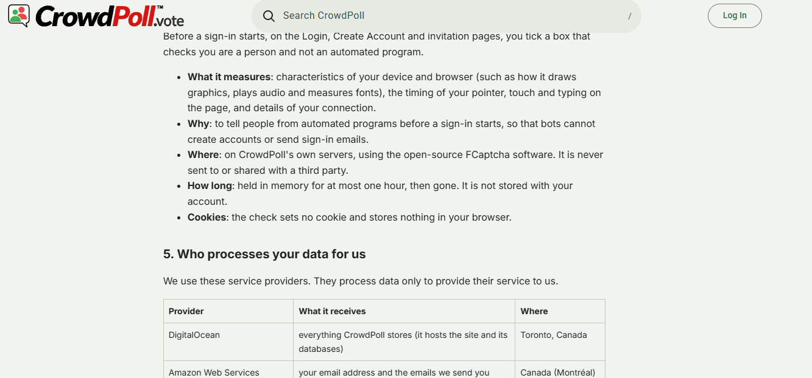
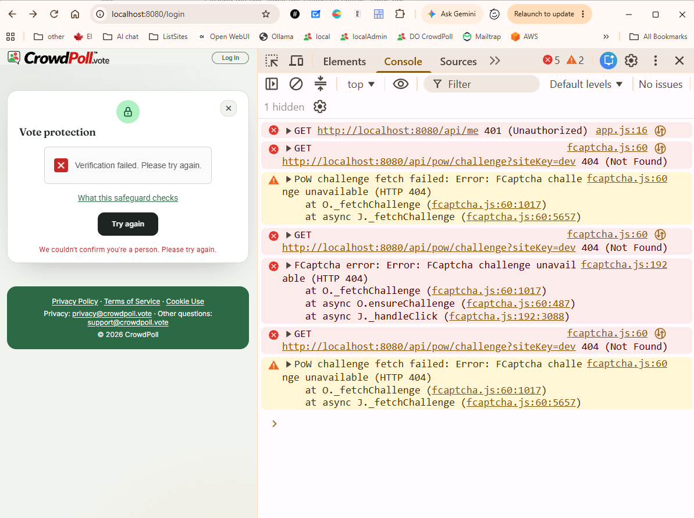

# Overview: `specs/20261102-144053-FCAPTCHA-AND-SEO`

## Document History

| Record | Value |
|---|---|
| Feature directory | `specs/20261102-144053-FCAPTCHA-AND-SEO` |
| Tweak file created | 2026-11-02 17:49 |
| Last updated | 2026-11-03 08:15 |

Legend: `[ ]` open · `[X]` Resolved · `[-]` Resolved (manually)  
(or accepted as-is) by the developer.
Tick `Run Tests` to have this tweak's automated tests written and run; leave it empty (the default) to postpone the run.

"Next" always returns the first `[ ]` item below.

The developer is expected to create the individual tweak requirements in this file, and then run the `/speckit-tweak` command to have the AI implement them, one at a time.  
Each tweak requirement initially carries an empty checkbox; tick it when the item is resolved or consciously accepted.  


# Tweaks

## TWEAK01 Quickstart FCaptcha Secrets Setup  
[X] Resolved  
[ ] Run Tests  

The Quickstart instructs to set FCAPTCHA_SECRET and FCAPTCHA_VERIFY_SECRET environment variables before starting the FCaptcha server.  
How is that done?  
Are those any 32+ character strings?  
Should they be different from each other? 

```
1. `cd fcaptcha-server && npm ci && FCAPTCHA_SECRET=<32+ chars> FCAPTCHA_VERIFY_SECRET=<32+ chars> FCAPTCHA_SITE_KEYS=dev FCAPTCHA_ALLOWED_HOSTNAMES=localhost PORT=3001 npm start`
```

### RECOMMENDATION

The answers, from FCaptcha 1.46.1's own source (`config.js`, `server.js`):  

- `FCAPTCHA_SECRET` is the signing key.  
  It must be at least 32 bytes with at least 8 distinct characters, or the server will not start;  
  generate it rather than typing it (`openssl rand -hex 32` gives 64 hex characters).  
- `FCAPTCHA_VERIFY_SECRET` is the credential the web app sends to `/api/token/verify`.  
  FCaptcha checks no length for it and falls back to the signing key when it is unset;  
  generate it the same way.  
- They should differ.  
  The verify secret is handed to every backend that verifies, while the signing key never leaves the FCaptcha server;  
  keeping them apart means a leaked verify secret cannot mint passes.  
- The web app's `ENV_FCAPTCHA_VERIFY_SECRET` (and the integration test's `FCAPTCHA_TEST_VERIFY_SECRET`) must equal `FCAPTCHA_VERIFY_SECRET`.  

Change, in `quickstart.md`, *Local, with a real FCaptcha server*:  

- Replace the one-line step 1 with:
  - a short note of the three rules above;
  - a Git Bash block that generates both secrets with `openssl rand -hex 32` into shell variables and starts the server;
  - a PowerShell 7 block doing the same with `[Convert]::ToHexString([Security.Cryptography.RandomNumberGenerator]::GetBytes(32))` and `$env:` variables, since the project's dev scripts are PowerShell.  
- Step 2 reuses the same verify secret variable.  

Tests: none, a documentation-only change has nothing a test can observe.  
Other artifacts: none; README already says `openssl rand -hex 32` for production.  

2026-11-02 18:45

### ACCEPTED RECOMMENDATION

- `quickstart.md`, *Local, with a real FCaptcha server*:
  - added a note on the two secrets: generated, different, the signing key's 32-byte and 8-distinct-character rule, and that `ENV_FCAPTCHA_VERIFY_SECRET` and `FCAPTCHA_TEST_VERIFY_SECRET` equal the verify secret;  
  - step 1 now has a Git Bash block (`openssl rand -hex 32`) and a PowerShell 7 block (`RandomNumberGenerator`) that generate both secrets, print the verify secret and start the server;  
  - step 2 runs the integration test with that verify secret, from a second terminal.  
- Tests: none, a documentation-only change has nothing a test can observe.  
- No code or other artifact changed.  

2026-11-02 18:46

## TWEAK02 FCaptcha Server Port Variable  
[X] Resolved  
[ ] Run Tests  

Change the Environment Variable used by the fcaptcha-server for the HTTMl port:    
From:
$env:PORT = "3001"
To:
$env:ENV_FCAPTCHA_PORT = "3001"

### RECOMMENDATION

FCaptcha's own server reads only `PORT`, so the rename happens in our launcher, `fcaptcha-server/start.js`.  

- `start.js`: before starting FCaptcha, `if (process.env.ENV_FCAPTCHA_PORT) process.env.PORT = process.env.ENV_FCAPTCHA_PORT;`.  
  `ENV_FCAPTCHA_PORT` wins when set;
  without it FCaptcha's own `PORT` (default 3000) still applies, so a platform-injected `PORT` does no harm.  
- `.do/app.yaml`: the `fcaptcha` service's `PORT` env becomes `ENV_FCAPTCHA_PORT` `"8080"` (still matching `http_port`).  
- `quickstart.md`: `PORT=3001` → `ENV_FCAPTCHA_PORT=3001` in the Git Bash block, `$env:PORT` → `$env:ENV_FCAPTCHA_PORT` in the PowerShell block.  
- `README.md` (local run line) and `tasks.md` T002 (`PORT` → `ENV_FCAPTCHA_PORT`).  
- Test, written but not run (Run Tests not ticked): new `tests/fcaptcha-start.test.ts` starts `fcaptcha-server/start.js` with `FCAPTCHA_INSECURE_DEV_MODE=1`, `PORT` set to one free port and `ENV_FCAPTCHA_PORT` to another, and expects `/health` to answer on the `ENV_FCAPTCHA_PORT` one;
  it skips when `fcaptcha-server/node_modules` is absent.  

2026-11-02 20:58

### ACCEPTED RECOMMENDATION

- `fcaptcha-server/start.js`: copies `ENV_FCAPTCHA_PORT` into `PORT` before FCaptcha starts;
  without it, FCaptcha's own `PORT` (default 3000) still applies.  
- `.do/app.yaml`: the `fcaptcha` service sets `ENV_FCAPTCHA_PORT` `"8080"` instead of `PORT`.  
- `quickstart.md`: both start blocks use `ENV_FCAPTCHA_PORT`.  
- `README.md`: the local run line, and a new `ENV_FCAPTCHA_PORT` row in the settings table.  
- `.claude/rules/environment.md`: a new `ENV_FCAPTCHA_PORT` row, marked as read by the FCaptcha service, not the web app.  
- `tasks.md` T002: `PORT` → `ENV_FCAPTCHA_PORT`.  
- Test: new `tests/fcaptcha-start.test.ts` (1 test: `/health` answers on `ENV_FCAPTCHA_PORT`, not on `PORT`).  
  Tests postponed (Run Tests not ticked);
  it was written but not run, so the tweak is unverified by a run.  
  `npx tsc --noEmit` passes.  

2026-11-02 20:59

## TWEAK03 ENV_FCAPTCHA_ Prefix For All FCaptcha Settings  
[X] Resolved  
[ ] Run Tests  
 Change all the FCAPTCHA environment variables to use the `ENV_FCAPTCHA_` prefix consistently.

### RECOMMENDATION

FCaptcha itself reads only its own names, so `fcaptcha-server/start.js` copies each `ENV_FCAPTCHA_*` value into the name FCaptcha reads before starting it, as it already does for `ENV_FCAPTCHA_PORT`.  
`ENV_FCAPTCHA_VERIFY_SECRET` then has the same name, and the same value, on both services.  

- **Option A**: rename the FCaptcha-named settings the project sets: `FCAPTCHA_SECRET`, `FCAPTCHA_VERIFY_SECRET`, `FCAPTCHA_SITE_KEYS`, `FCAPTCHA_ALLOWED_HOSTNAMES` and `FCAPTCHA_INSECURE_DEV_MODE` become `ENV_FCAPTCHA_SECRET`, `ENV_FCAPTCHA_VERIFY_SECRET`, `ENV_FCAPTCHA_SITE_KEYS`, `ENV_FCAPTCHA_ALLOWED_HOSTNAMES` and `ENV_FCAPTCHA_INSECURE_DEV_MODE`;
  `REDIS_URL` stays.  
  - Pros: smallest change.  
  - Cons: the FCaptcha service still has one setting without the prefix.  
- **Option B** _(recommended)_: Option A, plus `REDIS_URL` → `ENV_FCAPTCHA_REDIS_URL`, so every setting the project gives the FCaptcha service has the prefix.  
  The FCaptcha settings the project does not set (`TRUSTED_PROXIES`, `FCAPTCHA_CLIENT_PATH`, `FCAPTCHA_EXPERIMENTAL_BLOCKING`, …) are left alone.  
  - Pros: one prefix for everything in the `fcaptcha` service's `envs`;
    it also tells the Valkey URL apart from the web app's `ENV_VALKEY_URL`.  
  - Cons: one more name to map.  

Both options:  

- `start.js` stops with an error naming the new name when one of the old names is set, as `loadConfig` does for a renamed setting, so a stale console variable cannot be silently ignored.  
- `.do/app.yaml` (`fcaptcha` envs), `quickstart.md`, `README.md`, `.claude/rules/environment.md` (rows for the FCaptcha service's settings), `research.md` R1/R8 and `tasks.md` T002 follow.  
- The integration test's own `FCAPTCHA_TEST_URL` and `FCAPTCHA_TEST_VERIFY_SECRET` are test-only and stay.  
- The git-ignored local copies `.vscode/launch.json` and `devScripts/launch-dev.ps1` set only the web app's `ENV_FCAPTCHA_*` and do not change.  
- Tests, written but not run (Run Tests not ticked), in `tests/fcaptcha-start.test.ts`:
  - the server starts with only `ENV_FCAPTCHA_*` names (`ENV_FCAPTCHA_INSECURE_DEV_MODE`);
  - it refuses to start when an old name such as `FCAPTCHA_SECRET` is set.  

2026-11-02 21:27

### ACCEPTED RECOMMENDATION

Option B, accepted by "Accept B".  

- `fcaptcha-server/start.js`: maps `ENV_FCAPTCHA_SECRET`, `ENV_FCAPTCHA_VERIFY_SECRET`, `ENV_FCAPTCHA_SITE_KEYS`, `ENV_FCAPTCHA_ALLOWED_HOSTNAMES`, `ENV_FCAPTCHA_INSECURE_DEV_MODE` and `ENV_FCAPTCHA_REDIS_URL` to FCaptcha's own names;
  it exits with `<old> is no longer read; set <new> instead.` when an old name is set.  
  `PORT` is not refused, since a platform may inject it;
  `ENV_FCAPTCHA_PORT` overrides it.  
- `.do/app.yaml`: the `fcaptcha` service's five other envs renamed.  
- `devScripts.example/launch-dev.ps1`: the comment names `ENV_FCAPTCHA_PORT=3001`.  
- `README.md`: the FCaptcha service paragraph, the local run line, and five new FCaptcha-service rows in the settings table.  
- `.claude/rules/environment.md`: five new rows and a note on the mapping.  
- `quickstart.md` (both start blocks and the secrets note), `research.md` (R2 and the settings decision), `tasks.md` T002.  
- `tests/fcaptcha-start.test.ts`: the launch helper strips the old names from the inherited environment;
  the start test uses only `ENV_FCAPTCHA_*` names;
  new test: an old `FCAPTCHA_SECRET` makes it exit 1 with the message.  
  Tests postponed (Run Tests not ticked);
  2 tests written but not run, so the tweak is unverified by a run.  
  `npx tsc --noEmit` passes.  
- A deployed app needs its console secrets re-entered under the new names (`ENV_FCAPTCHA_SECRET`, `ENV_FCAPTCHA_VERIFY_SECRET`, `ENV_FCAPTCHA_REDIS_URL`).  

2026-11-02 21:31

## TWEAK04 Integration Test Run From Repository Root  
[X] Resolved  
[ ] Run Tests  

(base) PS C:\crowdPoll\fcaptcha\fcaptcha-server> ../devScripts/launch-test-fcaptcha.ps1           
(base) PS C:\crowdPoll\fcaptcha\fcaptcha-server> npx vitest run tests/fcaptcha.integration.test.ts

 RUN  v3.2.7 C:/crowdPoll/fcaptcha/fcaptcha-server

No test files found, exiting with code 1

filter: tests/fcaptcha.integration.test.ts
include: tests/**/*.test.ts
exclude:  **/node_modules/**, **/dist/**, **/cypress/**, **/.{idea,git,cache,output,temp}/**, **/{karma,rollup,webpack,vite,vitest,jest,ava,babel,nyc,cypress,tsup,build,eslint,prettier}.config.*

(base) PS C:\crowdPoll\fcaptcha\fcaptcha-server> 


### RECOMMENDATION

The test ran inside `fcaptcha-server/`, so vitest took that folder as its root:  
it found neither the repository's `vitest.config.ts` nor `tests/`, hence "No test files found".  
The test must run from the repository root (`cd ..` first);
the variables set by the script stay in the PowerShell session, so nothing else changes.  

- `quickstart.md` step 2: replace the one-line command with a Git Bash block and a PowerShell 7 block, each starting from the second terminal with `cd` to the repository root, setting `FCAPTCHA_TEST_URL` and `FCAPTCHA_TEST_VERIFY_SECRET`, and running `npx vitest run tests/fcaptcha.integration.test.ts`;
  add a line saying it fails with "No test files found" when run inside `fcaptcha-server/`.  
- Tests: none, a documentation-only change has nothing a test can observe.  
- Your git-ignored `devScripts/launch-test-fcaptcha.ps1` is left alone.  

2026-11-02 22:01

### ACCEPTED RECOMMENDATION

- `quickstart.md` step 2: now says to run the test from the repository root, and why it stops with "No test files found" inside `fcaptcha-server/`;
  a Git Bash block and a PowerShell 7 block each `cd` to the root, set `FCAPTCHA_TEST_URL` and `FCAPTCHA_TEST_VERIFY_SECRET`, and run `npx vitest run tests/fcaptcha.integration.test.ts`.  
- Tests: none, a documentation-only change has nothing a test can observe.  
- `devScripts/launch-test-fcaptcha.ps1` (git-ignored, yours) unchanged.  

2026-11-02 22:02

## TWEAK05 Integration Test Passes Locally  
[X] Resolved  
[ ] Run Tests  

(base) PS C:\crowdPoll\fcaptcha> npx vitest run tests/fcaptcha.integration.test.ts

 RUN  v3.2.7 C:/crowdPoll/fcaptcha

 ✓ tests/fcaptcha.integration.test.ts (3 tests) 39ms
   ✓ the human check against FCAPTCHA_TEST_URL > reaches the service 28ms
   ✓ the human check against FCAPTCHA_TEST_URL > refuses a made-up pass 9ms
   ✓ the human check against FCAPTCHA_TEST_URL > refuses everything when the verify secret is wrong 1ms

 Test Files  1 passed (1)
      Tests  3 passed (3)
   Start at  22:08:04
   Duration  223ms (transform 26ms, setup 0ms, collect 22ms, tests 39ms, environment 0ms, prepare 36ms)

(base) PS C:\crowdPoll\fcaptcha> 

### RECOMMENDATION

The run shows quickstart step 2 working as written after TWEAK03 and TWEAK04:  
all 3 integration tests pass against a local FCaptcha started with the `ENV_FCAPTCHA_*` names.  
Nothing asks for a change, so record the result and change no code or artifact.  

2026-11-02 22:08

### ACCEPTED RECOMMENDATION

- Recorded the developer's run: `tests/fcaptcha.integration.test.ts`, 3 of 3 passed (22:08), from the repository root.  
- No code, test or artifact changed.  

2026-11-02 22:08

## TWEAK06 Human Check Unavailable Locally  
[X] Resolved  
[ ] Run Tests  

Please provide strrreps I can use to diagnose this problem:
 fcaptcha error in DevTools console:


Server logs:
```text
(base) PS C:\crowdPoll\fcaptcha> devScripts/launch-dev.ps1
PostgreSQL service is running.
Starting server on http://localhost:8080 (both mode)...

> native-auth-oauth@0.1.0 dev
> tsx watch src/server.ts

[config] ENV_ALLOWED_EMAILS was not found, using default value: none (allowlist off: everyone may sign in).
[config] ENV_DATABASE_CA_CERT was not found, using default value: none (system certificate roots).
[config] ENV_OAUTH_APPLE_* was not found, using default value: none (Apple sign-in off).
[config] ENV_OAUTH_MICROSOFT_* was not found, using default value: none (Microsoft sign-in off).
[config] ENV_OPENSEARCH_URL was not found, using default value: none (PostgreSQL full-text search).
[config] ENV_PROTOTYPES was not found, using default value: none (no prototypes served).
[config] ENV_SPACES_* was not found, using default value: none (TRENDING objects and assets served from the instance).
[server] Starting in both sign-in mode
[auth] Sign-in method: both; providers: Google, Amazon
[auth] Sign-up allowlist off
[db] ENV_DATABASE_CA_CERT is not set: verifying the database certificate against the system roots
[server] Database schema is up to date
[cache] Valkey ready
[cache] Using Valkey
[mailer] SES transport ready (us-east-1)
[search] postgres is serving home search
[spaces] Not configured: TRENDING and Newest objects are served from this instance
[sweeps] staleEditUpdateSweep every 20000ms (lock 9)
[sweeps] pollsAwaitingApprovalSweep every 5000ms (lock 1)
[sweeps] scheduleSweep every 60000ms (lock 2)
[sweeps] counterFlushSweep every 10000ms (lock 3)
[sweeps] trendingSweep every 60000ms (lock 4)
[sweeps] newestSweep every 60000ms (lock 10)
[sweeps] outboxDrainSweep every 15000ms (lock 5)
[sweeps] bookmarkRemovalSweep every 86400000ms (lock 6)
[sweeps] invitationSweep every 30000ms (lock 12)
[sweeps] retentionSweep every 86400000ms (lock 11)
[sweeps] reconcileSweep every 86400000ms (lock 7)
[sweeps] budgetController every 1000ms (lock 8)
[votes] consumer d7ede399-0723-4bb5-bbfb-8a1a5ba5b301 started (batch 500)
[server] Listening on http://localhost:8080 (both mode)
[sweeps] trendingSweep: 12 change(s)
[sweeps] newestSweep: 12 change(s)
[controller] R=0 B=1250 S=0/200 V=0 a=1.00 k=1/1/1 tabs=0/0 stretched=0

```

fcaptcha server output:
```text
(base) PS C:\crowdPoll\fcaptcha\fcaptcha-server> npm ci                                                                                                                                  

added 80 packages, and audited 81 packages in 3s

31 packages are looking for funding
  run `npm fund` for details

found 0 vulnerabilities
(base) PS C:\crowdPoll\fcaptcha\fcaptcha-server> npm start

> crowdpoll-fcaptcha-server@1.0.0 start
> node start.js

FCaptcha server running on port 3000
Trusted proxies: 127.0.0.0/8, ::1/128, 10.0.0.0/8, 172.16.0.0/12, 192.168.0.0/16, 169.254.0.0/16, fe80::/10, fc00::/7
Site keys: any (no allowlist), max 8 distinct per IP
Shared state: in-memory
```


### RECOMMENDATION

Diagnosis, from the screenshot and the two logs:  

1. **The widget cannot load locally.**  
   The page asks for `http://localhost:8080/fcaptcha/fcaptcha.js`;
   in production App Platform's ingress sends `/fcaptcha/*` to the FCaptcha service, but locally nothing does, so the web app answers its own `404` HTML page and the browser refuses it as a script.  
   After that the page falls back, as designed: "The human check is unavailable right now." over the login card.  
2. **The FCaptcha server is on the wrong port.**  
   Its log says `running on port 3000`, while `ENV_FCAPTCHA_URL` is `http://localhost:3001`;
   `ENV_FCAPTCHA_PORT` was not set in that terminal, so the web app's server-side check cannot reach it and fails open (`[human-check] Skipped` on each sign-in start).  

Steps to confirm each cause:  

- `curl -i http://localhost:3001/health`: connection refused while FCaptcha is on 3000;
  restart it with `$env:ENV_FCAPTCHA_PORT = "3001"` (and `ENV_FCAPTCHA_SITE_KEYS = "dev"`, `ENV_FCAPTCHA_ALLOWED_HOSTNAMES = "localhost"`) and it answers `200`.  
- `curl -i http://localhost:3001/fcaptcha.js`: `200`, `application/javascript`;
  the widget itself is fine.  
- `curl -i http://localhost:8080/fcaptcha/fcaptcha.js`: `404`, `text/html`;
  this is cause 1.  
- `curl -s http://localhost:8080/api/config`: `humanCheck` is `{"siteKey":"dev","endpoint":"/fcaptcha"}`, so the check is on.  
- `curl -i -X POST http://localhost:8080/api/auth/request-login-link -H "Content-Type: application/json" -d '{"email":"a@b.c"}'`: `400 challenge-required` once FCaptcha answers on 3001;
  while it does not, the request goes through and the web log shows `[human-check] Skipped: service unreachable`.  

- **Option A**: steps only.  
  Add the steps above to `quickstart.md`, and say plainly that the widget cannot be drawn on a local run;
  no code change.  
  - Pros: no code.  
  - Cons: the human check can still be seen working only on a deployed app.  
- **Option B** _(recommended)_: a development-only `/fcaptcha` route on the web app.  
  When `ENV_PUBLIC_ORIGIN` is `http://localhost…` and the check is on, the web app forwards `/fcaptcha/*` (method, body, `Content-Type`, `Origin`) to `ENV_FCAPTCHA_URL` with the prefix removed, doing locally what the ingress does in production;
  on any other origin the route is not mounted.  
  Plus the steps above, and the quickstart's local section names it.  
  - Pros: the whole check (widget, tick, pass, server verify) runs on `npm run dev`;
    same paths as production, so no client change.  
  - Cons: a small route only development uses;
    it must never be mounted in production (tested).  
  - Tests, written but not run (Run Tests not ticked), in `tests/human-check.test.ts`:
    - with a localhost origin, `GET /fcaptcha/fcaptcha.js` and `POST /fcaptcha/api/verify` reach the injected fetch with the prefix removed;
    - with `https://crowdpoll.vote`, `/fcaptcha/fcaptcha.js` is `404`.  

2026-11-03 07:18

### ACCEPTED RECOMMENDATION

Option A, accepted by "accept a".  

- `quickstart.md`: new subsection *Diagnosing a local run with the check turned on*:
  why the widget cannot load locally (no ingress for `/fcaptcha/*`, so a `404` HTML page refused as a script, then the designed fallback);
  a table of five `curl` checks (FCaptcha health on 3001, its widget file, the web app's `/fcaptcha` 404, `/api/config`, and `request-login-link` without a pass) with what each should show and what a different answer means;
  a note on `curl.exe` and JSON quoting in PowerShell.  
- Tests: none, a documentation-only change has nothing a test can observe.  
- No code changed.  

2026-11-03 07:33

## TWEAK07 Human Check Widget Still Missing Locally  
[X] Resolved  
[ ] Run Tests  


Browser DevTools console:



The log of fcaptcha startup:
``text
(base) PS C:\crowdPoll\fcaptcha\fcaptcha-server> npm start

> crowdpoll-fcaptcha-server@1.0.0 start
> node start.js

FCaptcha server running on port 3000
Trusted proxies: 127.0.0.0/8, ::1/128, 10.0.0.0/8, 172.16.0.0/12, 192.168.0.0/16, 169.254.0.0/16, fe80::/10, fc00::/7
Site keys: any (no allowlist), max 8 distinct per IP
Shared state: in-memory
```

The log of webapp server:
```text
(base) PS C:\crowdPoll\fcaptcha>  C:; cd 'C:\crowdPoll\fcaptcha'; ${env:ENV_PORT}='8080'; ${env:ENV_PUBLIC_ORIGIN}='http://localhost:8080'; ${env:ENV_ADMINS}='devadmin01@crowdpoll.vote, devadmin02@crowdpoll.vote, devadmin03@crowdpoll.vote'; ${env:ENV_SCREENING_CALL_TIMEOUT}='10000'; ${env:ENV_POLL_APPROVAL_SWEEP_INTERVAL}='5000'; ${env:ENV_POLL_DATE_CHECK_SWEEP_INTERVAL}='60000'; ${env:ENV_POLL_EDIT_HEARTBEAT_INTERVAL}='10000'; ${env:ENV_MAX_ACCEPTABILITY_SCREENING_ATTEMPTS}='10'; ${env:ENV_POLL_ADMIN_PAGE_REFRESH_INTERVAL}='5000'; ${env:ENV_PARTICIPANTS_VIEWPORT_SIZE}='10'; ${env:ENV_EMAIL_RATE_LIMIT_WINDOW_MINUTES}='1'; ${env:ENV_EMAIL_RATE_LIMIT_MAX_REQUESTS_PER_WINDOW}='50'; ${env:ENV_MAX_PRIVATE_POLL_VOTERS}='100'; ${env:ENV_MIN_CHOICES}='2'; ${env:ENV_MAX_CHOICES}='50'; ${env:ENV_SESSION_CACHE_TTL}='300000'; ${env:ENV_MAX_POLLS_SEARCH_RESULTS}='200'; ${env:ENV_MAX_POLLS_ADMIN_SEARCH_RESULTS}='200'; ${env:ENV_MAX_TRENDING_POLLS}='200'; ${env:ENV_TRENDING_POLLS_RECOMPUTE_SWEEP_INTERVAL}='60000'; ${env:ENV_MAX_NEWEST_POLLS}='50'; ${env:ENV_NEWEST_POLLS_RECOMPUTE_SWEEP_INTERVAL}='60000'; ${env:ENV_LINE_GRAPH_MIN_VOTE_PERCENTAGE}='1'; ${env:ENV_LINE_GRAPH_REFRESH_INTERVAL}='60000'; ${env:ENV_MIN_LIVE_REFRESH_INTERVAL}='2000'; ${env:ENV_MIN_MANUAL_REFRESH_INTERVAL}='5000'; ${env:ENV_MANUAL_REFRESH_BURST}='5'; ${env:ENV_SEARCH_BURST}='3'; ${env:ENV_MIN_SEARCH_REFRESH_INTERVAL}='2000'; ${env:ENV_MIN_VOTE_REFRESH_INTERVAL}='2000'; ${env:ENV_MAX_VOTES_PER_IP_PER_MINUTE}='600'; ${env:ENV_MAX_LIVE_RESULTS_PER_USER}='5'; ${env:ENV_LIVE_RESULTS_MAX_IDLE_TIME}='1800000'; ${env:ENV_SERVER_MAX_REQUESTS_PER_INSTANCE_PER_SECOND}='1250'; ${env:ENV_SERVER_MAX_REQUESTS_PER_SECOND}='15000'; ${env:ENV_SERVER_MAX_SEARCH_PER_SECOND}='2000'; ${env:ENV_SERVER_MAX_SEARCH_FALLBACK_PER_SECOND}='200'; ${env:ENV_BUDGET_CONTROLLER_SWEEP_INTERVAL}='1000'; ${env:ENV_MAX_REFRESH_AND_SEARCH_STRETCH}='8'; ${env:ENV_BUDGET_LOWER_THRESHOLD_PERCENT}='80'; ${env:ENV_INSTANCE_MAX_INFLIGHT}='200'; ${env:ENV_INSTANCE_MAX_EVENT_LOOP_LAG}='100'; ${env:ENV_SHED_RETRY_AFTER}='2000'; ${env:ENV_COUNTER_FLUSH_SWEEP_INTERVAL}='10000'; ${env:ENV_INVITATION_SWEEP_INTERVAL}='30000'; ${env:ENV_VOTE_BATCH_SIZE}='500'; ${env:ENV_VOTE_QUEUE_LAG_NOTICE}='2000'; ${env:ENV_SEARCH_CACHE_TTL}='10000'; ${env:ENV_OUTBOX_DRAIN_SWEEP_INTERVAL}='15000'; ${env:ENV_MAX_BOOKMARKS_PER_USER}='200'; ${env:ENV_BOOKMARK_EXPIRY_MONTHS}='6'; ${env:ENV_PAGE_LOADS_PER_MINUTE}='120'; ${env:ENV_MAX_SIGNIN_COOKIE_DURATION}='2592000000'; ${env:ENV_STAY_SIGNED_IN}='1'; ${env:ENV_SIGNIN_METHOD}='both'; ${env:ENV_OPENSEARCH_URL}=''; ${env:ENV_SPACES_BUCKET}=''; ${env:ENV_SPACES_REGION}=''; ${env:ENV_SPACES_KEY}=''; ${env:ENV_SPACES_SECRET}=''; ${env:ENV_SPACES_CDN_URL}=''; ${env:ENV_FCAPTCHA_ENABLED}='1'; ${env:ENV_FCAPTCHA_URL}='http://localhost:3000'; ${env:ENV_FCAPTCHA_SITE_KEY}='dev'; ${env:ENV_FCAPTCHA_VERIFY_SECRET}='xxxxxxxxxxxxxxxx'; ${env:ENV_FCAPTCHA_SECRET}='xxxxxxxxx'; ${env:ENV_FCAPTCHA_PORT}='3000'; 
....................

Debugger attached.
Debugger attached.
Debugger attached.
[config] ENV_ALLOWED_EMAILS was not found, using default value: none (allowlist off: everyone may sign in).
[config] ENV_DATABASE_CA_CERT was not found, using default value: none (system certificate roots).
[config] ENV_OAUTH_APPLE_* was not found, using default value: none (Apple sign-in off).
[config] ENV_OAUTH_MICROSOFT_* was not found, using default value: none (Microsoft sign-in off).
[config] ENV_OPENSEARCH_URL was not found, using default value: none (PostgreSQL full-text search).
[config] ENV_PROTOTYPES was not found, using default value: none (no prototypes served).
[config] ENV_SPACES_* was not found, using default value: none (TRENDING objects and assets served from the instance).
[server] Starting in both sign-in mode
[auth] Sign-in method: both; providers: Google, Amazon
[auth] Sign-up allowlist off
[db] ENV_DATABASE_CA_CERT is not set: verifying the database certificate against the system roots
[server] Database schema is up to date
[cache] Valkey ready
[cache] Using Valkey
[mailer] SES transport ready (us-east-1)
[search] postgres is serving home search
[spaces] Not configured: TRENDING and Newest objects are served from this instance
[sweeps] staleEditUpdateSweep every 20000ms (lock 9)
[sweeps] pollsAwaitingApprovalSweep every 5000ms (lock 1)
[sweeps] scheduleSweep every 60000ms (lock 2)
[sweeps] counterFlushSweep every 10000ms (lock 3)
[sweeps] trendingSweep every 60000ms (lock 4)
[sweeps] newestSweep every 60000ms (lock 10)
[sweeps] outboxDrainSweep every 15000ms (lock 5)
[sweeps] bookmarkRemovalSweep every 86400000ms (lock 6)
[sweeps] invitationSweep every 30000ms (lock 12)
[sweeps] retentionSweep every 86400000ms (lock 11)
[sweeps] reconcileSweep every 86400000ms (lock 7)
[sweeps] budgetController every 1000ms (lock 8)
[votes] consumer d9c9d74a-85ec-4565-8d4d-14cd0175eac7 started (batch 500)
[server] Listening on http://localhost:8080 (both mode)
[sweeps] trendingSweep: 12 change(s)
[sweeps] newestSweep: 12 change(s)
[controller] R=0 B=2500 S=0/200 V=0 a=1.00 k=1/1/1 tabs=0/0 stretched=0
[sweeps] trendingSweep: 12 change(s)
[sweeps] newestSweep: 12 change(s)
[controller] R=0 B=1250 S=0/200 V=0 a=1.00 k=1/1/1 tabs=0/0 stretched=01


```


### RECOMMENDATION

The ports now agree (FCaptcha on 3000, `ENV_FCAPTCHA_URL=http://localhost:3000`), so the server-side check reaches FCaptcha.  
The console shows the one remaining cause, the first one TWEAK06 found:  
`http://localhost:8080/fcaptcha/fcaptcha.js` is the web app's `404` HTML page, because locally nothing does what App Platform's ingress does in production (send `/fcaptcha/*` to the FCaptcha service).  
Under TWEAK06 option A this is the expected local behaviour, so the widget will not appear until something routes `/fcaptcha/*` locally.  

- **Option A**: leave it as documented in TWEAK06;
  the widget is seen only on a deployed app.  
  - Pros: no code.  
  - Cons: the check cannot be tried before a deploy.  
- **Option B** _(recommended)_: TWEAK06's option B, a development-only `/fcaptcha` route on the web app.  
  When `ENV_PUBLIC_ORIGIN` is `http://localhost…` and the check is on, a new `src/routes/fcaptchaDevProxy.ts` mounted ahead of the page routes forwards `/fcaptcha/*` to `ENV_FCAPTCHA_URL` with the prefix removed:
  method, query, body, `Content-Type` and `Origin` go through, and the answer's status, `Content-Type` and body come back;
  on any other origin it is not mounted.  
  The quickstart's local-diagnosis section changes to say the widget appears locally, and the `/fcaptcha/fcaptcha.js` row expects `200` JavaScript.  
  ARCHITECTURE's human-check section gains one line.  
  - Pros: the whole check (widget, tick, pass, server verify) runs on a local server, on the same paths as production, so no client change.  
  - Cons: a small route only development uses.  
  - Tests, written but not run (Run Tests not ticked), in `tests/human-check.test.ts`, using the injected `humanCheckFetch`:
    - with `http://localhost:8080`, `GET /fcaptcha/fcaptcha.js` and `POST /fcaptcha/api/verify` reach FCaptcha's URL with the prefix removed, and the answer is passed back;
    - with `https://crowdpoll.vote`, `GET /fcaptcha/fcaptcha.js` is `404` and FCaptcha is never called.  

2026-11-03 07:42

### ACCEPTED RECOMMENDATION

Option B, accepted by "accept b".  

- New `src/routes/fcaptchaDevProxy.ts` (`createFcaptchaDevProxy`, `isLocalOrigin`): forwards `/fcaptcha/*` to `ENV_FCAPTCHA_URL` with the prefix removed;
  method, query, raw body, `Content-Type`, `Origin`, `Referer`, `User-Agent`, `Accept` and the caller's address (`X-Forwarded-For`) go through;
  the answer's status, `Content-Type` and body come back;
  `502` when FCaptcha cannot be reached.  
- `src/server.ts`: mounted after the in-flight counter, only when the check is on and `ENV_PUBLIC_ORIGIN` is `localhost`, `127.0.0.1` or `[::1]`;
  it uses the injected `humanCheckFetch` in tests.  
- `tests/human-check.test.ts`: new describe, 2 tests (forwarded with the prefix removed on a localhost origin;
  `404` and no call on `https://crowdpoll.vote`).  
  Tests postponed (Run Tests not ticked);
  written but not run, so the tweak is unverified by a run.  
  `npx tsc --noEmit` passes.  
- Artifacts: `quickstart.md` (local run now shows the widget;
  the `/fcaptcha/fcaptcha.js` row expects `200` JavaScript, with `502` and `404` explained), `tasks.md` (T048 added in Phase 9), `README.md` and `ARCHITECTURE.md` (one sentence each).  
- This adds a development-only behaviour to the design (research R1: browsers reach FCaptcha through the ingress);
  the requirements document may want the same note.  

2026-11-03 07:46

## TWEAK08 Vote Protection Wording  
[X] Resolved  
[ ] Run Tests  

Awesome.  
It works as expected on a local development server, forwarding requests to the FCaptcha server and handling responses correctly.  



Change the title to:
`Vote protection`

Change the label to:
`I am not a Bot or AI Agent`

Remove the text `WebDecoy FCaptcha`.

Change the help text to:
`What this safeguard checks.`


### RECOMMENDATION

Three of the four changes are ours or the widget's own options;
the fourth has no option, so it is removed after drawing.  

- `src/public/humanCheck.js`:
  - card title `Check you're human` → `Vote protection`;  
  - widget label: pass `strings: { label: "I am not a Bot or AI Agent" }` to `FCaptcha.render` (the client's documented string override, which replaces "I'm not a robot");  
  - "WebDecoy / FCaptcha": the widget has no setting to hide it, so remove its `.fcaptcha-branding` element right after `FCaptcha.render`, which builds the markup synchronously (both packages are MIT, which asks for no on-screen credit);  
  - link text `What it checks` → `What this safeguard checks.`.  
- `tests/client-human-check.test.ts`: the fake widget also draws a `.fcaptcha-branding` element;
  titles expect `Vote protection`, the first test expects the label option, no branding element and the new link text.  
  Written but not run (Run Tests not ticked).  
- Artifacts: `contracts/ui-contracts.md` C1, `quickstart.md` scenarios 1 and 13, `research.md`, `tasks.md` (T010 and the US1 test list), `README.md`, `ARCHITECTURE.md`.  

2026-11-03 07:59

### ACCEPTED RECOMMENDATION

Applied as recommended.  

- `src/public/humanCheck.js`: `TITLE` "Vote protection", new `LABEL` "I am not a Bot or AI Agent" passed as `strings.label`, `.fcaptcha-branding` removed after each draw, link "What this safeguard checks.".  
- `tests/client-human-check.test.ts`: 5 title expectations updated;
  the first test now also asserts the label option, that no `.fcaptcha-branding` or "WebDecoy" remains, and the new link text;
  the fake widget draws a branding element so its removal is tested.  
  Tests postponed (Run Tests not ticked);
  written but not run, so the tweak is unverified by a run.  
  `npx tsc --noEmit` passes.  
- Artifacts: `contracts/ui-contracts.md` (C1), `quickstart.md` (scenarios 1, 13), `research.md`, `tasks.md` (T010, test list), `README.md`, `ARCHITECTURE.md`.  
- The visible wording of the check changed;
  the requirements document may name the old title.  

2026-11-03 07:59

## TWEAK09 Help Text And Bot Check Anchor  
[X] Resolved  
[ ] Run Tests  

Remove this help text:
`This quick check keeps automated sign-ups out. `

Clicking the link "What this safeguard checks" lands on:



The link doesn't land with the "Bot check" title showing, so it isn't clear what text the user should be reading.

### RECOMMENDATION

- Help text: in `src/public/humanCheck.js` the line holds only the link;
  the sentence goes.  
- Anchor: the privacy page's numbered `h2` headings already carry `scroll-margin-top` (the fixed header's height plus 16 px), but `#bot-check` is a `<section>`, which has none, so the fixed header covers its "Bot check" title.  
  Add `.legal-doc section[id]{ scroll-margin-top:calc(var(--fixed-chrome-height, 0px) + 16px); }` to `src/public/legal-m3.css`.  
- Tests (written, not run):
  `tests/client-human-check.test.ts` asserts the line's text is the link's only;
  `tests/legal-pages.test.ts` asserts the rule and the section id.  
- Artifact: `contracts/ui-contracts.md` C1.  

2026-11-03 08:11

### ACCEPTED RECOMMENDATION

- `src/public/humanCheck.js`: the sentence "This quick check keeps automated sign-ups out." removed;
  the line holds only "What this safeguard checks.".  
- `src/public/legal-m3.css`: `.legal-doc section[id]` gets the same `scroll-margin-top` as the `h2` headings, so `/privacy#bot-check` lands with "Bot check" below the fixed header.  
- Tests: `tests/client-human-check.test.ts` (1 assertion added), `tests/legal-pages.test.ts` (1 test added).  
  Tests postponed (Run Tests not ticked);
  written but not run, so the tweak is unverified by a run.  
  `npx tsc --noEmit` passes.  
- Artifact: `contracts/ui-contracts.md` C1.  

2026-11-03 08:11

## TWEAK10 Widget Challenge Fetched From Site Root  
[X] Resolved  
[ ] Run Tests  




### RECOMMENDATION

The widget asks `http://localhost:8080/api/pow/challenge`, without the `/fcaptcha` prefix, and gets `404`.  
In FCaptcha 1.46.1 the checkbox widget builds its proof-of-work manager with no server URL, so it falls back to the page-wide `FCaptcha.serverUrl`;
the `serverUrl` given to `FCaptcha.render` is used only by the invisible mode.  
The same would happen in production, where the ingress also serves FCaptcha under `/fcaptcha`.  

- `src/public/humanCheck.js`: call `FCaptcha.configure({ serverUrl: humanCheck.endpoint })` before each `FCaptcha.render` (the client's documented page-wide setting).  
- `tests/client-human-check.test.ts`: the fake widget gains `configure`, recording its options;
  the first test asserts it was called with `{ serverUrl: "/fcaptcha" }`.  
  Written but not run (Run Tests not ticked).  
- Artifacts: `research.md` (the widget-drawing note), `ARCHITECTURE.md` (the browser line).  

2026-11-03 08:15

### ACCEPTED RECOMMENDATION

- `src/public/humanCheck.js`: `FCaptcha.configure({ serverUrl: humanCheck.endpoint })` before each draw, so the checkbox widget fetches `/fcaptcha/api/pow/challenge` and posts `/fcaptcha/api/verify`.  
- `tests/client-human-check.test.ts`: fake `configure` added;
  1 assertion added.  
  Tests postponed (Run Tests not ticked);
  written but not run, so the tweak is unverified by a run.  
  `npx tsc --noEmit` passes.  
- Artifacts: `research.md`, `ARCHITECTURE.md`.  

2026-11-03 08:15

## TWEAK11 <short title here>  
[ ] Resolved  
[ ] Run Tests  
tweak requirements...  
