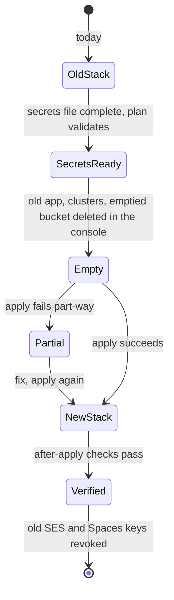
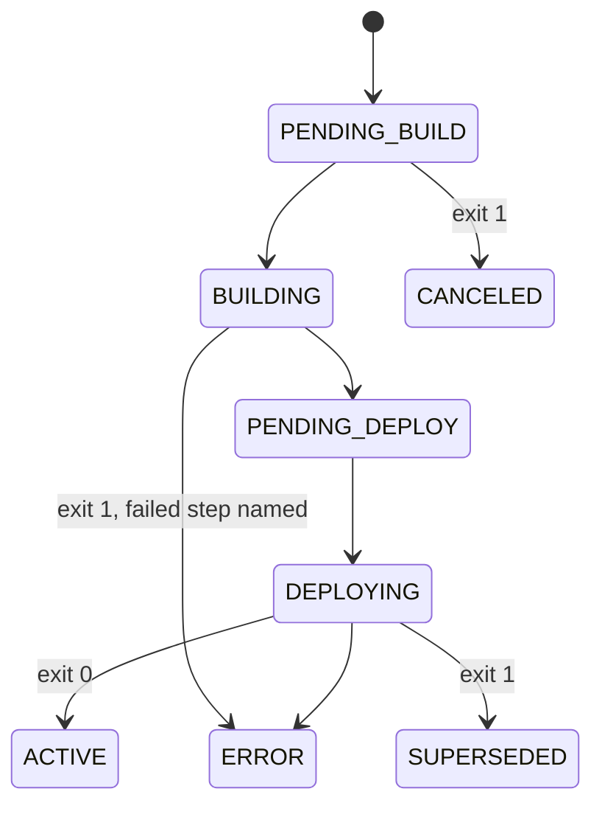

# Data Model: Provision CrowdPoll as Code

No application schema changes and no migration: the new PostgreSQL cluster starts empty and the app creates its schema
at start-up (`migrateToLatest`). The "data" of this feature is the infrastructure configuration, its inputs and its
state.

## Resources (in `infra/`)

| Resource | Name | Key attributes | Depends on |
|---|---|---|---|
| `digitalocean_database_cluster.pg` | `db-pgsql-tor1-crowdpoll` | `pg` 18, `tor1`, `var.pg_size`, `var.pg_node_count` | — |
| `digitalocean_database_cluster.valkey` | `valkey-tor1-crowdpoll` | `valkey` 9, `tor1`, `var.valkey_size`, 1 node | — |
| `digitalocean_spaces_bucket.crowdpoll` | `crowdpoll` | `tor1`, `acl = private`, `force_destroy = false` | — |
| `digitalocean_cdn.crowdpoll` | — | origin = the bucket's domain name | bucket |
| `random_password.fcaptcha_secret` | — | 64 alphanumeric | — |
| `random_password.fcaptcha_verify_secret` | — | 64 alphanumeric | — |
| `digitalocean_app.crowdpoll` | `crowdpoll` | domain, `web`, `fcaptcha`, ingress, two database attachments, alerts | clusters (by name), passwords |
| `digitalocean_database_firewall.pg` / `.valkey` | — | one rule: `type = app`, `value` = the app's id | app, clusters |

Outputs: `app_id`, `default_ingress`, `live_url`, `cdn_endpoint`. None is sensitive.

## Inputs (`infra/variables.tf`)

| Variable | Sensitive | Required | Becomes |
|---|---|---|---|
| `better_auth_secret` | yes | yes | `ENV_BETTER_AUTH_SECRET` |
| `ses_access_key_id`, `ses_secret_access_key` | yes | yes | `ENV_SES_ACCESS_KEY_ID`, `ENV_SES_SECRET_ACCESS_KEY` |
| `spaces_access_id`, `spaces_secret_key` | yes | yes | `ENV_SPACES_KEY`, `ENV_SPACES_SECRET`, and the provider's Spaces credentials |
| `allowed_emails` | yes | yes | `ENV_ALLOWED_EMAILS` |
| `oauth_*` (Google, Apple, Microsoft, Amazon) | yes | no (`""`) | the matching `ENV_OAUTH_*`, an env only when non-empty |
| `pg_size`, `pg_node_count`, `valkey_size` | no | no (defaults) | cluster sizes |

Validation: a required variable whose trimmed value is empty fails `terraform plan` with
`<variable> must be set in infra/secrets.auto.tfvars.` The token is not a variable: the provider reads
`DIGITALOCEAN_TOKEN` from the session.

## Files and their status in git

| File | In git | Holds |
|---|---|---|
| `infra/*.tf` | committed | the configuration |
| `infra/.terraform.lock.hcl` | committed | plugin versions and checksums |
| `infra/secrets.auto.tfvars.example` | committed | every input name, values `""` |
| `infra/secrets.auto.tfvars` | ignored | the outside secrets |
| `infra/terraform.tfstate`, `infra/*.tfstate.*` | ignored | the state, every secret in plain text |
| `infra/.terraform/` | ignored | downloaded plugins |

## The switch-over (states of the hosting)

## A deployment (deploy command)

A deployment still in progress after 30 minutes ends the command with exit 1 and its last phase; the deployment itself
carries on.
