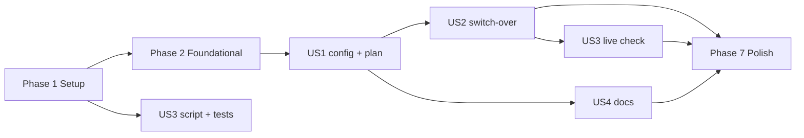

---

description: "Task list for Provision CrowdPoll as Code, With the FCaptcha Service"
---

# Tasks: Provision CrowdPoll as Code, With the FCaptcha Service

**Input**: Design documents from `specs/20261103-114927-PROVISION-FCAPTCHA-SERVICE/`

**Prerequisites**: plan.md, spec.md, research.md, data-model.md, contracts/, quickstart.md

**Tests**: Included: the plan names two Vitest suites (R12), `tests/infra-config.test.ts` and `tests/deploy-app.test.ts`; Terraform itself is checked by the quickstart scenarios.

**Organization**: Tasks are grouped by user story. Tasks marked **(operator)** are run by the operator against DigitalOcean, not by code changes.

## Format: `[ID] [P?] [Story] Description`

- **[P]**: Can run in parallel (different files, no dependencies)
- **[Story]**: Which user story this task belongs to (US1–US4)

---

## Phase 1: Setup (Shared Infrastructure)

**Purpose**: The tool runs, and the `infra/` folder exists with its pins and ignores.

- [x] T001 (operator) Install Terraform (or OpenTofu) on the operator's machine and run `terraform version` (or `tofu version`); if Windows Application Control blocks it, try OpenTofu, then review Smart App Control; record the outcome and version in `specs/20261103-114927-PROVISION-FCAPTCHA-SERVICE/quickstart.md` Prerequisites (FR-011, research R1)
- [X] T002 [P] Create `infra/versions.tf` with `required_version = ">= 1.6"` and `required_providers` pinning `digitalocean/digitalocean` to `= 2.106.0` and `hashicorp/random` to `= 3.9.1` (FR-010, R1)
- [X] T003 [P] Add to `.gitignore` the lines `infra/.terraform/`, `infra/*.tfstate`, `infra/*.tfstate.*` and `infra/secrets.auto.tfvars` (FR-026, data-model.md *Files*)

---

## Phase 2: Foundational (Blocking Prerequisites)

**Purpose**: The provider, the inputs and the secrets file every resource needs.

- [X] T004 Create `infra/providers.tf`: `provider "digitalocean"` reading the token from `DIGITALOCEAN_TOKEN` (no `token` argument) and `spaces_access_id = var.spaces_access_id`, `spaces_secret_key = var.spaces_secret_key`; `provider "random"` (R7, R13)
- [X] T005 Create `infra/variables.tf` with every input of `data-model.md` *Inputs*: the six required secrets (`better_auth_secret`, `ses_access_key_id`, `ses_secret_access_key`, `spaces_access_id`, `spaces_secret_key`, `allowed_emails`), `sensitive = true`, each with `validation { condition = length(trimspace(var.<name>)) > 0, error_message = "<name> must be set in infra/secrets.auto.tfvars." }`; the optional `oauth_*` values of `.claude/rules/environment.md` (Google, Apple, Microsoft, Amazon), `sensitive = true`, `default = ""`; `pg_size` (`db-s-1vcpu-1gb`), `pg_node_count` (1), `valkey_size` (`db-s-1vcpu-1gb`) (FR-013, FR-014, R4)
- [X] T006 Create `infra/secrets.auto.tfvars.example` listing every variable of `infra/variables.tf` as `name = ""`, in the order of `data-model.md` *Inputs* (FR-013, contracts/infra-config.md C5)
- [X] T007 Create `tests/infra-config.test.ts` (Vitest, reads files only): every `variable` block of `infra/variables.tf` appears in `infra/secrets.auto.tfvars.example` with `""`; every `sensitive = true` variable has no non-empty default; `.gitignore` contains the four lines of T003; no `infra/*.tf` file contains an unescaped App Platform binding (`"${db-`, `"${valkey-`, `"${fcaptcha.`) (R3, R12)
- [x] T008 (operator) Copy `infra/secrets.auto.tfvars.example` to `infra/secrets.auto.tfvars` and fill every required value (new SES access key, new Spaces key pair, `openssl rand -hex 32` for `better_auth_secret`, the allowlist); note the old clusters' sizes in the console and set `pg_size`, `pg_node_count`, `valkey_size` if they differ (quickstart Runbook 1–2, FR-021 / UA11)

**Checkpoint**: `npx vitest run tests/infra-config.test.ts` passes; the secrets file is complete.

---

## Phase 3: User Story 1 — Provision the whole stack from one reviewed command (Priority: P1) 🎯 MVP

**Goal**: One `infra/` configuration describes every resource of FR-001 with the names of FR-002, and its plan is reviewable.

**Independent Test**: `terraform init`, `fmt -check`, `validate` and `plan` in `infra/` succeed and the plan lists exactly the resources of `data-model.md` (quickstart scenario 2).

- [X] T009 [P] [US1] Create `infra/databases.tf`: `digitalocean_database_cluster.pg` (`name = "db-pgsql-tor1-crowdpoll"`, `engine = "pg"`, `version = "18"`, `region = "tor1"`, `size = var.pg_size`, `node_count = var.pg_node_count`) and `digitalocean_database_cluster.valkey` (`name = "valkey-tor1-crowdpoll"`, `engine = "valkey"`, `version = "9"`, `region = "tor1"`, `size = var.valkey_size`, `node_count = 1`) (FR-002, R6)
- [X] T010 [P] [US1] Create `infra/spaces.tf`: `locals { bucket_name = "crowdpoll" }`, the one place the bucket's name is written (a rename under FR-002's exception changes only it); `digitalocean_spaces_bucket.crowdpoll` (`name = local.bucket_name`, `region = "tor1"`, `acl = "private"`, `force_destroy = false`) and `digitalocean_cdn.crowdpoll` with `origin = digitalocean_spaces_bucket.crowdpoll.bucket_domain_name` (FR-002, R7)
- [X] T011 [P] [US1] Create `infra/fcaptcha.tf`: `random_password.fcaptcha_secret` and `random_password.fcaptcha_verify_secret`, each `length = 64`, `special = false` (FR-015, R4)
- [X] T012 [US1] Create `infra/app.tf`: `locals` with `domains = ["crowdpoll.vote"]` and `web_settings`, a map of every non-secret `web` env of `.do/app.yaml` with its value and scope (R9), plus `ENV_FCAPTCHA_ENABLED = "1"` and `ENV_FCAPTCHA_SITE_KEY = "crowdpoll"`, without `ENV_OPENSEARCH_URL`, and with `ENV_SPACES_BUCKET = digitalocean_spaces_bucket.crowdpoll.name` and `ENV_SPACES_CDN_URL = "https://${digitalocean_cdn.crowdpoll.endpoint}"` built from the T010 resources, never literals (and add to `tests/infra-config.test.ts` an assertion that `infra/app.tf` sets both from `digitalocean_spaces_bucket.crowdpoll` / `digitalocean_cdn.crowdpoll` and holds no `cdn.digitaloceanspaces.com` literal) (FR-002); `digitalocean_app.crowdpoll` with `spec { name = "crowdpoll", region = "tor1" }`, a `dynamic "domain"` over `local.domains` (`type = "PRIMARY"`, `zone = "crowdpoll.vote"`), the `web` service of `.do/app.yaml` (GitHub source `roadraceresults/crowdpoll` `main`, `deploy_on_push = false`, build and run commands, `apps-d-1vcpu-2gb`, autoscaling 1–1 at 70 % CPU, health check `/healthz`, termination grace 30 s, the two alerts) with `dynamic "env"` over `local.web_settings` and the SECRET envs: `ENV_DATABASE_URL = "$${db-pgsql-tor1-crowdpoll.DATABASE_URL}"`, `ENV_DATABASE_CA_CERT = "$${db-pgsql-tor1-crowdpoll.CA_CERT}"`, `ENV_VALKEY_URL = "$${valkey-tor1-crowdpoll.DATABASE_URL}"`, `ENV_FCAPTCHA_URL = "$${fcaptcha.PRIVATE_URL}"`, the six required secrets, `ENV_FCAPTCHA_VERIFY_SECRET = random_password.fcaptcha_verify_secret.result`, and a `dynamic "env"` adding each `oauth_*` value only when non-empty (FR-004, FR-006, FR-007, R3, R8, R9; contracts/infra-config.md C4)
- [X] T013 [US1] In `infra/app.tf`, add the `fcaptcha` service of `.do/app.yaml` (`source_dir = "fcaptcha-server"`, `npm ci --omit=dev`, `npm start`, port 8080, `apps-d-1vcpu-1gb`, autoscaling 1–3 at 70 % CPU, health check `/health`, `deploy_on_push = false`) with `ENV_FCAPTCHA_PORT = "8080"`, `ENV_FCAPTCHA_SITE_KEYS = "crowdpoll"`, `ENV_FCAPTCHA_ALLOWED_HOSTNAMES = join(",", local.domains)` (and add to `tests/infra-config.test.ts` an assertion that `infra/app.tf` sets it from `join(",", local.domains)`, never a literal), `ENV_FCAPTCHA_SECRET` and `ENV_FCAPTCHA_VERIFY_SECRET` from the two passwords, `ENV_FCAPTCHA_REDIS_URL = "$${valkey-tor1-crowdpoll.DATABASE_URL}/1"` (SECRET, RUN_TIME); the `ingress` rules `/fcaptcha` → `fcaptcha` (`preserve_path_prefix = false`) and `/` → `web`; the `database` blocks `db-pgsql-tor1-crowdpoll` (`PG`, version 18, `production = true`, `cluster_name = digitalocean_database_cluster.pg.name`, `db_name = "defaultdb"`, `db_user = "doadmin"`) and `valkey-tor1-crowdpoll` (`VALKEY`, version 9, `production = true`, `cluster_name = digitalocean_database_cluster.valkey.name`) (FR-003, FR-005, FR-024, R2, R8)
- [X] T014 [US1] Add to `infra/databases.tf` `digitalocean_database_firewall.pg` and `.valkey`, each with one `rule { type = "app", value = digitalocean_app.crowdpoll.id }` (FR-001, R6)
- [X] T015 [P] [US1] Create `infra/outputs.tf` with `app_id`, `default_ingress`, `live_url` and `cdn_endpoint` (data-model.md *Resources*)
- [x] T016 [US1] (operator) In `infra/`, run `terraform init` and commit the generated `infra/.terraform.lock.hcl`; run `terraform fmt -check`, `terraform validate` and `terraform plan`, and confirm the plan lists exactly the resources of `data-model.md` with secrets as `(sensitive value)` (contracts/infra-config.md C1, quickstart scenario 2)

**Checkpoint**: User Story 1's configuration is complete and its plan reviewed.

---

## Phase 4: User Story 2 — Prepare the secrets and retire the old stack safely (Priority: P1)

**Goal**: The switch-over runs in the order of FR-019, the new stack is live and verified, and the old keys are revoked.

**Independent Test**: Quickstart scenario 1 refuses an empty input; scenarios 3–8 pass after the apply; scenario 12 finds no secret in git.

- [x] T017 [US2] (operator) Empty `allowed_emails` in `infra/secrets.auto.tfvars`, run `terraform plan`, confirm it stops with `allowed_emails must be set in infra/secrets.auto.tfvars.` and no plan; restore the value (quickstart scenario 1, FR-014)
- [x] T018 [US2] (operator) Delete the old stack in the console, once: the app `crowdpoll`, the clusters `db-pgsql-tor1-crowdpoll` and `valkey-tor1-crowdpoll`, the bucket's CDN endpoint, then the bucket `crowdpoll` after emptying it; then check the DigitalOcean DNS zone `crowdpoll.vote` for records the old app left (its A/AAAA or CNAME records for the domain) and remove them, leaving the SES records alone (quickstart Runbook 4, FR-019)
- [x] T019 [US2] (operator) In `infra/`, note the time, run `terraform apply`, review and confirm; on a failure fix it and apply again; back up `infra/terraform.tfstate` in encrypted form (for example as a password-manager attachment), keeping it and `infra/secrets.auto.tfvars` out of cloud-synced folders (quickstart Runbook 5, FR-016, R10)
- [x] T020 [US2] (operator) Run quickstart scenarios 3–8 (`No changes` on a second plan, `/fcaptcha/health` and `/fcaptcha/fcaptcha.js`, `/healthz`, the human check on `/login`, a sign-in email and CDN assets, Valkey database 1 keys), and that `/healthz` answers and an account can be created on the fresh database (FR-020); record the time from the start of T019's apply to `crowdpoll.vote` answering, against SC-001's 45 minutes, in `specs/20261103-114927-PROVISION-FCAPTCHA-SERVICE/quickstart.md`; record the outcome of scenario 3 in README.md's deployment section, where a perpetual SECRET diff is documented as a provider gap per R5 (FR-009, FR-022, SC-002, SC-004)
- [x] T021 [US2] (operator) Revoke the old SES access key in AWS and the old Spaces key pair in DigitalOcean; the new Spaces key stays Full Access, since Terraform cannot plan the bucket with a key limited to it (done 2026-11-04: a limited key gave `AccessDenied`, so a new Full Access key was set and applied) (quickstart Runbook 7, FR-017, FR-021)

**Checkpoint**: The new stack serves `crowdpoll.vote` with the human check.

---

## Phase 5: User Story 3 — Release a new version without the console (Priority: P2)

**Goal**: `npx tsx devScripts/deploy-app.ts` starts and follows a deployment (contracts/deploy-command.md).

**Independent Test**: `npx vitest run tests/deploy-app.test.ts` passes; quickstart scenarios 10–11 pass against the live app.

- [X] T022 [P] [US3] Create `tests/deploy-app.test.ts` (Vitest, `fetch` stubbed, no network): exit 2 and a message naming `DIGITALOCEAN_TOKEN` when it is missing; exit 2 on an unknown argument; the app found by `spec.name` (default `crowdpoll`, `--app <name>`), exit 1 when absent; `POST /v2/apps/{id}/deployments` with `{"force_build": false}` and the bearer token; each phase printed once; exit 0 on `ACTIVE`; exit 1 with the failed step's name on `ERROR`, and on `CANCELED`, `SUPERSEDED`, an HTTP error (status and `message`) and the 30-minute timeout (fake timers); the token never printed (contracts/deploy-command.md D1–D3)
- [X] T023 [US3] Create `devScripts/deploy-app.ts` (ESM, Node `fetch`, no new dependency) implementing contracts/deploy-command.md: `findApp`, `startDeployment`, `followDeployment` (10 s polling, 30-minute limit), output lines of D2 and exit codes of D3; export the functions for the test and run `main()` only when executed directly; make T022 pass (FR-023, R11)
- [X] T024 [P] [US3] Add `!devScripts/deploy-app.ts` to `.gitignore` beside the other named dev scripts (CLAUDE.md invariant)
- [ ] T025 [US3] (operator) Run quickstart scenarios 10 and 11 against the live app (SC-005)

**Checkpoint**: Releases need no console.

---

## Phase 6: User Story 4 — The documentation describes the new way (Priority: P3)

**Goal**: `.do/app.yaml` is gone and every document describes `infra/`, the secrets file, the state backup, the switch-over and the deploy command.

**Independent Test**: Quickstart scenario 13; `tests/infra-config.test.ts` asserts `.do/app.yaml` is absent.

- [X] T026 [US4] Delete `.do/app.yaml` (after T012–T013 have ported its values) and add to `tests/infra-config.test.ts` an assertion that it does not exist (FR-025)
- [X] T027 [P] [US4] Rewrite README.md's "Deploying to DigitalOcean App Platform" section around `infra/`: prerequisites (Terraform/OpenTofu, the scoped token, the Spaces and SES keys), the secrets file and its example, `plan` / `apply`, the state file and its encrypted backup (kept, with the secrets file, out of cloud-synced folders), the one-time switch-over, the deploy command, what a second `plan` shows (no changes, or the provider gap on SECRET env values that T020 records there, R5), and the FCaptcha service paragraph updated (secrets generated by Terraform); remove the "a change to either must be made in both" sentence; keep the README self-contained (no links to specs) (FR-025, constitution)
- [X] T028 [P] [US4] Update ARCHITECTURE.md's Deployment section: the hosting is described by Terraform in `infra/` (the resources of data-model.md), PostgreSQL 18 and Valkey 9 as provisioned, and releases through the deploy command (FR-025)
- [X] T029 [P] [US4] Update CLAUDE.md outside the SPECKIT block: *Project Overview*'s deployment bullet (`infra/` Terraform, not `.do/app.yaml`; releases by `devScripts/deploy-app.ts`) and *Configuration rules*' production-secrets line (secrets in the git-ignored `infra/secrets.auto.tfvars`, never in a committed file) (FR-025)
- [X] T030 [P] [US4] Replace every current reference to `.do/app.yaml` in `.claude/rules/environment.md` and `CLAUDE_COMPLETE.md` with `infra/` (`infra/secrets.auto.tfvars` for secrets), leaving feature history in `specs/` and `requirements/` untouched (FR-025)

**Checkpoint**: `git grep -n ".do/app.yaml" -- . ':!specs' ':!requirements'` finds nothing.

---

## Phase 7: Polish & Cross-Cutting Concerns

- [X] T031 Run `npx tsc --noEmit` and `npm test`; all suites pass, `tests/infra-config.test.ts` and `tests/deploy-app.test.ts` included (quickstart scenario 14)
- [ ] T032 (operator) Run quickstart scenarios 9 (one setting changed → one change in the plan), 12 (no secret in committed files; `git check-ignore infra/secrets.auto.tfvars infra/terraform.tfstate`) and 13 (SC-003, SC-006)
- [X] T033 Confirm the documentation phase of the constitution: README.md and ARCHITECTURE.md hold no secret value and describe the delivered state (Documentation Deliverables)

---

## Dependencies & Execution Order

- **Phase 1** → **Phase 2** → **US1 (Phase 3)** → **US2 (Phase 4)**: the switch-over applies US1's configuration.
- **US3 (Phase 5)**: T022–T024 can start after Phase 1; T025 needs the live app from US2.
- **US4 (Phase 6)**: T026 needs T012–T013 (the values are ported first); T027–T030 can run in parallel after T026.
- **Phase 7** after all stories.

## Parallel Opportunities

- Phase 1: T002 and T003.
- US1: T009, T010, T011 and T015 (different files); T012 → T013 → T014 in order.
- US3: T022 and T024 alongside US1 work.
- US4: T027, T028, T029, T030 after T026.

## Implementation Strategy

1. **MVP**: Phases 1–3 give a reviewed plan of the whole stack without touching DigitalOcean.
2. **Go live**: Phase 4 runs the one-time switch-over.
3. **Releases**: Phase 5 removes the console from deploys.
4. **Docs and polish**: Phases 6–7.
