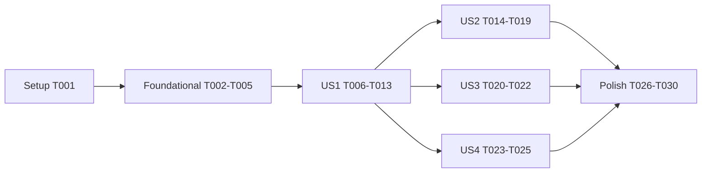

---

description: "Task list for the Home Tab"
---

# Tasks: Home Tab

**Input**: Design documents from `specs/20261103-120521-HOME-TAB/`

**Prerequisites**: plan.md, spec.md, research.md (R1–R14), data-model.md, contracts/api.md (A1–A3), contracts/ui-contracts.md (C1–C6), quickstart.md

**Tests**: included. The plan (R14) and the constitution (Principle IV) call for them, as every feature in this repository has.

**Organization**: tasks are grouped by user story, so each story can be built and checked on its own.

**Authority**: where this file and a supporting document (research.md, data-model.md, contracts/) disagree, this file wins; the tasks below say where they replace a supporting document.

## Format: `[ID] [P?] [Story] Description`

- **[P]**: can run in parallel (different files, no dependency on an unfinished task)
- **[Story]**: US1–US4 from spec.md
- New code carries no comment that cites a requirement, finding or task id (Constitution VI)

---

## Phase 1: Setup (Shared Infrastructure)

- [X] T001 [P] Add `ENV_HOME_TAB_REFRESH_INTERVAL` (default `7200000`, ms, at least `60000`; how long a user's Home list is reused before it is rebuilt) and `ENV_MAX_HOME_PAGE_POLLS` (default `200`, at least `1`; how many of the user's eligible polls a Home rebuild considers, most recent relation first) to the table in `.claude/rules/environment.md`, to every configuration in `launch.json.example`, to `devScripts.example/launch-dev.ps1`, and as a plain value to the `web` service's envs in `.do/app.yaml` (R12)

---

## Phase 2: Foundational (Blocking Prerequisites)

**Purpose**: the setting, the reason type and the counters every story uses

- [X] T002 In `src/config.ts`, add `homeTabRefreshIntervalMs: number` to `AppConfig`, read with `read.int("ENV_HOME_TAB_REFRESH_INTERVAL", 7_200_000)`; a value below `60_000` throws `ConfigError("Invalid ENV_HOME_TAB_REFRESH_INTERVAL: <v> — must be at least 60000.")`, modelled on the `ENV_NEWEST_POLLS_RECOMPUTE_SWEEP_INTERVAL` check; and `maxHomePagePolls: number`, read with `read.int("ENV_MAX_HOME_PAGE_POLLS", 200)`, a value below `1` throwing `ConfigError("Invalid ENV_MAX_HOME_PAGE_POLLS: <v> — must be at least 1.")` (R12, FR-018, FR-018a)
- [X] T003 [P] Extend `tests/config.test.ts`: the default `7200000`, a set value, `59999` → `ConfigError` naming the setting, a non-integer → `ConfigError`; for `ENV_MAX_HOME_PAGE_POLLS` the default `200`, a set value, `0` → `ConfigError` naming the setting
- [X] T004 [P] In `src/polls/userPolls.ts`, export `type HomeReason = UserPollRelation | "trending"` and widen `PersonalTab.relations` to `Map<string, HomeReason[]>` and `OverlayEntry.relations` to `HomeReason[]`; the four existing tabs still put only `UserPollRelation` values in it (R7)
- [X] T005 [P] In `src/refresh/tabVersions.ts`, export `HOME_REBUILT_KEY = "stats:home:rebuilt"` and `HOME_REUSED_KEY = "stats:home:reused"`, counted with the existing `countStat` (R13)

**Checkpoint**: `npx tsc --noEmit` and `npm test` pass; nothing visible has changed.

---

## Phase 3: User Story 1 - A signed-in user sees their current polls in one place (Priority: P1) 🎯 MVP

**Goal**: a signed-in user lands on Home, first in the bar, listing their polls by the five rules, each once, with the reason line.

**Independent Test**: quickstart.md scenarios 1–3: a user with polls in every relation opens `/` and sees Home selected, in rule order, each poll once, with "You were invited · You are watching", "Your poll" and "Trending".

### Tests for User Story 1

- [X] T006 [P] [US1] Create `tests/home-tab.test.ts` (supertest + embedded PostgreSQL, the personal-tab suites' helpers): for `POST /api/tabs/home/refresh`, `401` for a guest; empty listing without View Polls; rule order and first-rule-wins (a poll invited, voted and watched is listed once, in rule 1); order within a rule by that rule's own relation date (a poll invited last month and voted yesterday sits in rule 1 behind a poll invited last week); caps of 10 for rules 1, 2, 3 and 5 and none for rule 4; rule 1 equals Shared With You (a poll the user created is not in it; an Invitation Only poll without a current invitation is not); the date windows — OPEN launched 2 months minus a day listed, plus a day not; CLOSED closed 6 days ago listed, 8 days not; WAITING TO OPEN listed; INITIALIZED, AWAITING APPROVAL, REJECTED, ARCHIVED not; EDITING judged by its stashed state; rule 5 in the published TRENDING listing's order, skipping listed polls, and empty when no listing is cached; overlay `relations` (`["invited","bookmarked"]`, `["created"]`, `["trending"]`); `poll_invitations.accepted_at` unchanged after a Home refresh (FR-007–FR-012, SC-002)
- [X] T007 [P] [US1] Create `tests/client-home-tab.test.ts` (jsdom, `tests/helpers/browser.ts`): a signed-in load selects Home; a guest load selects Trending; a `/?open=…&tab=trending` landing wins over Home; the Home panel shows `EMPTY_LINES.home` when empty; a Home card shows "Your poll" for `created`, "Trending" for `trending`, "You were invited · You are watching" for `["invited","bookmarked"]`, and the Your Polls tab still shows no line (C2, C4, FR-003, FR-005a, FR-006)

### Implementation for User Story 1

- [X] T008 [US1] Create `src/polls/homeTab.ts` exporting `HOME_RULE_CAP = 10`, `HOME_LAUNCH_WINDOW_MONTHS = 2`, `HOME_CLOSED_WINDOW_DAYS = 7` and `loadHomeCandidates(db, email, now, limit)`: one query over `user_polls` joined to `polls` for `email` and `relation in ('invited','linked','created','voted','bookmarked')`, with the eligibility of research R3 in SQL (the stashed state while EDITING; WAITING TO OPEN; OPEN with `launched_at >= now − 2 UTC calendar months`; CLOSED with `closed_at >= now − 7 days`), grouped by poll as `personalTabQuery` does (each poll's relations with each one's `updated_at`), ordered by the poll's most recent relation first, limited to `limit` = `config.maxHomePagePolls` distinct polls; this limit, `ENV_MAX_HOME_PAGE_POLLS`, replaces research.md R2's "5 × `ENV_MAX_POLLS_SEARCH_RESULTS` rows" (R2, R3, FR-018a)
- [X] T009 [US1] In `src/polls/homeTab.ts`, add `composeHomeTab({ db, cache, config }, caller, email, userId, now)`: load the candidates' rows once, then place each pid under the first rule it satisfies — rule 1 `invited`/`linked` with `created_by_id ≠ userId` kept by `sharedWithYouKept`; rule 2 `created`; rule 3 `voted` kept by `reachableMany`; rule 4 `bookmarked` kept by `mayWatchMany`; each capped at `HOME_RULE_CAP` except rule 4, a pid failing a rule's narrowing or meeting a full rule falling through to a later one; within each rule, order the pids by the latest `updated_at` among that rule's own relations (rule 1 `invited`/`linked`, rule 2 `created`, rule 3 `voted`, rule 4 `bookmarked`), not by the pid's newest relation of any kind; then rule 5 from `listing:trending:counts` (`readTrendingObjects`, its `polls` order) skipping listed pids, capped at 10. Return `{ order, relations: Map<pid, HomeReason[]>, rows, trendingReady }`, where `relations` holds every relation the user has to the pid (from the candidates) or `["trending"]` (R4, R7)
- [X] T010 [US1] In `src/routes/tabsApi.ts`, add `POST /api/tabs/home/refresh` with `requireSession` and `...dynamic("refresh")`: without View Polls answer the empty listing as `personalTabRoute` does; otherwise `ensureVersion`, `composeHomeTab`, `writeProjections(rows)`, `personalListing(res, { rows, membershipVersion: now.toISOString(), relations })`, `recordSeen(cache, email, "home", …)` as the personal tabs do, and `sendDelta`. Home never calls `adoptInvitations` or `markAccepted` (A1, R8, FR-012)
- [X] T011 [P] [US1] In `src/public/index.html`, add the Home tab button first in `#tabBar` (C1: `data-tab="home"`, `id="tab-home"`, `aria-controls="panel-home"`, `hidden`, the research R11 house-outline `<svg class="tab-icon" viewBox="0 0 24 24" fill="none" stroke="currentColor" stroke-width="2" stroke-linecap="round" stroke-linejoin="round">`, label `Home`) and its panel first in the panel list (`<section class="tab-panel" data-panel="home" role="tabpanel" id="panel-home" aria-labelledby="tab-home" hidden><div class="card-grid"></div><p class="tab-empty" hidden></p></section>`)
- [X] T012 [US1] In `src/public/tabs.js`: add `"home"` to `PERSONAL_TABS`, to `KIND_OF` (`refresh`) and to `LANDING_TABS`; add `EMPTY_LINES.home` ("Nothing here yet. Polls shared with you, your polls, your votes, the polls you watch and what's trending will appear here."); create the controller in `init` with the other personal tabs (`createDeltaTab("home", "/api/tabs/home/refresh", { showVote: true, showLive: true, tab: "home" })`); in `applyGuestState`, set the Home button's `hidden` to `!signedIn`; end `init` with `select(isSignedIn() ? "home" : "trending")`; update the header comment's tab count (C1, C2, FR-001, FR-003)
- [X] T013 [P] [US1] In `src/public/pollCard.js`, add `created: 'Your poll'` and `trending: 'Trending'` to the reason words of the listed-because line; confirm `deltaClient.js` `toPollDetail` passes `created` and `trending` through unchanged (C4, FR-005a)

**Checkpoint**: T006 and T007 pass; quickstart.md scenarios 1–3 work; every Home refresh still rebuilds the list, and until US2 every refresh resends the whole list (its `membershipVersion` is the refresh time).

---

## Phase 4: User Story 2 - The Home list stays cheap to serve and fresh where it matters (Priority: P1)

**Goal**: the membership is reused per user for the interval, rebuilt on the user's own changes (except while `keepOrder`), and access is re-checked on every refresh.

**Independent Test**: quickstart.md scenarios 4–8 and 13.

### Tests for User Story 2

- [X] T014 [P] [US2] Extend `tests/home-tab.test.ts`: two refreshes within the interval rebuild once (`stats:home:rebuilt` 1, `stats:home:reused` 1) and keep the same `membershipVersion`; a new vote (or watch, invitation, created poll) — through the routes that call `forgetTabs` — rebuilds at the next refresh; `keepOrder: true` after such a change reuses the list, and a later refresh without it rebuilds; an expired membership (clock or TTL advanced past `homeTabRefreshIntervalMs`) rebuilds; with no TRENDING listing the membership's TTL is `trendingPollsRecomputeSweepIntervalMs`; a Home-listed poll made private by invitation (user not invited), archived, or deleted is gone at the next refresh, even with `keepOrder`; a watched poll listed by rule 4 is gone at the next refresh once the user is banned from it, even with `keepOrder`; with `ENV_MAX_HOME_PAGE_POLLS` set to 3, only the 3 polls with the most recent relations are considered; a cache read failure falls back to a rebuild (FR-013–FR-017, SC-003, SC-004)
- [X] T015 [P] [US2] Extend `tests/client-home-tab.test.ts`: after a vote, an added choice, a watch or an unwatch on a Home card the next Home request carries `keepOrder: true`; selecting another tab and Home again, or a fresh page load, sends a request without it; choosing Home again while it is showing keeps `keepOrder`; a bookmark made on another tab marks Home due; after a vote or watch on a Home card its reason line gains "You voted" / "You are watching" before any request returns (C3, clarification Q2, FR-005a)

### Implementation for User Story 2

- [X] T016 [US2] In `src/polls/homeTab.ts`, add `HOME_TAB_KEY(email)` (`home:` + `emailKeyOf(email.toLowerCase())`), `readHomeMembership(cache, email)` and `writeHomeMembership(cache, email, membership, ttlMs)` for the JSON `{ v, builtAt, order, relations, trendingReady }` of data-model.md; a read or parse failure logs `[home] Could not read the Home list:` with the error and returns `null`; a write failure logs `[home] Could not store the Home list:` and is otherwise ignored (R1, R13)
- [X] T017 [US2] In `src/polls/homeTab.ts`, add `homeTabListing(deps, caller, email, userId, version, keepOrder, now)`: reuse the cached membership when it exists and (`v === version` or `keepOrder`), counting `HOME_REUSED_KEY`; otherwise `composeHomeTab`, write it with TTL `homeTabRefreshIntervalMs` (or `trendingPollsRecomputeSweepIntervalMs` when `trendingReady` is false), counting `HOME_REBUILT_KEY`. Then load the listed rows and keep only those that are `isPublished`, in `reachableMany`, and, for rule-1 pids, in `sharedWithYouKept`, and, for rule-4 pids, in `mayWatchMany` (so a ban removes a watched poll at the next refresh, as on Watching); this per-refresh check replaces research.md R5's and data-model.md's shorter list. The candidates come from `loadHomeCandidates` with `config.maxHomePagePolls`, not research.md R2's limit. Return `{ rows, relations, membershipVersion: builtAt }` (R5, R6, FR-013–FR-017)
- [X] T018 [US2] In `src/routes/tabsApi.ts`, make the Home route read `keepOrder` (`req.body?.keepOrder === true`), try `shortcut(email, "home", request)` first as the personal tabs do, and answer from `homeTabListing` instead of calling `composeHomeTab` directly (A1, R8)
- [X] T019 [US2] In `src/public/tabs.js`, give the Home controller a `keepOrder` flag sent in its request body: set it when Home's grid reports a vote or added choice (`applyVote`/`applyAddedChoices` with `name === "home"`) or `toggleBookmark` acts on a pid while Home is active; clear it in `select("home")` only when coming from another tab, and at page load — choosing Home again while it is showing (its tab, the "All tabs" menu or the avatar menu) leaves it set (this replaces the first row of contracts/ui-contracts.md C3); make `placeBookmark` and a vote on another tab call `controllers.home.markDue()` (C3, R6)

**Checkpoint**: T014 and T015 pass; quickstart.md scenarios 4–8 and 13 work.

---

## Phase 5: User Story 3 - The avatar menu leads to Home (Priority: P2)

**Goal**: Home is the avatar menu's first item on every page, for every signed-in user.

**Independent Test**: quickstart.md scenarios 9 and 10.

- [X] T020 [P] [US3] Create `tests/client-home-menu-item.test.ts` (jsdom): the first `.avatar-menu` item is "Home" with `href="/?tab=home"` for a user with and without the Create Poll grant; on a page without `window.Tabs` the link navigates; on `/` with `window.Tabs.select` stubbed, a click calls it with `"home"`, closes the menu and does not navigate; a guest header has no Home item (C5, FR-021, FR-022)
- [X] T021 [US3] In `src/public/app.js`, add `HOME_GLYPH` (the circle in `currentColor` with the research R11 house outline stroked in `var(--paper)`) and, first in `renderSiteHeader`'s menu, `<a href="/?tab=home">` filled with `fillMenuItem(link, HOME_GLYPH, "Home")`; its click, when `window.Tabs` exists, prevents the default, closes the menu and calls `window.Tabs.select("home")` (C5, R10)
- [X] T022 [US3] Run `tests/client-create-poll-item.test.ts`, `tests/client-site-settings.test.ts`, `tests/client-m3-header.test.ts`, `tests/client-home.test.ts` and `tests/pages.test.ts`; update any assertion that pins the avatar menu's first item or item count to include Home first (BC1)

**Checkpoint**: T020 passes; quickstart.md scenarios 9 and 10 work.

---

## Phase 6: User Story 4 - Guests do not see Home (Priority: P2)

**Goal**: no Home tab or menu entry for guests, and Trending on sign-out.

**Independent Test**: quickstart.md scenarios 11 and 12.

- [X] T023 [P] [US4] Extend `tests/client-home-tab.test.ts`: a guest sees no visible Home tab and the "All tabs" menu lists none; `/?tab=home` as a guest selects Trending; arrow keys skip the hidden tab; signing out while on Home hides it and selects Trending; signing in shows it (C1, C2, FR-002, FR-004, FR-023)
- [X] T024 [US4] In `src/public/tabs.js`: `select("home")` for a guest selects Trending instead of going to `/login`; `applyGuestState` selects Trending when Home is active and the user signed out; `moveTabFocus` skips tabs with `hidden` (R9)
- [X] T025 [P] [US4] In `src/public/tabBarScroll.js` `buildTabMenu`, skip tabs whose `hidden` is true (R9)

**Checkpoint**: T023 passes; quickstart.md scenarios 11 and 12 work.

---

## Phase 7: Polish & Cross-Cutting Concerns

- [X] T026 [P] In `postman/openapi.json`, add `POST /api/tabs/home/refresh`, tagged `home`, beside `/api/tabs/your-votes/refresh`, with the optional `keepOrder` request field and the personal tabs' responses (A1); `tests/openapi-contract.test.ts` passes
- [X] T027 [P] Update the suites that count or list the tab bar's tabs (`tests/tab-bar-assets.test.ts`, `tests/client-tabs-026.test.ts`, `tests/client-tab-bar-scroll.test.ts`, `tests/m3-assets.test.ts` if it pins `index.html`) for the ninth tab, first in the bar (BC2)
- [X] T028 Run `npx tsc --noEmit` and `npm test`; fix any regression
- [X] T029 Walk quickstart.md scenarios 1–14 against a local run, including the Light and Dark contrast of the Home icons and reason line (SC-007)
- [X] T030 [P] After implementation, update `README.md` (the Home tab, its rules and the avatar menu item) and `ARCHITECTURE.md` (the Home membership on the refresh path: built on demand, `home:<emailKey>`, the interval and `keepOrder`), per the constitution's Documentation Deliverables

---

## Dependencies & Execution Order

- **Setup (T001)** → **Foundational (T002–T005)** → user stories.
- **US1** depends on Foundational.
- **US2** depends on US1 (T009 `composeHomeTab`, T010 the route, T012 the controller).
- **US3** depends on US1's tab (T011, T012) to have somewhere to go; its menu code is independent.
- **US4** depends on US1 (T011, T012).
- **Polish** comes last.



### Within each story

The tests are written first and fail; then server, then client.

## Parallel Opportunities

- Foundational: T003, T004, T005 beside T002.
- US1: T006, T007, T011, T013 touch different files; T008 → T009 → T010 in sequence; T012 after T011.
- US2: T014 and T015 together; T016 → T017 → T018 on the server, T019 on the client beside them.
- US3 and US4 can run beside US2, by a second developer; within US4, T025 beside T024.
- Polish: T026, T027 and T030 together.

### Parallel example: User Story 1

```text
T006 tests/home-tab.test.ts          T007 tests/client-home-tab.test.ts
T011 src/public/index.html           T013 src/public/pollCard.js
```

## Implementation Strategy

1. **MVP**: Setup, Foundational and US1: Home lists the right polls, rebuilt on each refresh.
2. Add US2 before shipping: the per-user membership, `keepOrder` and the per-refresh access check are what make Home cheap and steady.
3. Add US3 (menu item) and US4 (guest hiding); both are small and independent.
4. Polish: OpenAPI, the tab-count suites, the full test run, the quickstart walk, then README.md and ARCHITECTURE.md.
