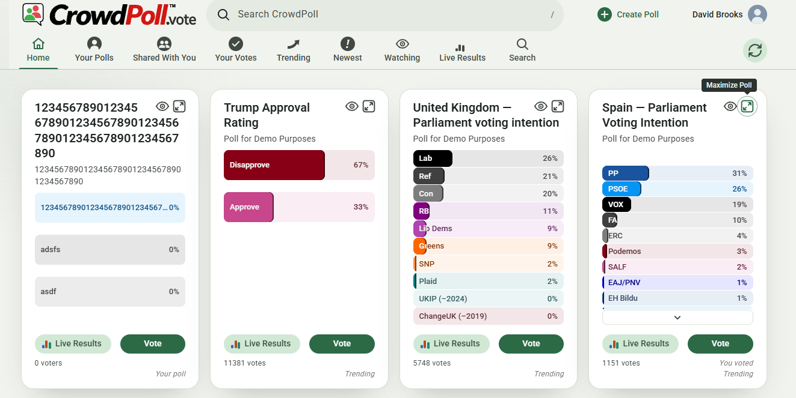

# Overview: `specs/20261103-120521-HOME-TAB`

## Document History

| Record | Value |
|---|---|
| Feature directory | `specs/20261103-120521-HOME-TAB` |
| Tweak file created | 2026-11-03 15:31 |
| Last updated | 2026-11-03 16:33 |

Legend: `[ ]` open · `[X]` Resolved · `[-]` Resolved (manually)  
(or accepted as-is) by the developer.
Tick `Run Tests` to have this tweak's automated tests written and run; leave it empty (the default) to postpone the run.

"Next" always returns the first `[ ]` item below.

The developer is expected to create the individual tweak requirements in this file, and then run the `/speckit-tweak` command to have the AI implement them, one at a time.  
Each tweak requirement initially carries an empty checkbox; tick it when the item is resolved or consciously accepted.  


# Tweaks

## TWEAK01 Voted Poll Listed After Trending  
[-] Resolved (manually)  
[ ] Run Tests  


On our first manual test, we observed that 2 "Trending" Polls appeared before a "You Voted" poll.  
research.md  - ## R4. Assigning rules, caps and rule 5
says:
```text
- **Decision**: `composeHomeTab` walks the candidates in `updated_at desc` order and puts each pid in the first rule its relations satisfy, in rule order:
  1. `invited` or `linked`, created by someone else, and kept by `sharedWithYouKept` (private; an Invitation Only poll needs a current invitation) — cap 10;
  2. `created` — cap 10;
  3. `voted`, kept by `reachableMany` — cap 10;
  4. `bookmarked`, kept by `mayWatchMany` — no cap of its own (bounded by `ENV_MAX_BOOKMARKS_PER_USER`, AM1 A);
```



### CLARIFICATIONS

The screenshot's fourth card, "Spain — Parliament Voting Intention", shows "You voted" with the reason "Trending", so Home placed it by rule 5, not rule 3.  
The code can do that, as specified, in two ways, and they need different tweaks:  

1. **The date window (FR-009, research R3).**  
   Rules 1–4 keep an OPEN poll only when its `launched_at` is within the last 2 months, and a null `launched_at` is never eligible.  
   Rule 5 (TRENDING) applies no window.  
   A demo poll opened more than 2 months ago, or before `launched_at` existed (there was no back-fill, and it stays null until the poll is next opened), therefore drops out of rule 3 and comes back through Trending.  
2. **`keepOrder` (R5, clarification Q2).**  
   If you voted on Spain from the Home tab during this visit, Home kept its list on purpose, so the card did not jump.  
   It moves to rule 3 the next time Home is opened from another tab or the page is reloaded.  

- **Q1**: Did you vote on Spain from the Home tab during this visit, and does Spain move ahead of the Trending cards after you open another tab and then Home again (or reload)?  
- **Q2**: When was Spain last opened?  
  This read-only query answers it: `select id, poll_state, launched_at, closed_at from polls where title like 'Spain%';`  
  A `launched_at` that is null or older than 2026-09-03 means cause 1.  
- **Q3**: If it is cause 1, which do you want?  
  - **A**: Keep FR-009 as written.  
    The poll stays under Trending, and the demo polls are re-opened (or `launched_at` is back-filled) so they fall inside the window.  
  - **B**: Change the rule, so a poll you voted on, created, were shared or watch is placed by its own rule even outside the date window when it is also in TRENDING.  
    This changes FR-009, research R3 and R4, and `composeHomeTab`.  
  - **C**: Apply the date window to rule 5 too, so an old Trending poll is not listed at all.  
  - **D**: Something else; describe it.  

Asked 2026-11-03 15:52  

- **A1** (developer, 2026-11-03 15:54): No, the vote on Spain was not cast today.  
  That rules out `keepOrder` (cause 2), so cause 1, the date window, is the likely one.  
  Q2 and Q3 are still open.  

- **A2** (developer, 2026-11-03 15:58): Spain (`850830cc-8672-4934-94cb-06f26cc7ac6d`) is `OPEN` with `launched_at` 2025-09-07 00:00 -04.  
  That is about 14 months ago, well outside the 2-month window, so cause 1 is confirmed.  
  Rule 3 leaves the poll out as FR-009 requires, and rule 5 lists it.  
  Q3 is still open.  

### ACCEPTED RECOMMENDATION

- **Resolution**: resolved by the developer ("we resolved it", 2026-11-03 16:33), who did not say how.  
- **Detected**: no change to the repository.  
  No source, test, spec, research, contract or documentation file changed after the clarifications were recorded (last write 15:58).  
  The cause was data, not code: Spain (`850830cc-8672-4934-94cb-06f26cc7ac6d`) was `OPEN` with `launched_at` 2025-09-07, outside the 2-month window, so FR-009 kept it out of rule 3 and rule 5 listed it.  
  A fix outside the repository, such as reopening the poll so it gets a new `launched_at`, matches Q3 option A, but that is not confirmed.  
- **Behaviour**: unchanged; FR-009 and research R3 and R4 stand as written.  
- **Tests**: none added, since no code changed; existing coverage of the windows is in `tests/home-tab.test.ts`; none run (Run Tests not ticked).  
- **Artifacts**: none needed.  

2026-11-03 16:33  

## TWEAK02 <short title here>  
[ ] Resolved  
[ ] Run Tests  
tweak requirements...  
