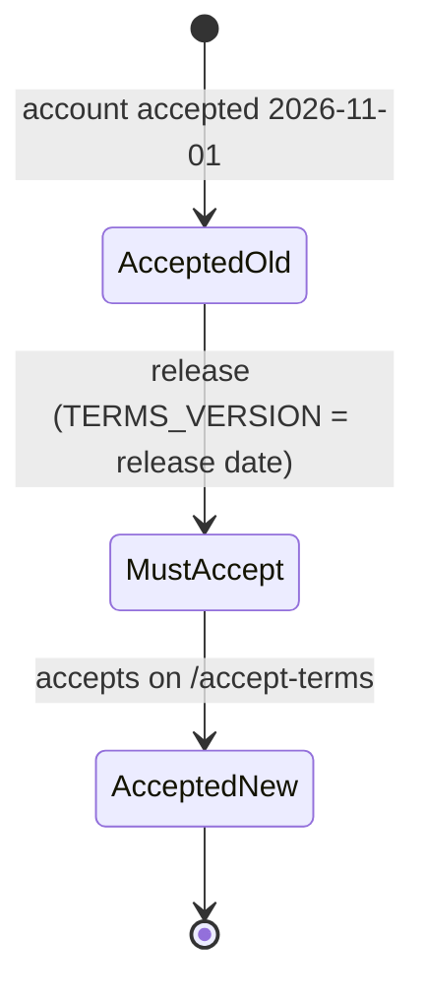

# Data Model: Legal Page Updates

No migration, table, column, cache key, cookie or browser storage key changes.

## Policy version (existing)

- **Where**: `TERMS_VERSION` in `src/legal/version.ts`, printed as `Version <value>` on `/privacy` and `/terms`; each account's accepted value is `user.terms_version`, read into the session as `termsVersion` (`src/auth/sessionCache.ts`).
- **Change**: the value becomes the release date, `YYYY-MM-DD` (research R8).
- **Rule (unchanged)**: an account whose `termsVersion` differs from `TERMS_VERSION` is sent to `/accept-terms` by the terms gate; accepting stores the current value.
- **State transition**:

## History entry number (page memory, new)

- **Where**: `history.state.legalDepth` on the legal pages' own history entries, written only by `backArrow.js` (research R2).
- **Values**: a whole number ≥ 0; 0 is the entry the visitor arrived on, each in-page anchor step adds 1.
- **Lifetime**: the tab's history entry; never sent to the server, never read by another page, not a cookie or storage key (FR-018).
- **Rule**: pressing the arrow goes back `legalDepth + 1` entries; an entry without a number gets the last known number plus 1; any other keys a page put in `history.state` are kept.
