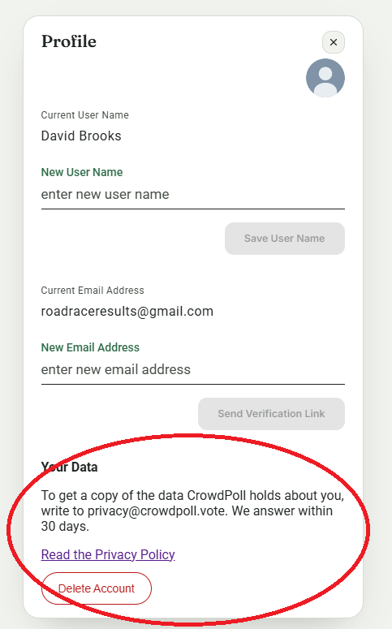
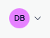
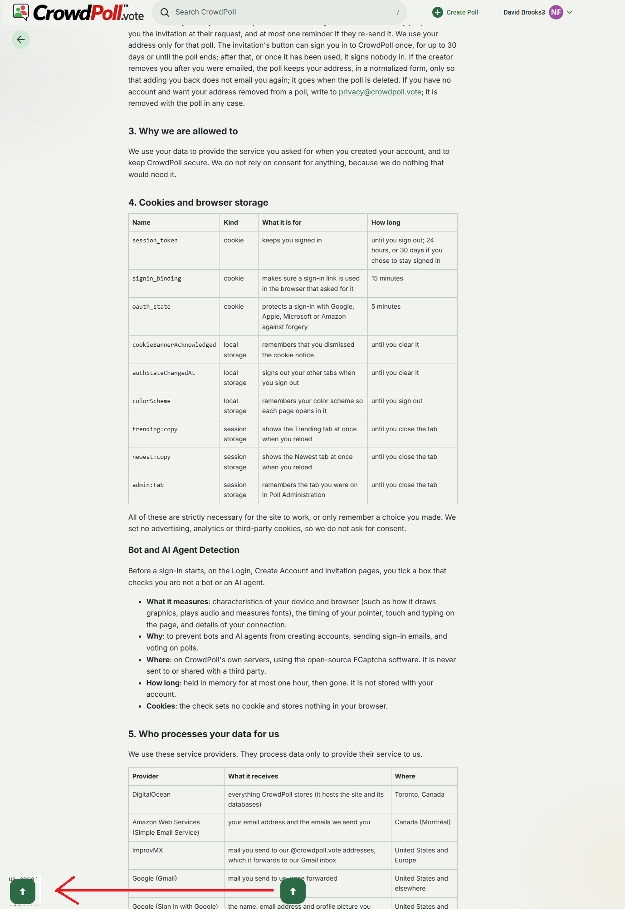
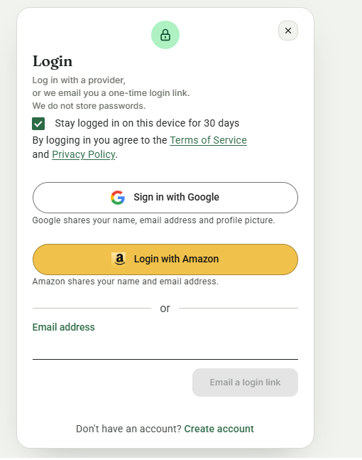
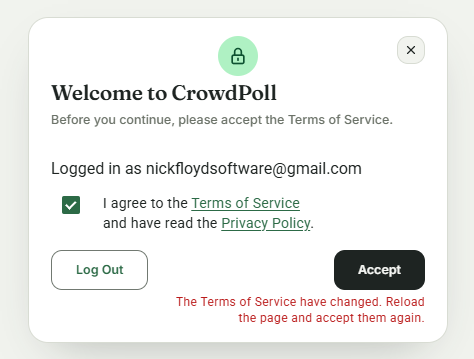

# Overview: `specs/20261105-161242-SOCIAL-LOGIN-AVATAR`

## Document History

| Record | Value |
|---|---|
| Feature directory | `specs/20261105-161242-SOCIAL-LOGIN-AVATAR` |
| Tweak file created | 2026-11-05 21:08 |
| Last updated | 2026-11-06 14:13 |

Legend: `[ ]` open · `[X]` Resolved · `[-]` Resolved (manually)  
(or accepted as-is) by the developer.
Tick `Run Tests` to have this tweak's automated tests written and run; leave it empty (the default) to postpone the run.

"Next" always returns the first `[ ]` item below.

The developer is expected to create the individual tweak requirements in this file, and then run the `/speckit-tweak` command to have the AI implement them, one at a time.  
Each tweak requirement initially carries an empty checkbox; tick it when the item is resolved or consciously accepted.  


The developer reported that all manual tests have passed and the tweaks are done (2026-11-06 13:57).  

The full test run after the tweaks had 3 failures and 1 unhandled error, fixed in T056 (2026-11-06 14:13).  

# Tweaks

## TWEAK01 Remove Your Data Section From Profile  
[X] Resolved  
[ ] Run Tests  

Remove the "Your Data section" from the profile page.
Circled in red in this image:
 

### RECOMMENDATION

The circled area includes the **Delete Account** button, which is the site's only way to delete an account.
The Privacy Policy also sends people to it: "Delete your account: on your Profile page, under Your Data".
So there are two reasonable readings.

- **Option A (recommended)**: remove the heading, the copy sentence and the policy link, and keep the Delete Account button at the bottom of the card.
  - Change `src/public/profileCard.js`: drop those three elements; keep the `profile-your-data` class off the section, which holds only the button.
  - Change `src/public/profile-editor-m3.css`: remove the two `.profile-your-data` rules.
  - Change `src/public/privacy.html` line 152 to "on your Profile page"; line 156 already says how to ask for a copy.
  - Change `README.md` line 144 to match.
  - Tests, written but not run: rework `tests/client-delete-account.test.ts` so the section's text is gone and Delete Account still opens the dialog.
  - <u>Pros</u>: people can still delete their account themselves, and the policy stays true; the page is shorter.
  - <u>Cons</u>: the button stays, inside the area you circled.

- **Option B**: remove everything circled, including Delete Account.
  - The same edits, plus removing the delete dialog (`openDeleteDialog`), its tests and `.profile-delete-btn`.
  - `src/public/privacy.html` line 152, `README.md`, and the spec's User Story 5 and SC-006 would say deletion is by writing to privacy@crowdpoll.vote.
  - `DELETE /api/me` would stay, with nothing calling it, or be removed as a separate decision.
  - <u>Pros</u>: exactly what is circled.
  - <u>Cons</u>: people can no longer delete their own account, so each request becomes manual work for you, and every deleted picture depends on it.

Option A is recommended because the requirement names the section, and the button is the one part with a purpose of its own.
2026-11-06 05:10

### ACCEPTED RECOMMENDATION

Developer's resolution, given in chat in place of Options A and B: remove everything circled, and reach Delete Account from the Privacy Policy.

- `src/public/profileCard.js`: the Your Data section is gone (heading, copy sentence, policy link and button).
  `/profile#delete-account` opens the delete dialog once the card is drawn, and the hash is removed, so a reload does not reopen it.
  Closing the dialog puts focus on the New User Name field.
- `src/public/profile-editor-m3.css`: the two `.profile-your-data` rules are removed; `.profile-delete-btn` stays for the dialog's button.
- `src/public/privacy.html` section 8: "Delete your account" is a link to `/profile#delete-account`, and "on your Profile page, under Your Data." is gone.
  The line's wording now follows the developer's text: "get around the ban" and "can be removed by request at".
- `README.md`: the Your data bullet follows.
- Tests: `tests/client-delete-account.test.ts` reworked: no section, no button, the dialog opens from the hash and removes it, the policy's link, and focus after closing.
  Tests postponed (Run Tests not ticked); they were not run, so this tweak is unverified by a run.
- Artifacts: `contracts/ui-contracts.md` (C6, new C7), `spec.md` (FR-029), `plan.md`, `quickstart.md` (Q9), `tasks.md` (T040).

2026-11-06 05:34

## TWEAK02 Explain The Suites In The Quickstart  
[X] Resolved  
[ ] Run Tests  

The quickstart.md says:  
```
The suites stand in for Google's picture host and for Spaces, so neither is needed.
```  

What is "the suites" referring to in the quickstart.md?

### RECOMMENDATION

"The suites" means the automated test files in `tests/`, which `npm test` runs with Vitest; the ones for this feature are `tests/profile-picture.test.ts` and the `client-*` suites.
They use fakes in place of Google's picture host and Spaces: a stubbed `fetch` and a fake object store.
Reword the sentence in `quickstart.md` so it says this plainly.
2026-11-06 05:41

### ACCEPTED RECOMMENDATION

- `quickstart.md`: the sentence now reads "`npm test` runs the automated test files in `tests/`. They use fakes in place of Google's picture host and Spaces, so neither is needed."
- Tests: none, since this is a documentation-only change that no test can observe.

2026-11-06 05:41

## TWEAK03 Add A Down Icon Beside The Profile Icon  
[X] Resolved  
[ ] Run Tests  

Please add a "down icon" to the left of the profile icon to indicate the dropdown menu.  
This is a typical way to indicate that the profile icon has a dropdown menu associated with it.



### RECOMMENDATION

Put a down chevron inside the avatar button, immediately to the left of the avatar, so clicking either one opens the menu.  
Draw it as an inline SVG in `currentColor`, hidden from screen readers; the button already announces its menu with `aria-haspopup` and its "open menu" name.  
The written requirement says left, while `image-1.png` shows the chevron on the right; this follows the written requirement, and moving it is a one-line change.  
2026-11-06 05:46

### ACCEPTED RECOMMENDATION

- `src/public/app.js`: `.avatar-btn` now holds the chevron, then the avatar.  
- `src/public/header-tab-bar-m3.css`: the button centres its two parts with a 4px gap and takes `on-surface-variant` for the chevron's colour, which is 20px square.  
- Tests: `tests/client-m3-header.test.ts` checks that the chevron comes first, directly before the avatar, and is hidden from screen readers.  
  Tests postponed (Run Tests not ticked); they were not run, so this tweak is unverified by a run.  
- Artifacts: `contracts/ui-contracts.md` (new C8), `spec.md` (FR-030), `plan.md`, `tasks.md` (T041).  

2026-11-06 05:46

## TWEAK04 Move The Down Icon Right Of The Picture  
[X] Resolved  
[ ] Run Tests  
Out mistake.  
We should have asked for the chevron to be to the right of the Profile picture.

### RECOMMENDATION

Keep the chevron inside the avatar button, and put it after the avatar instead of before it.  
Change the order in `src/public/app.js`, update the order check in `tests/client-m3-header.test.ts`, and say "right" in the artifacts.  
The styles need no change, because the gap and the centring work in either order.  
2026-11-06 05:56

### ACCEPTED RECOMMENDATION

- `src/public/app.js`: `.avatar-btn` now holds the avatar, then the chevron.  
- Tests: `tests/client-m3-header.test.ts` checks that the chevron comes directly after the avatar and is hidden from screen readers.  
  Tests postponed (Run Tests not ticked); they were not run, so this tweak is unverified by a run.  
- Artifacts: `contracts/ui-contracts.md` (C8), `spec.md` (FR-030), `tasks.md` (T041).  

2026-11-06 05:56

## TWEAK05 Confirm What Quickstart Q3 Checks  
[X] Resolved  
[ ] Run Tests  
For quickstart Q3, is this what we should be checking?  
The URL is:
https://crowdpoll-cdn.tor1.digitaloceanspaces.com/avatars/80d25c562563859c3ba703099330c6e0

### RECOMMENDATION

Yes, that address is what Q3 should find: an `avatars/` object is stored only after the host rule accepts Google's address, so Q3 passes for this picture.  
Requests on 2026-11-06 returned `200`, `image/png`, 1,045 bytes and `Cache-Control: public, max-age=86400, immutable`.  
The address is the Spaces bucket rather than the CDN, because the local `.vscode/launch.json` sets `ENV_SPACES_CDN_URL` to the bucket's address; Terraform sets the CDN's address in production.  
The same object loads through `https://crowdpoll-cdn.tor1.cdn.digitaloceanspaces.com`, and a second request there was a cache `HIT`.  
The root address of both hosts answers `403`, so nothing is listed.  
Q3's wording does not say what to look at, so reword it in `quickstart.md`, and say there which address the CDN checks need.  
2026-11-06 06:04

### ACCEPTED RECOMMENDATION

- `quickstart.md`: Q3 now names the address to read and the log line to check; the Manual checks introduction gives the CDN's address and how to tell it from the bucket's.  
- `.vscode/launch.json`: unchanged, since it is the developer's git-ignored file.  
  Q1, Q4 and Q9 go through the CDN, so they need `ENV_SPACES_CDN_URL` changed there first.  
- Tests: none, since this is a documentation-only change that no test can observe.  

2026-11-06 06:04

## TWEAK06 Move The Sign-In Snackbar To The Top  
[X] Resolved  
[ ] Run Tests  
The Snackbar appeared but we had to try a few times befofe we noticed it at the bottom of the page.  
Please move it to the top of the page so it is immediately visible.  
It is okay if it obscure the heading temporarily.

### RECOMMENDATION

Show the "Signed in as" snackbar at the top of the screen, 16px from the edge and centred, above the fixed header.  
Use a new `.m3-snackbar--top` class in `src/public/snackbar-m3.css`, so the admin page's snackbar, which shares the base rule, stays at the bottom.  
Its stacking needs no change: the snackbar's `z-index` of 50 is already above the header's 41.  
Tests, written but not run: `tests/client-sign-in-notice.test.ts` and `tests/m3-assets.test.ts`.  
2026-11-06 06:17

### ACCEPTED RECOMMENDATION

- `src/public/snackbar-m3.css`: new `.m3-snackbar--top`, which also slides in from above.  
- `src/public/app.js`: the sign-in notice uses it.  
- Tests: `tests/client-sign-in-notice.test.ts` checks the class, and `tests/m3-assets.test.ts` checks the rule.  
  Tests postponed (Run Tests not ticked); they were not run, so this tweak is unverified by a run.  
- Artifacts: `spec.md` (the clarification, User Story 3's scenario, FR-022), `contracts/ui-contracts.md` (C4, C5), `research.md` (R8), `quickstart.md` (Q5), `tasks.md` (T042).  

2026-11-06 06:17

## TWEAK07 Move Back To Top To The Container's Left  
[X] Resolved  
[ ] Run Tests  

Move the "Back to top" icon to the left of the webapp container,  
as shown in the image below.
This applied to anywhere the "Back to top" icon appears.


### RECOMMENDATION

Move the button to the left edge of the site's container, in line with the header's logo, as `image-2.png` shows.  
Every page shares `src/public/back-to-top-m3.css`, so one rule covers them all.  
Use the header's gutters: 20px inside the 1280px container, and 14px below 640px.  
Tests, written but not run: `tests/back-to-top-sheet.test.ts`.  
2026-11-06 06:30

### ACCEPTED RECOMMENDATION

- `src/public/back-to-top-m3.css`: the centring is replaced by the left position, with the narrower gutter below 640px.  
- Tests: `tests/back-to-top-sheet.test.ts` checks both positions and that the centring is gone.  
  Tests postponed (Run Tests not ticked); they were not run, so this tweak is unverified by a run.  
- Documents: `README.md`, `ARCHITECTURE.md`, `CLAUDE.md` and `CLAUDE_COMPLETE.md`.  
- Artifacts: `contracts/ui-contracts.md` (new C9), `spec.md` (FR-031), `plan.md`, `tasks.md` (T043).  

2026-11-06 06:30

## TWEAK08 Add Delete Account To The Footer  
[X] Resolved  
[ ] Run Tests  

Add "Delete Account" link to the site's footer as shown in the image below.


### RECOMMENDATION

The footer appears on every page for everyone, including signed-out visitors, and they have no account to delete.  
A signed-out visitor who follows the link goes to `/login` and then lands on home, not the dialog.  
So the question is who sees the link.

Both options add the link to `renderSiteFooter` in `src/public/app.js`, after Cookie Use, using the footer's usual `·` separator.  
Both also make `src/public/profileCard.js` listen for `hashchange`, because clicking the link while already on `/profile` does not reload the page, so the dialog would not open.  
Tests in both, written but not run: `tests/client-footer.test.ts` and `tests/client-delete-account.test.ts`.  
Artifacts in both: `contracts/ui-contracts.md`, `spec.md`, `tasks.md`, `quickstart.md` and `README.md`.

- **Option A (recommended)**: signed-in users only.  
  The link and its separator stay hidden until the session is known, and hide again on sign-out.  
  - <u>Pros</u>: nobody meets a link that does nothing for them, and search engines do not find it on public poll pages; the Home tab already hides from guests in the same way.  
  - <u>Cons</u>: a few more lines in `app.js`, and a signed-out person must sign in before they see it.

- **Option B**: everyone, exactly as the image shows.  
  - <u>Pros</u>: the smallest change, and the footer is the same for everyone.  
  - <u>Cons</u>: a signed-out visitor who follows it signs in and lands on home, with no dialog.

2026-11-06 06:34

### ACCEPTED RECOMMENDATION

Option A, by "accept a": signed-in users only.

- `src/public/app.js`: the footer's first line gains " · Delete Account" after Cookie Use, hidden until the session is known and again after signing out.
- `src/public/profileCard.js`: the dialog also opens on `hashchange`, for the link followed while already on `/profile`.
- `README.md`: the footer's entry says so.
- Tests: `tests/client-footer.test.ts` covers a guest and a signed-in user, and `tests/client-delete-account.test.ts` covers `hashchange`.
  Hiding the link after signing out has no test of its own.
  Tests postponed (Run Tests not ticked); they were not run, so this tweak is unverified by a run.
- Artifacts: `contracts/ui-contracts.md` (new C10), `spec.md` (FR-029, new FR-032), `plan.md`, `quickstart.md` (Q9), `tasks.md` (T044).

2026-11-06 06:36

## TWEAK09 Change The Back To Top Button's Color  
[X] Resolved  
[ ] Run Tests  

Change the color of the "Back to top" icon to the specified hex code.
#3A8C5D

### RECOMMENDATION

Make the button's background `#3A8C5D`, and keep the arrow as it is.
The background is the part to change because an arrow in `#3A8C5D` on the current `#2C6A46` would be hard to see; the new colour also separates the button from the footer, which uses `#2C6A46` and hid it in `image-3.png`.
The value is written directly in `src/public/back-to-top-m3.css`, since no token holds it, like the sign-in buttons' brand colours.
Contrast is enough for an icon, at least 3:1: the white arrow is 4.1:1 in the light scheme, and the dark arrow is 3.2:1 in the dark scheme.
Against the footer, the button is only 1.6:1 in the light scheme and 2.4:1 in the dark scheme, so it is easier to tell apart but still a close match.
Tests, written but not run: `tests/back-to-top-sheet.test.ts`.
2026-11-06 06:43

### ACCEPTED RECOMMENDATION

- `src/public/back-to-top-m3.css`: the background is `#3A8C5D` in both colour schemes.
- Tests: `tests/back-to-top-sheet.test.ts` checks the background and the arrow's colour.
  Tests postponed (Run Tests not ticked); they were not run, so this tweak is unverified by a run.
- Artifacts: `contracts/ui-contracts.md` (C9), `spec.md` (FR-031), `tasks.md` (T045).

2026-11-06 06:43

## TWEAK10 Stay Signed In For Provider Sign-Ins  
[X] Resolved  
[ ] Run Tests  
Question: when the user signs in with a social provider, 
does the "Stay signed in on this device for 30 days" apply?  
It is greyed out unless the user signs in with an email address.

### CLARIFICATIONS

The question in this tweak has an answer: no, "Stay signed in" does not apply to a provider sign-in.
The provider buttons send only the provider and `callbackURL` (`startSignin` in `src/public/loginCard.js`), so the box's value never reaches the server.
Only the emailed link's route reads `staySignedIn` (`src/routes/api.ts`).
A provider sign-in therefore always gets BetterAuth's default: a 24-hour session whose cookie survives closing the browser.
This comes from reading the code; it was not observed in a real sign-in.
The box being greyed out until an address is typed is deliberate (`syncEnabled`), and it fits this behaviour.

Two questions before anything changes:

1. **How long should a provider sign-in last?**
   - A: leave it at 24 hours, and change nothing.
   - B: always 30 days, with no box, since the person has no chance to choose.
   - C: honour the box, which must then be available without an address and be carried through the provider's redirect.
2. **Do you want what the title and `image-4.png` show?**
   The title says "Move "Shares" Text Under Provider Button", but the text below it asks only the question above, and the image is not linked from it.
   The image shows each provider's sentence directly under its own button, with no Privacy Policy link in the sentence.
   The line is one paragraph under all the buttons today, and contract C2 and quickstart Q7 require that link.
   - Yes, and keep the link: where should it go?
   - Yes, and drop the link.
   - No, the title is left over.

2026-11-06 06:54

Developer's answers: 1C, "the user chooses to stay signed in for 30 days, for any way of signing in"; 2, "the title was incorrect".
2026-11-06 07:00

### RECOMMENDATION

Honour the box on provider sign-ins, and correct the title.
On the Login card, put the box above the provider buttons when there are any, available with no address typed, because under the email field it reads as applying to email alone.
Carry the choice in BetterAuth's OAuth state (`additionalData`), so it needs no new cookie or URL parameter, and read it in the callback hook for both callback routes.
A ticked box gets the emailed link's 30-day session and cookie; a clear box gets its browser-session cookie and 24-hour session.
Tests, written but not run: `tests/oauth-providers.test.ts`, `tests/client-oauth-login.test.ts` and `tests/client-invite-card.test.ts`.
2026-11-06 07:00

### ACCEPTED RECOMMENDATION

- `src/auth/auth.ts`: the after hook now runs on both callback routes, and shapes the session and cookie; a failure leaves the 24-hour session and never stops the sign-in.
- `src/public/loginCard.js`: one box, above the provider buttons when there are any; it is kept when the human check is asked again after a provider button.
- `src/public/inviteCard.js`: its box, already above the buttons, now reaches the provider sign-in.
- `postman/openapi.json`, `README.md`, `ARCHITECTURE.md`, `CLAUDE.md` and `CLAUDE_COMPLETE.md` follow.
- Tests: the three files above cover a ticked box with Google and Amazon, a clear box, the box's place, and the invitation card.
  Tests postponed (Run Tests not ticked); they were not run, so this tweak is unverified by a run.
- Artifacts: `contracts/ui-contracts.md` (new C11), `spec.md` (FR-033), `plan.md`, `quickstart.md` (new Q10), `tasks.md` (T046).

2026-11-06 07:00

## TWEAK11 Change "Sign in" to "Log in"  
[X] Resolved  
[ ] Run Tests  
Change "Sign in" text everywhere in the code base to "Log in".

### RECOMMENDATION

Change the wording everywhere it is text: pages, emails, API messages, logs, comments, tests and documents, using "log in", "logged in" and, as a noun, "login".
Leave four things that are not wording or are not ours to change.

- The "Sign in with Google", "Sign in with Apple" and "Sign in with Microsoft" buttons, because those providers set that wording in their branding rules.
- BetterAuth's `/api/auth/sign-in/*` routes, which the library defines.
- Identifiers and file names such as `ENV_SIGNIN_METHOD`, `signin_binding` and `confirm-signin.html`, because renaming them would break configuration, cookies and links.
- Earlier features' specs and requirements, and migrations, which are records of what was done.

"Sign out" is not part of this request, so it stays.
Tests, written but not run: the same change in every test that pins the wording, and new `tests/login-wording.test.ts`.
2026-11-06 07:03

### ACCEPTED RECOMMENDATION

- 751 wordings changed in 124 files, across `src`, `tests`, `postman/openapi.json`, `devScripts`, `fcaptcha-server`, `infra`, `.claude/rules`, the root documents and this feature's artifacts.
- `tests/fixtures/email-messages-before-heading-line-2.json`: changed too, because `tests/email-layout.test.ts` compares the emails with it.
- `src/public/privacy.html` and `src/public/terms.html` change in wording only, under the new `TERMS_VERSION` this feature already brings.
- Tests: new `tests/login-wording.test.ts` checks the pages and the emails.
  Tests postponed (Run Tests not ticked); they were not run, so this tweak is unverified by a run.
- Artifacts: `contracts/ui-contracts.md` (new C12), `spec.md` (FR-034), `tasks.md` (T047), with the wording changed throughout this feature's artifacts except this file.

2026-11-06 07:03

## TWEAK12 Rearrange The Login Card's Provider Text  
[X] Resolved  
[ ] Run Tests  

On the Login Page:
1. move the "Shares with.." text for each provider to under the provider's button  (since it applied to any way of logging in).
2. move the "Stay logged in..." and "By logging in..." text above the Provider button (since it applied to any way of logging in).
3. Remove the 
Privacy Policy" link from the "Shares with..." text, since it is now under the provider's button.

See the screenshot below:


### RECOMMENDATION

Rearrange the Login card as `image-5.png` shows, when it has provider buttons.
The order becomes the "Stay logged in" box, the "By logging in" line, then each provider's button with its own sentence directly under it.
The Privacy Policy link leaves the sentences; the "By logging in" line still links to the Privacy Policy, which keeps the link FR-020 requires.
With the email form alone there are no provider buttons, so that layout does not change.
The tweak names only the Login page, so the invitation card keeps its one line under the buttons, with its Privacy Policy link.
Tests, written but not run: `tests/client-oauth-login.test.ts`.
2026-11-06 09:09

### ACCEPTED RECOMMENDATION

- `src/public/loginCard.js`: the "By logging in" line moves above the buttons when there are provider buttons, and each button sits in a row with its sentence.
- `src/public/cardShell.js`: new `addProviderSharing`, used by the Login card; `addOauthSharing` stays for the invitation card.
- `src/public/card-shell-m3.css`: spacing for the rows and for the gap above the first button.
- `README.md`, `ARCHITECTURE.md`: both say where each card shows this.
- Tests: `tests/client-oauth-login.test.ts` checks each sentence is under its own button with no link, and that the line sits above the buttons.
  Tests postponed (Run Tests not ticked); they were not run, so this tweak is unverified by a run.
- Artifacts: `contracts/ui-contracts.md` (C2), `spec.md` (User Story 2, FR-020, new FR-035), `quickstart.md` (Q7), `tasks.md` (T048).

2026-11-06 09:09

## TWEAK13 Date The Privacy Policy Today For Testing  
[X] Resolved  
[ ] Run Tests  

For testings, please update the Privacy Policy date to today's date.

### RECOMMENDATION

Set the Privacy Policy's "Last updated" to 6 November 2026, and move `TERMS_VERSION` and the version line on both legal pages to 2026-11-06.
The date cannot change alone, because `tests/legal-pages.test.ts` requires it to match `TERMS_VERSION`, and both pages show that version.
An account that accepted 2026-11-05 is therefore asked to accept once more, and no email is sent.
The Terms' "Last updated 22 October 2026" stays, because that test pins it and the tweak names only the Privacy Policy.
Tests: none to write, because that test already covers the date.
2026-11-06 09:33

### ACCEPTED RECOMMENDATION

- `src/legal/version.ts`: `TERMS_VERSION` is 2026-11-06.
- `src/public/privacy.html`: "Version 2026-11-06 · Last updated 6 November 2026".
- `src/public/terms.html`: "Version 2026-11-06", with its date unchanged.
- Tests: no change; `tests/legal-pages.test.ts` checks the date against `TERMS_VERSION`.
  Tests postponed (Run Tests not ticked); they were not run, so this tweak is unverified by a run.
- Artifacts: `tasks.md` (T049).
  This is a testing date; T027 still asks for the real release date.

2026-11-06 09:33

## TWEAK14 Name The Changed Documents In The Notice  
[X] Resolved  
[X] Run Tests  

As expected, when an existing user logs in, they are presented with the "Updated Terms of Service" notice since the date of Terms of Service and Privacy Policy have changed.  

Is it possible to have the notice say "Updated Terms of Service and Privacy Policy" when both dates have changed,  
and "Updated Terms of Service" when only the Terms date has changed  
and "Updated Privacy Policy" when only the Privacy Policy date has changed.

Test just this change.
We will run the complete suite after all tweaks have been made.

### RECOMMENDATION

Yes, and it needs no migration, because the version an account accepted is already a date.
Give each document its own date in `src/legal/version.ts`, and make `TERMS_VERSION` the later of the two, so the gate and the stored value work as they do today.
`GET /api/me` compares each date with the version the account accepted, and the card names what is later.
This answers for each account: someone who accepted long ago sees both documents, even if only one changed in this release.
2026-11-06 10:11

### ACCEPTED RECOMMENDATION

- `src/legal/version.ts`: new `TERMS_UPDATED` (2026-10-22) and `PRIVACY_UPDATED` (2026-11-06); `TERMS_VERSION` is the later of them.
- `src/routes/api.ts`: `GET /api/me` adds `termsUpdated` and `privacyUpdated`.
- `src/public/acceptTermsCard.js`: the title, subtitle and browser tab name the changed documents.
  The tab title now also follows the welcome notice, which used to keep "Updated Terms of Service".
- `postman/openapi.json`, `ARCHITECTURE.md`, `CLAUDE.md`: updated.
- Tests: `tests/terms-gate.test.ts`, `tests/client-sign-in-notice.test.ts`, `tests/client-terms-box.test.ts` and `tests/legal-pages.test.ts`.
  As asked, only these four files were run: 42 passed, none failed. The full suite is still to run.
- Artifacts: `contracts/ui-contracts.md` (new C13, and the `TERMS_VERSION` line), `spec.md` (FR-036), `tasks.md` (T050, and the release note).

2026-11-06 10:11

## TWEAK15 Fix The Terms Changed Error After A Reload  
[X] Resolved  
[ ] Run Tests  

We have been changing the TERMS_UPDATED and PRIVACY_UPDATED dates in `src/legal/version.ts` for testing.  
Starting at 2026-10-22, retarting the server, deleting the user, logging in, accepting the Terms of Service and Privacy Policy, and confirming the records in the users table, 
increasing the PRIVACY_UPDATED date, restarting the server, and refreshing the browser page, etc.
We frequently get in a state where a red error message appears,  
"The Terms of Service have changed. Reload the page and accept them again." 
This message even appears when the title is "Update Privacy Policy".
The only way to reso0lve it is to log out and back in.  
A browser page refresh doesn't resolve it.



### RECOMMENDATION

The likely cause is the browser's cached copy of `/api/config`.
That route answers `Cache-Control: public, max-age=300` (`src/routes/api.ts`), so after a date change and a server restart the browser can keep the old `termsVersion` for up to five minutes.
A reload does not help, because the scripts' `fetch` calls can still use that copy; the card posts the old version, and `POST /api/legal/accept-terms` refuses it with this message.
Logging out does not clear that copy, so it most likely worked because the five minutes had passed by then.
This comes from reading the code; it was not reproduced in a browser.
It is not only a testing problem: after a release that changes a date, anyone holding the old copy would get the same error for up to five minutes.

Make `CardShell.termsVersion` ask the server to confirm its copy (`cache: "no-cache"`), which covers the Accept and Create Account cards, and leave the route cacheable for every other reader.
The message also blames the Terms when the Privacy Policy changed, so name both documents in it.
Tests, written but not run: `tests/client-terms-box.test.ts` and `tests/terms-agreement.test.ts`.
2026-11-06 11:42

### ACCEPTED RECOMMENDATION

- `src/public/cardShell.js`: `termsVersion` reads `/api/config` with `cache: "no-cache"`.
- `src/routes/api.ts`: all four refusals say "The Terms of Service or Privacy Policy have changed. Reload the page and accept them again."
- Tests: `tests/client-terms-box.test.ts` posts the server's version while the browser holds an older one, and `tests/terms-agreement.test.ts` pins the new message.
  Tests postponed (Run Tests not ticked); they were not run, so this tweak is unverified by a run.
- Artifacts: `contracts/ui-contracts.md` (C13), `spec.md` (FR-037), `tasks.md` (T051).

2026-11-06 11:42

## TWEAK16 Update The Accept Terms Card's Wording  
[X] Resolved  
[ ] Run Tests  

Update accept-term page:
- I agree to the Terms of Service and have read the Privacy Policy and Cookie Use.
- make the "Cookie Use" a link to /privacy#cookies
- make the email address BOLD

### RECOMMENDATION

On the Accept Terms card, make the box read "I agree to the Terms of Service and have read the Privacy Policy and Cookie Use.", with Cookie Use a link to `/privacy#cookies`, and show the address after "Logged in as" in bold.
The box is shared, so `CardShell.termsBox` gains an argument that only this card passes; the tweak names only this page, so the Create Account and invitation cards keep their wording.
The sentence keeps its line break after "Terms of Service".
Tests, written but not run: `tests/client-terms-box.test.ts`.
2026-11-06 12:08

### ACCEPTED RECOMMENDATION

- `src/public/cardShell.js`: `termsBox` takes `withCookieUse`.
- `src/public/acceptTermsCard.js`: passes it, and puts the address in a `strong`.
- Tests: `tests/client-terms-box.test.ts` checks the sentence, its three links and the bold address; the existing test there keeps the other cards' wording.
  Tests postponed (Run Tests not ticked); they were not run, so this tweak is unverified by a run.
- Artifacts: `contracts/ui-contracts.md` (C3, C13), `spec.md` (FR-038), `tasks.md` (T052).

2026-11-06 12:08

## TWEAK17 Privacy Policy Links, Dates And Copy Review  
[X] Resolved  
[ ] Run Tests  

Make every instance of "delete your account" in the Privacy Policy a link.
Make the dates at the top of the Privacy Policy and the Terms of Service come from version.ts. No time needed.  
Just reads "Last Updated YYYY-MM-DD
Please comment on our suggested copy for the Privacy Policy.

```
Privacy Policy
Version 2026-11-05 · Last updated 5 November 2026

In short
We set one cookie to keep you logged in. Two other cookies are used temporarily; one for 15 minutes while a login link is waiting, and one for 5 minutes while you log in with Google, Apple, Microsoft or Amazon. Nothing else.
We use your email address to log you in, to send you the emails you ask for, to identify you on the polls you participate in. Never for marketing.
No tracking: no analytics, no advertising, no profiling, nothing that follows you to other sites.
Before you log in, a quick check on our own servers detects bots and AI agents. It sets no cookie.
We never sell your data or share it for anyone else's purposes.
You can permanently delete your account at any time.
1. Who we are
Crowdpoll.vote is operated by CrowdPoll, 6 Spruce Street, Cambridge, Ontario, Canada, N1R 4J9. For any information regarding your privacy, email privacy@crowdpoll.vote. For other questions, email support@crowdpoll.vote.

2. What we collect and why
Your email address: to log you in, to send you the emails you ask for, to identify you on the polls you create, are invited to or vote in and to send you poll updates when you opt-in. It is never shown to other users. Only the creator of a poll you were invited to, and CrowdPoll's administrators, can see it.
Your Google, Apple, Microsoft or Amazon account: if you log in with one of them, they tells us the name and email address you choose to share, and we use them as above. If you log in with Google, we keep a copy of the profile picture it shares, and show it to you where your avatar appears. We keep no contacts or anything else from your account there, and no picture from any other provider. The copy is kept on our content delivery network and is accessible using an encrypted url. If you delete your account it is removed within minutes, a cached copy can last up to a day, and the content delivery network may hold cached copies outside Canada. If you use Apple's Hide My Email, we store the relay address Apple gives us as your email address.
Your user name and avatar: shown with your polls and, on polls that do not hide voters, with your votes.
Your polls and votes: the polls you create, and the choices you make on polls, with the time. When you add a choice to a poll that does not hide voters, the poll keeps which account added it; only the poll's creator sees it, and it is removed when your account is deleted.
Addresses other people give us: a poll's creator may type your address to invite you to a private poll, or to bar you from one. We use it only for that poll. If you have no account and want it removed, email your request to privacy@crowdpoll.vote.
Your IP address: used for a few minutes to limit how many emails or requests one connection can make, which stops abuse. It is not stored with your account or your session.
Mail you send us: kept to respond to you.
Apart from the name a login provider shares, we do not ask for, and do not want, your name, age, location, payment details or anything else.

3. Why we are allowed to
We use your data to provide the service offered when you created your account, and to keep CrowdPoll.vote secure.

4. Cookies and browser storage
Name	Kind	What it is for	How long
session_token	cookie	keeps you logged in	until you log out; 24 hours, or 30 days if you chose to stay logged in
signin_binding	temporary cookie	makes sure a login link is used in the browser that asked for it	15 minutes
oauth_state	temporary cookie	protects a login with Google, Apple, Microsoft or Amazon against forgery	5 minutes
cookieBannerAcknowledged	local storage	remembers that you dismissed the cookie notice	until you clear it
authStateChangedAt	local storage	signs out your other tabs when you log out	until you clear it
colorScheme	local storage	remembers your color scheme so each page opens in it	until you log out
trending:copy	session storage	shows the Trending tab at once when you reload	until you close the tab
newest:copy	session storage	shows the Newest tab at once when you reload	until you close the tab
admin:tab	session storage	remembers the tab you were on in Poll Administration	until you close the tab
All of these are strictly necessary for the site to work, or only remember a choice you made. We set no advertising cookies, analytics cookies or third-party cookies, so we do not ask for consent.

Bot and AI Agent Detection
Before a login starts, on the Login, Create Account and Invitation pages, you tick a box that checks you are not a bot or an AI agent.

What it measures: characteristics of your device and browser (such as how it draws graphics, plays audio and measures fonts), the timing of your pointer, touch and typing on the page, and details of your connection.
Why: to prevent bots and AI agents from creating accounts, sending login emails, and voting on polls.
Where: on CrowdPoll's own servers, using the open-source FCaptcha software. It is never sent to or shared with a third party.
How long: held in memory for at most one hour, then gone. It is not stored with your account.
Cookies: the check sets no cookie and stores nothing in your browser.
5. Who processes your data for us
We use these service providers. They process data only to provide their service to us.

Provider	What it receives	Where
DigitalOcean	DigitalOcean hosts the site and its databases	Toronto, Canada
Amazon Web Services (Simple Email Service)	your email address and the emails we send you	Canada (Montréal)
Google (Sign in with Google)	the name, email address and profile picture you choose to share when you log in with it	United States and elsewhere
Apple (Sign in with Apple)	the name and email address you choose to share when you log in with it	United States and elsewhere
Microsoft (Sign in with Microsoft)	the name and email address you choose to share when you log in with it	United States and elsewhere
Amazon (Login with Amazon)	the name and email address you choose to share when you log in with it	United States and elsewhere
No advertiser, data broker or analytics company receives anything. Our pages load nothing from other websites.

6. No tracking
We do not use analytics, advertising, profiling, or anything that follows you to other sites. We do not record which pages you look at.

7. How long we keep it
Data	Kept
Your account and profile	until you delete your account
Login sessions	until you log out, or 30 days at most
Login and email-change links	15 minutes
Rate-limit records (with your IP address)	15 minutes
Bot and AI agent detection measurements	in memory, one hour at most
Polls and votes	as long as the poll exists; deleted with the poll or with your account
The history of changed votes	12 months
Bookmarks	6 months after the poll closes
Server logs (with your address masked, e.g. j•••@gmail.com)	not stored: DigitalOcean shows them live and keeps none, and we forward them nowhere
Database backups	7 days, after which deleted data is gone from backups too
Mail you send us	until your question is settled, and 2 years at most
8. Your rights
Delete your account: This deletes your account, your sessions, your bookmarks and the polls you created with their votes. Your votes on other people's polls stay counted but no longer carry your address or name; they show as "Deleted user". If you were barred from a poll, that record stays, so deleting an account cannot be used to get around the ban. If you changed your email address, anything recorded under your earlier address can be removed by sending your request to privacy@crowdpoll.vote.
See your data: send your request to privacy@crowdpoll.vote and we will send you a copy within 30 days.
Correct your data: change your user name or email address on your Profile page.
Complain: if you are not satisfied with our answer, you can complain to the Office of the Privacy Commissioner of Canada, or to the data protection authority where you live.
9. Children
CrowdPoll accounts are for people 16 or older.

10. Changes to this policy
The "Last Updated" date at the top changes whenever this policy does. If we make a significant change, we will email every account 30 days before it takes effect. Otherwise, you will be notified of minor changes when you log in.
```

### RECOMMENDATION

Link every "delete your account" in the Privacy Policy to `/profile#delete-account`.  
Fill both pages' dates in on the server from `src/legal/version.ts`, showing only "Last Updated YYYY-MM-DD", so the date needs no script in the browser.  
The version line goes, so "The version and date at the top" becomes "The date at the top" on both pages.  
The suggested copy is not applied, since the request was for comments.  

### COMMENTS ON THE SUGGESTED COPY

These come from comparing the copy with the current page and the code. This is not legal advice.  

**Fix before using: these make the policy untrue or remove something it must say**

1. "accessible using an encrypted url" is not true. The address is random and public-read (`avatars/<random>`), and it is not encrypted. Keep "at an address that cannot be guessed and that we give only to you, though anyone holding that address could load it".  
2. ImprovMX and Google (Gmail) are gone from section 5, yet the copy still says mail you send us is kept. Unless that mail no longer goes through them, keep both rows.  
3. The "Invitations to a private poll" paragraph is gone. The invitation email links to `/privacy#invitations` (`src/email/templates.ts`), so that link would land nowhere. It is also the only place that discloses the reminder, the one-time login in the invitation, and the kept address after a removal.  
4. "to send you poll updates when you opt-in" describes emails that do not exist; I found none in `src/email`. Either leave it out, or keep the old section 10, which also promises a one-click way to stop them.  
5. "Correct your data" drops "or write to us". With provider-only login (`ENV_SIGNIN_METHOD=oauth`), the email-change route is unavailable, so those people would have no way to correct their address.  

**Worth changing**

6. Section 10: "you will be notified of minor changes when you log in" undersells what happens. Every date change makes each account accept before continuing, and it does not wait for a login. Suggested: "Otherwise, you will be asked to accept the new version the next time you use CrowdPoll while logged in."
7. Section 10: the 30-day email is a promise with nothing in the code to send it, so it would be done by hand.  
8. "Apart from the name a login provider shares" now leaves out the Google picture the same section says we keep. Suggested: "Apart from the name and picture a login provider shares". The current page has this too.  
9. Section 5's DigitalOcean row no longer says what it receives. "everything CrowdPoll stores" answered the column's question; the new text does not.  
10. Your IP address "for a few minutes" sits beside "15 minutes" in section 7. Suggested: "for up to 15 minutes".  

**Small wording**

11. "they tells us" should be "they tell us"; "when you opt-in" should be "opt in"; "url" should be "address".  
12. "Crowdpoll.vote" and "CrowdPoll.vote" both appear, beside "CrowdPoll". Pick one for the site's name.  
13. "Bookmarks" in sections 7 and 8 is "Favorites" everywhere else on the site. The current page has this too.  

**What improves on the current page**

- "to identify you on the polls you participate in" removes a real contradiction: the page says the address shows "who voted", and also that it is never shown to other users.  
- "Two other cookies are used temporarily", "permanently delete" and dropping the "do not rely on consent" sentence are all clearer.  

**When it goes in**

The pasted text has no links, so the existing ones (`#bot-check`, the mail addresses, the Commissioner) must be kept.  
Several tests pin the current sentences, including `tests/legal-pages.test.ts` and `tests/privacy-minimization.test.ts`, and those would change with it.  
Tests, written but not run: `tests/legal-pages.test.ts` and `tests/client-delete-account.test.ts`.  
2026-11-06 12:53

### ACCEPTED RECOMMENDATION

- `src/public/privacy.html`: the three unlinked "delete your account" are now links, and the top reads "Last Updated {{PRIVACY_UPDATED}}".  
- `src/public/terms.html`: the top reads "Last Updated {{TERMS_UPDATED}}".  
- `src/routes/assets.ts`: fills the dates in when serving a page.  
- `CLAUDE.md`: says so.  
- Tests: `tests/legal-pages.test.ts` checks the served dates and that no version line remains; `tests/client-delete-account.test.ts` checks every instance is a link.  
  Tests postponed (Run Tests not ticked); they were not run, so this tweak is unverified by a run.  
- Artifacts: `contracts/ui-contracts.md` (C6, C13), `spec.md` (FR-039), `tasks.md` (T053).  

2026-11-06 12:53

## TWEAK18 Discuss The Privacy Policy Changes  
[X] Resolved  
[ ] Run Tests  

Thank you for your comments regarding the copy of Privacy Policy.  
As a followup, rather than suggesting spec ific working, let's discuss the changes we would like to make.  

1. We will require a user who is invited to create an account just as any other user. They are not limited to just the poll they are invited to. Just one kind of user exists on the platform. Yes, permissions can be removed from a user, but by default a Invited User is just a user. 

2. Regarding the possibility of sending emails with updates to polls, even though the code does not do this, we want to make it clear that any such emails would only be sent to users who have explicitly opted in to receive them. No unsolicited emails will be sent, and the default behavior is to not send updates unless requested by the user. 
We do not want to have a separate section in the Privacy Policy for these emails, because they are not sent by default and only go to users who have opted in. At this point, no user has opted in. That will be a future feature. 
If you don suggest this, then will will now add a checkbox to the Profile page where users can opt into receiving updates about polls they participate in, when available. 

3. We want to identify the signin-binding and oauth_state cookies in the table as "temporary cookies" to make it especially clear that they are not persistent and only exist for a short duration during the login process. 

4. Can the signin_binding and oauth_state be done in temporary session storage instead of cookies, to further emphasize their temporary nature and reduce reliance on client-side cookies? 
We want to be able to clain the "One Cookie Rule".  

5. Can this be changed:
"We use your data to provide the service you asked for when you created your account"  
to
"We use your data to provide the services of Crrowdpoll.vote"  
This is because the user really didn't specifically ask for certain services. 
As the services expand, without affecting their privacy, we want to make it clear that we use the user's data to provide the services of Crrowdpoll.vote rather than implying that the user specifically requested each service. 

6. "mail you send to us, once forwarded" 
to
"mail you send to us, may be forwarded to GMail"

7. "mail you send to our @crowdpoll.vote addresses, which it forwards to our Gmail inbox"
to
"receives mail you to our @crowdpoll.vote addresses"

8. "No advertiser, data broker or analytics company receives anything. Our pages load nothing from other websites."
Can this be made a section of its own to give it emphasis.  

Section title:No advertiser, data broker or analytics
No advertiser, data broker or analytics company receives anything. Our pages load nothing from other websites. Nothing follows you to other sites. We never sell your data.

### CLARIFICATIONS

This is a discussion, so nothing has changed yet. Items 3, 5, 7 and 8 need no decision from you beyond what is written here; the rest need the decisions below.  

**Item 1, invited users.** The code already has one kind of user.  
Accepting an invitation creates an ordinary account, after the same Terms box and bot check, and it can use the whole site (`POST /api/invitations/redeem`).  
The one difference is that the email's button logs the person in once, without a separate login email.  
The policy still needs a short invitation paragraph, because it covers someone who has no account and whose address another person typed in.  
The invitation email also links to `/privacy#invitations`.  

**Item 2, poll update emails.** I do not suggest the checkbox yet.  
Nobody could get anything from it, and agreeing to emails that do not exist yet may not count as consent to the real ones later, so you might have to ask again anyway.  
One sentence in section 2 does the job, and the separate section goes: "We send no poll update emails. If we offer them, they will go only to people who opt in."
"We do not rely on consent for anything" should go too, since opting in is consent.  

**Item 3, temporary cookies.** Yes: the Kind column will say "temporary cookie" for `signin_binding` and `oauth_state`.  

**Item 4, session storage and the One Cookie Rule.** Session storage will not work for either cookie.  
The server must read the value when the browser arrives, and it cannot read session storage.  
Each browser tab also has its own session storage, and an emailed link usually opens in a new tab.  

- `signin_binding` can be removed. Without it, a login link opened in the same browser takes one more click, on the confirmation card that a link opened elsewhere already shows.  
- `oauth_state` should stay. It stops another site logging a visitor into the wrong account, and BetterAuth needs a cookie for that check. Its `skipStateCookieCheck` setting would remove that protection.  

So a plain "one cookie" claim would not be true while provider login is on. "One cookie that lasts" would be true.  
Which cookies a person can get depends on `ENV_SIGNIN_METHOD`: `oauth` sets `session_token` and `oauth_state`, `native` sets `session_token` and `signin_binding`, and `both` can set all three.  

**Item 5, why we are allowed to.** Yes, your reasoning is sound.  
Please keep the security half, and tie it to section 2, so the wider wording does not read as permission for any use: "We use your data, as described in section 2, to provide the services of CrowdPoll.vote and to keep them secure."
A new use of data would still need the policy updated.  

**Items 6 and 7, mail.**
Item 7 is missing a word: "receives mail you send to our @crowdpoll.vote addresses". This reads fine in the "What it receives" column as "mail you send to our @crowdpoll.vote addresses".  
For item 6, "may be forwarded" is only accurate if some mail is not forwarded.  

**Item 8, its own section.** Yes. "No advertiser, data broker or analytics" reads as unfinished, so I suggest "No advertisers, data brokers or analytics".  
One sentence needs care: "Our pages load nothing from other websites."
In production, assets and pictures load from DigitalOcean's CDN address (`digitalocean_cdn.crowdpoll.endpoint` in `infra/app.tf`), which is not on crowdpoll.vote.  
DigitalOcean is listed in section 5, so this is not a third party in the usual sense, but the sentence is not literally true.  
A CDN address under crowdpoll.vote would make it true, or it could say "nothing from anyone but the hosting provider listed above".  

**Decisions**

- **D1, invitations:** (A, recommended) keep the email's one-time login, and reword the paragraph to say an invited person gets an ordinary account; or (B) remove the one-time login, so an invited person always logs in or creates an account the usual way, which is a code change and adds a step.  
- **D2, poll update emails:** (A, recommended) the one sentence, with no checkbox; or (B) add the checkbox now.  
- **D3, cookies:** (A, recommended) keep both temporary cookies and claim "one cookie that lasts"; or (B) also remove `signin_binding`, for one more click on each emailed link, which makes "one cookie" literally true only when `ENV_SIGNIN_METHOD` is `native`.  
- **D4, Gmail:** does all mail to @crowdpoll.vote reach Gmail? If yes, I suggest "mail you send to us, forwarded by ImprovMX". If some does not, "mail you send to us that is forwarded to Gmail".  
- **D5, CDN sentence:** (A, recommended) "nothing from anyone but the hosting provider listed above"; or (B) keep the sentence and move the CDN to an address under crowdpoll.vote, which is an infrastructure change.  
- **D6, what to apply:** (A, recommended) your pasted copy, plus these items and the fixes from TWEAK17's comments 1, 5, 8, 9, 10, 11, 12 and 13; or (B) only these eight items on the current page.  

Applying any of this changes the policy, so `PRIVACY_UPDATED` moves and every account accepts again.  

2026-11-06 13:24

### ACCEPTED RECOMMENDATION

Decisions, by "D1 A, D2 A, D3 A, D4 yes, D5 A, D6 B": the eight items only, on the current page.  

- `src/public/privacy.html`:  
  - D1: the invitation paragraph says accepting gives an ordinary account; the one-time login stays.  
  - D2: one sentence in section 2 on poll update emails; the separate section and "We do not rely on consent" are gone; no checkbox.  
  - D3: "In short" says one cookie lasts; the table says "temporary cookie" for `signin_binding` and `oauth_state`; both stay cookies.  
  - D4: the ImprovMX and Google (Gmail) rows are reworded.  
  - D5: new section 6 says nothing loads "from anyone but the hosting provider listed above"; later sections renumber.  
  - Item 5: section 3 is reworded.  
- `src/legal/version.ts`: `PRIVACY_UPDATED` is 2026-11-06. `TERMS_UPDATED` stays at the developer's testing value, 2026-10-26.  
- Tests: `tests/legal-pages.test.ts` and `tests/privacy-minimization.test.ts` check the new statements and the section numbers.  
  Tests postponed (Run Tests not ticked); they were not run, so this tweak is unverified by a run.  
- Artifacts: `contracts/ui-contracts.md` (new C14), `spec.md` (FR-040), `tasks.md` (T054).  
- By D6, the pasted copy and TWEAK17's comments are not applied, including "at an address that cannot be guessed", which stays as it is.  

2026-11-06 13:38

## TWEAK19 Change Three Terms Of Service Sentences  
[X] Resolved  
[ ] Run Tests  
Regarding the Terms of Service:

1. Can this be changed?
"To the extent the law allows, we are not liable for indirect or consequential losses, and our total liability to you is limited to CAD $100." 
to
"To the extent the law allows, we are not liable for indirect or consequential losses."

2. 
Can this be changed?
"We may stop offering CrowdPoll; we will tell account holders by email at least 30 days before."
to
"We may stop offering the services of CrowdPoll."


3. Can this be changed?
"The version and date at the top change when they do; for a change that matters we will email every account 30 days before it takes effect, and ask you to accept the new terms when you next visit."
to
"The Last Updated date at the top changes when they do; you will then need to accept the new terms when you next visit."
Is it possible to avoid notifying account holders by email 30 days before?  
If they never visit the site again it isn't relevant.  
And if they visit the site again, they will see the updated terms and can accept them at that time.  
Nowadays email that a person isn't expecting  can easily go unnoticed anyways. 
An email confirmation is something they are told to go check, so that is different.

### RECOMMENDATION

All three can change, and they are applied as written; the decisions are the developer's, and this is not legal advice.  
Yes, the 30-day email can go for the Terms: nothing in the code sends it, and the terms gate already stops anyone using the site until they accept, which is stronger evidence of agreement than an email.  
Three things to know:  

- Removing the CAD $100 cap removes a protection for CrowdPoll, not for the user: direct losses become uncapped. A lawyer should look at this one first.  
- Some consumer-protection laws require advance notice before changing an agreement, though mainly for paid ones. CrowdPoll is free, which helps, but a lawyer should confirm this too.  
- The Privacy Policy's section 11 keeps its 30-day email, because the tweak is about the Terms. The reasoning differs there: someone who never returns still has data stored, so a change in how it is used does reach them.  

Tests, written but not run: `tests/legal-pages.test.ts`.  
2026-11-06 13:51

### ACCEPTED RECOMMENDATION

- `src/public/terms.html`: the three sentences, as written in this tweak.  
- `src/legal/version.ts`: `TERMS_UPDATED` is 2026-11-06, replacing the testing value.  
- Tests: `tests/legal-pages.test.ts` checks the three sentences, and that "CAD" and "30 days before" are gone.  
  Tests postponed (Run Tests not ticked); they were not run, so this tweak is unverified by a run.  
- Artifacts: `contracts/ui-contracts.md` (new C15), `spec.md` (FR-041), `tasks.md` (T055).  

2026-11-06 13:51

## TWEAK20 <short title here>
[ ] Resolved
[ ] Run Tests


