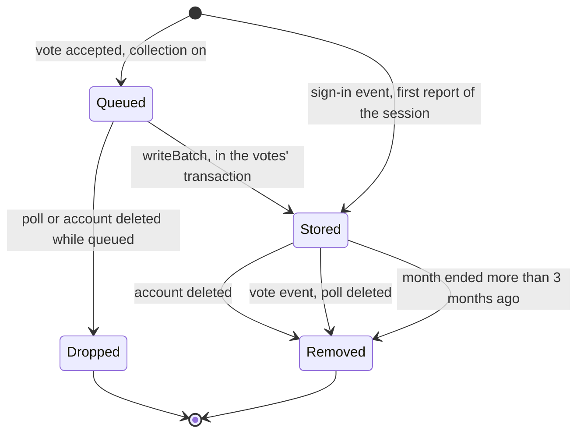

# Data Model: Multiple Account Prevention

## New table: `device_events` (migration `019-device-events`)

Partitioned by range on `at`, one child per calendar month, named `device_events_YYYY_MM`.

| Column | Type | Rules |
|---|---|---|
| `id` | `bigserial` | with `at`, the primary key |
| `account_id` | `text not null` | `user.id`; no foreign key, like `vote_history` |
| `event` | `text not null` | `check (event in ('sign-in', 'vote'))` |
| `poll_id` | `text` | set for `vote`, null for `sign-in`; `check ((event = 'vote') = (poll_id is not null))` |
| `browser_hash` | `text` | keyed hash (R5); null when the fingerprint was missing or malformed |
| `hardware_hash` | `text` | keyed hash; null under the same condition |
| `fingerprint_version` | `integer not null` | `DEVICE_FINGERPRINT_VERSION` |
| `at` | `timestamptz not null` | a vote's `votedAt`; a sign-in event's time means "first seen in this session" |

Each partition has an index on `account_id` and an index on `poll_id`, which the deletions use.

The table holds no choice, IP address, user agent, email address or raw device attribute.

**Volume**: one row per accepted vote and one per session, kept about 4 months.

## Lifecycle

A ban or a vote reset removes the vote but not its event (R10).

## Vote stream entry (`VOTE_STREAM`)

Three optional fields join the entry when collection is on:

| Field | Value |
|---|---|
| `accountId` | `user.id`; its absence means no event is written |
| `browserHash` | keyed hash, or an empty string when missing |
| `hardwareHash` | keyed hash, or an empty string when missing |

An entry queued before the release lacks them and is saved as a vote only.

## Cache key

| Key | Value | TTL | Meaning |
|---|---|---|---|
| `device-signin:<sessionId>` | `1` | `maxSigninCookieDurationMs` | this session's sign-in event is recorded |

## Settings

| Setting | Default | Rule |
|---|---|---|
| `ENV_DEVICE_EVENTS_ENABLED` | `false` | boolean |
| `ENV_DEVICE_EVENTS_KEY` | unset | required with at least 32 characters when enabled; never logged |

## Constants

| Constant | Value | Where |
|---|---|---|
| `DEVICE_FINGERPRINT_VERSION` | `1` | bumped when the library or the key changes |
| `DEVICE_EVENTS_RETENTION_MONTHS` | `3` | beside `VOTE_HISTORY_RETENTION_MONTHS` in `src/polls/sweeps.ts` |
| `TERMS_VERSION` | the release date | `src/legal/version.ts` |

## Browser

Nothing is stored. The fingerprint stays in page memory only. The library's `cookietest` cookie is removed in the call that sets it (R2).
