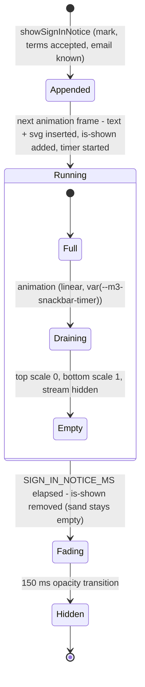

# Data Model: Snackbar Hourglass

No migration, no table, no column, no cache key, no setting, no cookie and no browser storage key.
The only "data" is the notice's markup, which lives in the page for its lifetime, and one constant.

## The constant

| Name | Where | Before | After |
|---|---|---|---|
| `SIGN_IN_NOTICE_MS` | `src/public/app.js` | `6000` | `7000` |

It is the notice's only duration. The stylesheet receives it as `--m3-snackbar-timer` (research R4).

## The notice's markup (built by `showSignInNotice`)

```text
div.m3-snackbar.m3-snackbar--top.m3-snackbar--timed   role="status"   style="--m3-snackbar-timer: 7000ms"
├── span.m3-snackbar-text                              "Logged in as <email>"   (textContent, never innerHTML)
└── svg.m3-snackbar-hourglass                          viewBox="0 0 22 32"  aria-hidden="true"  focusable="false"
    ├── path.hourglass-frame                           outline (stroke)
    ├── path.hourglass-top.hourglass-part              top sand (fill)
    ├── rect.hourglass-stream.hourglass-part           falling stream (fill)
    └── path.hourglass-bottom.hourglass-part           bottom heap (fill)
```

- **The bar's `textContent`** is exactly `Logged in as <email>`; the SVG adds no text (no `<title>`, no `<text>`).
- **Validation**: the address comes from `/api/me` (`me.emailAddress`) and is set with `textContent`, as today, so it is never parsed as markup.

## States



| Part | Resting (no animation, also reduced motion) | End of run (`forwards`) |
|---|---|---|
| `hourglass-top` | `scaleY(1)` | `scaleY(0)` |
| `hourglass-bottom` | `scaleY(0)` | `scaleY(1)` |
| `hourglass-stream` | `opacity: 0` | `opacity: 0` (shown from 0% to 98% of the run) |
