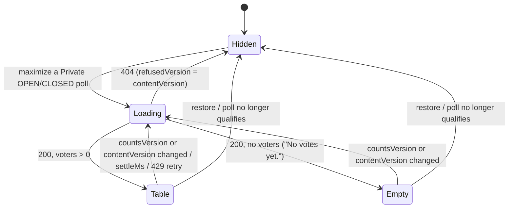

# Data Model: Who Voted Report

No migration, no new table, column, cache key, setting, cookie or browser storage key.

## Read: the current votes of one poll

Source: the existing `votes` table (one row per address per poll), read by `readVoterReport(db, row)` in
`src/polls/voters.ts`.

| Column | Use |
|---|---|
| `poll_id` | the poll asked for |
| `user_name` | the voter's name as recorded with the vote (UA8); `Deleted user` after account deletion |
| `choice_ids` | the voter's current choices; rows with an empty array (invited, not voted) are skipped |
| `voted_at` | when the current vote was cast; sent as an ISO 8601 instant |
| `email` | never selected |

Filter: `cardinality(choice_ids) > 0`; then `choice_ids ∩ ids(row.choices)`; a row left empty is dropped.  
Order: `user_name`, then `voted_at`.  
Returns `{ voters, counted }`, where `counted` is the number of rows with a non-empty `choice_ids` before the choice
filter; the route compares it with the live counters' `voteCount` to decide `settleMs` (R4) and never sends it.

## Value: VoterReport (the route's answer)

```ts
interface VoterReport {
  voters: { name: string; choiceIds: string[]; votedAt: string }[];
  settleMs?: number; // present when the live counters count a vote not yet in `votes` (R4)
}
```

- `choiceIds` keep only ids of the poll's voter-facing choices, in stored order; the browser orders them.
- No address, user id or count of withheld rows is ever included.

## Browser state (in `whoVoted.js`, per mounted section, in memory only)

| Field | Meaning | Life |
|---|---|---|
| `pid` | the poll shown | set by `show`, cleared by `hide` |
| `sort` | `"voter"` or `"choice"` | `"voter"` on the first `show` for a pid; kept across refreshes; reset by `hide` |
| `request` | token of the latest request; a reply with another token is dropped | each fetch |
| `report` | the last `VoterReport` | each accepted reply |
| `refusedVersion` | the `contentVersion` a `404` was received for; no request while it is current | `404` / `hide` |
| `retryTimer` | the one pending `settleMs` or `429` retry | cleared by a newer fetch or `hide` |

## Derived views

- **Bar order**: `detail.choices` by `pct` descending, ties by `position`.
- **By voter**: groups = voters (collator order, ties by `votedAt`); lines = the voter's choices in bar order.
- **By choice**: groups = choices in bar order with at least one voter; lines = their voters in collator order.
- Every line shows the vote's date (`votedAt`).

## Panel states



While a request is in flight after the first one, the panel keeps showing the previous table.
