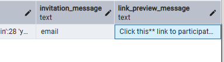
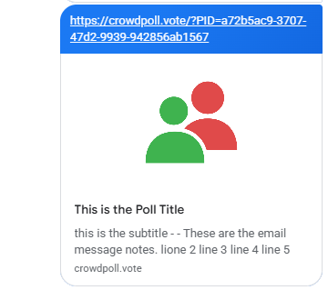
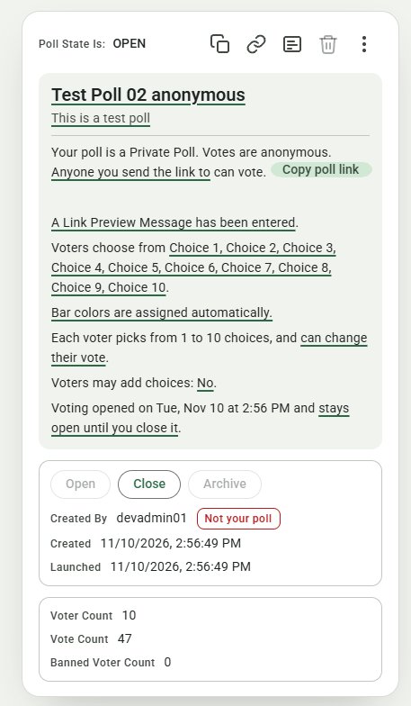

# Overview: `specs/20261111-132724-SHARED-LINK-MESSAGE`

## Document History

| Record | Value |
|---|---|
| Feature directory | `specs/20261111-132724-SHARED-LINK-MESSAGE` |
| Tweak file created | 2026-11-11 20:03 |
| Last updated | 2026-11-12 11:23 |

Legend: `[ ]` open · `[X]` Resolved · `[-]` Resolved (manually)  
(or accepted as-is) by the developer.
Tick `Run Tests` to have this tweak's automated tests written and run; leave it empty (the default) to postpone the run.

"Next" always returns the first `[ ]` item below.

The developer is expected to create the individual tweak requirements in this file, and then run the `/speckit-tweak` command to have the AI implement them, one at a time.  
Each tweak requirement initially carries an empty checkbox; tick it when the item is resolved or consciously accepted.  


# Tweaks

## TWEAK01 Copy Link Preview Shows the Custom Email Message  
[-] Resolved (accepted as-is)  
[ ] Run Tests  

It seems that link from "Copy Link" has the "Custom Email Message" applied instead of the "Link Preview Message".  
We confirmed that it aactually is using the "Custom Email Message".  
  

We changed the email message value and that is what is being previewed.  

Here is an example:  


### CLARIFICATIONS

The server picks the message by the poll's stored sharing mode (`previewMessageOf` in `src/seo/loginPage.ts`):  
the Custom Email Message for an *Only people you invite* poll, else the Link Preview Message.  
Production (`curl -sL https://crowdpoll.vote/?PID=a72b5ac9-…`) answers `this is the subtitle - - email` right now, the `invitation_message` column, so for this poll the stored mode must be `Invitation Only`, or something else is wrong.  
Please answer in this file or in chat:  

1. In the same database row (`polls` where `id = 'a72b5ac9-3707-47d2-9939-942856ab1567'`), what do `poll_visibility` and `poll_sharing_mode` hold?  
   And which option does Step 1 of the wizard show selected for this poll: *Anyone you send the link to* or *Only people you invite*?  
2. Was the poll created as *Only people you invite* and switched to *Anyone you send the link to* (or the reverse) at some point, and had it received votes by then?  
3. The description carries a double dash, `this is the subtitle - - email`.  
   Is the subtitle literally `this is the subtitle -`, or does the Custom Email Message start with `- `?  
   (The card in your screenshot, "These are the email message notes…", is older text than the `email` the column holds now; Google Messages keeps the card it fetched first for a link, so a changed message shows only on a link shared afresh.)  

Asked 2026-11-11 20:24

Answer (2026-11-11 20:32, in chat): the link was copied and shared before the switch to *Anyone you send the link to* had been saved;  
the poll's saved mode was still *Only people you invite* when the app fetched the card.  

### ACCEPTED RECOMMENDATION

Resolution: accepted as-is by the developer (2026-11-11 20:32)  
No defect in the implementation:  
the server reads the saved sharing mode (`previewMessageOf` in `src/seo/loginPage.ts`), and at the time of the share that mode was still *Only people you invite*, so the Custom Email Message was the right message under the spec's mode rule (research R2, contract P1).  
Once the switch to *Anyone you send the link to* is saved, the same link previews with the Link Preview Message, as production's login page now serves it.  
A messaging app keeps the card it fetched first for a link, so a conversation that already holds the old card may keep showing it;  
the new card appears where the link is pasted afresh.  
No code, test or artifact change.  

## TWEAK02 Speech Bubble on the Link Preview Logo  
[X] Resolved  
[ ] Run Tests  

The larger logo provided to the link preview looks great now.  
We realized that the fav-icon was created from the brand logo back in spec `specs\20261016-172002-FAVICON\research.md`:
```
## R4. Drawing the mark: `favicon.svg`

- **Decision**: Copy the figure geometry from `.brand-logo` in `SITE_HEADER_MARKUP` (`src/public/app.js`) — the mask `brand-logo-front`, the red group, the green circle and body — and drop both speech-bubble paths (fill and stroke). Use a cropped square `viewBox="10 4.5 96 96"`.
- **Rationale** (geometry from the logo):
  - The figures span x 16–100 and y 15–90 (84 × 75 units, the mockup's 23 × 20 ratio).
  - At 16 px one pixel is 6 units; filling the width with 1 px each side gives 84 + 12 = 96 units, so x 10–106; centring 75 units vertically in 96 gives y 4.5–100.5.
  - No background rectangle, so it is transparent (U1).
  - Give the mask a file-local id (`favicon-front`); the file is standalone.
- **Markup rules**: `<title>CrowdPoll</title>` as the first child (A2); no `role`/`aria-*` (a favicon is not in the accessibility tree); no comments (Constitution VI).
```

The fav-icon dropped the speech-bubble paths from the brand logo, keeping only the core figure geometry (mask, red group, green circle and body) for a simplified and recognizable mark at small sizes.  

For the large link preview logo, please add a speech bubble back to the core figure geometry, while keeping the high quality at larger sizes.  
Create the SVG using the same technique you used for the current large link preview logo, ensuring that the speech bubble integrates seamlessly with the core figure geometry and maintains visual clarity at larger sizes.

### RECOMMENDATION

Add a second standalone master beside the favicon, `src/public/og-logo.svg`, and render the preview image from it:  

- `src/public/og-logo.svg`: the whole `.brand-logo` drawing of `SITE_HEADER_MARKUP` (`src/public/app.js`), copied verbatim — the speech-bubble fill (`#FAFAFA`), the red group under its mask, the green circle and body, and the bubble's black outline (stroke 4.5, round joins) — on the logo's own `viewBox="0 0 120 120"`, so the bubble's tail and outline are inside the frame;  
  the favicon's file rules apply (favicon research R4): `<title>CrowdPoll</title>` first, a file-local mask id `og-logo-front`, no `role`/`aria-*`, no comments, no background rectangle.  
- `devScripts/favicon-ico.ts`: `renderOgImage` draws `OG_LOGO_PATH` (`src/public/og-logo.svg`) instead of `SVG_PATH`, still 480 px tall and centred on white at 1200 × 630;  
  the header comment names the new master.  
  Rerun it; the icon and email logo are unchanged, `og-image.png` is replaced.  
- `src/seo/pollPage.ts`: the `OG_IMAGE` comment names `og-logo.svg`.  
- Tests (written, not run — Run Tests is empty): in `tests/pages.test.ts`, beside the `og-image.png` test, one test that `og-logo.svg` exists, starts with `<title>CrowdPoll</title>`, holds the bubble path (`M96 6 H24`), its outline stroke, the `og-logo-front` mask, both figure colours, and carries no `role`, `aria-` or comment;  
  the existing `og-image.png` test (1200 × 630, under 300 KB, served as PNG) still covers the rendered file.  
- Artifacts: `spec.md` (clarification Q1, FR-011), `research.md` R6, `tasks.md` T038, `quickstart.md`, `README.md`, `ARCHITECTURE.md`, `CLAUDE.md` and `CLAUDE_COMPLETE.md` say "rendered from `favicon.svg`";  
  each now names `og-logo.svg` (the brand logo with its speech bubble).  

Recommended 2026-11-12 04:20

### ACCEPTED RECOMMENDATION

Applied as recommended:  

- `src/public/og-logo.svg` (new): the header's brand logo copied verbatim — bubble fill `#FAFAFA`, masked red figure, green figure, black outline (stroke 4.5, round joins) — on `viewBox="0 0 120 120"`, with `<title>CrowdPoll</title>` first, the file-local mask id `og-logo-front`, no `role`/`aria-*`, no comments.  
- `devScripts/favicon-ico.ts`: `OG_LOGO_PATH`;  
  `renderOgImage` draws it instead of `favicon.svg`;  
  header comment updated.  
  Rerun: `favicon.ico` and `email-logo.png` unchanged byte for byte;  
  `src/public/og-image.png` re-rendered (1200 × 630, 20,035 bytes), the bubble and figures sharp and centred.  
- `src/seo/pollPage.ts`: the `OG_IMAGE` comment names `og-logo.svg`.  
- Tests: `tests/pages.test.ts` gains "og-logo.svg is the brand logo with its speech bubble, under the favicon's file rules";  
  the existing `og-image.png` test still covers the rendered file.  
  Tests postponed (Run Tests not ticked);  
  the new test was written but not run, so this tweak is unverified by a run.  
  `npx tsc --noEmit` passes.  
- Artifacts: `spec.md` (Q1), `research.md` (R6), `plan.md`, `tasks.md` (T038), `quickstart.md`, `README.md`, `ARCHITECTURE.md`, `CLAUDE.md`, `CLAUDE_COMPLETE.md` now say the image is rendered from `og-logo.svg`.  

Applied 2026-11-12 04:21  

## TWEAK03 Copy Poll Link Moves to the Settings Summary  
[X] Resolved  
[ ] Run Tests  

We want to prevent the problem we encountered when clicking "Copy Link" from the "Who" tab of the Admin Poll Tab in editing mode.  

Please remove the "Copy Link" button from the "Who" tab of the Admin Poll Tab in editing mode.  

The Summary Paragraph will have a change to the paragraph that describes the "Who" tab. 
Currently, for Private Polls, the Summary Paragraph is similar to the following:
```
Your poll is a Private Poll. Anyone you send the link to can vote. Users can see who voted for what.
```

Change that paragraph so that the "Anyone you send the link to can vote" sentence is the last sentence.
For example, the revised paragraph could be:
```
Your poll is a Private Poll. Users can see who voted for what. Anyone you send the link to can vote.
```

Immediately after the "Anyone you send the link to can vote" sentence,  
there will be an M3 button "Copy poll Link". Make the button have a smaller height than the typical M3 button so that it fits in with the rest of the Summary Paragraph.  
We do not just want a link for the "Copy poll link" but rather a button.


### RECOMMENDATION

Take the Copy link block out of Step 1 and give the saved poll's Settings Summary a small "Copy poll link" button after the sharing sentence:

- `src/public/adminCard.js`, Step 1 (`buildStep1`): drop `buildCopyLink()` and its call, so the Link Preview Message field sits directly under *Anyone you send the link to*;
  the Step 3 comment that likens the Paste note to "Copy link's note" is reworded.
- `src/public/adminCard.js`, `buildSummary`: for a private poll the Who line becomes kind, anonymity, then sharing — `Your poll is a Private Poll. Users can see who voted for what. Anyone you send the link to can vote.` (or `Votes are anonymous.`);
  the *Only people you invite by email can vote.* sentence moves last the same way, so both private wordings have one shape;
  the public wording is unchanged.
  Each part stays tappable exactly as now (anonymity → Step 1 `pollVisibility`, sharing → Step 1 `pollSharingMode`).
- The button: `<button type="button" class="m3-tonal-btn wizard-summary-copy-link">Copy poll link</button>`, aria label `Copy the link to your poll`, appended to the Who line right after *Anyone you send the link to can vote.*;
  it copies `pollLink()` to the clipboard and shows the `Link copied` snackbar, or `Could not copy the link` when the clipboard refuses (the hidden manual box goes with the block).
  It is added **only in the read-only card's summary** (`part === readOnlyPart`), never in the wizard's: the wizard's summary describes unsaved settings, and copying there is the TWEAK01 mistake this tweak prevents;
  a new poll has no working link until it is published anyway.
  An *Only people you invite* poll gets no button (its link travels in the invitation email; the card header's link icon still copies it).
- `src/public/admin-card-m3.css` (section 8, after the tonal rule): `.poll-admin-card .wizard-summary-copy-link{ height:28px; padding:0 14px; margin-left:6px; vertical-align:middle; }` — the tonal colours, full corners and Label Large come from the shared button rule, so the 14 px label matches the paragraph's Body Medium;
  28 px (M3 Expressive's extra-small button is 32 px) sits in the 22 px line with a little extra leading on that line only.
  Remove the `.wizard-copy-link` rule from `src/public/admin.css` and the `.wizard-copy-manual` rules from both sheets;
  `.wizard-copy-note` stays, Step 3's Paste note uses it.
- Tests (written, not run — Run Tests is empty), `tests/client-admin-wizard.test.ts`:
  - "copies the poll link under the link-only option" becomes: Step 1 of a link poll has no `.wizard-copy-link` and no *Copy link* button;
  - "shows the field under Anyone you send the link to, after the Copy Link block" now expects the field as the link row's next sibling;
  - new: a saved link poll's read-only Who line reads `Your poll is a Private Poll. Votes are anonymous. Anyone you send the link to can vote.` and ends with `button.wizard-summary-copy-link` labelled *Copy poll link*;
    clicking it puts `http://localhost/?PID=<pid>` on the clipboard and shows *Link copied*, and does not open the editor;
    the wizard's summary of the same poll, and the read-only summaries of an invite poll and a public poll, carry no such button.
- Artifacts: `spec.md` (the Link Preview Message field is "directly under the option", clarification, US1 scenario 1 and FR-011), `contracts/ui-contracts.md` C1, `quickstart.md` step 1, `tasks.md` T013 wording;
  `README.md` (Step 1 wording, and the Settings Summary's *Copy poll link* button), `CLAUDE.md` and `CLAUDE_COMPLETE.md` (the Wizard decision: field directly under the option;
  the Copy poll link button lives in the read-only Settings Summary, TWEAK03).

Recommended 2026-11-12 09:21

### ACCEPTED RECOMMENDATION

Applied as recommended:

- `src/public/adminCard.js`: `buildStep1` no longer calls `buildCopyLink()`, which is gone with its note and manual box;
  the Link Preview Message field sits directly under *Anyone you send the link to*.
  `buildSummary` writes a private poll's Who line as kind, anonymity, sharing — `Your poll is a Private Poll. Users can see who voted for what. Anyone you send the link to can vote.` (or `Votes are anonymous.`; the invite wording moves last the same way);
  the public wording is unchanged and every part stays tappable as before.
  New `copyLinkButton()`: `<button type="button" class="m3-tonal-btn wizard-summary-copy-link">Copy poll link</button>`, aria label `Copy the link to your poll`, appended after the sharing sentence only when the summary is the read-only card's (`part === readOnlyPart`);
  it copies `pollLink()` and shows `Link copied`, or `Could not copy the link` when the clipboard refuses.
  The wizard's summary carries no button.
- CSS: `admin-card-m3.css` section 8 gains `.poll-admin-card .wizard-summary-copy-link{ height:28px; padding:0 14px; margin-left:2px; vertical-align:middle; }` (tonal colours, full corners and Label Large come from the shared button rule);
  the `.wizard-copy-link` rule left `admin.css` and the `.wizard-copy-manual` rules left both sheets;
  `.wizard-copy-note` stays for Step 3's Paste note.
- Tests, `tests/client-admin-wizard.test.ts` (written, not run — Run Tests is empty):
  - "has no Copy link block in Step 1 and no copy button in the wizard's summary, whatever the option" replaces the old Step 1 copy test;
  - "puts a private poll's sharing sentence last in the Who line, after the anonymity sentence" checks the four wordings;
  - "ends the read-only card's Who line of a link poll with Copy poll link, which copies without opening the editor" seeds a link, an invite and a public poll, checks the button's text, type, class and aria label, that it is the line's last element, that a click puts `http://localhost/?PID=…` on the clipboard with the *Link copied* snackbar and sends no edit-session request, that the other two cards and the opened editor's summary have no button;
  - the field test now expects the field as the link row's next sibling.
  This tweak is unverified by a run;
  `npx tsc --noEmit` passes and `adminCard.js` parses.
- Artifacts: `spec.md` (US1, scenario 1, FR-001), `contracts/ui-contracts.md` (C1), `research.md` (R7), `tasks.md` (T013, T020), `quickstart.md` (step 1);
  `README.md` (Step 1 wording; the Settings Summary paragraph describes the sentence order and the *Copy poll link* button), `CLAUDE.md` and `CLAUDE_COMPLETE.md` (the Wizard decision).

Applied 2026-11-12 09:26

## TWEAK04 A Smaller Copy Poll Link Button on the Sentence's Line  
[X] Resolved
[ ] Run Tests

Please make the button with less height and padding.  
And on the same line as the sharing sentence.  
The following mockup gives an approximate idea, though not pixel perfect:  


### RECOMMENDATION

Shrink the button to the mockup's pill and let it ride the sentence's own line:

- `src/public/admin-card-m3.css`, the `.poll-admin-card .wizard-summary-copy-link` rule (section 8) becomes:
  `height:20px; padding:0 8px; margin-left:6px; vertical-align:middle;` plus Label Medium type from the tokens — `font-size:var(--md-sys-typescale-label-medium-size)` (12 px), `line-height:var(--md-sys-typescale-label-medium-line-height)` (16 px), `font-weight` and `letter-spacing` likewise — in place of the shared rule's 40 px / Label Large;
  the tonal colours, full corners, `white-space:nowrap`, hover state layer and focus ring stay inherited.
  At 20 px the pill fits inside the Who line's 22 px line box, so it no longer adds leading, and with about 90 px of width it follows *can vote.* on the same text line wherever that line has the room (the mockup's case);
  only when the sentence ends at the very edge does the pill wrap, as any word would.
  The pill is below Material's 48 px touch target, which the mockup accepts;
  the card header's link icon remains the full-size control.
- No change to `adminCard.js`: the button is already appended inline after the sentence.
- Test (written, not run — Run Tests is empty): in `tests/m3-assets.test.ts`, one test that `admin-card-m3.css` holds the rule with `height:20px;`, `padding:0 8px;` and the four `--md-sys-typescale-label-medium-*` tokens, and that the wizard sheet carries no `font-size:…px` literal for it.
- Artifacts: `CLAUDE.md` and `CLAUDE_COMPLETE.md` (the Wizard decision says "28 px tonal button" → "20 px Label Medium pill, TWEAK04");
  `README.md` already says "a small Copy poll link button" and needs no change.

Recommended 2026-11-12 09:50

### ACCEPTED RECOMMENDATION

Applied as recommended:

- `src/public/admin-card-m3.css`: the `.poll-admin-card .wizard-summary-copy-link` rule is now `height:20px; padding:0 8px; margin-left:6px; vertical-align:middle;` with Label Medium type from the tokens (size, weight, line-height, tracking);
  the tonal colours, full corners, nowrap, state layer and focus ring stay inherited from the shared button rules.
  The 20 px pill fits inside the Who line's 22 px line box, so it adds no leading and follows *can vote.* on the same text line wherever the line has room.
- `src/public/adminCard.js`: unchanged.
- Test (written, not run — Run Tests is empty): `tests/m3-assets.test.ts` gains "draws the Settings Summary's Copy poll link as a 20px Label Medium pill", checking the rule's height, padding, vertical-align, the four Label Medium tokens and no literal font size.
  This tweak is unverified by a run;
  the stylesheet is plain CSS, so no type-check applies.
- Artifacts: `CLAUDE.md` and `CLAUDE_COMPLETE.md` (the Wizard decision now says "20 px Label Medium tonal pill", TWEAK04);
  `README.md` already says "a small Copy poll link button".

Applied 2026-11-12 09:59

## TWEAK05 Quickstart Step 12: No Preview Log Line  
[X] Resolved
[ ] Run Tests

For Step 12 of quickstart.md:  

```
12. **Log**: the server printed `[login] Poll preview rendered: <pid>` for step 3, and at start-up listed
    `ENV_DEFAULT_LINK_PREVIEW_MESSAGE` among the defaults in use.
```

The server log didn't show anything related:

```
[controller] R=0 B=1250 S=0/200 V=0 a=1.00 k=1/1/1 tabs=0/0 stretched=0
[trending] published counts for 19 polls
[sweeps] trendingSweep: 19 change(s)
[newest] published counts for 19 polls to Spaces bucket "crowdpoll-cdn"
[sweeps] newestSweep: 19 change(s)
[controller] R=0 B=1250 S=0/200 V=0 a=1.00 k=1/1/1 tabs=0/0 stretched=0
[trending] published counts for 19 polls
[sweeps] trendingSweep: 19 change(s)
[newest] published counts for 19 polls to Spaces bucket "crowdpoll-cdn"
[sweeps] newestSweep: 19 change(s)

```

but the response was as expected, see below.  
To make sure we are hitting the correct server, we stopped it and ran CURL again and got no response. 


```
(base) PS C:\crowdPoll\link-message> curl -sL "http://localhost:8080/?PID=<pid>"
<!doctype html>
<html lang="en">
<head>
  <meta charset="utf-8">
  <meta name="viewport" content="width=device-width, initial-scale=1">
  <link rel="icon" href="/favicon.svg" type="image/svg+xml">
  <link rel="icon" href="/favicon.ico" sizes="16x16 32x32 48x48">
  <title>CrowdPoll — live opinion polls</title>
  <meta name="description" content="Vote on live opinion polls and see the results change as people vote.">
  <script src="/colorScheme.js"></script>

```

### RECOMMENDATION

No defect in the server: the curl never reached the preview branch, and the second half of step 12 does not apply to this machine.

- **The response is the home page, not the login page.**
  The head you pasted — `<title>CrowdPoll — live opinion polls</title>` and the description *Vote on live opinion polls…* — is `src/public/index.html`;
  the login page's title is `Login`, and a rendered preview's is `<poll title> · CrowdPoll` with the `og:` tags.
  `GET /` serves the home page when the `PID` query value is not a poll id (`parsePid` in `src/polls/sharedLink.ts` accepts only a UUID);
  the literal `<pid>`, or a pid with a stray character, takes that path, nothing is looked up, and so nothing is logged.
  With a real id the `302` goes to `/login?PID=…`, the preview renders and `[login] Poll preview rendered: <pid>` is printed (my own dev run logged it three times for the quickstart, see the earlier session);
  for a poll that is not open or closed the plain login page (`<title>Login</title>`) comes back, also without the line.
- **The defaults line is printed only for a setting the environment does not set.**
  `defaultsUsedLines` in `src/server.ts` lists the settings `loadConfig` fell back on;
  your `devScripts/launch-dev.ps1` sets `ENV_DEFAULT_LINK_PREVIEW_MESSAGE` to *Development Environment: Check out this link!* (line 86), so the line is correctly absent, and a poll with neither subtitle nor message previews with that sentence instead of the built-in one.
- **Change**: `quickstart.md` only —
  step 3 names where the id comes from (the UUID in the poll's *Copy poll link*) and what the two wrong heads mean (the home page's title: the `PID` is not a poll id;
  `<title>Login</title>`: the poll is not open or closed);
  step 12 says the defaults line appears only when the launch script leaves the setting unset, and that a script which sets it shows its own sentence in step 5 instead.
  No code, test or other artifact changes.
- To confirm on your side: with the server on 8080 up, `curl -sL "http://localhost:8080/?PID=<the UUID from Copy poll link>" | grep -E "<title>|og:"` on an OPEN poll;
  the title line carries the poll's title and the log shows the `[login]` line.

Recommended 2026-11-12 11:09

### ACCEPTED RECOMMENDATION

Applied as recommended — `quickstart.md` only:

- Step 3 now says `<pid>` is the UUID from the poll's *Copy poll link*, that the title of a rendered preview is `<poll title> · CrowdPoll`, and what the two wrong heads mean:
  `CrowdPoll — live opinion polls` is the home page, served when the `PID` value is not a poll id;
  `Login` is the plain login page, served when the poll is not open or closed.
- Step 12 now says nothing is logged for those two heads, and that the defaults line appears only when the launch script leaves `ENV_DEFAULT_LINK_PREVIEW_MESSAGE` unset;
  the local `devScripts/launch-dev.ps1` sets it, so no line is expected there and step 5's first description is the script's own sentence.
- No code, test or other artifact change;
  nothing to run.

Applied 2026-11-12 11:14

## TWEAK06 Is the Preview Head Correct?  
[-] Resolved (accepted as-is)
[ ] Run Tests

Does this look correct?  
```
(base) PS C:\crowdPoll\link-message> curl -sL "http://localhost:8080/?PID=c586f920-c43b-4ac1-8c91-d4797b8d91d8"
<!doctype html>
<html lang="en">
<head>
  <meta charset="utf-8">
  <meta name="viewport" content="width=device-width, initial-scale=1">
  <link rel="icon" href="/favicon.svg" type="image/svg+xml">
  <link rel="icon" href="/favicon.ico" sizes="16x16 32x32 48x48">
  <title>Test Poll 02 anonymous · CrowdPoll</title>
  <meta name="description" content="This is a test poll - This is Link Preview Message">
  <meta property="og:type" content="website">
  <meta property="og:site_name" content="CrowdPoll">
  <meta property="og:title" content="Test Poll 02 anonymous">
  <meta property="og:description" content="This is a test poll - This is Link Preview Message">
  <meta property="og:url" content="http://localhost:8080/?PID=c586f920-c43b-4ac1-8c91-d4797b8d91d8">
  <meta property="og:image" content="http://localhost:8080/og-image.png">
  <meta property="og:image:width" content="1200">
  <meta property="og:image:height" content="630">
  <meta property="og:image:type" content="image/png">
  <meta name="twitter:card" content="summary">
  <meta name="robots" content="noindex">
  <script src="/colorScheme.js"></script>
  <link rel="stylesheet" href="/fonts/fonts.css">
  <!-- 013 D2: index.html's precedent. styles.css is deliberately NOT loaded —
       its element-level rules bleed into the reference components this page is
       now built from. -->
  <link rel="stylesheet" href="/m3-tokens.css">
  <link rel="stylesheet" href="/tabs.css">
  <link rel="stylesheet" href="/pollCard.css">
  <link rel="stylesheet" href="/site.css">
  <link rel="stylesheet" href="/tooltip-m3.css">
  <link rel="stylesheet" href="/header-tab-bar-m3.css">
  <link rel="stylesheet" href="/header-single-column-m3.css">
  <link rel="stylesheet" href="/header-single-row-m3.css">
  <link rel="stylesheet" href="/header-fixed-m3.css">
  <link rel="stylesheet" href="/back-to-top-m3.css">
  <link rel="stylesheet" href="/card-shell-m3.css">
  <link rel="stylesheet" href="/human-check-m3.css">
  <link rel="stylesheet" href="/footer-m3.css">
</head>
<body data-session-role="obtains">

<div class="page-decor"></div>

<div class="page">
  <div class="container">
    <div class="layout">
      <header id="site-header" class="site-header"></header>
      <main id="card-root"><noscript><p class="card-shell-status">Logging in needs JavaScript.</p></noscript></main>
    </div>
  </div>
</div>

<script src="/m3-ripple.js" defer></script>
<script src="/tooltip-m3.js" defer></script>
<script src="/app.js" defer></script>
<script src="/headerFit.js" defer></script>
<script src="/fixedChrome.js" defer></script>
<script src="/cardShell.js" defer></script>
<script src="/humanCheck.js" defer></script>
<script src="/loginCard.js" defer></script>
<script src="/backToTopFab.js" defer></script>
</body>
</html>
(base) PS C:\crowdPoll\link-message> 
```


### RECOMMENDATION

Yes — the head matches contract P1 (`contracts/page.md`) line for line, so the recommendation is *Accept as-is*:

- `<title>Test Poll 02 anonymous · CrowdPoll</title>` and `og:title`: the poll's title.
- `description` and `og:description`: `This is a test poll - This is Link Preview Message` — the subtitle, ` - `, then the Link Preview Message of this *Anyone you send the link to* poll (the mode rule, research R2), on one line.
- `og:type` `website`, `og:site_name` `CrowdPoll`.
- `og:url`: the shared link `http://localhost:8080/?PID=c586f920-…` on `ENV_PUBLIC_ORIGIN`, never `/login`.
- `og:image` `http://localhost:8080/og-image.png` with width 1200, height 630, type `image/png`, after `og:url` and before `twitter:card` `summary`.
- `robots` `noindex` kept;
  no canonical link, no JSON-LD.
- The body is the unchanged login page, so a person who taps the link still signs in as before.

This is the quickstart's step 3 passing on the development server;
step 12's `[login] Poll preview rendered: c586f920-…` should be in that server's console for this request.
No code, test or artifact change.

Recommended 2026-11-12 11:17

### ACCEPTED RECOMMENDATION

Resolution: accepted as-is by the developer (2026-11-12 11:23)
The pasted head matches contract P1 (`contracts/page.md`): title, one-line description from the subtitle and the Link Preview Message, `og:url` on the public origin, the four `og:image*` tags, `twitter:card` `summary`, `noindex`.
The developer also reports quickstart steps 1–10 and 12 passing on the development server (T042 ticked in `tasks.md`);
step 11 (T047) waits for the next deployment and a day for Meta's crawler.
No code, test or artifact change.

Applied 2026-11-12 11:23

## TWEAK07 <short title here>
[ ] Resolved
[ ] Run Tests
tweak requirements...
