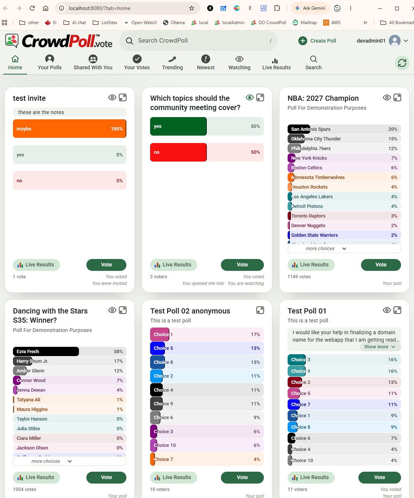

# Overview: `specs/20261112-124616-POLL-DATA-EXTRACTORS`

## Document History

| Record | Value |
|---|---|
| Feature directory | `specs/20261112-124616-POLL-DATA-EXTRACTORS` |
| Tweak file created | 2026-11-12 14:53 |
| Last updated | 2026-11-12 15:10 |

Legend: `[ ]` open · `[X]` Resolved · `[-]` Resolved (manually)  
(or accepted as-is) by the developer.
Tick `Run Tests` to have this tweak's automated tests written and run; leave it empty (the default) to postpone the run.

"Next" always returns the first `[ ]` item below.

The developer is expected to create the individual tweak requirements in this file, and then run the `/speckit-tweak` command to have the AI implement them, one at a time.  
Each tweak requirement initially carries an empty checkbox; tick it when the item is resolved or consciously accepted.  


# Tweaks

## TWEAK01 Deleted Polls Still on Home Tab  
[X] Resolved  
[ ] Run Tests  

Question: on dev, we manuyally deleted all polls from the polls table,  
and then ran 
npm run populate-all-polls 

The Home tab for the admin user devadmin012@crowdpoll.vote 
shows all the deleted polls.  
I assume it is because the users_polls table still contains references to the deleted polls, which causes them to reappear on the Home tab.  

What do you suggest as the best solution to clean this up?

The only polls that still exist are these titles:  
"United Kingdom - Parliament Voting Intention"
"France - President Emmanuel Macron's Approval Rating"
"Spain - National Parliament Voting Intention"
"Top US Netflix Show This Week"
"NBA: 2027 Champion"
"Dancing with the Stars S35: Winner?"

### RECOMMENDATION

Cause: not `user_polls`.  
Its `poll_id` references `polls` with `on delete cascade` (migration `003-participation`), so the manual delete removed those rows too.  
The deleted polls come back from the cache: the development server uses the local Valkey (`ENV_VALKEY_URL = redis://localhost:6379` in `devScripts/launch-dev.ps1`), which survives restarts and still holds each deleted poll's `poll:<pid>` projection and the admin's cached Home list (`home:<emailKey>`, reused for up to `ENV_HOME_TAB_REFRESH_INTERVAL`, 2 hours).  
The app's own delete (`deletePoll` in `src/polls/store.ts`) calls `forgetProjections`, so every tab drops the poll; a SQL `delete` skips that step.  

- **Option A** _(recommended)_: add a development script, `devScripts/forget-deleted-polls.ts` (`npm run forget-deleted-polls`), that lists the `poll:*` keys in the cache, keeps those whose poll still exists, and calls the app's `forgetProjections` for the rest.  
  It prints how many it forgot and changes nothing in the database.  
  Tests: a unit test with the in-memory cache and a test database (one live poll, one deleted) asserting only the deleted poll's projection goes.  
  Docs: one README line beside `fix-migrations`; a `.gitignore` line and a `package.json` script.  
  - Pros: precise, keeps live counters, queues and sessions; reusable whenever polls are deleted by hand.  
  - Cons: a new script, outside this feature's scope (poll data extractors).  
- **Option B**: no code; clear the local cache once.  
  Stop the dev server, run `redis-cli -h localhost -p 6379 -n 0 FLUSHDB`, start the server, then `npm run reconcile` to rebuild the vote counters from the `votes` table.  
  Everything else (projections, Home lists, TRENDING, Newest) rebuilds from PostgreSQL.  
  - Pros: no code; one minute.  
  - Cons: drops any vote still queued in Valkey, empties the other cached state (sessions are simply re-read from PostgreSQL), and needs `redis-cli` installed.  
- **Option C**: accept as-is and wait.  
  The Home list is rebuilt from the database within 2 hours, without the deleted polls; the orphan `poll:<pid>` keys stay but are never listed again.  
  - Pros: nothing to do.  
  - Cons: the stale rows stay until then, and the same thing happens after the next manual delete.  

In every case, delete polls through the admin page (or the app's `deletePoll`) rather than SQL, so the cache stays in step.  
2026-11-12 14:58


### ACCEPTED RECOMMENDATION

Option A accepted.  
- `devScripts/forget-deleted-polls.ts` (new): `forgetDeletedPolls(db, cache)` scans the cache for `poll:*` keys, keeps those whose poll is still in `polls`, and removes the rest through the app's `forgetProjections`;  
  `npm run forget-deleted-polls` loads the server's configuration, prints `[forget-deleted-polls] <n> deleted poll(s) forgotten` and changes nothing in the database.  
- `package.json`: the `forget-deleted-polls` script.  
- `.gitignore`: `!devScripts/forget-deleted-polls.ts`.  
- `README.md`: a paragraph after `fix-migrations` (delete polls from the admin page; the command after a delete in SQL).  
- `tests/forget-deleted-polls.test.ts` (new, 2 tests): only a poll deleted in SQL loses its projection, the live one keeps it and the database is untouched;  
  nothing is forgotten when every cached poll exists.  
- Tests postponed (Run Tests not ticked); the 2 tests were written, not run, so the tweak is unverified by a run.  
  The new script and test type-check cleanly.  
- Artifacts: `tasks.md` (T024 added), `plan.md` (project structure line).  
- To clean the development cache now: run `npm run forget-deleted-polls` with the dev server's `ENV_*` variables (as for `npm run reconcile`), then refresh the Home tab.  

2026-11-12 15:01

## TWEAK02 Hand-Made Test Polls Still Listed  
[-] Resolved (manually)  
[ ] Run Tests  

We ran this. Restarted the server. Refreshed the browser page.
```
(base) PS C:\crowdPoll\main> npm run forget-deleted-polls

> crowdpoll.vote@0.2.0 forget-deleted-polls
> tsx devScripts/forget-deleted-polls.ts

[cache] Valkey ready
[cache] Using Valkey
[forget-deleted-polls] 42523 deleted poll(s) forgotten
[cache] Valkey connection closed
(base) PS C:\crowdPoll\main> 
```

The polls table shows the 6 polls we expected.  
Home page on localhost shows this:  


### CLARIFICATIONS

Finding: the server is right; the 11 extra polls are still in the development database.  
`forget-deleted-polls` removed 42,523 cached copies of polls that really were deleted, and the Home tab re-reads its rows from PostgreSQL (`rowsOf` in `src/polls/homeTab.ts`), so a card is listed only when its poll exists.  
A read-only query of `app01` on `localhost` (the database in `devScripts/launch-dev.ps1`) on 2026-11-12 15:07 finds 17 polls, all OPEN:  

| Created | Votes | Title |
|---|---:|---|
| 2026-08-04 | 1146 | United Kingdom - Parliament Voting Intention |
| 2026-08-04 | 1146 | France - President Emmanuel Macron's Approval Rating |
| 2026-08-04 | 1143 | Spain - National Parliament Voting Intention |
| 2026-09-30 | 3 | Which topics should the community meeting cover? |
| 2026-11-01 | 2 | add choices |
| 2026-11-02 | 2 | add choices Copy |
| 2026-11-03 | 1 | anyone with link |
| 2026-11-07 | 1040 | Top US Netflix Show This Week |
| 2026-11-09 | 0 | Brainstorm: Poll Website Name |
| 2026-11-10 | 6 | test invite |
| 2026-11-10 | 1 | test invite Copy |
| 2026-11-10 | 2 | test invite Copy Copy |
| 2026-11-10 | 6 | Brainstorm: Polling Website Name |
| 2026-11-10 | 11 | Test Poll 01 |
| 2026-11-10 | 10 | Test Poll 02 anonymous |
| 2026-11-12 | 1149 | NBA: 2027 Champion |
| 2026-11-12 | 1004 | Dancing with the Stars S35: Winner? |

Questions:  
1. The SQL client that showed 6 polls: which database and host is it connected to?  
   If it is not `app01` on `localhost`, the delete ran on that other database, not on the one the dev server uses.  
2. Should the 11 hand-made polls (the rows above other than the 6 populated ones) be deleted from `app01`?  
   If yes: delete them from the admin page, or say so here and the AI will delete them through the app's `deletePoll` (which also drops their cached copies and their votes, history and relations), after you confirm the list.  

### ACCEPTED RECOMMENDATION

Resolved manually by the developer.  
Detected: no code change; the 6-poll count came from a query with an unintended `where` clause, and the developer fixed the data themselves.  
Tests: none needed (no code changed).  
Artifacts: none needed.  
2026-11-12 15:10

## TWEAK03 <short title here>  
[ ] Resolved  
[ ] Run Tests  
tweak requirements...  
