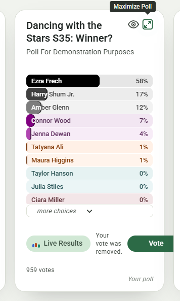

# Overview: `specs/20261112-173151-REMOVE-VOTE`

## Document History

| Record | Value |
|---|---|
| Feature directory | `specs/20261112-173151-REMOVE-VOTE` |
| Tweak file created | 2026-11-12 19:36 |
| Last updated | 2026-11-12 19:48 |

Legend: `[ ]` open · `[X]` Resolved · `[-]` Resolved (manually)  
(or accepted as-is) by the developer.
Tick `Run Tests` to have this tweak's automated tests written and run; leave it empty (the default) to postpone the run.

"Next" always returns the first `[ ]` item below.

The developer is expected to create the individual tweak requirements in this file, and then run the `/speckit-tweak` command to have the AI implement them, one at a time.  
Each tweak requirement initially carries an empty checkbox; tick it when the item is resolved or consciously accepted.  

# Tweaks

## TWEAK01 Removal Notice Squeezed Between Buttons  
[X] Resolved  
[ ] Run Tests  

After removing a vote, the front of the poll card has the text "Your vote was removed." between the "live Results" and "Vote" buttons.
See this screenshot:  

### RECOMMENDATION

The notice sits in the front action row's message slot (`.poll-vote-notice`, `src/public/pollCard.js` card template), the slot 017 gave the queued notice.  
The closed, editing and blocked messages use that slot too, but they hide the Live Results link and the Vote button first;  
the vote notice keeps both, so the row shares its width three ways and the text wraps onto three lines, as the screenshot shows.  
The queued notice has the same layout today.  

- **Option A** _(recommended)_: move the notice under the action row, into `.card-foot`, as the line "You voted" takes.  
  - Move `

` from `.card-front .actions` to the end of `.card-foot-row`, after `.poll-voted`, in the card template;  
    in `src/public/site.css` restyle `.poll-vote-notice` like `.poll-voted` (the italic, right-aligned, muted footer text; `flex:0 0 auto; margin-left:auto`), dropping its `display:flex`;  
    in `src/public/pollCard-m3.css` move it from the message group to the `.poll-voted` colour group.  
  - After a removal the row then reads `959 votes            Your vote was removed.`, in the place "You voted" has just left;  
    the queued notice takes the same place after a vote.  
  - Tests: `tests/client-remove-vote.test.ts` asserts the notice is inside `.card-front .card-foot-row` and that the action row holds only the link and the button;  
    `tests/client-home.test.ts` (the queued notice test) keeps its selector;  
    `tests/poll-card-assets.test.ts` pins the `.poll-vote-notice` rule in `site.css`.  
  - Artifacts: `contracts/ui-contracts.md` C2 step 2 names the footer line;  
    `tasks.md` gains a task line for the move.  
  - Pros: the buttons keep their width and places;  
    the message reads where the card's other status lines are;  
    one change covers the queued notice too.  
  - Cons: the queued notice moves as well (a wanted side effect, in my view).  

- **Option B**: keep the slot but give the notice its own line in the action row.  
  - Let `.card-front .actions` wrap (`flex-wrap:wrap`) and give `.poll-vote-notice` `flex-basis:100%; order:1` so it drops below the two buttons, full width, left-aligned.  
  - Tests: the same selectors; `tests/poll-card-assets.test.ts` pins the two rules.  
  - Pros: the smallest CSS change, no template move.  
  - Cons: the row grows by a line only while a notice shows, so the foot shifts down and back as the notice comes and goes;  
    the notice sits above the count, not with the other status text.  

- **Option C**: show no notice after a removal; "You voted" leaving and the lower count are the signal.  
  - Revert the notice branch in `pollCard.js` to its one-argument form;  
    `spec.md` FR-017, `contracts/ui-contracts.md` C2 and the client test change to say no notice is shown.  
  - Pros: nothing to lay out.  
  - Cons: changes a requirement the testers asked for (UA3);  
    the queued notice keeps the squeezed layout.  

Recommended: Option A.  
2026-11-12 19:41

### ACCEPTED RECOMMENDATION

Option A applied.
- `src/public/pollCard.js`: `.poll-vote-notice` moved from the front action row to the end of `.card-foot-row`, after `.poll-voted`.
- `src/public/site.css`: the notice joins the `.poll-voted` group (italic, muted, right-aligned; `flex:0 0 auto; margin-left:auto`);
  its own rule (bold, `display:flex`) is gone, the `[hidden]` rule stays.
- `src/public/pollCard-m3.css`: moved from the message typography group to the `.poll-voted` colour group.
- Tests written, postponed (Run Tests not ticked), not run:
  `tests/client-remove-vote.test.ts` asserts the notice sits in `.card-foot-row` and the action row shows only the Live Results link and the Vote button;
  `tests/poll-card-assets.test.ts` pins the `site.css` rule.
  The tweak is therefore unverified by a run.
- Artifacts: `contracts/ui-contracts.md` C2 step 2 names the line;
  `tasks.md` T028 added.
2026-11-12 19:48

## TWEAK02 <short title here>
[ ] Resolved
[ ] Run Tests
tweak requirements...
