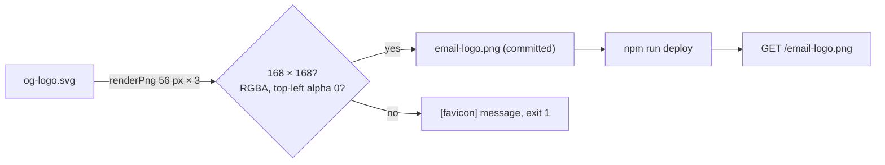

# Data Model: Email Logo With Speech Bubble

No stored data, migration, setting or API changes. The feature's "entities" are three committed static images and the
drawings they come from.

| Entity | File | Source | Size | Changes |
|---|---|---|---|---|
| Email logo | `src/public/email-logo.png` | `src/public/og-logo.svg` (was `favicon.svg`) | 168 × 168 px RGBA, shown at 56 × 56 | drawing, size, source |
| Link-preview master | `src/public/og-logo.svg` | hand-copied from `.brand-logo` in `app.js` | `viewBox="0 0 120 120"` | none (now the source of two images) |
| Link-preview image | `src/public/og-image.png` | `og-logo.svg`, centred 480 px tall on white | 1200 × 630 | none |
| Favicon master | `src/public/favicon.svg` | figures only | `viewBox="10 4.5 96 96"` | none (no longer the email logo's source) |
| Favicon | `src/public/favicon.ico` | `favicon.svg` | 16, 32, 48 px | none |

## Validation rules (enforced by `devScripts/favicon-ico.ts`)

- Email logo: width and height 168 (`EMAIL_LOGO_SIZE` 56 × `EMAIL_LOGO_SCALE` 3); bit depth 8, colour type 6 (RGBA);
  top-left pixel alpha 0. Otherwise the script stops with a `[favicon]` message and writes nothing more.
- Favicon: each PNG is exactly its size at 1× (unchanged).
- Link-preview image: 1200 × 630, at most 300 000 bytes (unchanged).

## Lifecycle

