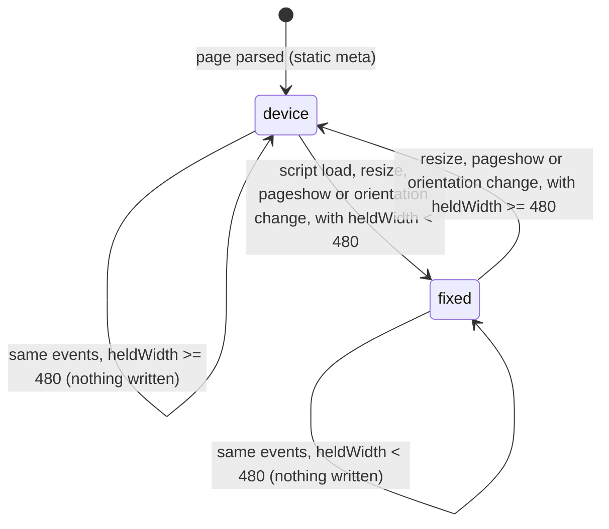

# Data Model: Fixed Viewport Width Trial

Nothing is stored: no table, cache key, cookie or browser storage (FR-014). The feature's only state is the content of
each page's viewport meta tag, decided in the browser.

## Constants (`src/public/viewportWidth.js`)

| Name | Value | Meaning |
|---|---|---|
| `FIXED_WIDTH` | `480` | the layout width given to narrow devices, and the threshold below which a device is narrow |
| device content | read from the page's meta at start-up | `width=device-width, initial-scale=1`, restored when the rule does not apply |

## Inputs

| Input | Source | Notes |
|---|---|---|
| the screen's two sides | `screen.width`, `screen.height` | CSS pixels; which is which differs by platform (research R2) |
| landscape or portrait | `screen.orientation.type`, else `window.orientation` | the device's orientation, not the viewport's shape |

`heldWidth` = the longer side in landscape, the shorter in portrait.

## States of a page's viewport

| State | Condition | Meta `content` | Root inline style |
|---|---|---|---|
| **device** | `heldWidth >= 480`, or the script did not run | `width=device-width, initial-scale=1` | no `text-size-adjust` |
| **fixed** | `heldWidth < 480` | `width=480` | `text-size-adjust: 100%`, `-webkit-text-size-adjust: 100%` |

## Transitions

A transition writes the meta and the root style once; an event that leaves the state unchanged writes nothing
(research R4).
