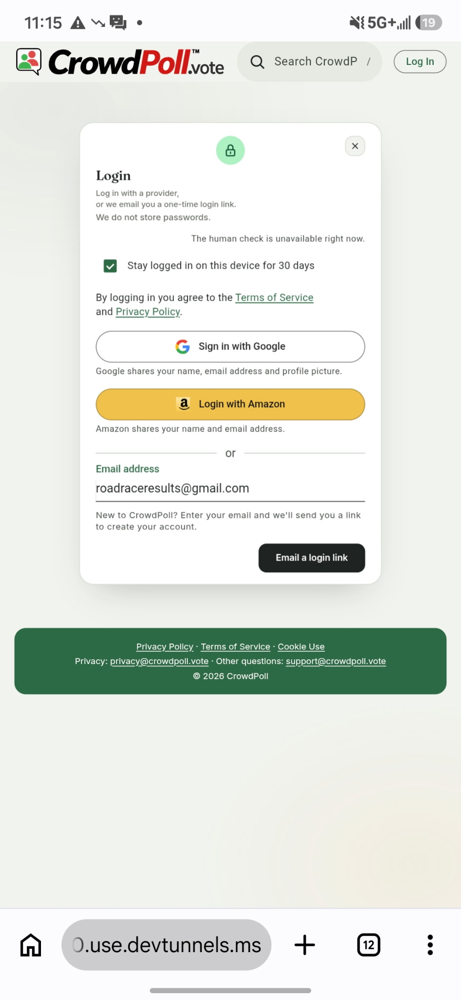
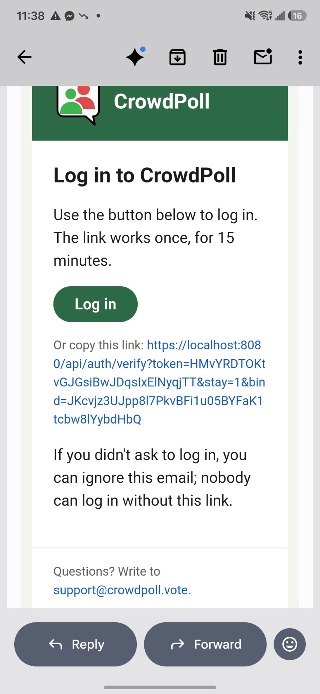
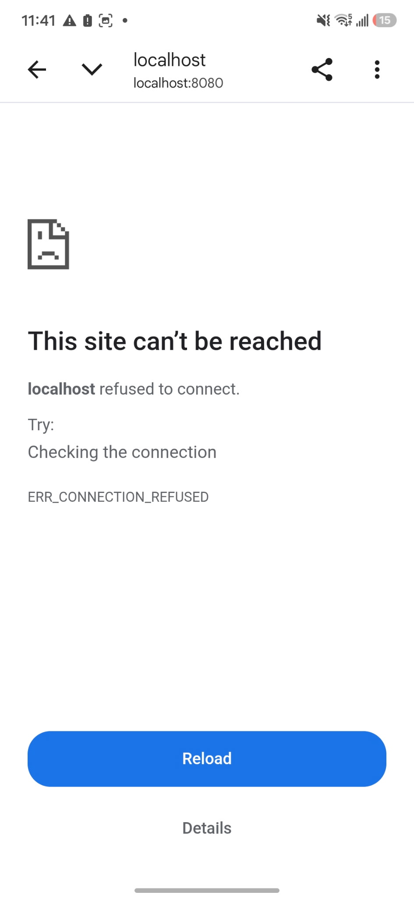
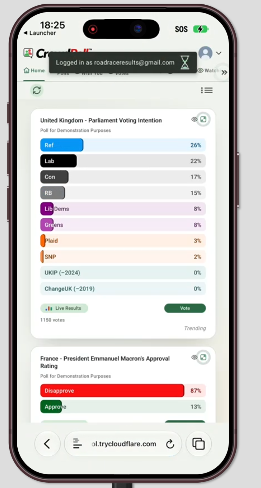

# Overview: `specs/20261113-085157-FIXED-VIEWPORT-WIDTH`

## Document History

| Record | Value |
|---|---|
| Feature directory | `specs/20261113-085157-FIXED-VIEWPORT-WIDTH` |
| Tweak file created | 2026-11-13 10:51 |
| Last updated | 2026-11-13 13:28 |

Legend: `[ ]` open · `[X]` Resolved · `[-]` Resolved (manually)  
(or accepted as-is) by the developer.
Tick `Run Tests` to have this tweak's automated tests written and run; leave it empty (the default) to postpone the run.

"Next" always returns the first `[ ]` item below.

The developer is expected to create the individual tweak requirements in this file, and then run the `/speckit-tweak` command to have the AI implement them, one at a time.  
Each tweak requirement initially carries an empty checkbox; tick it when the item is resolved or consciously accepted.  

# Tweaks

## TWEAK01 View The Trial On Phones  
[X] Resolved  
[ ] Run Tests  

To properly review this we need to view it on phones.  
Is there any possible way to do this while it is running on the local development server?

### RECOMMENDATION

Yes.  
What was found in the code:

- The development server already listens on every network interface (`app.listen(config.port)` in `src/server.ts`, no host), so a phone on the same Wi-Fi can open `http://192.168.0.145:8080` today.  
- Signing in does not work at that address.  
  The session cookies are `secure: true` (`src/auth/auth.ts:326`), which a browser accepts only over HTTPS or on `localhost`;  
  and BetterAuth's `baseURL` and `trustedOrigins` are `ENV_PUBLIC_ORIGIN`, `http://localhost:8080` in `devScripts/launch-dev.ps1`.  
- So a phone sees guest pages over the LAN address, and needs to reach the server as `localhost`, or over HTTPS, to sign in.  

Options:

- **Option A** _(recommended)_: no code or setting change; add a "Reaching the development server from a phone" section to `quickstart.md` with two routes.  
  - Any phone, as a guest: open `http://192.168.0.145:8080` on the same Wi-Fi (allow Node through Windows Firewall when asked).  
    This covers the home page with its poll cards, a maximized card, `/login`, `/privacy` and `/terms`.  
  - Android, signed in: connect the phone by USB with USB debugging on, open `chrome://inspect/#devices` in desktop Chrome, and under "Port forwarding" map `8080` to `localhost:8080`.  
    The phone then opens `http://localhost:8080`, where login, the wizard and every signed-in page work unchanged.  
  - Pros: nothing in the product changes; nothing leaves the local network; the server runs exactly as it does today.  
  - Cons: an iPhone can only see the guest pages this way, so the wizard cannot be checked on iOS.  
  - Tests: none; this is documentation only.  
- **Option B**: an HTTPS tunnel (for example VS Code's port forwarding, `cloudflared` or `ngrok`) with `ENV_PUBLIC_ORIGIN` set to the tunnel's address in the local `devScripts/launch-dev.ps1`; documented in `quickstart.md`.  
  - Pros: any phone, iPhone included, can sign in and reach every page; no cable.  
  - Cons: the development server and its database are reachable from the internet while the tunnel is up; a third-party service carries the traffic; none of these tools is installed on this machine; login emails then link to the tunnel address.  
  - Tests: none; this is configuration and documentation only.  
- **Option C**: a new development-only setting that drops `secure` from the cookies and trusts the LAN origin, so any phone can sign in at `http://192.168.0.145:8080`.  
  - Pros: any phone on the Wi-Fi, no cable and no third party.  
  - Cons: it changes authentication code and adds a setting whose only job is to weaken cookie security; a mistake in its guard would matter in production; it is far more than the trial needs.  
  - Tests: `tests/config.test.ts` and the auth cookie tests would need new cases; written but not run, since `Run Tests` is not ticked.  

Recommended: Option A, because it answers the question with no change to the product.  
If the trial must be judged signed-in on an iPhone, Option B is the way to do it.  

2026-11-13 10:53

### ACCEPTED RECOMMENDATION

Option B accepted by the developer: an HTTPS tunnel, documented in the quickstart.  

- `quickstart.md`: a new section, "Reaching the development server from a phone", after the prerequisites.  
  It gives the tunnel command (`cloudflared`, or VS Code port forwarding) and the five settings to change in the local `devScripts/launch-dev.ps1` for the review:  
  `ENV_PUBLIC_ORIGIN` (the tunnel address);  
  `ENV_FCAPTCHA_ENABLED` empty, because the local human check is only proxied for a `localhost` origin (`src/server.ts:105`);  
  `ENV_SIGNIN_METHOD = "native"`, because the social providers redirect only to registered origins;  
  `ENV_ALLOWED_EMAILS` set to the developer’s own addresses, because the address is public;  
  and every `ENV_SPACES_*` left empty, because the publish guard only recognises a `localhost` origin (`isLocalOrigin` in `src/config.ts`).  
  The prerequisites now point at the section.  
- `tasks.md`: T012 names the section.  
- No product code, setting or test changed.  
- Not done by the skill: no tunnel tool was installed, no tunnel was started and `devScripts/launch-dev.ps1` was not edited;  
  the tunnel address is only known once the developer starts the tunnel.  
- The tunnel commands and the address forms they print are written from the tools’ documented behaviour and were not run here.  
- Tests: none written; the change is documentation only, with nothing a test can observe.  

2026-11-13 10:56

## TWEAK02 Phone Login Loops Back To Login Page  
[X] Resolved  
[ ] Run Tests  

The tunneling setup is going to be great. Thanks.  

Help us diagnose this problem.  
When trying to Log In on my phone, we enter an Allowed Email address and click the login link,  
but it just keeps redirecting back to the Login Page,  
with no message about sending the email. 
And no email is received.  

How can we diagnose this?

### RECOMMENDATION

Diagnosis, from the screenshot and the running server:

- The login card in the screenshot says "The human check is unavailable right now.".
  That line only appears when the server has the human check on and the phone cannot load it.
- The running server confirms it: `curl http://localhost:8080/api/config` answers `"humanCheck":{…,"endpoint":"/fcaptcha"}` and `"signinMethod":"both"`.
- A login-link request without a human-check token is refused before any email is sent:
  `POST /api/auth/request-login-link` answers `400 {"error":"Please complete the human check.","code":"challenge-required"}`, and the card is drawn again.
  That is the "redirect back to the Login Page" with no message and no email.
- The `/fcaptcha` endpoint is a development proxy that is only mounted when `ENV_PUBLIC_ORIGIN` is a `localhost` address (`src/server.ts:105`);
  with the tunnel address it does not exist, so the check can never be completed from the phone.
- Why the setting did not take: the server on port 8080 was started from VS Code, which reads `.vscode/launch.json`, not `devScripts/launch-dev.ps1`.
  `launch.json` has the tunnel address (line 21) but still `"ENV_FCAPTCHA_ENABLED": "1"` (line 23) and `"ENV_SIGNIN_METHOD": "both"` (line 61).
  The values changed in `launch-dev.ps1` are not used by that server.
- The quickstart section written for TWEAK01 named only `devScripts/launch-dev.ps1`; that omission is the cause.

Recommendation:

- The developer changes two values in `.vscode/launch.json` and restarts the server from VS Code:
  `"ENV_FCAPTCHA_ENABLED": ""` (line 23);
  `"ENV_SIGNIN_METHOD": "native"` (line 61).
- `quickstart.md`: the phone section names both launch files, and gains a paragraph on this symptom and the `/api/config` check.
- No product code changes, so there are no tests to write.

Two slips in `devScripts/launch-dev.ps1`, unrelated to this problem and left for the developer:

- line 14 starts with `//`, which is not a PowerShell comment (PowerShell uses `#`); it prints an error and is skipped;
- the `ENV_FCAPTCHA_URL` line starts with a backtick, so that variable is never set.

2026-11-13 11:23

### ACCEPTED RECOMMENDATION

Single recommendation, applied.

- `quickstart.md`: step 2 of "Reaching the development server from a phone" now names `devScripts/launch-dev.ps1` and `.vscode/launch.json` and says they are separate;
  steps 3 and 4 no longer name one file;
  a new paragraph describes the "human check is unavailable" symptom and the `curl http://localhost:8080/api/config` check.
- Not changed by the skill: `.vscode/launch.json` and `devScripts/launch-dev.ps1` are the developer's local, git-ignored settings;
  the two values above are theirs to change, followed by a restart.
- Verified while diagnosing, against the running server: the `/api/config` answer and the 400 `challenge-required` answer quoted above.
  The probe used an `example.invalid` address and was refused before any email was sent.
- Not verified: that login from the phone succeeds after the two values are changed; that needs the restart and the phone.
- Tests: none written; documentation only, with nothing a test can observe.

2026-11-13 11:23

## TWEAK03 Login Link Points At localhost
[X] Resolved
[ ] Run Tests
We got the Login email sent successfully.  
However, the link sent is this:
https://localhost:8080/api/auth/verify?token=HMvYRDTOKtvGJGsiBwJDqsIxElNyqjTT&stay=1&bind=JKcvjz3UJpp8l7PkvBFi1u05BYFaK1tcbw8lYybdHbQ

### RECOMMENDATION

Diagnosis:

- The server builds the login link from the request it receives, not from `ENV_PUBLIC_ORIGIN`:
  `requestOrigin(req)` in `src/routes/api.ts:69` is `req.protocol + "://" + req.get("host")`, stored with the link at line 210 and used in `src/auth/auth.ts:267`.
- VS Code's port forwarding (Dev Tunnels) rewrites the `Host` header to `localhost:8080` before the request reaches the server, while the forwarded protocol stays `https`.
  The two together give `https://localhost:8080`, which is the link in the email.
- The same `requestOrigin(req)` is compared with the browser's `Origin` header on five routes, and they refuse a mismatch with 403:
  creating an account from a link (`api.ts:239`), `POST /api/auth/confirm-signin`, `POST /api/invitations/redeem`, `DELETE /api/me` and `POST /api/legal/accept-terms`.
  So behind this tunnel a new account cannot be created and the Terms cannot be accepted, even with a corrected link.
- Nothing is wrong with the settings changed for TWEAK02; the tunnel is what differs from production, where the platform passes the real host through.

To get through once, now, with the tunnel that is running:
in the phone's browser, paste the emailed link with `https://localhost:8080` replaced by `https://g6zpsnlz-8080.use.devtunnels.ms`, in the same browser that asked for it.
This logs in an account that already exists and has accepted the Terms; the five routes above still refuse.

Options:

- **Option A** _(recommended)_: use a tunnel that leaves the `Host` header alone; no product change.
  - `cloudflared tunnel --url http://localhost:8080` passes the visitor's `Host` through by default, so the link and the five checks use the tunnel address.
    The address changes, so `ENV_PUBLIC_ORIGIN` in `.vscode/launch.json` is set to the new one and the server restarted.
  - Or keep Dev Tunnels, hosted from the `devtunnel` command line with the host header left unchanged (Microsoft documents `--host-header unchanged`); VS Code's Ports panel does not offer it.
  - `quickstart.md`: the phone section says why VS Code's port forwarding does not work for login and names these two.
  - Pros: the server runs the code that is deployed; nothing to test or to undo.
  - Cons: one tool to install; a new address to put in `launch.json`; neither command was run on this machine, so the behaviour is from the tools' documentation.
  - Tests: none; no code changes.
- **Option B**: build emailed links, and the five origin checks, from `ENV_PUBLIC_ORIGIN` instead of from the request.
  - Pros: works behind any tunnel; links can never follow a forged `Host` header.
  - Cons: it changes production authentication code for every route above, outside this feature's scope; a request reaching the server under any other host name (the platform's own `ondigitalocean.app` name, tests on `127.0.0.1`) would then fail the checks, so many auth tests change with it.
  - Tests: `tests/auth.test.ts` and the other suites that read emailed links or send an `Origin` header would be updated; written but not run, since `Run Tests` is not ticked.
- **Option C**: read the host from `X-Forwarded-Host` when it is present (`req.host`), one line in `requestOrigin`.
  - Pros: the smallest code change; VS Code's tunnel then works as it is.
  - Cons: the server trusts every proxy (`app.set("trust proxy", true)`), so unless the production platform strips that header a visitor could make the server email a login link pointing at a host of their choosing; that is not confirmed either way, so this is not safe to ship without checking.
  - Tests: a case in `tests/auth.test.ts` for the forwarded host; written but not run.

Recommended: Option A, because the fault is in the tunnel, not in the product.

Sources:
[Dev Tunnels: test and debug securely](https://devblogs.microsoft.com/microsoft365dev/test-and-debug-securely-with-dev-tunnels/);
[Dev Tunnels command-line reference](https://learn.microsoft.com/en-gb/azure/developer/dev-tunnels/cli-commands);
[Cloudflare Tunnel origin parameters](https://developers.cloudflare.com/tunnel/advanced/origin-parameters);
[Cloudflare Quick Tunnel guide](https://stackharbor.com/en/knowledge-base/cf-quick-tunnel-trycloudflare-guide/).

2026-11-13 11:43

### ACCEPTED RECOMMENDATION

Option A accepted by the developer: a tunnel that leaves the `Host` header alone; no product change.

- `quickstart.md`, "Reaching the development server from a phone":
  step 1 now says the tunnel must pass the `Host` header through and why;
  it lists `cloudflared` and the `devtunnel` command line with `--host-header unchanged`;
  it says not to use VS Code's Ports panel, and what goes wrong with it;
  a line after the human-check paragraph names the `https://localhost:8080` link as the sign of a rewritten host.
- No product code, setting or test changed.
- Not done by the skill: no tunnel tool was installed and no tunnel was started;
  `ENV_PUBLIC_ORIGIN` in `.vscode/launch.json` still holds the VS Code tunnel's address and must be set to the new tunnel's address before the restart.
- Not verified: neither tunnel command was run on this machine, so that `cloudflared` passes the host through is from its documentation;
  `curl` against the new address, then a login from the phone, will confirm it.
- Tests: none written; documentation only, with nothing a test can observe.

2026-11-13 11:48

## TWEAK04 Try A 480 px Fixed Width
[X] Resolved
[ ] Run Tests

The tunnel works great now. Thanks.  

Now it is possible to see exactly what the site looks like when 640px wide.  
We like the way the layout adapts to the narrower viewport.  
We are on the right track.  

Now, we want to see what it will be like at 480px wide.

### RECOMMENDATION

- `src/public/viewportWidth.js`: change `FIXED_WIDTH` from 640 to 480.
  The constant is both the layout width and the threshold, so devices held narrower than 480 px get the 480 px layout;
  devices from 480 px up keep their own width, so nothing is ever enlarged.
- What changes on a phone: at 480 px the page is below the site's 640 px phone breakpoint, so a phone shows the single-column phone layout with the card at its full 420 px, not the two columns seen at 640 px;
  text is at 67 to 90 % of its designed size instead of 50 to 67 % (16 px text at 13 px on a 390 px phone).
- `tests/client-viewport-width.test.ts`: the expected content becomes `width=480`;
  the boundary cases become 479 and 480;
  a 568 px landscape phone moves to the "keeps its own width" group.
  Written but not run, since `Run Tests` is not ticked.
- Artifacts: every statement of the width in `spec.md`, `plan.md`, `research.md` (R6's table rewritten for 480), `data-model.md`, `contracts/viewport.md` (V2), `quickstart.md` (size table) and `tasks.md` (new T019);
  `CLAUDE.md`, `CLAUDE_COMPLETE.md` and `ARCHITECTURE.md`.

2026-11-13 12:25

### ACCEPTED RECOMMENDATION

Single recommendation, applied.

- `src/public/viewportWidth.js`: `FIXED_WIDTH = 480`.
- `tests/client-viewport-width.test.ts`: updated as recommended;
  tests postponed (`Run Tests` not ticked), not run, so the change is unverified by the suite;
  `npx tsc --noEmit` printed no errors.
- Measured again in headless Chrome mobile emulation (home, `/privacy`, `/login` served as static files to a guest):
  the layout is 480 px wide at 320, 360, 390 and 430 px, with one card column and the phone query matching;
  844 px landscape and a 768 px tablet keep their own width;
  10 of 10 turns return to 480 px;
  with scripts disabled the page is 390 px wide.
- One thing to check on the phone: at 390 and 430 px the browser reports a scroll width of 481 against a layout width of 480.
  It is a rounding of the layout viewport (no element is wider than the page), and whether the page can be nudged sideways by it on a real phone is not known.
  It did not appear at 640 px.
- Also different from 640 px: the tab bar no longer fits all its tabs, so it scrolls within itself, as on the current site.
- Artifacts brought into line: `spec.md`, `plan.md`, `research.md`, `data-model.md`, `contracts/viewport.md`, `quickstart.md`, `tasks.md` (T019 added), `CLAUDE.md`, `CLAUDE_COMPLETE.md`, `ARCHITECTURE.md`.
- Not changed: `requirements/20261113-085157-fixed-viewport-width/requirements.md` still names 640 px (finding NC1);
  it is the record of what was first decided and was not edited unasked.
- To go back to 640 px, change the one constant; the tests and documents would need the same pass in reverse.

2026-11-13 12:25

## TWEAK05 Which Phones Get The 480 px Layout
[X] Resolved
[ ] Run Tests

480px is perfect.  
Now we can work with 480px and design the phone layout.  

We will start a new feature specifically to redesign the UI/UX on width 480 px.  

Question: this means that any modern phone that has a "real" resolution of 480px or more will be displayed using the 480 px layout? 
And there aren't any modern phone that have a "real" resolution below 480 px. Correct?

### RECOMMENDATION

Answer: the outcome is right, but the rule runs the other way round, and on a different kind of pixel.

- The rule compares **CSS pixels**, not the screen's physical ("real") pixels.
  A phone with a 1080 or 1290 physical-pixel screen reports about 360 to 440 CSS pixels to the browser, because each CSS pixel is drawn with 2 to 3 physical pixels.
- The rule is: a device held **narrower than 480 CSS pixels** gets the 480 px layout, scaled down to fit;
  a device held 480 CSS pixels or wider keeps its own width.
- Every current phone in portrait is about 320 to 440 CSS pixels wide, so every phone in portrait gets the 480 px layout.
  That is the result wanted: one layout to design for.
- "No modern phone has a real resolution below 480 px" is correct in physical pixels: the smallest current phones are about 720 to 750 physical pixels wide.
  What it guarantees is sharpness: the 480 px layout is always drawn with more than one physical pixel per layout pixel (about 1.5 on the smallest phone, 2.25 on a 1080-pixel one), so text stays crisp although it is smaller.

Devices that do **not** get the 480 px layout, and keep their own width:

- tablets;
- a folding phone when unfolded (its inner screen is about 600 CSS pixels or wider); folded, its cover screen gets the 480 px layout;
- most phones in landscape (about 568 to 930 CSS pixels wide);
- desktop browsers, which ignore the declaration;
- a large Android phone whose owner has set the system's display size to its smallest step may report a little over 480 CSS pixels; it then shows the site's ordinary phone layout at its own width.
  This last case is from how Android's display-size setting works in general and was not measured.

For the redesign: design the phone layout at exactly 480 CSS pixels wide.
The other widths still need a working layout, because the devices above do not get the fixed width: landscape phones and tablets from 480 px up, and desktop windows of any width.

Recommendation: no code change.
`spec.md` gains one assumption saying that its widths are CSS pixels and which devices fall on each side of 480.
Tests: none; nothing a test can observe.

2026-11-13 12:40

### ACCEPTED RECOMMENDATION

Single recommendation, applied.

- `spec.md`, Assumptions: one new item on CSS pixels and which devices get the fixed layout.
- No code, test or other artifact changed.
- The phone widths quoted (320 to 440 CSS pixels, 720 to 1440 physical) are general knowledge of current phones, not measured here;
  the two widths confirmed in this trial are the developer's phone and the emulated 320, 360, 390 and 430 px.
- Tests: none written; documentation only.

2026-11-13 12:40

## TWEAK06 Advice On 640 Or 480 For The Redesign
[X] Resolved
[ ] Run Tests

We still have a few questions.  
We want to be absolutely sure that we start redesigning the narrow width layouts with the following goals in mind:  
- fewest possible layout thresholds (currently seven: 900, 768, 640, 560, 480, 360, 320 - see the table below)  
- the layouts are readable and usable at each width  
- the layouts work well on real devices
- the user experience remains intuitive across widths
- the user can view polls and vote with minimal scrolling and friction

Question: We would like your advice. If we set the `FIXED_WIDTH` back to 640 and design for that width as the primary narrow layout, will it cover the majority of phone devices effectively, or should we consider additional thresholds for smaller widths?  
If we do that, we will make the fonts a bit larger to improve readability on narrower screens.
That way, we can target just 640px, 641-900px, and > 900px.

CrowdPoll has seven viewport-width thresholds in `src/public/`; the two that matter most are **640px** (phone layout) and **900px** (compact tab bar).

| Threshold | Applies when | What changes |
|---|---|---|
| **900px** | width ≤ 900px | Tab bar stops wrapping and scrolls horizontally with scroll arrows and smaller labels; a vertical mouse wheel scrolls it sideways (`tabBarScroll.js`). Card question text shrinks to 75%, and header buttons drop to 32px high. |
| **768px** | width < 768px | Header search box changes its position and sizing (`site.css:217`, `header-single-row-m3.css:16`). |
| **640px** | width < 640px | The phone layout: single-column card grid (`tabs.css:227`, `single-column-m3.css:30`), tighter page and header padding, and smaller header buttons. `headerFit.js` uses the same query. The back arrow, back-to-top button, footer, legal pages and admin card padding also switch here. |
| **560px** | width ≥ 560px | Admin toolbar becomes a three-column grid so "Create New Poll" lines up with the centred 420px card column (`admin.css:13`). |
| **480px** | width < 480px | Poll cards and admin cards get tighter padding and an 18px corner radius (`pollCard.css:602`, `admin.css:194`). |
| **360px** | width < 360px | Admin pages only: the wizard gets tighter spacing, and search radio groups and checkbox rows stack in one column. |
| **320px** | width < 320px | Admin search field pairs stack in one column (`admin-search-m3.css:82`). |

### RECOMMENDATION

Short answer: either number covers every phone in portrait, and neither needs a smaller threshold for phones.
The advice is to stay at 480, because once the fonts are made large enough to read at 640, the 640 design shows exactly what a 480 design shows, and costs more everywhere else.

**1. Coverage is not the difference.**

- With a fixed width, every phone in portrait is laid out at exactly that width, whatever the number.
  No phone ever sees a narrower layout, so thresholds below the fixed width are never reached on a phone, at 640 or at 480.

**2. The fixed width does not create room; the screen's physical size does.**

- A phone is about 6 to 7.5 cm wide.
  Text needs to be about as tall as today's 16 px text on a 390 px phone to read comfortably, and a control about as large as today's 48 px to tap.
  How many of those fit across the screen is fixed by the glass, not by the layout width.
- What the number changes is how much every size must be raised to reach that physical size:

| To show at today's size on a 390 px phone | In a 480 px layout | In a 640 px layout |
|---|---|---|
| 16 px text | 20 px | 26 px |
| 14 px text | 17 px | 23 px |
| 48 px control | 59 px | 79 px |
| Scale on a 360 / 390 / 430 px phone | 0.75 / 0.81 / 0.90 | 0.56 / 0.61 / 0.67 |

- "Fonts a bit larger" at 640 is therefore not enough: text raised from 16 to 20 px still shows at 12 px on a 390 px phone and 11 px on a 360 px one.
  Raised all the way (×1.33 over a 480 design), a 640 layout is pixel-for-pixel the 480 layout: 640 ÷ 480 = 1.33.
  The two columns of cards seen at 640 only fit because everything was drawn at 61 % size.

**3. Where 640 costs more than 480.**

- **The middle range cannot share sizes.**
  Tablets and phones in landscape are not scaled (they are wider than the fixed width), so they show sizes at face value.
  A 26 px body size that is right for a scaled phone is far too large on a tablet at 768 px, so the "640" and "641 to 900" layouts would need two type scales.
  At 480 the phone is scaled by only 0.75 to 0.9, so one type scale can serve both the phone layout and the range above it.
- **Turning the phone.**
  A 390 px phone turned to landscape goes from scaled (0.61 at 640, 0.81 at 480) to unscaled; text jumps by 64 % at 640 and by 23 % at 480.
- **Narrow desktop windows.**
  Desktop browsers ignore the fixed width.
  Desktop browser windows can be made roughly 500 px narrow (the exact minimum varies by browser and was not measured here), so layouts between about 500 and 640 px are reachable on a desktop and need to work if the fixed width is 640;
  at 480 almost nothing real is narrower than the fixed width, so the 480, 360 and 320 px rules can simply be deleted.
- **Browser-drawn details** (hairline borders, the text caret, focus rings, form-control chrome) shrink with the scale and are thinner at 0.61 than at 0.81.

**4. The thresholds this leads to.**

The goal of three layouts is reachable at 480, as "480, 481 to 900, above 900":

| Layout | Who gets it | Thresholds |
|---|---|---|
| Phone, designed at exactly 480 px | every phone in portrait (scaled to fit) | `max-width: 480px` |
| Middle, 481 to 900 px | phones in landscape, tablets in portrait, narrow desktop windows | between the two |
| Wide, above 900 px | tablets in landscape, desktop | `min-width: 900.02px` (today's 900 px boundary) |

- Two thresholds instead of seven: 480 and 900.
- 768 (the header search position) and 560 (the admin toolbar) fold into the middle layout; the phone layout's own boundary moves from 640 to 480; 480, 360 and 320 go.
- The phone layout is designed once, at one width, with sizes about 20 % above today's (body text about 19 to 20 px, controls about 56 to 60 px) so they show at today's physical size on common phones.

**5. Two things to verify in the redesign, not known from this trial.**

- iOS Safari zooms the page when a focused input's text is small; whether it judges that before or after the viewport scale is not confirmed, so inputs in the phone layout should be checked on an iPhone.
- `text-size-adjust: 100%`, which this trial sets to stop browsers enlarging text unevenly, may also switch off a visitor's own text-size setting in some mobile browsers; this should be checked on Android and iOS before the redesign relies on it.

Options:

- **Option A** _(recommended)_: keep `FIXED_WIDTH` at 480 and take the advice above into the new feature's requirements; no change now.
  - Pros: sizes need the smallest correction; one type scale for phone and middle layouts; the three sub-480 thresholds can be deleted outright; the smallest jump when a phone is turned.
  - Cons: the two-column card view seen at 640 is not available on phones, unless the cards are redesigned narrower.
  - Tests: none; no code changes.
- **Option B**: set `FIXED_WIDTH` back to 640 now and design the phone layout there.
  - Pros: the layout already reviewed and liked; all the tabs fit across the tab bar.
  - Cons: fonts and controls must be raised by about 60 % to read and tap as today, which removes the extra room; a separate type scale for the middle range; desktop windows between about 500 and 640 px still need handling; the code, tests and documents get the reverse of TWEAK04's pass.
  - Tests: `tests/client-viewport-width.test.ts` back to 640; written but not run, since `Run Tests` is not ticked.

Recommended: Option A.

2026-11-13 12:57

### ACCEPTED RECOMMENDATION

Option A accepted by the developer: `FIXED_WIDTH` stays at 480; no change now.

- No code, test or artifact changed: the code and the feature's documents already say 480 px (TWEAK04).
- The advice in the recommendation above (design the phone layout at exactly 480 px; three layouts, "480, 481 to 900, above 900", with thresholds at 480 and 900; sizes about 20 % above today's; the two points to verify) is input for the new redesign feature's requirements.
  It is recorded here only; nothing was written into a requirements document.
- Tests: none; nothing changed.

2026-11-13 13:20

## TWEAK07 Close The Feature, Commit And Push
[X] Resolved
[ ] Run Tests

We will now start a new feature in this branch to redesign at the three layout thresholds: 480, 481 to 900, and above 900.  
No need to run the full test suite now.  

Consider this feature complete.  

For validation on any phone imaginable, we have subscribed to BrowserStack.  

Please commit and push this branch

### RECOMMENDATION

- Record the trial's outcome in `quickstart.md` §6: kept with a different width, 480 px.
- Close the remaining tasks in `tasks.md` (T011 to T013, T018), saying they were closed at the developer's decision and that the checklist's tables were not all filled in.
- `README.md`: add the one sentence T018 asks for when the outcome is "kept", in the phone notes.
- Run only the two viewport test files, since the 480 px tests have not been run since TWEAK04 and the branch is about to be pushed; not the full suite.
- Commit everything this feature changed and push `phone-uiux` to `origin`.

2026-11-13 13:28

### ACCEPTED RECOMMENDATION

Single recommendation, applied.

- `quickstart.md` §6: outcome "kept with a different width: 480 px", dated, with a note that the developer declared the feature complete, which conditions and tables were left unfilled, and the one open measurement (481 against 480 at 390 and 430 px).
- `tasks.md`: T011, T012, T013 and T018 marked done, each with how it was closed; no task is open.
- `README.md`: a new "On a phone" item in the phone notes.
- Tests: `npx vitest run tests/client-viewport-width.test.ts tests/viewport-width-pages.test.ts` passed, 2 files and 61 tests;
  the full suite was not run, as asked; it last passed in full before the change from 640 to 480 (205 files, 3,265 tests).
- Committed on `phone-uiux` and pushed to `origin`, in the commit that holds this record.
- In the commit, for awareness: `tweaks.md` and the screenshots beside it show the developer's email address, a used one-time login link and two tunnel addresses that no longer exist.

2026-11-13 13:28

## TWEAK08 <short title here>
[ ] Resolved
[ ] Run Tests
tweak requirements...
