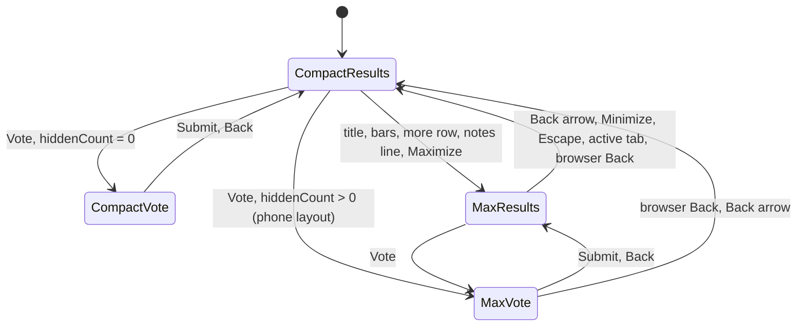

# Data Model: Phone Layout Redesign

Nothing is stored: no table, column, cache key, cookie or browser storage is added or changed. The server loses four
routes and gains none. The feature's state is in the browser, per page view.

## Essential choices (pure function, `pollCard.js`)

`essentialChoices(sorted, ownIds, limits) → { shown, hiddenCount, hiddenShare }`

| Input | Meaning |
|---|---|
| `sorted` | the poll's choices, already ordered by share, largest first (today's stable sort) |
| `ownIds` | the ids the viewer has voted for (`myChoiceIds`), possibly empty |
| `limits` | `{ lead: 4, allUpTo: 5 }` on the compact card; `{ lead: 10, allUpTo: 12, abovePct: 2, allAbovePct: 0 }` in the maximized view |

| Output | Meaning |
|---|---|
| `shown` | all of `sorted` when its length ≤ `allUpTo` (with `allAbovePct`, only those whose `pct` is above it, unless none is, plus the viewer's own; TWEAK05); otherwise the first `lead` (with `abovePct`, only those of them whose `pct` is above it, unless none is; TWEAK03), then the viewer's own choices not among them, in `sorted` order |
| `hiddenCount` | `sorted.length − shown.length` |
| `hiddenShare` | the sum of the hidden choices' shares, rounded as the bars' percentages are |

## View state of a poll card (in memory)

| Field | Values | Notes |
|---|---|---|
| mode | `compact`, `maximized` | existing (`setMaximized`) |
| face | `results`, `vote` | existing (`.is-flipped`) |
| choiceView | `essential`, `voted`, `all` | new; maximized only; `voted` when opened from the "More choices" row, else `essential`; reset when the view closes (TWEAK07, was `showAll`) |
| extra shown | one of `notes`, `graph`, `voters`, or none | new; phone layout only; the leftmost the poll has when the view opens, or `notes` when opened from the notes line; none when the poll has none (TWEAK01) |

## History state (`history.state`)

| Key | Set by | Meaning |
|---|---|---|
| `maximizedPid` | `tabs.js`, on maximize from a card | this history step is a maximized view of that poll; absent on every other step |
| `legalDepth` | `backArrow.js` (existing) | unchanged; legal pages only |

Other keys already in `history.state` are passed through unchanged.

## Removed with Poll Results

| Removed | Kind |
|---|---|
| `GET /admin/poll/results` | page route |
| `GET /api/admin/polls/:pid/results` | data route (`PollResults`, `Participant` schemas) |
| `GET /api/admin/polls/:pid/export.json` | download |
| `GET /api/admin/polls/:pid/export.md` | download |

No stored data is deleted; votes, voters and invitations stay as they are.
