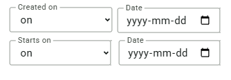

# Overview: `specs/20261113-140600-PHONE-LAYOUT-REDESIGN`

## Document History

| Record | Value |
|---|---|
| Feature directory | `specs/20261113-140600-PHONE-LAYOUT-REDESIGN` |
| Tweak file created | 2026-11-13 19:05 |
| Last updated | 2026-11-15 21:12 |

Legend: `[ ]` open · `[X]` Resolved · `[-]` Resolved (manually)  
(or accepted as-is) by the developer.
Tick `Run Tests` to have this tweak's automated tests written and run; leave it empty (the default) to postpone the run.

"Next" always returns the first `[ ]` item below.

The developer is expected to create the individual tweak requirements in this file, and then run the `/speckit-tweak` command to have the AI implement them, one at a time.  
Each tweak requirement initially carries an empty checkbox; tick it when the item is resolved or consciously accepted.  


# Tweaks

## TWEAK01 Extras Tab Bar In Maximized View  
[X] Resolved  
[ ] Run Tests  


Rather than this method of expanding the sections in the Maximized Poll view,  

  

Implement a tab bar like this rough mockup:  


The font sizes and colors will be the same as the Tab Menu on the Home page.
The line under the items and the thick line under the selected item will have the same style as in the Tab Menu on the Home page.  

The Poll notes will be displayed when he "Read More" with document icon is clicked.    

The Line Graph will be displayed when the "Polling History" with graph icon is clicked.  

The Who Voted table will be displayed when the "Who Voted" with 2 person icon is clicked.  
The 2 person icon is the same as the fav-icon except the color is solid.  

Only one section is displayed at one time.  

If none of these sections are available, all items are greyed out, just as Home menu Tab items are greyed out with not available.  

If just one is available, then it will be displayed by default and other greyed out.

If more than one is avaiable then the item that is leftmost will be displayed by default.  


If any Clarifications are needed to implement this, just ask.

### RECOMMENDATION

Replace the three expandable rows with one tab bar under the maximized card, in the phone layout only (480 px and narrower).  
Above 480 px the view keeps all three sections open in its right column, as today.  
This changes FR-029 and FR-030 of the spec, which describe closed expandable rows.  

- `src/public/index.html`  
  - In `#maximizedCardGrid`, remove the three `button.extras-header` and put one `div.extras-tabs` (`role="tablist"`) first in `.maximized-space-right`.  
  - It holds three `button.extras-tab` (`role="tab"`), left to right: "Read More" (document icon, notes), "Polling History" (graph icon, line graph), "Who Voted" (two-person icon, voters).  
  - The two-person icon is the favicon's two figures in one solid colour, as a shared `<symbol id="who-voted-people">`.  
- `src/public/tabs.js`  
  - One section is shown at a time: the leftmost available one when the view opens, or Notes when the view is opened from the card's notes line.  
  - An unavailable tab gets `aria-disabled="true"` and does nothing when tapped; with none available all three are greyed and no section shows.  
  - The Who Voted report and the graph are still fetched only when their tab is first shown.  
- `src/public/phone-card-m3.css`  
  - Style the bar from the same tokens as the Home tab bar's phone rules: `label-small` type, `on-surface-variant` text, `primary` for the selected tab with the 3 px indicator, a 1 px `outline-variant` line, 38% `on-surface` for a greyed tab, icon over label, 64 px tall.  
  - Hide the two sections that are not selected; remove the `.extras-header` rules.  
- `src/public/tabs.css`: hide `.extras-tabs` above 480 px in place of `.extras-header`.  
- Tests, written but not run (`Run Tests` is empty):  
  - `tests/client-phone-view.test.ts`: the default tab, one section at a time, greyed tabs, voters fetched on first show, Notes from the notes line.  
  - `tests/phone-sheets.test.ts`: the bar's rules and its tokens.  
  - `tests/client-maximized.test.ts`, `tests/client-poll-notes.test.ts`, `tests/client-who-voted.test.ts`: the template's new structure.  
- Artifacts: `spec.md` (the story text, FR-029, FR-030, Key Entities), `plan.md`, `research.md` R8, `data-model.md`, `contracts/poll-card.md` C4, `contracts/phone-layout.md`, `quickstart.md`, `README.md`, `ARCHITECTURE.md`, `CLAUDE_COMPLETE.md`.  

Assumptions made instead of questions:  

- The bar is for the phone layout only.  
- The tab order is the mockup's (notes, graph, voters), not the old rows' (notes, voters, graph).  
- The bar is always shown in the phone layout, also when all three tabs are greyed.  

Note: `image-4.png` and `image-7.png` are in `specs/20261113-085157-FIXED-VIEWPORT-WIDTH`, not in this directory, so the two image links above do not resolve.  

2026-11-13 21:08

### ACCEPTED RECOMMENDATION

The three expandable rows are replaced by one tab bar under the maximized card, in the phone layout only.  
Nothing was run in a browser and no test was run, so the look and the behaviour are unverified until the next device or test run.  

- Code  
  - `src/public/index.html`: `div.extras-tabs` with three `button.extras-tab` (Read More, Polling History, Who Voted) replaces the three `button.extras-header`;  
    the two-person icon is the new shared `<symbol id="who-voted-people">`, the favicon's figures in one colour.  
  - `src/public/tabs.js`: `syncExtras` selects one tab and greys out the ones the poll lacks;  
    `showExtra` replaces `toggleExtra`;  
    `extraShown` replaces `extrasOpen`.  
  - `src/public/phone-card-m3.css`: the bar's rules, from the tokens the Home tab bar uses;  
    the two sections not selected are hidden;  
    the `.extras-header` rules are gone.  
  - `src/public/tabs.css`: `.extras-tabs` is hidden above 480 px.  
- Tests: tests postponed (Run Tests not ticked);  
  the following were written or updated and not run.  
  - `tests/client-phone-view.test.ts`: four tests in "the extras tab bar of the maximized view" (all greyed, leftmost by default and one at a time, Who Voted alone, Notes from the notes line).  
  - `tests/phone-sheets.test.ts`: the bar is phone-only, only the selected section shows, the tabs use the Home tab bar's tokens, `.extras-tab` is a 64 px row.  
  - `tests/client-maximized.test.ts`, `tests/client-poll-notes.test.ts`, `tests/client-who-voted.test.ts`: the template's new structure.  
  - `npx tsc --noEmit` passes.  
- Artifacts  
  - `spec.md`: Story 3's text, FR-029 and FR-030 (a requirement changed), Key Entities.  
  - `plan.md`, `research.md` (R8), `data-model.md`, `contracts/poll-card.md` (C4), `contracts/phone-layout.md`, `quickstart.md` (§5 and the runs table), `tasks.md` (T049 added).  
  - `README.md`, `ARCHITECTURE.md`, `CLAUDE_COMPLETE.md`.  

2026-11-13 21:12

## TWEAK02 Footer Line Spacing And Larger Dots  
[X] Resolved  
[ ] Run Tests  

There is too much line spacing in the footer:  


Also, please make the white dots twice the size.

### RECOMMENDATION

The spacing comes from the 23 px of padding above and below every footer link, which made each link a 64 px touch row.  
Put the links back in the text flow and space the footer's lines at 32 px (1.6 × the small text's line height), in the phone layout only.  
This changes contract P3: footer links are no longer 64 px rows but links inside a sentence with a 32 px hit area, like the legal text.  

- `src/public/phone-m3.css`  
  - `.site-footer`: add `line-height:calc(var(--md-sys-typescale-body-small-line-height) * 1.6)`.  
  - `.site-footer a`: `padding-block:6px` in place of `display:inline-block; padding-block:23px`.  
  - `.site-footer-dot`: twice the small text's size, with no effect on the line's height.  
- `src/public/app.js`: each " · " separator in the footer becomes a `span.site-footer-dot` with a space on either side, so the dots can be sized;  
  the footer's text is unchanged.  
- The dots are doubled in the phone layout only; above 480 px the footer looks as before.  
- Tests, written but not run (`Run Tests` is empty):  
  - `tests/client-footer.test.ts`: the four separators are `.site-footer-dot` spans and the text is unchanged.  
  - `tests/phone-sheets.test.ts`: the footer's line height, the links' padding and the dot's size.  
- Artifacts: `contracts/phone-layout.md` (P3 row for footer links), `quickstart.md` (the list of links under 64 px), `tasks.md` (new task line).  

2026-11-13 21:23

### ACCEPTED RECOMMENDATION

The footer's lines are 32 px apart in the phone layout and its separator dots are twice the size.  
Nothing was run in a browser and no test was run, so the look, and the dots' vertical position in particular, is unverified until the next device or test run.  

- Code  
  - `src/public/phone-m3.css`: `.site-footer` has a line height of 1.6 × the small text's;  
    `.site-footer a` keeps its place in the text with `padding-block:6px`;  
    `.site-footer-dot` is twice the small text's size with `line-height:0`.  
  - `src/public/app.js`: `renderSiteFooter` builds each separator as `span.site-footer-dot`;  
    the footer's text is unchanged, and above 480 px so is its look.  
- Tests: tests postponed (Run Tests not ticked);  
  the following were written and not run.  
  - `tests/client-footer.test.ts`: "puts every separator dot in its own element, so the phone layout can size it".  
  - `tests/phone-sheets.test.ts`: two tests in "the footer in the phone layout".  
  - `npx tsc --noEmit` passes.  
- Artifacts  
  - `contracts/phone-layout.md`: P3 no longer lists footer links as 64 px rows (a requirement changed).  
  - `quickstart.md` (§8, the row on controls under 64 px), `tasks.md` (T050 added).  

2026-11-13 21:24

## TWEAK03 Maximized Bars Above One Percent  
[X] Resolved  
[ ] Run Tests  
Change the rule:  
"The 50-choice poll shows ten bars and "Show all 50 choices"; it expands in place and reads "Show fewer"."  
to  
"The 50-choice poll shows the bars that render greater than '1%' and no more than 10 bars, and "Show all 50 choices"; it expands in place and reads 'Show fewer'."

### RECOMMENDATION

In the maximized view of the phone layout, a poll with thirteen or more choices shows only those of its ten leaders whose bar reads 2% or more.  
This changes FR-027 of the spec, which says the ten leading choices are shown.  

- `src/public/pollCard.js`  
  - `MAXIMIZED_LIMITS` becomes `{ lead: 10, allUpTo: 12, abovePct: 1 }`.  
  - `essentialChoices` keeps, of the first `lead` choices, those whose `pct` is above `abovePct`, when the limits carry one.  
  - "Show all N choices" and "Show fewer" work as before.  
- Tests, written but not run (`Run Tests` is empty):  
  - `tests/essential-choices.test.ts`: the new limit, leaders at 1% and 0% left out, an own choice at 1% kept, the no-leader-above-1% case.  
  - `tests/client-phone-card.test.ts`: a maximized 37-choice poll with three leaders above 1% shows three bars and "Show all 37 choices".  
- Artifacts: `spec.md` (Story 3, FR-027, Key Entities), `quickstart.md` (the rule quoted above and the runs table), `contracts/poll-card.md` (C1), `data-model.md`, `research.md` (R5), `plan.md`, `tasks.md`, `README.md`, `ARCHITECTURE.md`, `CLAUDE.md`, `CLAUDE_COMPLETE.md`.  

Assumptions made instead of questions:  

- "Greater than 1%" is read from the rounded figure the bar displays, so a bar reading 1% is left out and one reading 2% is shown.  
- The viewer's own choices are still shown, whatever their share.  
- When none of the ten leaders is above 1% (a poll with no votes yet, or votes spread thinly), the ten leaders are shown as before, so the view is never just the "Show all" row.  
- A poll with twelve or fewer choices still shows every choice, also those at 1% and 0%.  
- The compact card in a tab is unchanged: its four leaders, whatever their share.  

2026-11-14 04:47

### ACCEPTED RECOMMENDATION

In the phone layout's maximized view, a poll with thirteen or more choices shows only those of its ten leaders whose share reads above 1%, plus the viewer's own choices.  
Nothing was run in a browser and no test was run, so the behaviour is unverified until the next device or test run.  

- Code  
  - `src/public/pollCard.js`: `MAXIMIZED_LIMITS` is `{ lead: 10, allUpTo: 12, abovePct: 1 }`;  
    `essentialChoices` keeps the leaders whose `pct` is above `abovePct`, or all of them when none is.  
- Tests: tests postponed (Run Tests not ticked);  
  the following were written or updated and not run.  
  - `tests/essential-choices.test.ts`: the new limit and five tests (three above 1%, fifteen above 1%, an own choice at 1%, none above 1%, the compact card unchanged).  
  - `tests/client-phone-card.test.ts`: "leaves out the leaders that read 1% or less".  
  - `npx tsc --noEmit` passes.  
- Artifacts  
  - `spec.md`: Story 3's text and scenarios, FR-027 (a requirement changed), Key Entities.  
  - `quickstart.md`: the rule as given in this tweak, and the runs table.  
  - `contracts/poll-card.md` (C1, four rows added), `data-model.md`, `research.md` (R5), `plan.md`, `tasks.md` (T051 added).  
  - `README.md`, `ARCHITECTURE.md`, `CLAUDE.md`, `CLAUDE_COMPLETE.md`.  

2026-11-14 04:47

## TWEAK04 Rule For Choices In Maximized View  
[X] Resolved  
[ ] Run Tests  
What is the rule for showing choices in the maximized view on the front face of a Poll Card?

### RECOMMENDATION

This is a question, so the recommendation is its answer and no change to the code.  
The front face (the results side) of a maximized card follows this rule, as the code stands after TWEAK03.  

- Order: the choices are sorted by share, largest first;  
  choices with the same share, and all choices of a poll with no votes yet, keep the poll's own order.  
- Phone layout (480 px and narrower), in `essentialChoices` of `src/public/pollCard.js`:  
  1. Twelve choices or fewer: every choice is a bar, also those at 1% and 0%.  
  2. Thirteen choices or more: take the ten leaders and keep those whose displayed share is above 1% (2% or more).  
  3. If none of the ten is above 1%, keep all ten.  
  4. Add the viewer's own choices that are not already shown, after the leaders, whatever their share.  
  5. Under the bars one row reads "Show all N choices";  
     it shows every choice in place and then reads "Show fewer", which restores the shorter list.  
  6. The list starts short again each time the view is opened.  
- Above 480 px: every choice is a bar and nothing is left out;  
  the bars get shorter as the poll has more choices (`maximizedBarLayout`).  
- The voting side always lists every choice, at every width.  

The rule is also in `contracts/poll-card.md` (C1 and C4) and in FR-027 and FR-028 of `spec.md`.  

2026-11-14 04:58

### ACCEPTED RECOMMENDATION

Answered above; nothing was changed in the code, the tests or the feature's artifacts.  
To change any step of the rule, write it as the next tweak.  

2026-11-14 04:58

## TWEAK05 Trial Of Stricter Bar Thresholds  
[X] Resolved  
[ ] Run Tests  
We would like to try these changes and test for a bit to see if we like it:

The front face (the results side) of a maximized card follows this rule:
- Order: the choices are sorted by share, largest first;  
  choices with the same share, and all choices of a poll with no votes yet, keep the poll's own order.  
- Phone layout (480 px and narrower), in `essentialChoices` of `src/public/pollCard.js`:  
  1. Twelve choices or fewer: every choice is a bar, also those at 1%, excluding those at 0%.  
  2. Thirteen choices or more: take the ten leaders and keep those whose displayed share is above 2% (3% or more).  
  3. If none of the ten is above 1%, keep all ten.  
  4. Add the viewer's own choices that are not already shown, after the leaders, whatever their share.  
  5. Under the bars one row reads "Show all N choices";  
     it shows every choice in place and then reads "Show fewer", which restores the shorter list.  
  6. The list starts short again each time the view is opened.  
- Above 480 px: every choice is a bar and nothing is left out;  
  the bars get shorter as the poll has more choices (`maximizedBarLayout`).  
- The voting side always lists every choice, at every width.  

### RECOMMENDATION

Two steps of the rule differ from today's: step 1 leaves out the choices at 0%, and step 2 raises the threshold from above 1% to above 2%.  
Both are two numbers in `MAXIMIZED_LIMITS`, so the trial is easy to undo.  
This changes FR-027 of the spec again.  

- `src/public/pollCard.js`  
  - `MAXIMIZED_LIMITS` becomes `{ lead: 10, allUpTo: 12, abovePct: 2, allAbovePct: 0 }`.  
  - `essentialChoices` applies `allAbovePct` to a list of `allUpTo` or fewer, the way it applies `abovePct` to the leaders of a longer list.  
- Tests, written but not run (`Run Tests` is empty):  
  - `tests/essential-choices.test.ts`: the new limits, twelve choices with some at 0%, twelve with no votes, leaders at 2% left out, every leader at 2%.  
  - `tests/client-phone-card.test.ts`: a twelve-choice poll hides its 0% choices behind "Show all 12 choices"; a 37-choice poll leaves out leaders at 2% or less.  
- Artifacts: `spec.md` (Story 3, FR-027, Key Entities), `quickstart.md`, `contracts/poll-card.md` (C1, C4), `data-model.md`, `research.md` (R5), `plan.md`, `tasks.md`, `README.md`, `ARCHITECTURE.md`, `CLAUDE.md`, `CLAUDE_COMPLETE.md`.  

Assumptions made instead of questions:  

- Step 3 still says "none above 1%", which no longer matches step 2: ten leaders all at exactly 2% would leave no bar at all.  
  It is implemented as "if none of the ten is above 2%, keep all ten".  
- A poll of twelve or fewer in which every choice is at 0% (no votes yet) shows every choice.  
- A poll of twelve or fewer that leaves choices out gets the "Show all N choices" row of step 5, which it never had before.  
- Step 4 also applies to a poll of twelve or fewer: the viewer's own choice at 0% is shown.  
- The compact card in a tab is unchanged.  

2026-11-14 05:07

### ACCEPTED RECOMMENDATION

On trial: in the phone layout's maximized view a poll of twelve or fewer choices leaves out its choices at 0%, and a longer poll shows only those of its ten leaders that read above 2%.  
Nothing was run in a browser and no test was run, so the behaviour is unverified until the next device or test run.  
To end the trial, set `MAXIMIZED_LIMITS` in `src/public/pollCard.js` back to `{ lead: 10, allUpTo: 12, abovePct: 1 }`, or write that as a tweak so the tests and artifacts follow.  

- Code  
  - `src/public/pollCard.js`: `MAXIMIZED_LIMITS` is `{ lead: 10, allUpTo: 12, abovePct: 2, allAbovePct: 0 }`;  
    `essentialChoices` filters a short list by `allAbovePct` and a long list's leaders by `abovePct`, and keeps them all when none passes.  
- Tests: tests postponed (Run Tests not ticked);  
  the following were written or updated and not run.  
  - `tests/essential-choices.test.ts`: the limits, three new tests and three updated to the 2% threshold.  
  - `tests/client-phone-card.test.ts`: "leaves out a twelve-choice poll's choices at 0% until asked for all" and "leaves out the leaders that read 2% or less".  
  - `npx tsc --noEmit` passes.  
- Artifacts  
  - `spec.md`: Story 3's text and scenarios 1 and 2, FR-027 (a requirement changed), Key Entities.  
  - `quickstart.md`: the 50-choice line at 2%, a new line for polls of twelve or fewer, the runs table.  
  - `contracts/poll-card.md` (C1 with three rows added, C4), `data-model.md`, `research.md` (R5), `plan.md`, `tasks.md` (T052 added).  
  - `README.md`, `ARCHITECTURE.md`, `CLAUDE.md`, `CLAUDE_COMPLETE.md`.  

2026-11-14 05:07

## TWEAK06 Larger Extras Tab Icons  
[X] Resolved  
[ ] Run Tests  

A small change to TWEAK01 requirement.  
Make the icons 50% larger.

### RECOMMENDATION

Draw the three icons of the maximized view's tab bar (Read More, Polling History, Who Voted) at 30 px in place of 20 px.  

- `src/public/phone-card-m3.css`: `.extras-tab .tab-icon{ width:30px; height:30px; }`.  
- The bar grows about 10 px taller with them;  
  the labels, colours and the selected line are unchanged.  
- Test, written but not run (`Run Tests` is empty): `tests/phone-sheets.test.ts` pins 30 px against the Home tabs' 20 px, in place of the check that the two sizes are equal.  
- Artifacts: `research.md` (R8), `tasks.md`.  

Assumption made instead of a question: "the icons" are those of the TWEAK01 tab bar only, so the Home tab bar's icons stay at 20 px.  

2026-11-14 05:10

### ACCEPTED RECOMMENDATION

The three icons of the maximized view's tab bar are 30 px, 50% larger than before.  
Nothing was run in a browser and no test was run, so the look is unverified until the next device or test run.  

- Code: `src/public/phone-card-m3.css`, the `.extras-tab .tab-icon` rule.  
- Tests: tests postponed (Run Tests not ticked);  
  `tests/phone-sheets.test.ts` has the new test "draws the extras tabs' icons half as large again as the Home tab bar's", not run.  
  `npx tsc --noEmit` passes.  
- Artifacts: `research.md` (R8), `tasks.md` (T053 added).  

2026-11-14 05:10

## TWEAK07 More Choices And Remaining Choices Rows  
[X] Resolved  
[ ] Run Tests  

The Maximized Poll Card is one of the most critical features of CrowdPoll.  
The work we are doing to only display as many choices as necessary to help the user understand the poll results while minimizing poll card size is almost perfect.  
Users have described what they expect.  

One the home page Poll Card please change the message "N more choices - p%" to "More choices - p%".  

Then when clicking the link, the Maximized Poll Card shows shows all choices that have 1% or more.  
If there are still more choices, the message will read, "Remaining choices - 0%".    

When the Maximized Poll card is navigated to directly by any means besides the "more choices" button on the home page,  
(i.e. clicking the 'maximize' icon or from a shared link)   
then the Maximize Poll Card will have a clickable message "Show all N choices - p%".  

Then the "Show fewer" will now be "Show few choices", and it will bring the maximize card back to the default rule (existing) for the card.

### RECOMMENDATION

Give the maximized card a second starting list for the phone layout: every choice at 1% or more, used only when the view is opened from the home card's "More choices" row.  
This changes FR-015 and FR-028 of the spec and adds FR-028a.  

- `src/public/pollCard.js`  
  - The home card's row reads "More choices · p%" (no count);  
    on a multiple-choice poll it reads "More choices", as the share is left out there today.  
  - Tapping that row asks for the maximized view with `{ choices: 'voted' }`.  
  - The card's `showAll` flag becomes `choiceView`, one of `essential` (the existing default rule), `voted` or `all`.  
  - `voted`: every choice at 1% or more, plus the viewer's own;  
    when choices remain, the last row reads "Remaining choices · 0%".  
  - `essential`: the last row reads "Show all N choices · p%", where p is the combined share of the choices left out.  
  - `all`: every choice, and the last row reads "Show few choices", which returns to `essential`.  
- `src/public/tabs.js`: `maximize` passes `how.choices` on to `card.setMaximized`.  
- Tests, written but not run (`Run Tests` is empty): `tests/client-phone-card.test.ts`, the new wordings and the view opened from the "More choices" row.  
- Artifacts: `spec.md`, `quickstart.md`, `contracts/poll-card.md` (C2, C4), `data-model.md`, `research.md` (R5), `plan.md`, `tasks.md`, `README.md`, `ARCHITECTURE.md`.  

Assumptions made instead of questions:  

- The " - " in the three messages is the " · " the row already uses.  
- "Remaining choices · 0%" is a button: tapping it shows the remaining choices, and the row then reads "Show few choices".  
- "Show few choices" is used exactly as written, not "Show fewer choices".  
- The "p%" of "Show all N choices · p%" is left out on a multiple-choice poll, like the home card's;  
  "Remaining choices · 0%" always carries its "0%".  
- Opened from the "More choices" row with every choice at 1% or more, the view shows them all and, when the default rule would leave some out, the "Show few choices" row.  
- Opened from the "More choices" row before any vote (no choice at 1%), the view shows every choice.  
- Tapping the title, the subtitle, a bar or Maximize, a shared link, the Vote button and the browser's Forward all open the default rule; only the "More choices" row opens the 1% list.  

2026-11-14 12:00

### ACCEPTED RECOMMENDATION

The home card's row reads "More choices · p%" and opens the maximized view on every choice at 1% or more, with "Remaining choices · 0%" for the rest;  
opened any other way the view keeps the default rule, with "Show all N choices · p%" and then "Show few choices".  
Nothing was run in a browser and no test was run, so the behaviour is unverified until the next device or test run.  

- Code  
  - `src/public/pollCard.js`: `choiceView` replaces `showAll`;  
    `votedChoices` picks the choices at 1% or more;  
    `phoneResultsView` words the four rows;  
    the "More choices" row calls `requestMaximize({ choices: 'voted' })`;  
    `setMaximized(on, how)` takes the starting list.  
  - `src/public/tabs.js`: `maximize` calls `card.setMaximized(true, { choices: how.choices })`.  
- Tests: tests postponed (Run Tests not ticked);  
  the following were written or updated and not run.  
  - `tests/client-phone-card.test.ts`: six new tests (the row's request, no share on a multiple-choice "Show all" row, and four on the view opened from the "More choices" row) and nine expectations updated to the new wordings.  
  - `npx tsc --noEmit` passes.  
- Artifacts  
  - `spec.md`: Story 1 and Story 3 texts, the multiple-choice edge case, FR-015 and FR-028 (requirements changed), FR-028a (new).  
  - `quickstart.md` (§4 and §5), `contracts/poll-card.md` (C2, C4), `data-model.md`, `research.md` (R5), `plan.md`, `tasks.md` (T054 added).  
  - `README.md`, `ARCHITECTURE.md`.  

2026-11-14 12:00

## TWEAK08 Database Connection Reset On Launch  
[X] Resolved  
[ ] Run Tests  

Do you see the problem here.  
```
(base) PS C:\crowdPoll\phone-uiux> devScripts/launch-dev.ps1                                                                     
PostgreSQL service is running.
Starting server on http://localhost:8080 (both mode)...

> crowdpoll.vote@0.2.0 dev
> tsx watch src/server.ts

[config] ENV_DATABASE_CA_CERT was not found, using default value: none (system certificate roots).
[config] ENV_DEFAULT_LINK_PREVIEW_MESSAGE was not found, using default value: You have been invited to vote in this poll..
[config] ENV_DEVICE_EVENTS_ENABLED was not found, using default value: false (no device evidence is collected).
[config] ENV_FCAPTCHA_ENABLED was not found, using default value: off (no human check before login).
[config] ENV_OAUTH_APPLE_* was not found, using default value: none (Apple login off).
[config] ENV_OAUTH_MICROSOFT_* was not found, using default value: none (Microsoft login off).
[config] ENV_OPENSEARCH_URL was not found, using default value: none (PostgreSQL full-text search).
[config] ENV_PROTOTYPES was not found, using default value: none (no prototypes served).
[config] ENV_SPACES_* was not found, using default value: none (TRENDING objects and assets served from the instance).
[server] Starting in both login mode
[auth] Login method: both; providers: Google, Amazon
[auth] Sign-up allowlist on (1 addresses, 1 pattern; 3 administrators always allowed)
[db] ENV_DATABASE_CA_CERT is not set: verifying the database certificate against the system roots
[server] Database migration failed; refusing to start: MigrationError: Migration check failed: read ECONNRESET
    at migrateToLatest (C:\crowdPoll\phone-uiux\src\db\migrator.ts:22:11)
    at process.processTicksAndRejections (node:internal/process/task_queues:104:5)
    at async startServer (C:\crowdPoll\phone-uiux\src\server.ts:188:21)
(base) PS C:\crowdPoll\phone-uiux> npm run fix-migrations

> crowdpoll.vote@0.2.0 fix-migrations
> tsx devScripts/fix-migrations.ts

[migrations] Error: cannot reach the database: read ECONNRESET
(base) PS C:\crowdPoll\phone-uiux> 
```

### RECOMMENDATION

Yes: the PostgreSQL service is up, but it resets every new connection, so neither the server nor `fix-migrations` can reach the database.  
The cause is the database service, not the migrations and not this feature's code.  
Restart the service from an elevated PowerShell, then launch again:  

```
Restart-Service postgresql-x64-16
devScripts/launch-dev.ps1
```

What was checked (read-only, at 2026-11-15 20:31):  

- The service `postgresql-x64-16` is Running and listens on port 5432, on both `0.0.0.0` and `::`;  
  it has been up since the machine started on 2026-11-13 07:36.  
- A plain `pg` connection with the URL of `devScripts/launch-dev.ps1` fails with `read ECONNRESET` on `localhost`, `127.0.0.1` and `::1` alike, outside the app.  
- The server log `C:\Program Files\PostgreSQL\16\data\log\postgresql-2026-11-15_000000.log` shows `WARNING: autovacuum worker took too long to start; canceled` at 19:22, and nothing at all for the failed connections after 20:01.  
  A postmaster that accepts the socket but logs nothing and starts no worker is no longer able to start a backend process for a new connection.  
- Memory is not short (32 GB free), and the Windows event log holds no related error, so why it stopped starting processes is not known.  
- `ENV_DATABASE_CA_CERT is not set` in the output is the normal line for a local database and is not part of the problem.  

Not done by the AI:  

- The restart itself: it needs an elevated shell, and it closes the nine database connections that other programs have held open since 2026-11-13 07:37.  
- `npm run fix-migrations` is not needed: it failed for the same reason, and the migration record was never read.  

Option, not applied: have `launch-dev.ps1` try one connection after "PostgreSQL service is running." and print this advice when it is reset, as the service status alone does not show the fault.  

The tweak stays open until the restart is confirmed: say "I resolved it" once the server starts.  

2026-11-15 20:31

### RECOMMENDATION

The earlier recommendation is superseded: the restart could not work.  
Windows Smart App Control is blocking `C:\Program Files\PostgreSQL\16\bin\postgres.exe`, which is not code-signed.  
On Windows PostgreSQL starts a new `postgres.exe` for every connection, so the running server reset each new connection, and after the stop the service cannot start at all.  

Evidence (read-only, at 2026-11-15 20:51):  

- The service is Stopped; the shutdown at 20:45:51 was clean, so the data directory is intact.  
- The Application event log says `pg_ctl: could not find postgres program executable` at each start attempt.  
- Starting `postgres.exe -V` by hand fails with "An Application Control policy has blocked this file";  
  `pg_ctl.exe`, `psql.exe` and `initdb.exe` in the same folder run.  
- The Code Integrity log holds 220 blocks of `postgres.exe` (event 3077, with "Smart App Control Block" details), and no other file.  
- `Get-MpComputerStatus` reports `SmartAppControlState: On`.  
- Not established: why the blocking began on 2026-11-15 around 19:22 after days of running; the log does not reach back that far.  

Options, all the developer's to choose, none applied by the AI:  

- A: turn Smart App Control off in Windows Security, App & browser control, Smart App Control settings, then `Start-Service postgresql-x64-16`.  
  It is a machine-wide security setting, it has no per-program exception, and on some Windows versions it cannot be turned on again without resetting Windows.  
- B: keep Smart App Control on and run PostgreSQL where it does not apply, in WSL or Docker, on port 5432 with the data restored from a dump.  
  The dump itself needs the server running, so this path also needs A once, or a file-level copy of the data directory into the same PostgreSQL version.  

The test suite's embedded PostgreSQL starts its own unsigned `postgres.exe` and is likely to be blocked the same way; that was not tried.  

2026-11-15 20:51

### ACCEPTED RECOMMENDATION

The developer chose option B without a dump: PostgreSQL 16 now runs in Docker (container `crowdpoll-pg`, port 5432 on 127.0.0.1, empty `app01` database), and the Windows service is disabled.  
Smart App Control stays on.  
The server itself was not launched by the AI, so the first start and its migrations are still to be seen.  

- Done by the developer: the `docker run` command and `Set-Service postgresql-x64-16 -StartupType Disabled`.  
- Scripts  
  - `devScripts/launch-dev.ps1` and its template `devScripts.example/launch-dev.ps1`: for a local URL the script first tries the URL's port on both loopback addresses and uses whatever answers;  
    only when nothing answers does it start a PostgreSQL service that is not disabled, and with none it stops with advice naming the container.  
- Checked  
  - The database section alone was run against four URLs (local with and without a port, `[::1]` on an unused port, a remote host) and behaved as intended.  
  - A `pg` connection with the script's own `ENV_DATABASE_URL` reached `app01` on PostgreSQL 16.16 in the container.  
- Tests: none written or run;  
  `npm test` starts an embedded `postgres.exe` that Smart App Control is likely to block as well, which was not tried.  
- Artifacts: `README.md` (Windows 11 development machine: the Docker command and the reason).  

2026-11-15 21:12

## TWEAK09 Commit, Merge Main And Line Graph Fix  
[ ] Resolved  
[ ] Run Tests  

No tests yet.
First, 
commit and merge
then
merge the branch line-graph-fix into the current branch
