# Overview: `specs/20261113-140600-PHONE-LAYOUT-REDESIGN`

## Document History

| Record | Value |
|---|---|
| Feature directory | `specs/20261113-140600-PHONE-LAYOUT-REDESIGN` |
| Tweak file created | 2026-11-13 19:05 |
| Last updated | 2026-11-16 16:49 |

Legend: `[ ]` open · `[X]` Resolved · `[-]` Resolved (manually)  
(or accepted as-is) by the developer.
Tick `Run Tests` to have this tweak's automated tests written and run; leave it empty (the default) to postpone the run.

"Next" always returns the first `[ ]` item below.

The developer is expected to create the individual tweak requirements in this file, and then run the `/speckit-tweak` command to have the AI implement them, one at a time.  
Each tweak requirement initially carries an empty checkbox; tick it when the item is resolved or consciously accepted.  


# Tweaks

## TWEAK01 Extras Tab Bar In Maximized View  
[X] Resolved  
[ ] Run Tests  


Rather than this method of expanding the sections in the Maximized Poll view,  

  

Implement a tab bar like this rough mockup:  


The font sizes and colors will be the same as the Tab Menu on the Home page.
The line under the items and the thick line under the selected item will have the same style as in the Tab Menu on the Home page.  

The Poll notes will be displayed when he "Read More" with document icon is clicked.    

The Line Graph will be displayed when the "Polling History" with graph icon is clicked.  

The Who Voted table will be displayed when the "Who Voted" with 2 person icon is clicked.  
The 2 person icon is the same as the fav-icon except the color is solid.  

Only one section is displayed at one time.  

If none of these sections are available, all items are greyed out, just as Home menu Tab items are greyed out with not available.  

If just one is available, then it will be displayed by default and other greyed out.

If more than one is avaiable then the item that is leftmost will be displayed by default.  


If any Clarifications are needed to implement this, just ask.

### RECOMMENDATION

Replace the three expandable rows with one tab bar under the maximized card, in the phone layout only (480 px and narrower).  
Above 480 px the view keeps all three sections open in its right column, as today.  
This changes FR-029 and FR-030 of the spec, which describe closed expandable rows.  

- `src/public/index.html`  
  - In `#maximizedCardGrid`, remove the three `button.extras-header` and put one `div.extras-tabs` (`role="tablist"`) first in `.maximized-space-right`.  
  - It holds three `button.extras-tab` (`role="tab"`), left to right: "Read More" (document icon, notes), "Polling History" (graph icon, line graph), "Who Voted" (two-person icon, voters).  
  - The two-person icon is the favicon's two figures in one solid colour, as a shared `<symbol id="who-voted-people">`.  
- `src/public/tabs.js`  
  - One section is shown at a time: the leftmost available one when the view opens, or Notes when the view is opened from the card's notes line.  
  - An unavailable tab gets `aria-disabled="true"` and does nothing when tapped; with none available all three are greyed and no section shows.  
  - The Who Voted report and the graph are still fetched only when their tab is first shown.  
- `src/public/phone-card-m3.css`  
  - Style the bar from the same tokens as the Home tab bar's phone rules: `label-small` type, `on-surface-variant` text, `primary` for the selected tab with the 3 px indicator, a 1 px `outline-variant` line, 38% `on-surface` for a greyed tab, icon over label, 64 px tall.  
  - Hide the two sections that are not selected; remove the `.extras-header` rules.  
- `src/public/tabs.css`: hide `.extras-tabs` above 480 px in place of `.extras-header`.  
- Tests, written but not run (`Run Tests` is empty):  
  - `tests/client-phone-view.test.ts`: the default tab, one section at a time, greyed tabs, voters fetched on first show, Notes from the notes line.  
  - `tests/phone-sheets.test.ts`: the bar's rules and its tokens.  
  - `tests/client-maximized.test.ts`, `tests/client-poll-notes.test.ts`, `tests/client-who-voted.test.ts`: the template's new structure.  
- Artifacts: `spec.md` (the story text, FR-029, FR-030, Key Entities), `plan.md`, `research.md` R8, `data-model.md`, `contracts/poll-card.md` C4, `contracts/phone-layout.md`, `quickstart.md`, `README.md`, `ARCHITECTURE.md`, `CLAUDE_COMPLETE.md`.  

Assumptions made instead of questions:  

- The bar is for the phone layout only.  
- The tab order is the mockup's (notes, graph, voters), not the old rows' (notes, voters, graph).  
- The bar is always shown in the phone layout, also when all three tabs are greyed.  

Note: `image-4.png` and `image-7.png` are in `specs/20261113-085157-FIXED-VIEWPORT-WIDTH`, not in this directory, so the two image links above do not resolve.  

2026-11-13 21:08

### ACCEPTED RECOMMENDATION

The three expandable rows are replaced by one tab bar under the maximized card, in the phone layout only.  
Nothing was run in a browser and no test was run, so the look and the behaviour are unverified until the next device or test run.  

- Code  
  - `src/public/index.html`: `div.extras-tabs` with three `button.extras-tab` (Read More, Polling History, Who Voted) replaces the three `button.extras-header`;  
    the two-person icon is the new shared `<symbol id="who-voted-people">`, the favicon's figures in one colour.  
  - `src/public/tabs.js`: `syncExtras` selects one tab and greys out the ones the poll lacks;  
    `showExtra` replaces `toggleExtra`;  
    `extraShown` replaces `extrasOpen`.  
  - `src/public/phone-card-m3.css`: the bar's rules, from the tokens the Home tab bar uses;  
    the two sections not selected are hidden;  
    the `.extras-header` rules are gone.  
  - `src/public/tabs.css`: `.extras-tabs` is hidden above 480 px.  
- Tests: tests postponed (Run Tests not ticked);  
  the following were written or updated and not run.  
  - `tests/client-phone-view.test.ts`: four tests in "the extras tab bar of the maximized view" (all greyed, leftmost by default and one at a time, Who Voted alone, Notes from the notes line).  
  - `tests/phone-sheets.test.ts`: the bar is phone-only, only the selected section shows, the tabs use the Home tab bar's tokens, `.extras-tab` is a 64 px row.  
  - `tests/client-maximized.test.ts`, `tests/client-poll-notes.test.ts`, `tests/client-who-voted.test.ts`: the template's new structure.  
  - `npx tsc --noEmit` passes.  
- Artifacts  
  - `spec.md`: Story 3's text, FR-029 and FR-030 (a requirement changed), Key Entities.  
  - `plan.md`, `research.md` (R8), `data-model.md`, `contracts/poll-card.md` (C4), `contracts/phone-layout.md`, `quickstart.md` (§5 and the runs table), `tasks.md` (T049 added).  
  - `README.md`, `ARCHITECTURE.md`, `CLAUDE_COMPLETE.md`.  

2026-11-13 21:12

## TWEAK02 Footer Line Spacing And Larger Dots  
[X] Resolved  
[ ] Run Tests  

There is too much line spacing in the footer:  
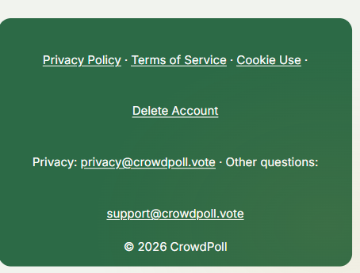

Also, please make the white dots twice the size.

### RECOMMENDATION

The spacing comes from the 23 px of padding above and below every footer link, which made each link a 64 px touch row.  
Put the links back in the text flow and space the footer's lines at 32 px (1.6 × the small text's line height), in the phone layout only.  
This changes contract P3: footer links are no longer 64 px rows but links inside a sentence with a 32 px hit area, like the legal text.  

- `src/public/phone-m3.css`  
  - `.site-footer`: add `line-height:calc(var(--md-sys-typescale-body-small-line-height) * 1.6)`.  
  - `.site-footer a`: `padding-block:6px` in place of `display:inline-block; padding-block:23px`.  
  - `.site-footer-dot`: twice the small text's size, with no effect on the line's height.  
- `src/public/app.js`: each " · " separator in the footer becomes a `span.site-footer-dot` with a space on either side, so the dots can be sized;  
  the footer's text is unchanged.  
- The dots are doubled in the phone layout only; above 480 px the footer looks as before.  
- Tests, written but not run (`Run Tests` is empty):  
  - `tests/client-footer.test.ts`: the four separators are `.site-footer-dot` spans and the text is unchanged.  
  - `tests/phone-sheets.test.ts`: the footer's line height, the links' padding and the dot's size.  
- Artifacts: `contracts/phone-layout.md` (P3 row for footer links), `quickstart.md` (the list of links under 64 px), `tasks.md` (new task line).  

2026-11-13 21:23

### ACCEPTED RECOMMENDATION

The footer's lines are 32 px apart in the phone layout and its separator dots are twice the size.  
Nothing was run in a browser and no test was run, so the look, and the dots' vertical position in particular, is unverified until the next device or test run.  

- Code  
  - `src/public/phone-m3.css`: `.site-footer` has a line height of 1.6 × the small text's;  
    `.site-footer a` keeps its place in the text with `padding-block:6px`;  
    `.site-footer-dot` is twice the small text's size with `line-height:0`.  
  - `src/public/app.js`: `renderSiteFooter` builds each separator as `span.site-footer-dot`;  
    the footer's text is unchanged, and above 480 px so is its look.  
- Tests: tests postponed (Run Tests not ticked);  
  the following were written and not run.  
  - `tests/client-footer.test.ts`: "puts every separator dot in its own element, so the phone layout can size it".  
  - `tests/phone-sheets.test.ts`: two tests in "the footer in the phone layout".  
  - `npx tsc --noEmit` passes.  
- Artifacts  
  - `contracts/phone-layout.md`: P3 no longer lists footer links as 64 px rows (a requirement changed).  
  - `quickstart.md` (§8, the row on controls under 64 px), `tasks.md` (T050 added).  

2026-11-13 21:24

## TWEAK03 Maximized Bars Above One Percent  
[X] Resolved  
[ ] Run Tests  
Change the rule:  
"The 50-choice poll shows ten bars and "Show all 50 choices"; it expands in place and reads "Show fewer"."  
to  
"The 50-choice poll shows the bars that render greater than '1%' and no more than 10 bars, and "Show all 50 choices"; it expands in place and reads 'Show fewer'."

### RECOMMENDATION

In the maximized view of the phone layout, a poll with thirteen or more choices shows only those of its ten leaders whose bar reads 2% or more.  
This changes FR-027 of the spec, which says the ten leading choices are shown.  

- `src/public/pollCard.js`  
  - `MAXIMIZED_LIMITS` becomes `{ lead: 10, allUpTo: 12, abovePct: 1 }`.  
  - `essentialChoices` keeps, of the first `lead` choices, those whose `pct` is above `abovePct`, when the limits carry one.  
  - "Show all N choices" and "Show fewer" work as before.  
- Tests, written but not run (`Run Tests` is empty):  
  - `tests/essential-choices.test.ts`: the new limit, leaders at 1% and 0% left out, an own choice at 1% kept, the no-leader-above-1% case.  
  - `tests/client-phone-card.test.ts`: a maximized 37-choice poll with three leaders above 1% shows three bars and "Show all 37 choices".  
- Artifacts: `spec.md` (Story 3, FR-027, Key Entities), `quickstart.md` (the rule quoted above and the runs table), `contracts/poll-card.md` (C1), `data-model.md`, `research.md` (R5), `plan.md`, `tasks.md`, `README.md`, `ARCHITECTURE.md`, `CLAUDE.md`, `CLAUDE_COMPLETE.md`.  

Assumptions made instead of questions:  

- "Greater than 1%" is read from the rounded figure the bar displays, so a bar reading 1% is left out and one reading 2% is shown.  
- The viewer's own choices are still shown, whatever their share.  
- When none of the ten leaders is above 1% (a poll with no votes yet, or votes spread thinly), the ten leaders are shown as before, so the view is never just the "Show all" row.  
- A poll with twelve or fewer choices still shows every choice, also those at 1% and 0%.  
- The compact card in a tab is unchanged: its four leaders, whatever their share.  

2026-11-14 04:47

### ACCEPTED RECOMMENDATION

In the phone layout's maximized view, a poll with thirteen or more choices shows only those of its ten leaders whose share reads above 1%, plus the viewer's own choices.  
Nothing was run in a browser and no test was run, so the behaviour is unverified until the next device or test run.  

- Code  
  - `src/public/pollCard.js`: `MAXIMIZED_LIMITS` is `{ lead: 10, allUpTo: 12, abovePct: 1 }`;  
    `essentialChoices` keeps the leaders whose `pct` is above `abovePct`, or all of them when none is.  
- Tests: tests postponed (Run Tests not ticked);  
  the following were written or updated and not run.  
  - `tests/essential-choices.test.ts`: the new limit and five tests (three above 1%, fifteen above 1%, an own choice at 1%, none above 1%, the compact card unchanged).  
  - `tests/client-phone-card.test.ts`: "leaves out the leaders that read 1% or less".  
  - `npx tsc --noEmit` passes.  
- Artifacts  
  - `spec.md`: Story 3's text and scenarios, FR-027 (a requirement changed), Key Entities.  
  - `quickstart.md`: the rule as given in this tweak, and the runs table.  
  - `contracts/poll-card.md` (C1, four rows added), `data-model.md`, `research.md` (R5), `plan.md`, `tasks.md` (T051 added).  
  - `README.md`, `ARCHITECTURE.md`, `CLAUDE.md`, `CLAUDE_COMPLETE.md`.  

2026-11-14 04:47

## TWEAK04 Rule For Choices In Maximized View  
[X] Resolved  
[ ] Run Tests  
What is the rule for showing choices in the maximized view on the front face of a Poll Card?

### RECOMMENDATION

This is a question, so the recommendation is its answer and no change to the code.  
The front face (the results side) of a maximized card follows this rule, as the code stands after TWEAK03.  

- Order: the choices are sorted by share, largest first;  
  choices with the same share, and all choices of a poll with no votes yet, keep the poll's own order.  
- Phone layout (480 px and narrower), in `essentialChoices` of `src/public/pollCard.js`:  
  1. Twelve choices or fewer: every choice is a bar, also those at 1% and 0%.  
  2. Thirteen choices or more: take the ten leaders and keep those whose displayed share is above 1% (2% or more).  
  3. If none of the ten is above 1%, keep all ten.  
  4. Add the viewer's own choices that are not already shown, after the leaders, whatever their share.  
  5. Under the bars one row reads "Show all N choices";  
     it shows every choice in place and then reads "Show fewer", which restores the shorter list.  
  6. The list starts short again each time the view is opened.  
- Above 480 px: every choice is a bar and nothing is left out;  
  the bars get shorter as the poll has more choices (`maximizedBarLayout`).  
- The voting side always lists every choice, at every width.  

The rule is also in `contracts/poll-card.md` (C1 and C4) and in FR-027 and FR-028 of `spec.md`.  

2026-11-14 04:58

### ACCEPTED RECOMMENDATION

Answered above; nothing was changed in the code, the tests or the feature's artifacts.  
To change any step of the rule, write it as the next tweak.  

2026-11-14 04:58

## TWEAK05 Trial Of Stricter Bar Thresholds  
[X] Resolved  
[ ] Run Tests  
We would like to try these changes and test for a bit to see if we like it:

The front face (the results side) of a maximized card follows this rule:
- Order: the choices are sorted by share, largest first;  
  choices with the same share, and all choices of a poll with no votes yet, keep the poll's own order.  
- Phone layout (480 px and narrower), in `essentialChoices` of `src/public/pollCard.js`:  
  1. Twelve choices or fewer: every choice is a bar, also those at 1%, excluding those at 0%.  
  2. Thirteen choices or more: take the ten leaders and keep those whose displayed share is above 2% (3% or more).  
  3. If none of the ten is above 1%, keep all ten.  
  4. Add the viewer's own choices that are not already shown, after the leaders, whatever their share.  
  5. Under the bars one row reads "Show all N choices";  
     it shows every choice in place and then reads "Show fewer", which restores the shorter list.  
  6. The list starts short again each time the view is opened.  
- Above 480 px: every choice is a bar and nothing is left out;  
  the bars get shorter as the poll has more choices (`maximizedBarLayout`).  
- The voting side always lists every choice, at every width.  

### RECOMMENDATION

Two steps of the rule differ from today's: step 1 leaves out the choices at 0%, and step 2 raises the threshold from above 1% to above 2%.  
Both are two numbers in `MAXIMIZED_LIMITS`, so the trial is easy to undo.  
This changes FR-027 of the spec again.  

- `src/public/pollCard.js`  
  - `MAXIMIZED_LIMITS` becomes `{ lead: 10, allUpTo: 12, abovePct: 2, allAbovePct: 0 }`.  
  - `essentialChoices` applies `allAbovePct` to a list of `allUpTo` or fewer, the way it applies `abovePct` to the leaders of a longer list.  
- Tests, written but not run (`Run Tests` is empty):  
  - `tests/essential-choices.test.ts`: the new limits, twelve choices with some at 0%, twelve with no votes, leaders at 2% left out, every leader at 2%.  
  - `tests/client-phone-card.test.ts`: a twelve-choice poll hides its 0% choices behind "Show all 12 choices"; a 37-choice poll leaves out leaders at 2% or less.  
- Artifacts: `spec.md` (Story 3, FR-027, Key Entities), `quickstart.md`, `contracts/poll-card.md` (C1, C4), `data-model.md`, `research.md` (R5), `plan.md`, `tasks.md`, `README.md`, `ARCHITECTURE.md`, `CLAUDE.md`, `CLAUDE_COMPLETE.md`.  

Assumptions made instead of questions:  

- Step 3 still says "none above 1%", which no longer matches step 2: ten leaders all at exactly 2% would leave no bar at all.  
  It is implemented as "if none of the ten is above 2%, keep all ten".  
- A poll of twelve or fewer in which every choice is at 0% (no votes yet) shows every choice.  
- A poll of twelve or fewer that leaves choices out gets the "Show all N choices" row of step 5, which it never had before.  
- Step 4 also applies to a poll of twelve or fewer: the viewer's own choice at 0% is shown.  
- The compact card in a tab is unchanged.  

2026-11-14 05:07

### ACCEPTED RECOMMENDATION

On trial: in the phone layout's maximized view a poll of twelve or fewer choices leaves out its choices at 0%, and a longer poll shows only those of its ten leaders that read above 2%.  
Nothing was run in a browser and no test was run, so the behaviour is unverified until the next device or test run.  
To end the trial, set `MAXIMIZED_LIMITS` in `src/public/pollCard.js` back to `{ lead: 10, allUpTo: 12, abovePct: 1 }`, or write that as a tweak so the tests and artifacts follow.  

- Code  
  - `src/public/pollCard.js`: `MAXIMIZED_LIMITS` is `{ lead: 10, allUpTo: 12, abovePct: 2, allAbovePct: 0 }`;  
    `essentialChoices` filters a short list by `allAbovePct` and a long list's leaders by `abovePct`, and keeps them all when none passes.  
- Tests: tests postponed (Run Tests not ticked);  
  the following were written or updated and not run.  
  - `tests/essential-choices.test.ts`: the limits, three new tests and three updated to the 2% threshold.  
  - `tests/client-phone-card.test.ts`: "leaves out a twelve-choice poll's choices at 0% until asked for all" and "leaves out the leaders that read 2% or less".  
  - `npx tsc --noEmit` passes.  
- Artifacts  
  - `spec.md`: Story 3's text and scenarios 1 and 2, FR-027 (a requirement changed), Key Entities.  
  - `quickstart.md`: the 50-choice line at 2%, a new line for polls of twelve or fewer, the runs table.  
  - `contracts/poll-card.md` (C1 with three rows added, C4), `data-model.md`, `research.md` (R5), `plan.md`, `tasks.md` (T052 added).  
  - `README.md`, `ARCHITECTURE.md`, `CLAUDE.md`, `CLAUDE_COMPLETE.md`.  

2026-11-14 05:07

## TWEAK06 Larger Extras Tab Icons  
[X] Resolved  
[ ] Run Tests  

A small change to TWEAK01 requirement.  
Make the icons 50% larger.

### RECOMMENDATION

Draw the three icons of the maximized view's tab bar (Read More, Polling History, Who Voted) at 30 px in place of 20 px.  

- `src/public/phone-card-m3.css`: `.extras-tab .tab-icon{ width:30px; height:30px; }`.  
- The bar grows about 10 px taller with them;  
  the labels, colours and the selected line are unchanged.  
- Test, written but not run (`Run Tests` is empty): `tests/phone-sheets.test.ts` pins 30 px against the Home tabs' 20 px, in place of the check that the two sizes are equal.  
- Artifacts: `research.md` (R8), `tasks.md`.  

Assumption made instead of a question: "the icons" are those of the TWEAK01 tab bar only, so the Home tab bar's icons stay at 20 px.  

2026-11-14 05:10

### ACCEPTED RECOMMENDATION

The three icons of the maximized view's tab bar are 30 px, 50% larger than before.  
Nothing was run in a browser and no test was run, so the look is unverified until the next device or test run.  

- Code: `src/public/phone-card-m3.css`, the `.extras-tab .tab-icon` rule.  
- Tests: tests postponed (Run Tests not ticked);  
  `tests/phone-sheets.test.ts` has the new test "draws the extras tabs' icons half as large again as the Home tab bar's", not run.  
  `npx tsc --noEmit` passes.  
- Artifacts: `research.md` (R8), `tasks.md` (T053 added).  

2026-11-14 05:10

## TWEAK07 More Choices And Remaining Choices Rows  
[X] Resolved  
[ ] Run Tests  

The Maximized Poll Card is one of the most critical features of CrowdPoll.  
The work we are doing to only display as many choices as necessary to help the user understand the poll results while minimizing poll card size is almost perfect.  
Users have described what they expect.  

One the home page Poll Card please change the message "N more choices - p%" to "More choices - p%".  

Then when clicking the link, the Maximized Poll Card shows shows all choices that have 1% or more.  
If there are still more choices, the message will read, "Remaining choices - 0%".    

When the Maximized Poll card is navigated to directly by any means besides the "more choices" button on the home page,  
(i.e. clicking the 'maximize' icon or from a shared link)   
then the Maximize Poll Card will have a clickable message "Show all N choices - p%".  

Then the "Show fewer" will now be "Show few choices", and it will bring the maximize card back to the default rule (existing) for the card.

### RECOMMENDATION

Give the maximized card a second starting list for the phone layout: every choice at 1% or more, used only when the view is opened from the home card's "More choices" row.  
This changes FR-015 and FR-028 of the spec and adds FR-028a.  

- `src/public/pollCard.js`  
  - The home card's row reads "More choices · p%" (no count);  
    on a multiple-choice poll it reads "More choices", as the share is left out there today.  
  - Tapping that row asks for the maximized view with `{ choices: 'voted' }`.  
  - The card's `showAll` flag becomes `choiceView`, one of `essential` (the existing default rule), `voted` or `all`.  
  - `voted`: every choice at 1% or more, plus the viewer's own;  
    when choices remain, the last row reads "Remaining choices · 0%".  
  - `essential`: the last row reads "Show all N choices · p%", where p is the combined share of the choices left out.  
  - `all`: every choice, and the last row reads "Show few choices", which returns to `essential`.  
- `src/public/tabs.js`: `maximize` passes `how.choices` on to `card.setMaximized`.  
- Tests, written but not run (`Run Tests` is empty): `tests/client-phone-card.test.ts`, the new wordings and the view opened from the "More choices" row.  
- Artifacts: `spec.md`, `quickstart.md`, `contracts/poll-card.md` (C2, C4), `data-model.md`, `research.md` (R5), `plan.md`, `tasks.md`, `README.md`, `ARCHITECTURE.md`.  

Assumptions made instead of questions:  

- The " - " in the three messages is the " · " the row already uses.  
- "Remaining choices · 0%" is a button: tapping it shows the remaining choices, and the row then reads "Show few choices".  
- "Show few choices" is used exactly as written, not "Show fewer choices".  
- The "p%" of "Show all N choices · p%" is left out on a multiple-choice poll, like the home card's;  
  "Remaining choices · 0%" always carries its "0%".  
- Opened from the "More choices" row with every choice at 1% or more, the view shows them all and, when the default rule would leave some out, the "Show few choices" row.  
- Opened from the "More choices" row before any vote (no choice at 1%), the view shows every choice.  
- Tapping the title, the subtitle, a bar or Maximize, a shared link, the Vote button and the browser's Forward all open the default rule; only the "More choices" row opens the 1% list.  

2026-11-14 12:00

### ACCEPTED RECOMMENDATION

The home card's row reads "More choices · p%" and opens the maximized view on every choice at 1% or more, with "Remaining choices · 0%" for the rest;  
opened any other way the view keeps the default rule, with "Show all N choices · p%" and then "Show few choices".  
Nothing was run in a browser and no test was run, so the behaviour is unverified until the next device or test run.  

- Code  
  - `src/public/pollCard.js`: `choiceView` replaces `showAll`;  
    `votedChoices` picks the choices at 1% or more;  
    `phoneResultsView` words the four rows;  
    the "More choices" row calls `requestMaximize({ choices: 'voted' })`;  
    `setMaximized(on, how)` takes the starting list.  
  - `src/public/tabs.js`: `maximize` calls `card.setMaximized(true, { choices: how.choices })`.  
- Tests: tests postponed (Run Tests not ticked);  
  the following were written or updated and not run.  
  - `tests/client-phone-card.test.ts`: six new tests (the row's request, no share on a multiple-choice "Show all" row, and four on the view opened from the "More choices" row) and nine expectations updated to the new wordings.  
  - `npx tsc --noEmit` passes.  
- Artifacts  
  - `spec.md`: Story 1 and Story 3 texts, the multiple-choice edge case, FR-015 and FR-028 (requirements changed), FR-028a (new).  
  - `quickstart.md` (§4 and §5), `contracts/poll-card.md` (C2, C4), `data-model.md`, `research.md` (R5), `plan.md`, `tasks.md` (T054 added).  
  - `README.md`, `ARCHITECTURE.md`.  

2026-11-14 12:00

## TWEAK08 Database Connection Reset On Launch  
[X] Resolved  
[ ] Run Tests  

Do you see the problem here.  
```
(base) PS C:\crowdPoll\phone-uiux> devScripts/launch-dev.ps1                                                                     
PostgreSQL service is running.
Starting server on http://localhost:8080 (both mode)...

> crowdpoll.vote@0.2.0 dev
> tsx watch src/server.ts

[config] ENV_DATABASE_CA_CERT was not found, using default value: none (system certificate roots).
[config] ENV_DEFAULT_LINK_PREVIEW_MESSAGE was not found, using default value: You have been invited to vote in this poll..
[config] ENV_DEVICE_EVENTS_ENABLED was not found, using default value: false (no device evidence is collected).
[config] ENV_FCAPTCHA_ENABLED was not found, using default value: off (no human check before login).
[config] ENV_OAUTH_APPLE_* was not found, using default value: none (Apple login off).
[config] ENV_OAUTH_MICROSOFT_* was not found, using default value: none (Microsoft login off).
[config] ENV_OPENSEARCH_URL was not found, using default value: none (PostgreSQL full-text search).
[config] ENV_PROTOTYPES was not found, using default value: none (no prototypes served).
[config] ENV_SPACES_* was not found, using default value: none (TRENDING objects and assets served from the instance).
[server] Starting in both login mode
[auth] Login method: both; providers: Google, Amazon
[auth] Sign-up allowlist on (1 addresses, 1 pattern; 3 administrators always allowed)
[db] ENV_DATABASE_CA_CERT is not set: verifying the database certificate against the system roots
[server] Database migration failed; refusing to start: MigrationError: Migration check failed: read ECONNRESET
    at migrateToLatest (C:\crowdPoll\phone-uiux\src\db\migrator.ts:22:11)
    at process.processTicksAndRejections (node:internal/process/task_queues:104:5)
    at async startServer (C:\crowdPoll\phone-uiux\src\server.ts:188:21)
(base) PS C:\crowdPoll\phone-uiux> npm run fix-migrations

> crowdpoll.vote@0.2.0 fix-migrations
> tsx devScripts/fix-migrations.ts

[migrations] Error: cannot reach the database: read ECONNRESET
(base) PS C:\crowdPoll\phone-uiux> 
```

### RECOMMENDATION

Yes: the PostgreSQL service is up, but it resets every new connection, so neither the server nor `fix-migrations` can reach the database.  
The cause is the database service, not the migrations and not this feature's code.  
Restart the service from an elevated PowerShell, then launch again:  

```
Restart-Service postgresql-x64-16
devScripts/launch-dev.ps1
```

What was checked (read-only, at 2026-11-15 20:31):  

- The service `postgresql-x64-16` is Running and listens on port 5432, on both `0.0.0.0` and `::`;  
  it has been up since the machine started on 2026-11-13 07:36.  
- A plain `pg` connection with the URL of `devScripts/launch-dev.ps1` fails with `read ECONNRESET` on `localhost`, `127.0.0.1` and `::1` alike, outside the app.  
- The server log `C:\Program Files\PostgreSQL\16\data\log\postgresql-2026-11-15_000000.log` shows `WARNING: autovacuum worker took too long to start; canceled` at 19:22, and nothing at all for the failed connections after 20:01.  
  A postmaster that accepts the socket but logs nothing and starts no worker is no longer able to start a backend process for a new connection.  
- Memory is not short (32 GB free), and the Windows event log holds no related error, so why it stopped starting processes is not known.  
- `ENV_DATABASE_CA_CERT is not set` in the output is the normal line for a local database and is not part of the problem.  

Not done by the AI:  

- The restart itself: it needs an elevated shell, and it closes the nine database connections that other programs have held open since 2026-11-13 07:37.  
- `npm run fix-migrations` is not needed: it failed for the same reason, and the migration record was never read.  

Option, not applied: have `launch-dev.ps1` try one connection after "PostgreSQL service is running." and print this advice when it is reset, as the service status alone does not show the fault.  

The tweak stays open until the restart is confirmed: say "I resolved it" once the server starts.  

2026-11-15 20:31

### RECOMMENDATION

The earlier recommendation is superseded: the restart could not work.  
Windows Smart App Control is blocking `C:\Program Files\PostgreSQL\16\bin\postgres.exe`, which is not code-signed.  
On Windows PostgreSQL starts a new `postgres.exe` for every connection, so the running server reset each new connection, and after the stop the service cannot start at all.  

Evidence (read-only, at 2026-11-15 20:51):  

- The service is Stopped; the shutdown at 20:45:51 was clean, so the data directory is intact.  
- The Application event log says `pg_ctl: could not find postgres program executable` at each start attempt.  
- Starting `postgres.exe -V` by hand fails with "An Application Control policy has blocked this file";  
  `pg_ctl.exe`, `psql.exe` and `initdb.exe` in the same folder run.  
- The Code Integrity log holds 220 blocks of `postgres.exe` (event 3077, with "Smart App Control Block" details), and no other file.  
- `Get-MpComputerStatus` reports `SmartAppControlState: On`.  
- Not established: why the blocking began on 2026-11-15 around 19:22 after days of running; the log does not reach back that far.  

Options, all the developer's to choose, none applied by the AI:  

- A: turn Smart App Control off in Windows Security, App & browser control, Smart App Control settings, then `Start-Service postgresql-x64-16`.  
  It is a machine-wide security setting, it has no per-program exception, and on some Windows versions it cannot be turned on again without resetting Windows.  
- B: keep Smart App Control on and run PostgreSQL where it does not apply, in WSL or Docker, on port 5432 with the data restored from a dump.  
  The dump itself needs the server running, so this path also needs A once, or a file-level copy of the data directory into the same PostgreSQL version.  

The test suite's embedded PostgreSQL starts its own unsigned `postgres.exe` and is likely to be blocked the same way; that was not tried.  

2026-11-15 20:51

### ACCEPTED RECOMMENDATION

The developer chose option B without a dump: PostgreSQL 16 now runs in Docker (container `crowdpoll-pg`, port 5432 on 127.0.0.1, empty `app01` database), and the Windows service is disabled.  
Smart App Control stays on.  
The server itself was not launched by the AI, so the first start and its migrations are still to be seen.  

- Done by the developer: the `docker run` command and `Set-Service postgresql-x64-16 -StartupType Disabled`.  
- Scripts  
  - `devScripts/launch-dev.ps1` and its template `devScripts.example/launch-dev.ps1`: for a local URL the script first tries the URL's port on both loopback addresses and uses whatever answers;  
    only when nothing answers does it start a PostgreSQL service that is not disabled, and with none it stops with advice naming the container.  
- Checked  
  - The database section alone was run against four URLs (local with and without a port, `[::1]` on an unused port, a remote host) and behaved as intended.  
  - A `pg` connection with the script's own `ENV_DATABASE_URL` reached `app01` on PostgreSQL 16.16 in the container.  
- Tests: none written or run;  
  `npm test` starts an embedded `postgres.exe` that Smart App Control is likely to block as well, which was not tried.  
- Artifacts: `README.md` (Windows 11 development machine: the Docker command and the reason).  

2026-11-15 21:12

## TWEAK09 Commit, Merge Main And Line Graph Fix  
[X] Resolved  
[ ] Run Tests  

No tests yet.
First, 
commit and merge
then
merge the branch line-graph-fix into the current branch

### RECOMMENDATION

Commit this feature on `phone-uiux`, merge `origin/main` into it, then merge `origin/line-graph-fix` into it, with no test run and no push.  

Assumptions made instead of questions:  

- "Commit and merge" names no target, so the first merge brings `main` into this branch (two commits it lacked), which any later merge into `main` needs anyway;  
  this branch was not merged into `main`, since nothing has been tested yet.  
- This clone has no local `main` or `line-graph-fix`, so the branches merged are the fetched `origin/main` and `origin/line-graph-fix`.  
- Nothing is pushed: the tweak does not ask for it.  

2026-11-16 09:15

### ACCEPTED RECOMMENDATION

The feature is committed and both merges are on `phone-uiux`, locally only.  
No test was run, as the tweak asks, so the merged result is untested;  
`npx tsc --noEmit` passes on it.  

- Commits on `phone-uiux`  
  - `cb72d72`: the feature with tweaks 01 to 08 (86 files).  
  - `06d8473`: merge of `origin/main` (`d7acf8b`), no conflict.  
  - `501e31d`: merge of `origin/line-graph-fix` (`19ff000`), four conflicts resolved by hand.  
- Conflicts  
  - `.specify/feature.json`, `.specify/requirements.json`, `.specify/analyze-findings.json`: this feature's versions kept, so Spec Kit still points at the phone layout redesign.  
  - `CLAUDE.md`: this feature's section kept, and the line graph plan's section added after it;  
    the older plans that `line-graph-fix` still listed were left out, as they are already in `CLAUDE_COMPLETE.md`.  
- Checked by reading, not by running  
  - The phone sheets name only `.line-graph-title` and `.line-graph-subtitle`, which the merged line graph still has;  
    the tooltip classes it removed are not used by this feature.  
  - `tests/m3-assets.test.ts`, `README.md` and `ARCHITECTURE.md` merged without conflict; their merged content was not reviewed line by line.  
- Tests: none run;  
  every test written for tweaks 03 to 07 and the merged line graph tests are still unrun together.  
- Not done: no push, and no merge into `main`.  

2026-11-16 09:15

## TWEAK10 Merge Admin Search  
[X] Resolved  
[ ] Run Tests  

Still no tests yet.
merge the branch admin-search into phone-uiux branch

### RECOMMENDATION

Merge `origin/admin-search` into `phone-uiux`, with no test run and no push.  
This clone has no local `admin-search`, so the fetched `origin/admin-search` (`1d4a097`) is merged.  

2026-11-16 09:20

### ACCEPTED RECOMMENDATION

`origin/admin-search` is merged into `phone-uiux` as `2d1600d`, locally only.  
No test was run, as the tweak asks, so the merged result is untested;  
`npx tsc --noEmit` passes on it.  

- Conflicts, resolved by hand  
  - `.specify/feature.json`, `.specify/requirements.json`, `.specify/analyze-findings.json`: this feature's versions kept.  
  - `CLAUDE.md`: this feature's and the line graph's sections kept, the admin search plan's section added after them.  
  - `src/public/admin.css`: the result list's frame, hairline and corner rules are taken;  
    the `(max-width: 479.98px)` block that `admin-search` extended is not, because this feature deleted that block (R12).  
- Test changed, not run  
  - `tests/admin-search-assets.test.ts`: the expectation of an 18 px frame radius in the `479.98px` block now expects that block to be absent.  
- Gap left by the merge, not fixed here  
  - The phone layer `phone-admin-m3.css` has no rule for the new `.admin-result` rows, so at 480 px and narrower they keep their desktop sizes, without the 64 px targets of this feature;  
    the frame keeps its 20 px radius there instead of 18 px.  
- Not done: no push, and no merge into `main`.  

2026-11-16 09:20

## TWEAK11 Phone Layout For Admin Search Results  
[X] Resolved  
[ ] Run Tests  

The merge of admin-search into this branch left the following gap:
```
- Gap left by the merge, not fixed here  
  - The phone layer `phone-admin-m3.css` has no rule for the new `.admin-result` rows, so at 480 px and narrower they keep their desktop sizes, without the 64 px targets of this feature;  
    the frame keeps its 20 px radius there instead of 18 px.  
```

Please resolve that gap.
    
### RECOMMENDATION

The gap is smaller than the TWEAK10 note said, and that note was partly wrong.  
Give the result rows the phone layout's 16 px gap and 28 px icon size in `src/public/phone-admin-m3.css`, and leave the rest as it is.  

- Already right, no change  
  - The result row is 64 px tall at every width (`min-height:64px` in `admin-search-m3.css`), so the phone layout's 64 px target is met.  
  - Its text comes from the typescale tokens, which the phone layout scales by 1.25 on its own.  
  - The frame's 20 px radius is what the contract asks of a card frame on a phone (`contracts/phone-layout.md`, P4);  
    the 18 px of the old `479.98px` block is the value this feature removed.  
- To change  
  - `.admin-result-row`: gap 16 px (12 px on wider screens).  
  - `.admin-result-chevron`: 28 px (24 px on wider screens), the size of the other phone icons.  
- Tests, written but not run (`Run Tests` is empty): one in `tests/phone-sheets.test.ts`.  
- Artifacts: `contracts/phone-layout.md` (P3), `tasks.md`.  

Assumption made instead of a question: the open card's panel keeps its padding (4 px, 12 px, 20 px), as the card inside still fits a 480 px screen.  

2026-11-16 09:29

### ACCEPTED RECOMMENDATION

The admin search result rows have the phone layout's gap and icon size at 480 px and narrower.  
Nothing was looked at in a browser and no test was run, so the look is unverified until the next device or test run.  

- Code  
  - `src/public/phone-admin-m3.css`: `.admin-result-row{ gap:16px; }` and `.admin-result-chevron{ width:28px; height:28px; }`.  
- Tests: tests postponed (Run Tests not ticked);  
  the following was written and not run.  
  - `tests/phone-sheets.test.ts`: "keeps an admin search result a 64px row at every width and draws its chevron at the phone icon size".  
  - `npx tsc --noEmit` passes.  
- Artifacts  
  - `contracts/phone-layout.md`: P3 has a row for the admin search result rows.  
  - `tasks.md`: T055 added.  
- Not committed: these changes are in the working tree only.  

2026-11-16 09:29

## TWEAK12 Admin Search In The Small Label Size  
[X] Resolved  
[ ] Run Tests  

Reminder: we are designing the layout for widths 480 px and narrower.  

In this and subsequent tweaks, we are going to make tweaks to the Admin Search layout to allow more content to fit on the layout.  

Set the font-sizer to --md-sys-typescale-label-small-size


### RECOMMENDATION

At 480 px and narrower, set the Admin Search's text in the `label-small` size (15 px on a phone) with its line height (18 px), in `src/public/phone-admin-m3.css`.  

- Set in the small label size  
  - The status line under the view tabs (was 18 px) and the show or hide toggle (was 18 px).  
  - The field labels at rest (were 20 px), the radio and checkbox labels (were 20 px), Search and Clear (were 18 px).  
  - The result rows: title and subtitle (were 20 px) and the facts line (was 18 px).  
- Left as they are  
  - The typed fields (`input`, `select`) keep 20 px: iOS Safari zooms the page when a field with text under 16 px takes focus.  
  - The poll card opened under a result, and the 64 px rows and 48 px buttons: only the text changes size.  
- Tests, written but not run (`Run Tests` is empty): one in `tests/phone-sheets.test.ts`.  
- Artifacts: `tasks.md`.  

Assumptions made instead of questions:  

- "Admin Search layout" is the search form with its status line and toggle, and the list of results; not the admin cards of the other views.  
- "font-sizer" is the font size; the token's line height is set with it, as every other rule of the phone sheets does, and weight and letter spacing are left alone.  

2026-11-16 09:53

### ACCEPTED RECOMMENDATION

The Admin Search's text is set in the small label size at 480 px and narrower, except the typed fields.  
Nothing was looked at in a browser and no test was run, so the look is unverified until the next device or test run.  

- Code  
  - `src/public/phone-admin-m3.css`: one rule gives ten selectors `label-small` size and line height;  
    the two earlier phone rules that set the status line to `body-medium` and the radios and checkboxes to `body-large` no longer set a size.  
- Tests: tests postponed (Run Tests not ticked);  
  the following were written or updated and not run.  
  - `tests/phone-sheets.test.ts`: new test "sets the admin search's text, but not its typed fields, in the small label size";  
    the TWEAK11 test's row expectation loosened to contain the gap.  
  - `npx tsc --noEmit` passes.  
- Artifacts: `tasks.md` (T056 added).  
- Not committed: the TWEAK11 and TWEAK12 changes are in the working tree only.  

2026-11-16 09:53

## TWEAK13 Three Radio Buttons Per Row In Admin Search  
[X] Resolved  
[ ] Run Tests  

Maek the admin-radio-groups so that three radio buyttons with their labels fit within the available width.  
If that means the labels need to wrap or be truncated, so be it.  

### RECOMMENDATION

At 480 px and narrower, stop stacking the Admin Search's radio groups: each group goes back to its row of three equal columns, and a label that does not fit wraps inside its column.  

- `src/public/phone-admin-m3.css`  
  - `.admin-search .admin-radio-group` is taken out of the rule that makes the form one column, so the three columns of `admin-search-m3.css` apply again.  
  - `.admin-search .admin-radio span{ min-width:0; overflow-wrap:anywhere; }` lets a label wrap, and break inside a word only when a single word is wider than its column.  
- By the sheet's numbers a column is about 136 px wide and leaves about 92 px for the label, so "Any choice mode", "Multiple Choice", "Vote can change" and "First vote is final" take two lines of 18 px.  
- Tests, written but not run (`Run Tests` is empty): one in `tests/phone-sheets.test.ts`.  
- Artifacts: `contracts/phone-layout.md` (P4), `quickstart.md`, `tasks.md`.  

Assumptions made instead of questions:  

- Labels wrap and are not truncated, so every label stays readable in full.  
- The two checkboxes stay one per row: the tweak names the radio groups only.  
- The developer's own edit of the radio and checkbox rule (`min-height:36px; gap:4px; padding:0px 8px 4px 8px`) is kept as it is.  

2026-11-16 10:14

### ACCEPTED RECOMMENDATION

Each Admin Search radio group is one row of three at 480 px and narrower, with wrapping labels.  
Nothing was looked at in a browser and no test was run, so the look is unverified until the next device or test run.  

- Code  
  - `src/public/phone-admin-m3.css`: the radio group no longer becomes one column;  
    the radio's label may wrap.  
- Tests: tests postponed (Run Tests not ticked);  
  the following was written and not run.  
  - `tests/phone-sheets.test.ts`: "keeps each admin search radio group in one row of three, its labels wrapping".  
  - `npx tsc --noEmit` passes.  
- Artifacts  
  - `contracts/phone-layout.md`: P4, the admin search form row.  
  - `quickstart.md`: the search form check.  
  - `tasks.md`: T057 added.  
- Left for the developer to settle  
  - The hand edit sets the radios and checkboxes to a 36 px minimum height, while P3 of `contracts/phone-layout.md` still lists them as 64 px rows;  
    the contract was not changed for it.  
- Not committed: the changes of TWEAK11 to TWEAK13 are in the working tree only.  

2026-11-16 10:14

## TWEAK14 Two Checkboxes Per Row In Admin Search  
[X] Resolved  
[ ] Run Tests  

Make the admin-checkbox-row so that two checkboxes with their labels fit within the available width.  
If that means the labels need to wrap or be truncated, so be it.

### RECOMMENDATION

At 480 px and narrower, put the Admin Search's two checkboxes side by side in two equal columns, and let a label that does not fit wrap inside its column.  

- `src/public/phone-admin-m3.css`  
  - `.admin-search .admin-checkbox-row{ grid-template-columns:repeat(2, minmax(0, 1fr)); }` replaces the single column.  
  - `.admin-search .admin-checkbox span` joins the rule that lets the radio labels wrap.  
- By the sheet's numbers a column is about 204 px wide and leaves about 160 px for the label, so "Line graph enabled" and "Custom colors set" should each stay on one line.  
- Tests, written but not run (`Run Tests` is empty): one in `tests/phone-sheets.test.ts`.  
- Artifacts: `contracts/phone-layout.md` (P4), `quickstart.md`, `tasks.md`.  

Assumption made instead of a question: two equal columns are used and not the first two of the radio groups' three columns;  
the checkboxes then do not line up under the radio buttons, but their labels need no second line.  

2026-11-16 10:16

### ACCEPTED RECOMMENDATION

The two checkboxes are side by side at 480 px and narrower, with labels that may wrap.  
Nothing was looked at in a browser and no test was run, so the look is unverified until the next device or test run.  

- Code  
  - `src/public/phone-admin-m3.css`: the checkbox row has two equal columns;  
    a checkbox label may wrap.  
- Tests: tests postponed (Run Tests not ticked);  
  the following were written or updated and not run.  
  - `tests/phone-sheets.test.ts`: new test "puts the admin search's two checkboxes side by side, their labels wrapping";  
    the TWEAK13 test no longer expects the checkbox row to be one column.  
  - `npx tsc --noEmit` passes.  
- Artifacts  
  - `contracts/phone-layout.md` (P4), `quickstart.md`, `tasks.md` (T058 added).  
- Not committed: the changes of TWEAK11 to TWEAK14 are in the working tree only.  

2026-11-16 10:16

## TWEAK15 Admin Search Fields And The iOS Zoom Rule  
[X] Resolved  
[ ] Run Tests  

With this rule in mind:
```
iOS Safari zooms the page when a field with text under 16 px takes focus.  
```

Please check if there are any fields in the Admin Search that have text under 16 px, as these would trigger iOS Safari to zoom the page when focused. 
If so, set the font size to 16px.


### RECOMMENDATION

No field of the Admin Search has text under 16 px, so no font size is changed.  
Add one test that keeps it so.  

- What was checked  
  - The form holds 15 typed fields: 1 search box, 1 text box, 3 dates, 3 numbers and 7 selects.  
  - All 15 sit directly inside `.m3-outlined`, and one rule sizes them: `.admin-search .m3-outlined :is(input, select)` in `admin-search-m3.css`, at the `body-large` size.  
  - `body-large` is 16 px at 481 px and wider and 20 px at 480 px and narrower (`m3-tokens.css`).  
  - No other sheet of the admin page sets a font size on these fields, and the phone sheet sets only their height.  
  - The 9 radio buttons and 2 checkboxes are not text fields and do not trigger the zoom;  
    their labels are 15 px since TWEAK12, which is safe for that reason.  
- Tests, written but not run (`Run Tests` is empty): one in `tests/phone-sheets.test.ts`.  

One risk the check cannot settle, for a device run:  
on a phone narrower than 480 px the fixed viewport width shrinks the whole page, so 20 px text is drawn smaller than 20 px on the glass, about 15.6 px on a 375 px wide iPhone and 16.25 px on a 390 px one.  
If Safari decides by the drawn size and not the CSS size, the narrowest iPhones may still zoom slightly;  
this is not verified, and nothing was changed for it.  

2026-11-16 10:21

### ACCEPTED RECOMMENDATION

Checked, and nothing needed changing: every typed field of the Admin Search is 20 px in the phone layout and 16 px on wider screens.  
No test was run and no device was used, so the zoom behaviour itself is unverified.  

- Code: none.  
- Tests: tests postponed (Run Tests not ticked);  
  the following were written or updated and not run.  
  - `tests/phone-sheets.test.ts`: new test "keeps every typed admin search field at 16px or more, so iOS Safari does not zoom on focus";  
    the TWEAK12 test accepts any pixel height for the fields, since the developer set them to 48 px by hand.  
  - `npx tsc --noEmit` passes.  
- Artifacts: none.  
- Not committed: the changes of TWEAK11 to TWEAK15 are in the working tree only.  

2026-11-16 10:21

## TWEAK16 Faint Line Under The Admin Tab Bar  
[X] Resolved  
[ ] Run Tests  

For the admin-tab-bar, render a faint line under the tab bar items, just like the tab-bar on the home page.
See this reference screenshot with the faint line pointed to by the red arrow:  
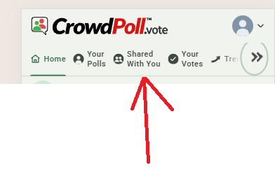

### RECOMMENDATION

At 480 px and narrower, draw a 1 px line in the `outline-variant` color under the admin tab bar, the same line the Home tab bar has.  

- `src/public/phone-admin-m3.css`: `.admin-tab-bar` gets `border-bottom:1px solid var(--md-sys-color-outline-variant)`.  
- The Home line is `.tab-bar-wrap::after` in `header-tab-bar-m3.css`, 1 px high in that color;  
  the admin bar has no wrapping element, so the line is the bar's own bottom border.  
- Tests, written but not run (`Run Tests` is empty): one in `tests/phone-sheets.test.ts`.  
- Artifacts: `contracts/phone-layout.md` (P4), `tasks.md`.  

Assumptions made instead of questions:  

- The line is added in the phone layout only, as the tweaks' reminder says the design in hand is for 480 px and narrower;  
  at 481 px and wider the admin tab bar is unchanged.  
- The line is as wide as the admin tab bar, which is the content column, and not the full window width that the Home line has in its fixed header.  

2026-11-16 10:36

### ACCEPTED RECOMMENDATION

The admin tab bar has the faint line under it at 480 px and narrower.  
Nothing was looked at in a browser and no test was run, so the look is unverified until the next device or test run.  

- Code  
  - `src/public/phone-admin-m3.css`: the bottom border on `.admin-tab-bar`.  
- Tests: tests postponed (Run Tests not ticked);  
  the following was written and not run.  
  - `tests/phone-sheets.test.ts`: "draws the Home tab bar's faint line under the admin tab bar".  
  - `npx tsc --noEmit` passes.  
- Artifacts: `contracts/phone-layout.md` (P4), `tasks.md` (T059 added).  
- Seen while reading, not changed  
  - `src/public/admin.html` now has two `admin-search-actions` blocks, and both Clear buttons carry `id="adminSearchClear"`.  
    `adminList.js` attaches Clear with `getElementById`, which finds only the first, so the second Clear button would do nothing.  
- Not committed: the changes of TWEAK11 to TWEAK16 are in the working tree only.  

2026-11-16 10:36

## TWEAK17 Admin Search Toggle As A Filled Button  
[X] Resolved  
[ ] Run Tests  

Render the Admin Search Toggle as a dark green button, the same as the admin-search-button.

### RECOMMENDATION

At 480 px and narrower, fill the Admin Search toggle with the `primary` color and set its text and chevron in `on-primary`, the two colors of the Search button.  

- `src/public/phone-admin-m3.css`: `.admin-search-toggle` gets `background:var(--md-sys-color-primary)` and `color:var(--md-sys-color-on-primary)`.  
- The chevron is drawn with `currentColor`, and the hover, focus and pressed layers too, so they follow the new text color.  
- The toggle already has the Search button's pill shape and 48 px height.  
- Tests, written but not run (`Run Tests` is empty): one in `tests/phone-sheets.test.ts`.  
- Artifacts: `tasks.md`.  

Assumptions made instead of questions:  

- The change is for the phone layout only, as the tweaks' reminder says;  
  at 481 px and wider the toggle stays a text button.  
- "The same as the admin-search-button" is taken for its colors: the toggle keeps its own padding (12 px and 16 px, for the chevron) and its place at the right of its row.  

2026-11-16 10:40

### ACCEPTED RECOMMENDATION

The Admin Search toggle is a filled button in the Search button's colors at 480 px and narrower.  
Nothing was looked at in a browser and no test was run, so the look is unverified until the next device or test run.  

- Code  
  - `src/public/phone-admin-m3.css`: background and color on `.admin-search-toggle`.  
- Tests: tests postponed (Run Tests not ticked);  
  the following was written and not run.  
  - `tests/phone-sheets.test.ts`: "fills the admin search toggle like the Search button".  
  - `npx tsc --noEmit` passes.  
- Artifacts: `tasks.md` (T060 added).  
- Not committed: the changes of TWEAK11 to TWEAK17 are in the working tree only.  

2026-11-16 10:40

## TWEAK18 Admin Search Toggle As An Outlined Button  
[X] Resolved  
[ ] Run Tests  

Let's try the Admin Search Toggle as an outlined button:  
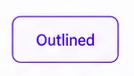

Make the outline and text the dark green color, same as the Search button.
The fill of the button is transparent.
### RECOMMENDATION

At 480 px and narrower, make the Admin Search toggle an outlined button: a 1 px outline in the `primary` color, text and chevron in `primary`, no fill.  
This replaces the filled button of TWEAK17.  

- `src/public/phone-admin-m3.css`: on `.admin-search-toggle`, the `primary` background and `on-primary` color of TWEAK17 are removed and `border:1px solid var(--md-sys-color-primary)` is added.  
- The transparent fill and the `primary` text color then come from `admin-search-m3.css`, as before TWEAK17.  
- Tests, written but not run (`Run Tests` is empty): the TWEAK17 test in `tests/phone-sheets.test.ts` is rewritten.  
- Artifacts: `tasks.md`.  

Assumptions made instead of questions:  

- The outline is 1 px, the width of the site's other outlined controls;  
  the reference picture's outline looks a little heavier.  
- The pill shape and the 48 px height stay; the picture's smaller corner radius is taken as an example of the style, not of the shape.  
- Phone layout only, as in TWEAK17.  

2026-11-16 10:44

### ACCEPTED RECOMMENDATION

The Admin Search toggle is an outlined button at 480 px and narrower.  
Nothing was looked at in a browser and no test was run, so the look is unverified until the next device or test run.  

- Code  
  - `src/public/phone-admin-m3.css`: `.admin-search-toggle` has the outline and no longer sets a background or a color.  
- Tests: tests postponed (Run Tests not ticked);  
  the following was rewritten and not run.  
  - `tests/phone-sheets.test.ts`: "outlines the admin search toggle in the Search button's color, with no fill" replaces the TWEAK17 test.  
  - `npx tsc --noEmit` passes.  
- Artifacts: `tasks.md` (T061 added, T060 marked as replaced).  
- Not committed: the changes of TWEAK11 to TWEAK18 are in the working tree only.  

2026-11-16 10:44

## TWEAK19 Smaller Corner Radius On The Admin Search Toggle  
[X] Resolved  
[ ] Run Tests  

For the Admin Search toggle, not a rounder pill shape but a smaller corner radius is desired.


### RECOMMENDATION

At 480 px and narrower, give the Admin Search toggle the `corner-small` radius, 8 px, in place of the pill shape.  

- `src/public/phone-admin-m3.css`: `.admin-search-toggle` gets `border-radius:var(--md-sys-shape-corner-small)`.  
- The hover, focus and pressed layer already takes the button's radius (`border-radius:inherit`), so it follows.  
- Tests, written but not run (`Run Tests` is empty): one in `tests/phone-sheets.test.ts`.  
- Artifacts: `tasks.md`.  

Assumptions made instead of questions:  

- 8 px is chosen from the shape tokens (4, 8, 12 and 28 px) as the nearest to the reference picture on a 48 px high button.  
- Phone layout only, as in TWEAK17 and TWEAK18;  
  at 481 px and wider the toggle keeps its pill-shaped hover layer.  

2026-11-16 10:48

### ACCEPTED RECOMMENDATION

The Admin Search toggle has 8 px corners at 480 px and narrower.  
Nothing was looked at in a browser and no test was run, so the look is unverified until the next device or test run.  

- Code  
  - `src/public/phone-admin-m3.css`: the radius on `.admin-search-toggle`.  
- Tests: tests postponed (Run Tests not ticked);  
  the following was written and not run.  
  - `tests/phone-sheets.test.ts`: "gives the admin search toggle the small corner, not the pill".  
  - `npx tsc --noEmit` passes.  
- Artifacts: `tasks.md` (T062 added).  
- Not committed: the changes of TWEAK11 to TWEAK19 are in the working tree only.  

2026-11-16 10:48

## TWEAK20 Admin Search Field Pairs Two Per Line  
[X] Resolved  
[ ] Run Tests  

There are 5 admin-field-pairs that can be rendered 2 per line as mocked up here:  


### RECOMMENDATION

At 480 px and narrower, stop stacking the five field pairs of the Admin Search, so each operator sits beside its value on one line, as in the mock-up.  

- `src/public/phone-admin-m3.css`: the rule that made `.admin-search .admin-field-pair` one column is removed;  
  the two equal columns of `admin-search-m3.css` apply again, with the phone layout's 16 px gap.  
- The five pairs are Created on, Starts on, Ends on, Voter count and Invitee count.  
- By the sheet's numbers each field is about 196 px wide, enough for "on or after" and for a date with its picker icon at 20 px text.  
- Tests, written but not run (`Run Tests` is empty): `tests/phone-sheets.test.ts` and `tests/admin-search-assets.test.ts`.  
- Artifacts: `contracts/phone-layout.md` (P4), `quickstart.md`, `tasks.md`.  

Assumption made instead of a question: "two per line" is the pair's own two fields on one line, as the mock-up shows, not two pairs on one line.  

2026-11-16 10:54

### ACCEPTED RECOMMENDATION

Each Admin Search operator sits beside its value at 480 px and narrower.  
Nothing was looked at in a browser and no test was run, so the look is unverified until the next device or test run.  

- Code  
  - `src/public/phone-admin-m3.css`: the one-column rule for `.admin-search .admin-field-pair` is removed.  
- Tests: tests postponed (Run Tests not ticked);  
  the following were written or updated and not run.  
  - `tests/phone-sheets.test.ts`: new test "keeps each admin search operator beside its value, two fields per line";  
    the one-column expectation is taken out of two older tests.  
  - `tests/admin-search-assets.test.ts`: the test of the field pairs now expects them not to stack in the phone layout.  
  - The same file's test of the radio groups still expected them to stack, which TWEAK13 had made untrue without the test being updated;  
    it is corrected here.  
  - `npx tsc --noEmit` passes.  
- Artifacts: `contracts/phone-layout.md` (P4), `quickstart.md`, `tasks.md` (T063 added).  
- Not committed: the changes of TWEAK11 to TWEAK20 are in the working tree only.  

2026-11-16 10:54

## TWEAK21 Admin Search Toggle As A Control Bar  
[X] Resolved  
[ ] Run Tests  

Let's try the Collapse Search and Expand Search controls in a "control bar" at the top of the Admin Search form.
See this rough mockup as an example of the control bar layout:  
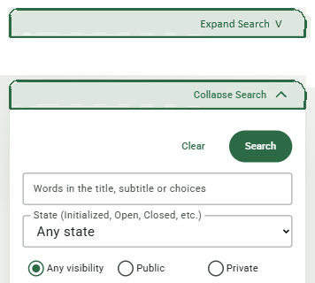

### RECOMMENDATION

At 480 px and narrower, draw the Collapse Search and Expand Search control as a bar across the top of the Admin Search form, joined to it, as in the mock-up.  
This replaces the outlined button of TWEAK18 and its small corners of TWEAK19.  

- `src/public/phone-admin-m3.css` only; no markup and no script changes, as the toggle already sits just above the form.  
  - The toggle fills its row and is the bar: 48 px high, label and chevron at the right, a 1 px `primary` outline, a `secondary-container` fill, text and chevron in `primary`.  
  - Expanded: the bar's top corners take the card's 20 px radius and its bottom corners are square;  
    the form under it loses its top border and top corner radius, so the two read as one card.  
  - Collapsed: the bar stands alone, rounded on all four corners, with 16 px under it before the results.  
  - The whole bar is the button, so a tap anywhere on it collapses or expands the form.  
- Tests, written but not run (`Run Tests` is empty): the two toggle tests in `tests/phone-sheets.test.ts` are rewritten.  
- Artifacts: `tasks.md`.  

Assumptions made instead of questions:  

- The pale green of the mock-up is the `secondary-container` token.  
- The collapsed bar is rounded on all corners; the mock-up draws its bottom edge square.  
- Phone layout only; at 481 px and wider the toggle stays the text button above the form.  

2026-11-16 11:05

### ACCEPTED RECOMMENDATION

The Admin Search toggle is a control bar on top of the search form at 480 px and narrower.  
Nothing was looked at in a browser and no test was run, so the look is unverified until the next device or test run.  

- Code  
  - `src/public/phone-admin-m3.css`: the bar rules on `.admin-search-toggle` and `.admin-search-toggle-row`, the collapsed variants, and `.admin-search-toggle-row + .admin-search` for the joined form.  
- Tests: tests postponed (Run Tests not ticked);  
  the following were rewritten and not run.  
  - `tests/phone-sheets.test.ts`: "draws the admin search toggle as a control bar on top of the search form" and "rounds the collapsed control bar on every corner and keeps it clear of the results" replace the TWEAK18 and TWEAK19 tests.  
  - `npx tsc --noEmit` passes.  
- Artifacts: `tasks.md` (T064 added).  
- Known difference in the look: the bar's outline is `primary` green while the form's side and bottom borders keep the card's own line color.  
- Not committed: the changes of TWEAK11 to TWEAK21 are in the working tree only.  

2026-11-16 11:05

## TWEAK22 One Outline Around The Control Bar And The Search Form  
[X] Resolved  
[ ] Run Tests  

That control bar at the top ofd rhe search form looks and works great.  
Now add the same dark green border to the entire form, so that the control bar and the form read as a single card with a consistent outline.

### RECOMMENDATION

At 480 px and narrower, give the search form under the control bar the bar's `primary` outline on its left, right and bottom edges.  

- `src/public/phone-admin-m3.css`: `.admin-search-toggle-row + .admin-search` gets `border-color:var(--md-sys-color-primary)`.  
- The form keeps no top border: the bar's bottom edge is the one line between the two.  
- Tests, written but not run (`Run Tests` is empty): one in `tests/phone-sheets.test.ts`.  
- Artifacts: `tasks.md`.  

Assumption made instead of a question: the line between the bar and the form stays, in the same green, as the bar's bottom edge.  

2026-11-16 11:07

### ACCEPTED RECOMMENDATION

The control bar and the search form share one `primary` outline at 480 px and narrower.  
Nothing was looked at in a browser and no test was run, so the look is unverified until the next device or test run.  

- Code  
  - `src/public/phone-admin-m3.css`: the border color on the form under the control bar.  
- Tests: tests postponed (Run Tests not ticked);  
  the following were written or updated and not run.  
  - `tests/phone-sheets.test.ts`: new test "outlines the search form in the control bar's color, so the two read as one card";  
    the TWEAK21 test's expectation of the joined form loosened to contain its three declarations.  
  - `npx tsc --noEmit` passes.  
- Artifacts: `tasks.md` (T065 added).  
- Not committed: the changes of TWEAK11 to TWEAK22 are in the working tree only.  

2026-11-16 11:07

## TWEAK23 Three-Line Clear Control With An X Icon  
[X] Resolved  
[ ] Run Tests  

Make the 2 admin-search-clear controls appear as shown in the following mockup:  


The text will be on 3 lines with line spacing set to 15px and right justified.  
There will be an X icon to the right of the text.

### RECOMMENDATION

Give both "Reset search fields" controls a text part and an X icon after it, and at 480 px and narrower set the text on three right-aligned lines 15 px apart.  

- `src/public/admin.html`: each control holds `<span class="admin-search-clear-text">Reset search fields</span>` and an X drawn as an inline SVG in the text color.  
- `src/public/admin-search-m3.css`: the control lays its text and icon out in a row, 8 px apart, with a 24 px icon, at every width.  
- `src/public/phone-admin-m3.css`: the text is as narrow as its longest word, so it breaks into "Reset", "search", "fields";  
  `line-height:15px`, `text-align:right`, a 28 px icon, 4 px between text and icon.  
- `src/public/adminList.js`: the two controls shared `id="adminSearchClear"` and only the first was attached;  
  both are now attached and held during an edit by their class, and only the first keeps the id.  
- Tests, written but not run (`Run Tests` is empty): `tests/phone-sheets.test.ts` and `tests/client-admin-search.test.ts`.  
- Artifacts: `tasks.md`.  

Assumptions made instead of questions:  

- The X is drawn in the control's green text color, not the black of the mock-up.  
- The three lines are for the phone layout; at 481 px and wider the text stays on one line, with the X after it.  
- The X is part of the same button, so a tap on it resets the form like a tap on the text.  

2026-11-16 11:20

### ACCEPTED RECOMMENDATION

Both Reset controls show their text and an X icon, on three right-aligned lines at 480 px and narrower, and both now reset the form.  
Nothing was looked at in a browser and no test was run, so the look and the second control's click are unverified until the next device or test run.  

- Code  
  - `src/public/admin.html`: the text span and the X icon in both controls;  
    the second control no longer carries the duplicate id.  
  - `src/public/admin-search-m3.css`: two rules for the control's row layout and icon size.  
  - `src/public/phone-admin-m3.css`: the control's gap and padding, the three-line text and the 28 px icon.  
  - `src/public/adminList.js`: the click and the hold during an edit reach every `.admin-search-clear` of the form.  
- Tests: tests postponed (Run Tests not ticked);  
  the following were written and not run.  
  - `tests/phone-sheets.test.ts`: "sets the Reset control's text on three right-aligned lines 15px apart, with a 28px X after it".  
  - `tests/client-admin-search.test.ts`: "has a Reset control above and below the fields, each with its text and an X icon, and both reset the form".  
  - `npx tsc --noEmit` passes.  
- Artifacts: `tasks.md` (T066 added).  
- Left for the developer  
  - `README.md` still calls the control **Clear** in two places; the label was changed by hand to "Reset search fields" and the README was not updated.  
  - Older tests in `tests/client-admin-search.test.ts` were written for one action row at the bottom with Clear before Search, and may fail on the hand-edited markup.  
- Not committed: the changes of TWEAK11 to TWEAK23 are in the working tree only.  

2026-11-16 11:20

## TWEAK24 X In A Solid Green Circle On The Reset Control  
[X] Resolved  
[ ] Run Tests  
Make the X beside the "Reset search fields" an X in a solid green circle icon:  

### RECOMMENDATION

Draw the X of both "Reset search fields" controls on a solid circle in the control's green, with the X itself in the `on-primary` color.  

- `src/public/admin.html`: each icon gains a filled circle (`fill="currentColor"`, so it takes the control's `primary` text color) and a smaller X inside it.  
- `src/public/admin-search-m3.css`: `.admin-search .admin-search-clear svg path{ stroke:var(--md-sys-color-on-primary); }` for the X.  
- The icon keeps its size: 24 px, and 28 px at 480 px and narrower.  
- Tests, written but not run (`Run Tests` is empty): one in `tests/phone-sheets.test.ts`.  
- Artifacts: `tasks.md`.  

Assumption made instead of a question: the change applies at every width, as the icon is in the page's markup and not in the phone sheet.  

2026-11-16 11:32

### ACCEPTED RECOMMENDATION

Both Reset controls show an X on a solid green circle.  
Nothing was looked at in a browser and no test was run, so the look is unverified until the next device or test run.  

- Code  
  - `src/public/admin.html`: the circle and the smaller X in both icons.  
  - `src/public/admin-search-m3.css`: the X's stroke color.  
- Tests: tests postponed (Run Tests not ticked);  
  the following was written and not run.  
  - `tests/phone-sheets.test.ts`: "draws the Reset control's X on a solid circle of the control's color".  
  - `npx tsc --noEmit` passes.  
- Artifacts: `tasks.md` (T067 added).  
- Not committed: the changes of TWEAK11 to TWEAK24 are in the working tree only.  

2026-11-16 11:32

## TWEAK25 Green Dot Before The First Result Fact  
[X] Resolved  
[ ] Run Tests  

On the Search Results list, render a green dot before the "Public/Private" label as mocked up here (pointed to by red arrow):   
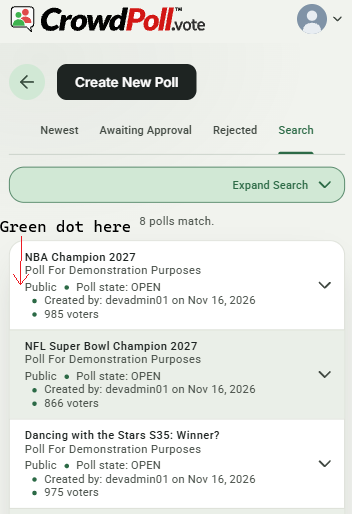

### RECOMMENDATION

At 480 px and narrower, draw the green dot before the first fact of a search result as well, so "Public" or "Private" lines up with the facts that wrap under it.  

- `src/public/phone-admin-m3.css`: `.admin-result-facts > span:first-child::before` gets the same dot as the separators of `admin-search-m3.css`: 6 px, `primary`, 10 px of margin on each side.  
- No script change: the dot is drawn by the sheet, as the other three are.  
- Tests, written but not run (`Run Tests` is empty): one in `tests/phone-sheets.test.ts`, which also keeps the two dots identical.  
- Artifacts: `tasks.md`.  

Assumption made instead of a question: phone layout only;  
at 481 px and wider the facts usually sit on one line, where the dots are separators and a leading dot is not needed.  

2026-11-16 11:39

### ACCEPTED RECOMMENDATION

A search result's first fact has the green dot before it at 480 px and narrower.  
Nothing was looked at in a browser and no test was run, so the look is unverified until the next device or test run.  

- Code  
  - `src/public/phone-admin-m3.css`: the dot before the first fact.  
- Tests: tests postponed (Run Tests not ticked);  
  the following was written and not run.  
  - `tests/phone-sheets.test.ts`: "draws the separator dot before a result's first fact too, so wrapped facts line up".  
  - `npx tsc --noEmit` passes.  
- Artifacts: `tasks.md` (T068 added).  
- Not committed: the changes of TWEAK11 to TWEAK25 are in the working tree only.  

2026-11-16 11:39

## TWEAK26 Small Label Size On The Admin Poll Card  
[X] Resolved  
[ ] Run Tests  

On the poll-admin-card, anywhere md-sys-typescale-label-medium-size is used,  
change it to `md-sys-typescale-label-small-size`.
### RECOMMENDATION

At 480 px and narrower, set the admin poll card's texts that use the `label-medium` size in `label-small`.  
Expect almost no visible change on a phone: the phone type scale gives both roles the same 15 px (`label-small` is held at 15 px, decision R2), so only the line height differs, 18 px against 20 px.  

- Where `label-medium` is used on the card (`admin-card-m3.css`)  
  - Field labels (`.card-field-label`) and the invitees' field label (`.invitees-field-label`): size and line height.  
  - The current wizard step's label, the "invitee" chip and the "not your poll" chip: size only.  
  - The "Copy link" button of the wizard summary also uses it, but the phone sheet already sets that button in `label-large`, so it is left alone.  
  - The switch's mark (`.m3-switch::before`), set by the phone sheet itself.  
- `src/public/phone-admin-m3.css`: those texts get `label-small`, with its line height where the card sets one.  
- Tests, written but not run (`Run Tests` is empty): one in `tests/phone-sheets.test.ts`.  
- Artifacts: `tasks.md`.  

Assumptions made instead of questions:  

- Phone layout only, as the tweaks' reminder says;  
  `admin-card-m3.css` is not edited, so at 481 px and wider these texts stay 12 px.  
- The line height follows the size where the card sets a `label-medium` line height.  

2026-11-16 11:49

### ACCEPTED RECOMMENDATION

The admin poll card's `label-medium` texts use `label-small` at 480 px and narrower.  
On a phone the size is 15 px either way, so the only real change is 2 px less line height on the field labels.  
Nothing was looked at in a browser and no test was run.  

- Code  
  - `src/public/phone-admin-m3.css`: two rules for the five texts, and the switch's mark changed from `label-medium` to `label-small`.  
- Tests: tests postponed (Run Tests not ticked);  
  the following was written and not run.  
  - `tests/phone-sheets.test.ts`: "sets every label-medium text of the admin poll card in the small label size".  
  - `npx tsc --noEmit` passes.  
- Artifacts: `tasks.md` (T069 added).  
- If smaller text was the aim, it needs a size below 15 px on a phone, which the phone type scale does not have;  
  that would be a new decision, not made here.  
- Not committed: the changes of TWEAK11 to TWEAK26 are in the working tree only.  

2026-11-16 11:49

## TWEAK27 At Most Five Choices In The Admin Card Summary  
[X] Resolved  
[ ] Run Tests  

On the Admin Poll Card (non-edit mode), for the "Voters choose from..." text,  
display up to 5 choices. If there are more than 5, display an ellipsis (`...`) after the fifth choice  
and then the text (N more choices) in brackets.  
Here is a rough mockup.  
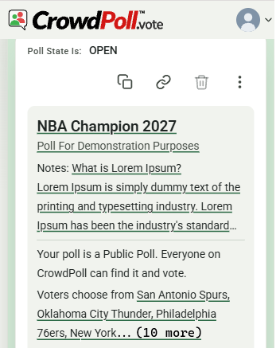

### RECOMMENDATION

On the admin poll card at rest, name at most five choices in the "Voters choose from" line, then "..." and the number left in brackets.  

- `src/public/adminCard.js`, in `buildSummary`  
  - Read-only card with more than five choices: "Voters choose from A, B, C, D, E... (10 more choices)."  
  - One left over reads "(1 more choice)".  
  - Five or fewer: the line is as before.  
  - The limit is the constant `SUMMARY_CHOICES_NAMED = 5`.  
- The five names stay one tappable part where the choices can be changed;  
  the "..." and the bracket are plain text after it.  
- Tests, written but not run (`Run Tests` is empty): two in `tests/client-admin-wizard.test.ts`.  
- Artifacts: `tasks.md`.  

Assumptions made instead of questions:  

- The bracket reads "(N more choices)", as the tweak's text says; the mock-up's shorter "(10 more)" is not used.  
- "Non-edit mode" is the card at rest; the summary at the top of the open wizard still names every choice, since that is where they are being edited.  
- The rule applies at every width: it is the card's wording, not a phone style.  
- The choices are named in their stored order, not by votes.  

2026-11-16 12:08

### ACCEPTED RECOMMENDATION

The admin poll card at rest names five choices at most and counts the rest.  
Nothing was looked at in a browser and no test was run, so the wording on a real card is unverified until the next device or test run.  

- Code  
  - `src/public/adminCard.js`: the constant and the shortened line for the read-only card.  
- Tests: tests postponed (Run Tests not ticked);  
  the following were written and not run.  
  - `tests/client-admin-wizard.test.ts`: "names five choices at most on the card at rest and counts the rest" (15, 6 and 5 choices) and "names every choice in the wizard's own summary".  
  - `npx tsc --noEmit` and `node --check` on the script pass.  
- Artifacts: `tasks.md` (T070 added).  
- Not committed: the changes of TWEAK11 to TWEAK27 are in the working tree only.  

2026-11-16 12:08

## TWEAK28 Notes Summary Clamped To Three Lines  
[X] Resolved  
[ ] Run Tests  

For the poll Notes: summary text, render up to 3 lines rather than the current 4 lines.

### RECOMMENDATION

At 480 px and narrower, cut the admin poll card's "Notes:" summary off after three lines, where it now shows four.  

- `src/public/phone-admin-m3.css`: `.poll-admin-card .wizard-summary-notes{ -webkit-line-clamp:3; line-clamp:3; }`.  
- The four-line rule of `admin-card-m3.css` already ends the text with an ellipsis and hides the rest; only the number changes.  
- Tests, written but not run (`Run Tests` is empty): one in `tests/phone-sheets.test.ts`.  
- Artifacts: `tasks.md`.  

Assumptions made instead of questions:  

- Phone layout only, as the tweaks' reminder says; at 481 px and wider the summary keeps four lines.  
- The rule covers the card at rest and the summary at the top of the open wizard alike, as the four-line rule does.  

2026-11-16 12:10

### ACCEPTED RECOMMENDATION

The admin poll card's Notes summary shows three lines at most at 480 px and narrower.  
Nothing was looked at in a browser and no test was run, so the look is unverified until the next device or test run.  

- Code  
  - `src/public/phone-admin-m3.css`: the three-line clamp.  
- Tests: tests postponed (Run Tests not ticked);  
  the following was written and not run.  
  - `tests/phone-sheets.test.ts`: "clamps the admin card's notes summary to three lines, one fewer than on wider screens".  
  - `npx tsc --noEmit` passes.  
- Artifacts: `tasks.md` (T071 added).  
- Not committed: the changes of TWEAK11 to TWEAK28 are in the working tree only.  

2026-11-16 12:10

## TWEAK29 Smaller Gaps Between Admin Search Rows  
[X] Resolved  
[ ] Run Tests  

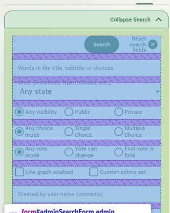

### CLARIFICATIONS

Asked 2026-11-16 14:21.  
The tweak holds the screenshot only, with no text, so the change wanted is not known.  
The screenshot shows the Admin Search form with the browser's flex overlay: the hatched bands are the 16 px gaps between its rows.  

- Q1: What should change?  
  - A: Make the gaps between the rows of the form smaller, so more fits on the screen.  
    If so, how tall: 8 px, 12 px, or another value?  
  - B: Move the "State (Initialized, Open, Closed, etc.)" label, which sits on the top border of its field and reaches into the gap above.  
  - C: Something else: please write it under the screenshot.  
- Q2: Should the gap inside the rows change too (16 px between the two fields of a pair, and between Search and "Reset search fields")?  

Answer: a, 8px, no (given in chat, 2026-11-16 14:23)  

### RECOMMENDATION

Recorded 2026-11-16 14:23.  
Set the gap between the rows of the Admin Search form to 8 px at 480 px and narrower.  

- `src/public/phone-admin-m3.css`: add `gap:8px` to the `.admin-search` rule.  
- The base sheet `admin-search-m3.css` keeps 16 px for 481 px and wider.  
- The 16 px gaps inside a row stay: between the two fields of a pair, and between Search and "Reset search fields".  

### ACCEPTED RECOMMENDATION

Applied 2026-11-16 14:23.  

- `src/public/phone-admin-m3.css`: `.admin-search` now has `gap:8px`.  
- `tests/phone-sheets.test.ts`: one test added, "halves the gap between the rows of the admin search form and keeps the gap inside a row".  
  Not run: `Run Tests` is not ticked.  
- `contracts/phone-layout.md`: the Admin search form row names the 8 px row gap.  
- `tasks.md`: T072 added.  
- Not checked in a browser.  

Assumptions:  

- Phone layout only, as stated in TWEAK12.  
- The form's 20 px padding and the 16 px under the form are unchanged; the answer named the gaps between the rows only.  
- A floating label, such as "State", sits on the top border of its field and reaches about 9 px above it;  
  with an 8 px gap it may touch the row above.  

## TWEAK30 Admin Search Row Gap At 9 px  
[X] Resolved  
[ ] Run Tests  
A followup to TWEAK29: 
try increasing the gap by 1 px to 9px  

### RECOMMENDATION

Recorded 2026-11-16 14:27.  
Raise the gap between the rows of the Admin Search form from 8 px to 9 px at 480 px and narrower.  

- `src/public/phone-admin-m3.css`: `gap:9px` on the `.admin-search` rule.  

### ACCEPTED RECOMMENDATION

Applied 2026-11-16 14:27.  

- `src/public/phone-admin-m3.css`: `.admin-search` now has `gap:9px`.  
- `tests/phone-sheets.test.ts`: the TWEAK29 test renamed and updated to expect 9 px.  
  Not run: `Run Tests` is not ticked.  
- `contracts/phone-layout.md`: the Admin search form row names 9 px.  
- `tasks.md`: T073 added.  
- Not checked in a browser.  

Assumption:  

- The gaps inside a row stay at 16 px, as answered in TWEAK29.  

## TWEAK31 Tighter Radio Rows And See-Through Field Labels  
[X] Resolved  
[ ] Run Tests  

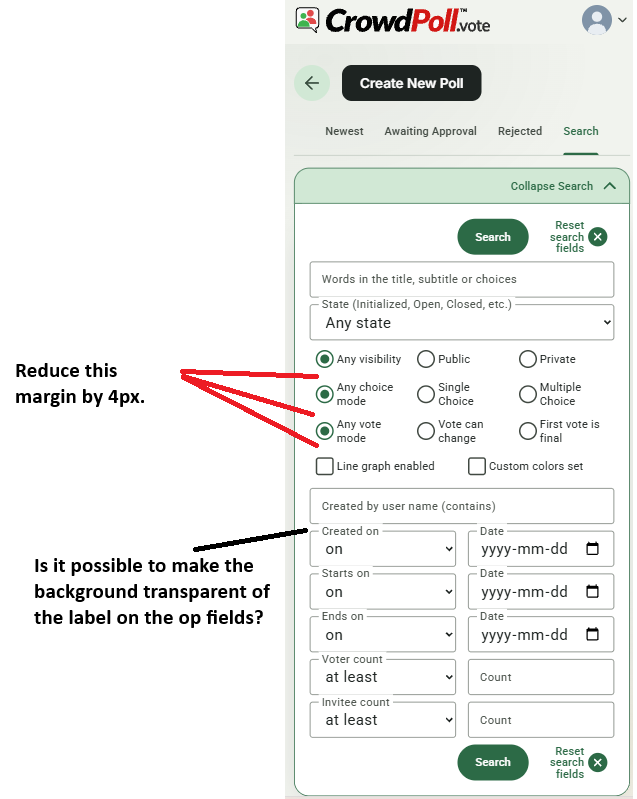

### RECOMMENDATION

Recorded 2026-11-16 14:32.  
The screenshot asks two things, both for the Admin Search form at 480 px and narrower.  

- "Reduce this margin by 4px" (the space under each of the three radio rows):  
  give `.admin-search .admin-radio-group` `margin-bottom:-4px`, so 5 px remain of the 9 px row gap.  
- "Is it possible to make the background transparent of the label on the op fields?":  
  yes, but only in part.  
  The label sits on the top border of its field, and its background is what interrupts that border behind the text;  
  with a fully transparent background the border line would run through the words.  
  The label is about 20 px tall and centered on the border, so with a 9 px row gap its upper edge covers the bottom border of the field above.  
  Make the upper half of the background transparent and keep the lower half, which hides the label's own border and nothing else.  

### ACCEPTED RECOMMENDATION

Applied 2026-11-16 14:32.  

- `src/public/phone-admin-m3.css`:  
  - `.admin-search .admin-radio-group{ margin-bottom:-4px; }` added.  
  - a floated label now has `background:linear-gradient(to bottom, transparent 50%, var(--paper-raised) 50%)`.  
- `tests/phone-sheets.test.ts`: two tests added.  
  Not run: `Run Tests` is not ticked.  
- `contracts/phone-layout.md`: the Admin search form row names both.  
- `tasks.md`: T074 added.  
- Not checked in a browser.  

Assumptions:  

- The three arrows mark the space under each radio row: visibility to choice mode, choice mode to vote mode, vote mode to the checkboxes.  
  The space above the first radio row (under the State field) stays at 9 px.  
- The label change applies to every floated label of the form (State, the operator fields, Date), not the operator fields only, since all sit on a border the same way.  
- Phone layout only: at 481 px and wider the rows are 16 px apart and no label reaches the field above.  

## TWEAK32 Smaller Summary Text On The Admin Card  
[X] Resolved  
[ ] Run Tests  

Using the screenshot below as a reference.  
Can the font-size of text below the subtitle be reduced without causing iOs Safari to zoom?

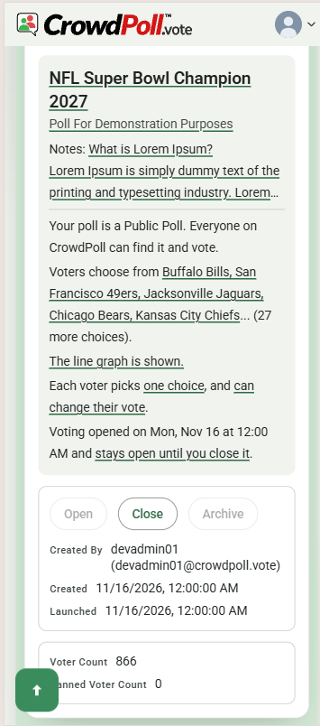

### RECOMMENDATION

Recorded 2026-11-16 14:40.  
Yes: the text can be reduced without iOS Safari zooming.  

- Safari zooms only when an editable control (`input`, `select`, `textarea`) with text under 16 px takes focus.  
- The summary holds sentences and underlined parts that are `<button>` elements, none of them editable, so their size never triggers the zoom.  
- Reduce the sentences under the subtitle from `body-medium` (18 px) to `body-small` (15 px) at 480 px and narrower.  
  15 px is the smallest size the phone layout uses (research R2), so it cannot go lower within the contract.  
- Reduce their line height from 32 px to 28 px in step.  
  An underlined part has 5 px of padding above and below, so 28 px lines still keep the parts of two lines from overlapping.  

### ACCEPTED RECOMMENDATION

Applied 2026-11-16 14:40.  

- `src/public/phone-admin-m3.css`: `.poll-admin-card .wizard-summary-text` now has `font-size:var(--md-sys-typescale-body-small-size)` and `line-height:28px`.  
- `tests/phone-sheets.test.ts`: one test added, "sets the admin card's summary sentences in the small body size, on lines that still clear a link's padding".  
  Not run: `Run Tests` is not ticked.  
- `contracts/phone-layout.md`: an "Admin card summary" row added.  
- `tasks.md`: T075 added.  
- Not checked in a browser or on an iPhone.  

Assumptions:  

- The question is also a request: the size was reduced, not only confirmed as possible.  
- "Below the subtitle" means the notes and every sentence after them; the title and the subtitle keep their sizes.  
- The same class draws the summary at the top of the open wizard, so that one is smaller too.  
- Phone layout only.  


## TWEAK33 Summary Lines 4 px Closer  
[X] Resolved  
[ ] Run Tests  

A further change to TWEAK32,  
make the line spacing withing a paragraph by 4px

### RECOMMENDATION

Recorded 2026-11-16 14:51.  
Reduce the line height of the admin card's summary sentences by 4 px, from 28 px to 24 px, at 480 px and narrower.  

- `src/public/phone-admin-m3.css`: `line-height:24px` on `.poll-admin-card .wizard-summary-text`.  
- Reduce the padding above and below an underlined part from 5 px to 3 px in the same sheet, so the tappable parts of two lines still do not overlap.  
  The underlined parts of the title and the subtitle already use 3 px.  
- The space between paragraphs is a margin and does not change.  

### ACCEPTED RECOMMENDATION

Applied 2026-11-16 14:51.  

- `src/public/phone-admin-m3.css`:  
  - `.poll-admin-card .wizard-summary-text` now has `line-height:24px`.  
  - `.poll-admin-card .wizard-summary-link` now has `padding-block:3px`.  
- `tests/phone-sheets.test.ts`: the TWEAK32 test updated to 24 px and 3 px.  
  Not run: `Run Tests` is not ticked.  
- `contracts/phone-layout.md`: the "Admin card summary" row updated.  
- `tasks.md`: T076 added.  
- Not checked in a browser.  

Assumptions:  

- The requirement has no verb before "by 4px"; it is read as "reduce by 4px", in line with the tweaks before it.  
- Each underlined part is now 4 px shorter to tap, about 24 px tall.  

## TWEAK34 Banned Voter Count Line Removed  
[X] Resolved  
[ ] Run Tests  
Remove the "Bsanned Vote Count" line.  

### RECOMMENDATION

Recorded 2026-11-16 14:54.  
Hide the "Banned Voter Count" line of the admin card's counts panel at 480 px and narrower.  

- `src/public/adminCard.js`: give that field the class `card-banned-count`.  
- `src/public/phone-admin-m3.css`: `.poll-admin-card .card-banned-count{ display:none; }`.  
- The line stays at 481 px and wider, where this feature changes nothing.  

### ACCEPTED RECOMMENDATION

Applied 2026-11-16 14:54.  

- `src/public/adminCard.js`: the field carries the class `card-banned-count`.  
- `src/public/phone-admin-m3.css`: the class is hidden.  
- `tests/phone-sheets.test.ts`: one test added, "leaves the Banned Voter Count line off the admin card".  
  Not run: `Run Tests` is not ticked.  
- `contracts/phone-layout.md`: an "Admin card counts" row added.  
- `tasks.md`: T077 added.  
- Not checked in a browser.  

Assumptions:  

- "Bsanned Vote Count" is the "Banned Voter Count" line of the admin card at rest.  
- Phone layout only, as stated in TWEAK12; the line is still built, so the existing tests of the counts panel are unchanged.  
- The periodic refresh of `bannedVoterCount` and the ban list of the invitees panel are untouched.  

## TWEAK35 Vote Counts In The Dates Panel  
[X] Resolved  
[ ] Run Tests  
tweak requirements...  

Put the "Vote Count" in the panel above that has "Created By", "Created", "Launched".

### RECOMMENDATION

Recorded 2026-11-16 14:57.  
On the phone layout, list the vote counts after "Launched" in the dates panel of the admin card.  

- `src/public/adminCard.js`: when the card is drawn at 480 px and narrower, "Voter Count" (and "Vote Count" on a multiple-choice poll) go into `.card-dates-panel`.  
- The counts panel then holds the invitation counts only;  
  on a poll without invitations it would be empty (TWEAK34 hides the banned count), so it is not drawn there.  
- The two panels are separate elements, so this cannot be done in CSS alone;  
  the script asks the same media query as the phone sheets.  

### ACCEPTED RECOMMENDATION

Applied 2026-11-16 14:57.  

- `src/public/adminCard.js`:  
  - `isPhoneLayout()` added, `matchMedia("(max-width: 480px)")`.  
  - `renderReadOnly` places the vote counts in the dates panel on the phone layout and leaves the counts panel out when it has no invitation counts.  
- `tests/client-admin-wizard.test.ts`: one test added, "lists the vote counts under the dates on the phone layout, with no counts panel on a poll without invitations".  
  Not run: `Run Tests` is not ticked.  
- `contracts/phone-layout.md`: the "Admin card counts" row extended.  
- `tasks.md`: T078 added.  
- Not checked in a browser.  

Assumptions:  

- "Vote Count" means the count lines left in the lower panel: "Voter Count" always, and "Vote Count" on a multiple-choice poll.  
- Phone layout only; at 481 px and wider the two panels are as before.  
- On an Invitation Only poll the counts panel remains, with "Invitation Count" and "Accepted Count".  
- The layout is chosen when the card is drawn;  
  a window resized across 480 px shows the other arrangement at the next redraw, such as the periodic refresh.  

## TWEAK36 Five Choices In The Edit-Mode Summary Too  
[X] Resolved  
[ ] Run Tests  

Apply TWEAK27 to the Poll Card when in edit-mode as well.  

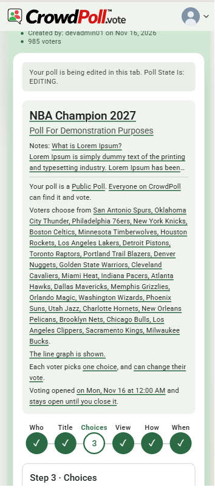

### RECOMMENDATION

Recorded 2026-11-16 15:10.  
Name five choices at most, then `...` and "(N more choices)", in the summary at the top of the open wizard, as on the card at rest.  

- `src/public/adminCard.js`: `buildSummary` applies `SUMMARY_CHOICES_NAMED` whichever kind of card it draws.  
- The Choices step itself still lists every choice for editing.  

### ACCEPTED RECOMMENDATION

Applied 2026-11-16 15:10.  

- `src/public/adminCard.js`: the limit no longer depends on the card being at rest.  
- `tests/client-admin-wizard.test.ts`: the test "names every choice in the wizard's own summary" rewritten as "names five choices at most in the wizard's own summary too, and counts the rest".  
  Not run: `Run Tests` is not ticked.  
- `tasks.md`: T079 added.  
- Not checked in a browser.  

Assumptions:  

- As with TWEAK27, the limit applies at every width, since the sentence is built by the script.  
- The five named are the first five in the poll's order; the underlined part still opens Step 3, where all of them are.  
- A choice just added in Step 3 beyond the fifth does not appear by name in the summary, only in the count.  

## TWEAK37 Font Size Of The Choices Text Area  
[X] Resolved  
[ ] Run Tests  
We are now going to start working on the Admin Poll Card in edit-mode.  
This is all the tabbed panels "Step 1" through "Step 6".  

What is the size of the font of the Choices in the text area?  
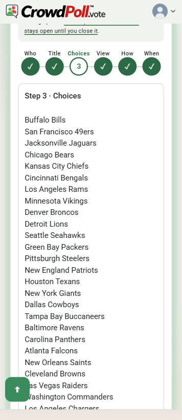

### RECOMMENDATION

Recorded 2026-11-16 15:23.  
The tweak asks a question and no change; the answer is recorded and nothing is edited.  

- At 480 px and narrower the Choices text area is 20 px on 30 px lines:  
  `.poll-admin-card .m3-field-input` in `src/public/phone-admin-m3.css` takes `body-large`, which the phone layout sets to 20 px / 30 px.  
- At 481 px and wider it is 17 px on 1.4 lines (`src/public/admin-card-m3.css`).  
- Every typed field of the wizard shares that rule, so the title, subtitle and the other inputs are the same size.  
- The text area is an editable control, so iOS Safari zooms in when it is under 16 px.  
  The next size down in the phone type scale is 18 px (`body-medium` or `label-large`);  
  16 px is the lowest safe size but is not a step of the phone scale.  

### ACCEPTED RECOMMENDATION

Applied 2026-11-16 15:23.  

- No code, test or artifact changed.  

## TWEAK38 Choices Text Area At 16 px  
[X] Resolved  
[ ] Run Tests  
As a followup to the previous tweak,  
was the response that it can not be made 16px?  

If it can, please do so.

### RECOMMENDATION

Recorded 2026-11-16 15:27.  
No: the text area can be set to 16 px.  
But the answer in TWEAK37 left something out, and it decides whether 16 px is wise, so nothing is changed until an option is chosen.  

- `viewportWidth.js` draws the page as 480 px wide on any screen narrower than 480 px, and every iPhone is (375 to 440 points).  
  The page is therefore drawn at about 0.78 to 0.92 of its CSS size.  
- Safari's zoom rule works on the drawn size, as far as is known: it zooms when the focused field's text is under 16 points on the screen.  
  A 16 px field is drawn at about 12.5 to 14.7 points, so Safari would zoom in on every iPhone.  
- The present 20 px is drawn at 16.25 points on a 390-point iPhone, which is just over the limit;  
  on a 375-point iPhone it is 15.6 points and may already zoom.  
- This has not been tried on a device; it follows from how WebKit computes the zoom, and was noted as an open risk in TWEAK15.  

Options:  

- A (recommended): keep 20 px.  
  It is the smallest size that stays clear of the zoom on most iPhones.  
- B: set the Choices text area to 16 px on 24 px lines, at 480 px and narrower, and try it on an iPhone.  
  Expect Safari to zoom in when the text area is tapped.  
- C: set 16 px as in B and also stop the zoom on focus on iOS, by adding `maximum-scale=1` to the viewport that `viewportWidth.js` writes.  
  iOS Safari still lets the reader pinch to zoom with that setting; it must not be sent to Android, where it would block pinching.  
  This changes every page, not only the admin card, and needs a check on a device.  

### ACCEPTED RECOMMENDATION

Applied 2026-11-16 15:29.  
Option C, chosen in chat.  

- `src/public/phone-admin-m3.css`: the Choices text area (`.m3-field--choices .m3-field-input`) is 16 px on 24 px lines;  
  its least height is still four lines.  
  The size is written `max(16px, var(--md-sys-typescale-body-small-size))`, since the phone scale has no 16 px step.  
- `src/public/viewportWidth.js`: on iOS only, the fixed viewport is `width=480, maximum-scale=<held width / 480>`, for example `0.8125` on a 390-point iPhone.  
- The value is not `1`, as the option said.  
  The page opens at about 0.81, so a limit of 1 would still let Safari zoom from 0.81 to 1;  
  a limit equal to the fitted scale leaves it nothing to zoom to.  
- `tests/phone-sheets.test.ts`: one test added.  
- `tests/client-viewport-width.test.ts`: one test added for three iPhone sizes; the test "writes nothing that limits zoom" now speaks of other phones.  
  Not run: `Run Tests` is not ticked.  
- `contracts/phone-layout.md`: a row for the Choices text area added.  
- `tasks.md`: T080 added.  
- `CLAUDE_COMPLETE.md`: the note on `viewportWidth.js` names the iOS limit.  
- Not checked on an iPhone, which is the only real test of this change.  

Assumptions and risks:  

- "It" is the Choices text area only; the title, subtitle and the other typed fields stay at 20 px.  
- The fixed-viewport feature's FR-005 says zoom must not be limited (`specs/20261113-085157-FIXED-VIEWPORT-WIDTH/spec.md`).  
  Safari ignores `maximum-scale` when the reader pinches, so it holds there.  
  A browser built into another iOS app (a mail or social app opening a link) may honour the limit and stop the reader zooming in;  
  that spec is not edited.  
- With the limit in place Safari no longer zooms in on any field of any page on an iPhone, including those that zoomed before.  
- iOS is recognised by `iPhone`, `iPod` or `iPad` in the user agent.  

## TWEAK39 Second Next Button At The Top Of Each Step  
[X] Resolved  
[ ] Run Tests  

On each Admin Card Step,  
add a Next button at the top in addition to the one at the bottom.  
This mockup shows an example:  
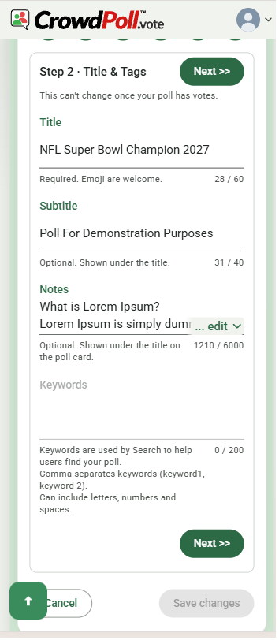

### RECOMMENDATION

Recorded 2026-11-16 15:37.  
On the phone layout, put a second "Next >>" button on the heading line of each wizard step that has one below, as in the mockup.  

- `src/public/adminCard.js`: `buildStepPanel` wraps the heading and a second `nextButton()` in `div.wizard-panel-top` when the card is drawn at 480 px and narrower.  
- `src/public/phone-admin-m3.css`: lay that line out with the heading on the left and the button on the right.  
- Both buttons do the same thing and are blocked together while two choices are duplicates.  

### ACCEPTED RECOMMENDATION

Applied 2026-11-16 15:37.  

- `src/public/adminCard.js`:  
  - the second button is added on Steps 1 to 5 on the phone layout.  
  - `refreshWizardChrome` blocks or frees every Next of the card, not the first only.  
  - after a step change the focus still goes to the lower Next when the step has no field to take it.  
- `src/public/phone-admin-m3.css`: `.wizard-panel-top` rules added.  
- `tests/client-admin-wizard.test.ts`: two tests added.  
  Not run: `Run Tests` is not ticked.  
- `contracts/phone-layout.md`: a row for the wizard's Next added.  
- `tasks.md`: T081 added.  
- Not checked in a browser.  

Assumptions:  

- Step 6 has no Next below, so it gets none above.  
- Phone layout only, chosen when the step is drawn, as in TWEAK35; wider screens keep the single button.  
- A long step name shares the line with the button and wraps beside it.  

## TWEAK40 Density Pass On The Admin Card Wizard  
[X] Resolved  
[ ] Run Tests  

All the TWEAKS from TWEAK10 to TWEAK39 have a goal of maximizing the content that can be displayed on the phone layout without unnecessary scrolling or zooming.  
Rather than me specifying each individual tweak, the overarching goal is to ensure that the phone layout presents as much content as possible without requiring the user to scroll or zoom unnecessarily.  
Please proceed.  

### RECOMMENDATION

Recorded 2026-11-16 15:56.  
Make one density pass over the admin card's wizard (Steps 1 to 6), the area named in TWEAK37 as the current work, at 480 px and narrower.  
Follow the choices already made in TWEAK12 to TWEAK39: 48 px fields, smaller gaps, text sizes left alone unless a tweak asked.  

- Fields and rows that were 64 px tall become 48 px.  
- The gaps between the parts of the card and of a step become 12 px.  
- Buttons keep 48 px and their halo.  
- Typed text stays at 20 px, which does not depend on the untested iOS scale limit of TWEAK38.  

### ACCEPTED RECOMMENDATION

Applied 2026-11-16 15:56.  
All in `src/public/phone-admin-m3.css`, under `.poll-admin-card`:  

| Part | Before | After |
|---|---|---|
| Gap between summary, circles, step and footer (`--new`) | 20 px | 12 px |
| Summary padding | 16 px | 12 px 16 px |
| Step circles (and the line through them) | 48 px | 40 px |
| Step panel gap and padding | 16 px, 16 px | 12 px, 12 px 16 px |
| Gap between fields (`.wizard-fields`) | 24 px | 12 px |
| Typed field height and padding (`.m3-field-input`) | 64 px, 17 px | 48 px, 9 px |
| Choices text area least height | 130 px | 114 px |
| Space above a field's helper line | 8 px | 4 px |
| Radio row (`.m3-radio-item`) | 64 px, padding 12 px | 48 px, padding 6 px |
| Switch row | 64 px, padding 12 px | 48 px, padding 4 px |
| Date and time row, color row, notes preview | 64 px | 48 px |
| Keyword chip input; chip row gap and padding | 64 px; 16 px, 8 px | 48 px; 8 px, 4 px |
| Question spacing; gap in the How step | 12 px; 8 px | 8 px; 4 px |
| Padding around "What does this mean?", Next and the footer | 8 px | 0 |
| Halo of the notes "edit" control | 64 px tall | 48 px tall |

- `tests/phone-sheets.test.ts`: one test added.  
  Not run: `Run Tests` is not ticked.  
- `contracts/phone-layout.md`: a row "Admin card wizard, density" added, as an exception to P3.  
- `tasks.md`: T082 added.  
- Not checked in a browser: the values are reasoned from the style sheet, so each step needs a look.  

Assumptions:  

- The scope is the admin card's wizard only.  
  The home page and the poll card that voters use keep the larger text and 64 px targets, which are the purpose of this feature.  
- The card at rest, the invitees panel, the menus and the dialogs are unchanged.  
- Touch targets of the wizard's rows are now 48 px, below the 64 px of contract P3;  
  where two controls with a halo sit closer than 16 px, their halos overlap.  
- No text size was changed and no content was removed.  

## TWEAK41 All Wizard Typed Fields At The Choices Size  
[X] Resolved  
[ ] Run Tests  

On the wizard tabs, set all textarea and text field font size to be the same as the Choices on Step 3.
See this screenshot:  
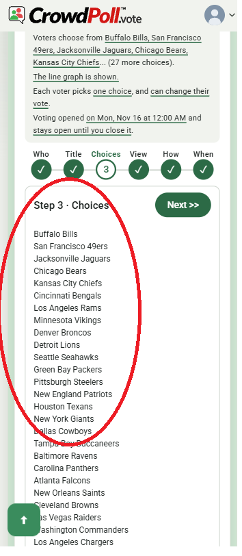

### RECOMMENDATION

Recorded 2026-11-16 16:20.  
Set every typed field of the wizard to the size of the Choices text area, 16 px on 24 px lines, at 480 px and narrower.  

- `src/public/phone-admin-m3.css`: one rule for `.m3-field-input` (title, subtitle, keywords, choices and the other text fields), the notes preview, the notes editor and the date and time inputs.  
- Give a field 12 px of padding above and below, so one line of 24 px fills the 48 px field of TWEAK40.  

### ACCEPTED RECOMMENDATION

Applied 2026-11-16 16:20.  

- `src/public/phone-admin-m3.css`:  
  - the four kinds of typed field share `font-size:max(16px, var(--md-sys-typescale-body-small-size))` and `line-height:24px`.  
  - `.m3-field-input` has `padding-block:12px`; the Choices text area is at least four lines, 120 px.  
- `tests/phone-sheets.test.ts`: the TWEAK38 test rewritten for every typed field.  
  Not run: `Run Tests` is not ticked.  
- `contracts/phone-layout.md`: the row for the Choices text area now covers every typed field.  
- `tasks.md`: T083 added.  
- Not checked in a browser or on an iPhone.  

Assumptions and risks:  

- "Text field" includes the notes (their preview in Step 2 and the editor) and the date and time inputs of Step 6, so no typed text of the wizard is left larger.  
- The invitees box under the wizard is not a step and stays at 20 px.  
- Field labels, helper lines, radio and switch labels are not typed text and keep their sizes.  
- Every one of these fields now depends on the iOS scale limit of TWEAK38, which has not been tried on an iPhone;  
  if it does not hold, Safari zooms in on each of them.  

## TWEAK42 Solid Field Labels And 2 px More Room Above  
[X] Resolved  
[ ] Run Tests  

I am going to backtrack on Tweak 31. The label on the op fields does not need to be transparent.  
Am adding 2px more padding to the top of the op fields.
Three of those fields are shown in this screenshot:  
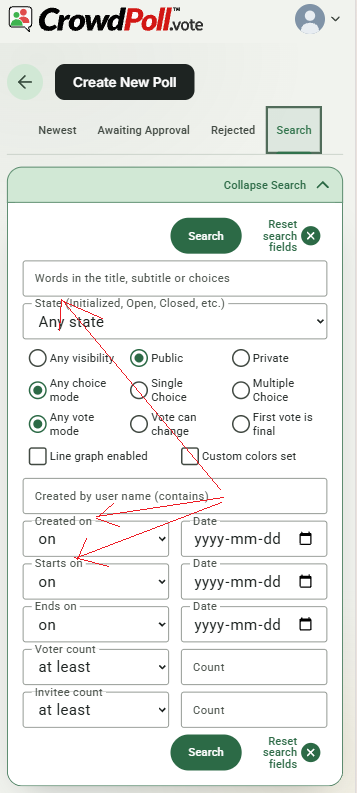

### RECOMMENDATION

Recorded 2026-11-16 16:34.  
Two changes to the Admin Search form at 480 px and narrower.  

- Withdraw the label change of TWEAK31: remove the rule that made the upper half of a floated label transparent, so the label has its solid background again.  
- Add 2 px above each row whose label floats on its top border: the State field and the five operator and value pairs.  
  With the 9 px row gap that leaves 11 px, which clears the label's upper half of about 10 px.  

### ACCEPTED RECOMMENDATION

Applied 2026-11-16 16:34.  

- `src/public/phone-admin-m3.css`:  
  - the `linear-gradient` label rule removed.  
  - `.admin-search > .m3-outlined:has(> select)` and `.admin-search > .admin-field-pair` have `margin-top:2px`.  
- `tests/phone-sheets.test.ts`: the test of the half-transparent label replaced by one for the 2 px and the solid label.  
  Not run: `Run Tests` is not ticked.  
- `contracts/phone-layout.md`: the Admin search form row updated.  
- `tasks.md`: T084 added.  
- Not checked in a browser.  

Assumptions:  

- "Am adding 2px" is read as a request to add it; the sheet held no such change.  
- The 2 px is space above the row, a margin, not padding inside the field, so the fields keep their 48 px height.  
- A whole pair moves down together, so an operator and its value stay level.  
- The radio rows of TWEAK31 are unchanged.  

## TWEAK43 Title And Subtitle Only In The Edit-Mode Summary  
[X] Resolved  
[ ] Run Tests  

This tweak applies just to widths of 480px or less.  
When the Poll Card is in edit-mode, do not display the entire summary text.  
Just the Title and subtitle. The title and subtitle do not need to be a link in this context.  

### RECOMMENDATION

Recorded 2026-11-16 16:43.  
At 480 px and narrower, show only the title and the subtitle in the summary of the open wizard, as plain text.  

- `src/public/adminCard.js`: `buildSummary` stops after the subtitle when it draws the wizard's own summary on the phone layout, and builds the two as plain parts instead of links.  
- The card at rest keeps the whole summary and its links, which are how a step is opened from there.  
- In the wizard the step circles still lead to every step.  

### ACCEPTED RECOMMENDATION

Applied 2026-11-16 16:43.  

- `src/public/adminCard.js`: the summary of the open wizard is the title and subtitle alone on the phone layout.  
- `src/public/phone-admin-m3.css`: a summary with neither is not drawn (`.wizard-summary:empty`).  
- `tests/client-admin-wizard.test.ts`: one test added, "shows the title and subtitle alone, as plain text, in the wizard's summary on the phone layout".  
  Not run: `Run Tests` is not ticked.  
- `contracts/phone-layout.md`: a row "Admin card wizard, summary" added.  
- `tasks.md`: T085 added.  
- Not checked in a browser.  

Assumptions:  

- The notes line goes too: the request names the title and subtitle only.  
- The title and subtitle still follow typing in Step 2.  
- The five-choice limit of TWEAK36 and the line spacing of TWEAK32 and TWEAK33 now show only at 481 px and wider in the wizard, and on the card at rest.  
- The layout is chosen when the wizard is drawn, as in TWEAK35.  

## TWEAK44 Cancel And Save Buttons Above The Step Circles  
[X] Resolved  
[ ] Run Tests  

Now, similar to how the "Next" button has been placed at the top of edit tab panel,  
we want the "Cancel" and "Save changes" buttons to be rendered above the numbered tab circles, and below the title/subtitle. (as well as on the footer as it is now)

### RECOMMENDATION

Recorded 2026-11-16 16:49.  
On the phone layout, draw the wizard's footer buttons a second time between the title and subtitle and the step circles.  

- `src/public/adminCard.js`: `renderWizard` adds a second footer, marked `wizard-footer--top`, after the summary when the card is drawn at 480 px and narrower.  
- Both rows are rebuilt together when a change blocks or frees Save, so they never disagree.  
- The lower row stays where it is.  

### ACCEPTED RECOMMENDATION

Applied 2026-11-16 16:49.  

- `src/public/adminCard.js`:  
  - `buildTopFooter()` added and used by `renderWizard` on the phone layout.  
  - `refreshWizardChrome` rebuilds every footer of the card, and places "Saving sends your poll to be reviewed again." above the lower one only.  
- `tests/client-admin-wizard.test.ts`: two tests added.  
  Not run: `Run Tests` is not ticked.  
- `contracts/phone-layout.md`: a row "Admin card wizard, footer" added.  
- `tasks.md`: T086 added.  
- No style rule was needed: the upper row takes the footer's existing rules.  
- Not checked in a browser.  

Assumptions:  

- A new poll's footer is Cancel, Save and Publish; all three are repeated, as the same row.  
- Phone layout only, chosen when the wizard is drawn, as in TWEAK39.  
- The 12 px gap of TWEAK40 separates the upper row from the summary and the circles.  

## TWEAK45 <short title here>  
[ ] Resolved  
[ ] Run Tests  
tweak requirements...  
