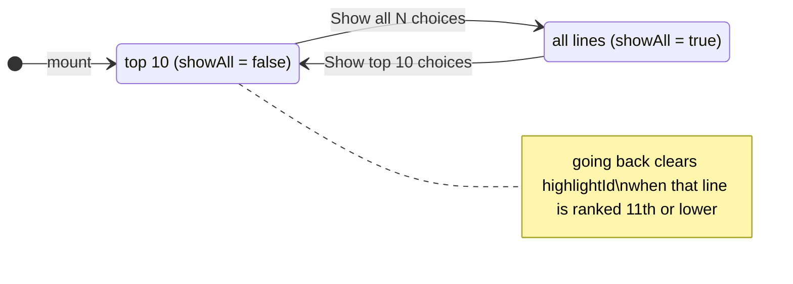
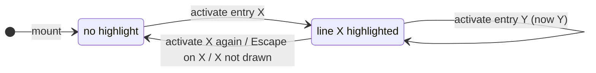

# Data Model: Line Graph Readability

Nothing is stored, sent or migrated. The feature adds five fields to the in-memory `state` object that
`src/public/lineGraph.js` creates in `mount` and drops in `unmount`.

## View state (per mounted graph)

| Field | Type | Starts as | Changed by | Cleared by |
|---|---|---|---|---|
| `showAll` | boolean | `false` | the show-all button | `unmount` only |
| `highlightId` | choice id or `null` | `null` | a legend entry (click, Enter, Space) | the same entry again; Escape on it; its line no longer drawn; `unmount` |
| `crosshairTime` (existing) | bucket time or `null` | `null` | pointer or keys on the plot | Escape, the mouse leaving the plot while not pinned, a press or focus outside plot + legend + show-all button, a scale change |
| `pinned` | boolean | `false` | a press on the plot (touch or mouse click) | whenever `crosshairTime` is cleared |
| `pressedInside` | boolean | `false` | every `pointerdown` in the document: true when it is on the plot, the legend or the show-all button | a `keydown` in the graph |
| `rebuildingLegend` | boolean | `false` | `renderLegend`, while it replaces the entries | the end of that rebuild |

Removed: `view.tooltip`.

## Derived values (computed on each draw, never stored)

| Name | Rule |
|---|---|
| `state.data.series` | the served series of the scale shown, ordered by newest point, highest first; ties keep the served (choice) order |
| `drawnSeries()` | all of `state.data.series` when `showAll`; else its first `leadingCount()` |
| `leadingCount()` | the length when ≤ 10; else the lines reaching 80% of the sum of the current shares, with ties of the last one, 10 at most |
| legend rows | the fewest rows for which the drawn entries, filled column by column, fit the legend's width (each column as wide as its widest entry); the number of entries when the legend has no width yet; recomputed when the legend is rebuilt and on a resize |
| readout index | the index of `crosshairTime` in `buckets`, else the last index |
| readout time label | `Latest` when `crosshairTime` is `null`; else the bucket's time (date + hour on 1 Day / 1 Week, date + year on 1 Month / 1 Year) |
| show-all button | hidden when `state.data.series.length ≤ 10`; else `Show all N choices` (`showAll` false) or `Show top M choices`, M = `leadingCount()` (`showAll` true) |

## State transitions

Refresh, a scale change and a selected time change neither `showAll` nor `highlightId` (except "X not drawn").
