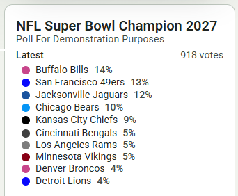
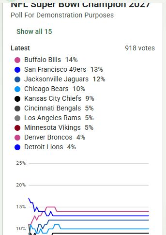
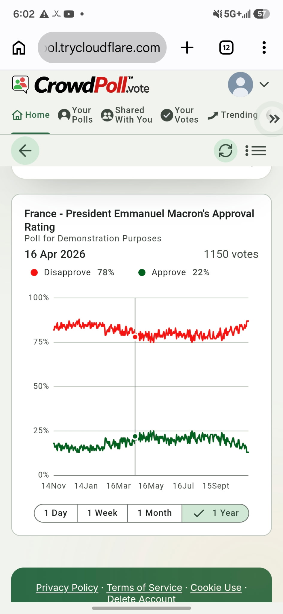

# Overview: `specs/20261113-150353-LINE-GRAPH-READABILITY`

## Document History

| Record | Value |
|---|---|
| Feature directory | `specs/20261113-150353-LINE-GRAPH-READABILITY` |
| Tweak file created | 2026-11-14 11:59 |
| Last updated | 2026-11-15 18:31 |

Legend: `[ ]` open · `[X]` Resolved · `[-]` Resolved (manually)  
(or accepted as-is) by the developer.
Tick `Run Tests` to have this tweak's automated tests written and run; leave it empty (the default) to postpone the run.

"Next" always returns the first `[ ]` item below.

The developer is expected to create the individual tweak requirements in this file, and then run the `/speckit-tweak` command to have the AI implement them, one at a time.  
Each tweak requirement initially carries an empty checkbox; tick it when the item is resolved or consciously accepted.  

# Tweaks

## TWEAK01 Tighter Legend Line Spacing  
[X] Resolved  
[ ] Run Tests  

Tighten up the line spacing in the line graph legend similar to this mockup:  

### RECOMMENDATION

List the legend one entry per row, each row 24 px tall, as in the mockup.  

- `src/public/line-graph-m3.css`  
  - `.line-graph-legend`: `flex-direction:column; align-items:flex-start` in place of `flex-wrap:wrap; align-items:center; gap:2px 4px`.  
  - `.line-graph-legend-entry`: `min-height:24px; padding:2px 8px` in place of `min-height:40px; padding:4px 8px`.  
- Row height: 24 px is one label-large line (20 px) plus 4 px;  
  the mockup's rows are slightly tighter, but 24 px is the smallest touch target WCAG 2.2 accepts.  
- This replaces the 40 px legend buttons accepted in the first analysis.  
- Tests: one new test in `tests/m3-assets.test.ts` for the two rules, written but not run (`Run Tests` is empty).  
- Artifacts: `contracts/ui.md` (U7 sizes), `research.md` (R4), `tasks.md` (T005 values).  

2026-11-14 12:30

### ACCEPTED RECOMMENDATION

Applied as recommended.  

- `src/public/line-graph-m3.css`: the legend is a flex column with no gap;  
  an entry is `min-height:24px` with `padding:2px 8px`.  
- `tests/m3-assets.test.ts`: added "lists the line graph legend one entry per row, 24px tall".  
- Tests postponed (`Run Tests` not ticked): the new test was not run, so the tweak is unverified by a run;  
  `npx tsc --noEmit` passes.  
- Artifacts: `contracts/ui.md` (U7: legend row added, entry size changed), `research.md` (R4 decision), `tasks.md` (T005 values).  
- Not seen in a browser: compare the legend with the mockup at 360 px and at desktop width.  

2026-11-14 12:30

## TWEAK02 Tighter Legend Rows And Title Block  
[X] Resolved  
[ ] Run Tests  

Looks great.  
We are working towards making the legend smaller so that the graph and legend can fit better within the available space.  
Ideally to fit on the screen of a mobile device without requiring horizontal scrolling.  
We won't be concerned here about which phone and how small,  
but let's try making the labels in the legent to have even less line spacing.  
And less spacing in the title/subtitle as shown in this mockup:  

### RECOMMENDATION

Make each legend row one text line (20 px) and close the gaps above the legend.  

- `src/public/line-graph-m3.css`  
  - `.line-graph-legend-entry`: `min-height:20px; padding:0 8px` in place of `min-height:24px; padding:2px 8px`.  
  - `.line-graph`: `gap:4px` in place of `gap:12px`, so the subtitle, the "Latest" row and the legend sit close together.  
  - `.line-graph-subtitle`: `margin-top:-4px`, so it sits directly under the title.  
  - `.line-graph-plot` and `.line-graph-scales`: `margin-top:8px`, so they keep their 12 px above.  
- 20 px is the label-large line height, the tightest a row can be with the type scale's tokens;  
  the mockup's rows are about 18.5 px, which would need a literal line height in an M3 layer.  
- Tests: update the legend test in `tests/m3-assets.test.ts` for the new values, written but not run (`Run Tests` is empty).  
- Artifacts: `contracts/ui.md` (U7 sizes), `research.md` (R4), `tasks.md` (T005 values).  

2026-11-14 12:34

### ACCEPTED RECOMMENDATION

Applied as recommended.  

- `src/public/line-graph-m3.css`: legend rows are 20 px with no vertical padding;  
  the graph's gap is 4 px;  
  the subtitle sits directly under the title;  
  the plot and the scale buttons keep 12 px above them.  
- `tests/m3-assets.test.ts`: the legend test is now "lists the line graph legend one entry per row, 20px tall, under a tight title block" and also checks the four spacing rules.  
- Tests postponed (`Run Tests` not ticked): the test was not run, so the tweak is unverified by a run;  
  `npx tsc --noEmit` passes.  
- Artifacts: `contracts/ui.md` (U7: entry size, spacing row added), `research.md` (R4), `tasks.md` (T005 values).  
- Not seen in a browser.  
- The "Show all" button also moved 8 px closer to the legend.  

2026-11-14 12:34

## TWEAK03 Show-All Button Under The Subtitle  
[X] Resolved  
[ ] Run Tests  

Let's move the "Show all N" and "Show top M" buttons under the subtitle.  

### RECOMMENDATION

Move the show-all button from below the legend to directly under the subtitle.  

- `src/public/lineGraph.js`, `mount`: append `state.showAllEl` after the subtitle, before the note and the "Latest" row.  
- No style change: the button stays a left-aligned 40 px text button, hidden on a poll with 10 lines or fewer.  
- Tests: one new test in `tests/line-graph-many-lines.test.ts` that the button follows the subtitle in both states, written but not run (`Run Tests` is empty).  
- Artifacts: `contracts/ui.md` (element tree), `research.md` (R7), `tasks.md` (T010 placement).  

2026-11-14 12:38

### ACCEPTED RECOMMENDATION

Applied as recommended.  

- `src/public/lineGraph.js`: the show-all button is appended directly after the subtitle.  
- `tests/line-graph-many-lines.test.ts`: added "places the show-all button directly under the subtitle, in both states".  
- Tests postponed (`Run Tests` not ticked): the new test was not run, so the tweak is unverified by a run;  
  `node --check` and `npx tsc --noEmit` pass.  
- Artifacts: `contracts/ui.md` (element tree), `research.md` (R7 decision and rationale), `tasks.md` (T010 placement).  
- Not seen in a browser.  
- The button is 40 px tall, so on a poll with more than 10 lines it adds a 40 px row between the subtitle and the "Latest" row.  

2026-11-14 12:38

## TWEAK04 Show-All Button Outline And Label, Smaller Legend Type  
[X] Resolved  
[ ] Run Tests  

1. the "Show all N" doesn't show as a button initially, just the text. After clicking it, the button then shows.  
Here's a screenshot:  

Please add the suffix " choices". "Show all N" should become "Show all N choices". And "Show top M" should become "Show top M choices".  

2. render the legend labels using the same font size as the Y axis % labels on the graph. The legend labels can still be bold.  

### RECOMMENDATION

1. Show-all button.  
   - Cause: it was styled as an M3 text button, which has no outline or fill at rest;  
     its shape shows only on hover, focus or press.  
   - `src/public/line-graph-m3.css`, `.line-graph-show-all`: make it an M3 outlined button,  
     `border:1px solid var(--md-sys-color-outline)` and `padding:0 16px`, like the scale buttons' outline.  
   - `src/public/lineGraph.js`, `renderShowAll`: the text becomes `Show all N choices` / `Show top 10 choices`.  
2. Legend type size.  
   - `src/public/line-graph-m3.css`, `.line-graph-legend`: the label-small size, line height and tracking tokens (11 px, as the axis labels) in place of label-large (14 px).  
   - The weights are unchanged, and the rows stay 20 px.  
- Tests, written but not run (`Run Tests` is empty):  
  - `tests/line-graph-many-lines.test.ts`: the five button-text assertions gain " choices".  
  - `tests/m3-assets.test.ts`: one new test for the legend's size token and the button's outline.  
- Artifacts: the button text in `spec.md`, `plan.md`, `research.md`, `data-model.md`, `quickstart.md`, `contracts/ui.md`, `tasks.md` and `ARCHITECTURE.md`;  
  the button style in `research.md` (R7), `contracts/ui.md` (U7), `plan.md` and `tasks.md` (T011).  
- The button text is a requirement (FR-014): the requirements document under `requirements/` still says "Show all N".  

2026-11-14 12:48

### ACCEPTED RECOMMENDATION

Applied as recommended.  

- `src/public/line-graph-m3.css`: `.line-graph-show-all` has a 1 px outline and 16 px side padding;  
  `.line-graph-legend` uses the label-small size, line height and tracking tokens.  
- `src/public/lineGraph.js`: the button reads `Show all N choices` / `Show top 10 choices`.  
- `tests/line-graph-many-lines.test.ts`: five assertions updated.  
- `tests/m3-assets.test.ts`: added "sets the line graph legend in the axis labels' size and outlines the show-all button".  
- Tests postponed (`Run Tests` not ticked): none of these were run, so the tweak is unverified by a run;  
  `node --check` and `npx tsc --noEmit` pass.  
- Artifacts: button text in `spec.md`, `plan.md`, `research.md`, `data-model.md`, `quickstart.md`, `contracts/ui.md`, `tasks.md`, `ARCHITECTURE.md`;  
  button style in `research.md` (R7), `contracts/ui.md` (U7), `plan.md`, `tasks.md` (T011).  
- Not changed: `requirements/20261113-150353-line-graph-readability/requirements.md` still says "Show all N".  
- Not seen in a browser.  

2026-11-14 12:48

## TWEAK05 Legend Font Size Across Viewport Widths  
[X] Resolved  
[ ] Run Tests  
 The font size of the legend labels is good now.  
 Question: Is the font size of the legend labels the same at all viewport widths?

### RECOMMENDATION

Answer: yes, and no change is needed.  

- The legend takes its size from `--md-sys-typescale-label-small-size`, which is 11 px in `m3-tokens.css`;  
  no media query changes that token or any line-graph rule.  
- The Y axis labels use the same token, and the plot is drawn at the width of its column, so they are 11 px too.  
- One exception, for the axis labels only: in a column narrower than 320 px the plot is drawn 320 wide and scaled down,  
  so the axis labels shrink slightly while the legend stays 11 px.  
- A browser's own text zoom or minimum font size setting applies to both.  
- Tests: none added;  
  the legend and axis size tokens are already asserted in `tests/m3-assets.test.ts`.  

2026-11-14 13:29

### ACCEPTED RECOMMENDATION

Answered; no code, test or artifact was changed.  

- The legend labels are 11 px at every viewport width.  
- Tests: none added and none run, because nothing changed.  

2026-11-14 13:29

## TWEAK06 Smaller Show-All Button, 80th Percentile Default  
[X] Resolved  
[ ] Run Tests  

For the "Show ... choices" button, use the same font size as the legend labels.  
This will also allow the button height to be less.

Here is a new rule for determing how many lines to show on the line graph by default. 

Select the choices in the 80th percentile only. 
The "Show all N choices" button will reveal the remaining choices beyond the 80th percentile.  
And when all N choices are shown, the "Show all N choices" will set N to be the number of choices in the top 80th percentile.

### CLARIFICATIONS

The button's font and height need no answer.  
The 80th percentile rule replaces "top 10" in the spec (FR-012 to FR-014), and it can be read three ways that give very different graphs.  
Answer here or in chat, then Type or Say "Next".  

1. Which meaning of "80th percentile"?  
   For the 15-line poll in your screenshot (14, 13, 12, 10, 9, 5, 5, 5, 4, 4 … %):  
   - **A** _(my guess)_: the leading choices whose current shares together reach 80% of the votes.  
     That poll would show 10 lines (they add up to 81%).  
   - **B**: the choices whose share is at or above the 80th percentile of all shares, the top fifth of the choices.  
     That poll would show 3 lines.  
   - **C**: the top 80% of the choices by rank.  
     That poll would show 12 lines.  
   - Answer:  

2. Does the limit of 10 lines stay as a cap?  
   Under A, a poll of 30 nearly even choices would draw 24 lines at rest.  
   - Suggested: yes, show the 80% set but never more than 10.  
   - Answer:  

3. Under A, on a multiple-choice poll the shares add up to more than 100%.  
   - Suggested: 80% of the sum of the graphed lines' current shares, so the rule works the same on every poll.  
   - Answer:  

Assumed unless you say otherwise:  

- The set is worked out from the current (latest) shares, as the order is today, and again on each refresh;  
  so the number on the "Show top M choices" button can change while the graph is open.  
- Choices tied with the last one included are included too only if that stays within the cap.  
- When the rule already includes every line, the button is hidden.  

2026-11-14 13:36

Answers given in chat, 2026-11-14:  

1. A.  
2. Yes, the cap of 10 stays.  
3. Yes, 80% of the sum of the graphed lines' current shares.  
4. Asked afterwards, which polls the rule applies to: only polls with more than 10 graphed lines;  
   a poll with 10 lines or fewer draws every line, as before.  

### RECOMMENDATION

1. Show-all button.  
   - `src/public/line-graph-m3.css`, `.line-graph-show-all`: the label-small type tokens (11 px, as the legend), `height:24px` and `padding:0 12px` in place of label-large, 40 px and 16 px.  
2. The 80% rule.  
   - `src/public/lineGraph.js`: new `leadingCount()` and `TOP_SHARE_PCT = 80`.  
     On a graph of more than 10 lines it counts the leading lines until their current shares reach 80% of the sum of all the lines' current shares,  
     adds any lines tied with the last of them, and stops at 10.  
   - `drawnSeries()` returns that many lines until "Show all N choices" is pressed;  
     the button then reads "Show top M choices", M being that count.  
   - M follows the latest shares, so it can change on a refresh.  
- Tests, written but not run (`Run Tests` is empty):  
  - `tests/line-graph-many-lines.test.ts`: the 12-line poll now expects 7 lines and "Show top 7 choices";  
    two new tests, for the cap of 10 and for ties.  
  - `tests/m3-assets.test.ts`: the button's size token and height.  
- Artifacts: `spec.md` (US3 scenario 1, FR-013, FR-014, assumptions), `plan.md`, `research.md` (R2, R7), `data-model.md`, `contracts/ui.md` (U2, U6), `quickstart.md`, `tasks.md`, `README.md`, `ARCHITECTURE.md`, `CLAUDE.md`.  
- This changes a requirement (FR-013, FR-014): the requirements document under `requirements/` still describes a fixed top 10.  

2026-11-14 21:55

### ACCEPTED RECOMMENDATION

Applied as recommended.  

- `src/public/line-graph-m3.css`: the show-all button is 24 px tall in the legend's 11 px type.  
- `src/public/lineGraph.js`: `leadingCount()` decides how many lines a graph of more than 10 lines draws at first;  
  the button reads "Show all N choices" / "Show top M choices".  
- `tests/line-graph-many-lines.test.ts`: the 12-line poll's expectations changed from 10 lines to 7;  
  added "never draws more than ten lines at first" and "includes the lines tied with the last leading one".  
- `tests/m3-assets.test.ts`: the show-all assertions now include the size token and `height:24px`.  
- Tests postponed (`Run Tests` not ticked): none of these were run, so the tweak is unverified by a run;  
  the expected counts (7, 10 and 7 lines) come from arithmetic on the seeded votes, not from a run;  
  `node --check` and `npx tsc --noEmit` pass.  
- Artifacts: `spec.md` (US3 scenario 1, FR-013, FR-014, assumptions), `plan.md`, `research.md` (R2, R7), `data-model.md`, `contracts/ui.md` (U2, U6), `quickstart.md`, `tasks.md` (T007, T010, T011), `README.md`, `ARCHITECTURE.md`, `CLAUDE.md`.  
- `spec.md` still says "top 10" in several scenarios and edge cases;  
  FR-013 now states that these mean the leading lines.  
- Not changed: `requirements/20261113-150353-line-graph-readability/requirements.md` still describes a fixed top 10.  
- Not seen in a browser.  

2026-11-14 21:55

## TWEAK07 Line Graph Subtitle In Label-Small Type  
[X] Resolved  
[ ] Run Tests  

Make the Subtitle on the Maximized Poll Card --md-sys-typescale-label-small-size.

### RECOMMENDATION

- Read as the subtitle of the line graph in the maximized view (`.line-graph-subtitle`), the one the earlier tweaks moved and tightened.  
  The poll card's own subtitle (`.card-face .subtitle`), also on screen in the maximized view, is left as it is.  
- `src/public/line-graph-m3.css`, `.line-graph-subtitle`: the label-small size, line height and tracking tokens (11 px on a 12 px line) in place of body-medium (14 px on a 20 px line).  
  The weight and color stay.  
- Test, written but not run (`Run Tests` is empty): `tests/m3-assets.test.ts` checks the subtitle's size token.  
- Artifacts: `contracts/ui.md` (U7).  

2026-11-15 11:53

### ACCEPTED RECOMMENDATION

Applied as recommended.  

- `src/public/line-graph-m3.css`: `.line-graph-subtitle` is set in label-small type (size, line height, tracking).  
- `tests/m3-assets.test.ts`: the show-all test also checks the subtitle's size token.  
- Tests postponed (`Run Tests` not ticked): not run, so the tweak is unverified by a run;  
  `npx tsc --noEmit` passes.  
- Artifacts: `contracts/ui.md` (U7): a row for the subtitle;  
  the show-all button's row, left at 40 px and `padding:0 16px` by TWEAK06, now says 24 px, `padding:0 12px` and label-small.  
- The subtitle's line is 8 px shorter, so everything under it moves up by 8 px.  
- Not seen in a browser.  

2026-11-15 11:53

## TWEAK08 Line Graph Title Styled As The Card Title  
[X] Resolved  
[ ] Run Tests  

Set the styles of the Line Graph title to be the same as the Maximized Poll Card title.

### RECOMMENDATION

- Above 900 px the two titles already share every type value: the font, title-large size (20 px), line height (28 px), weight, tracking, color and no margin.  
- Two differences remain, and both are removed:  
  - From 900 px down the card title is smaller (13.5 px on a 1.27 line) and the line graph title is not.  
    `src/public/single-column-m3.css`: `.line-graph .line-graph-title` joins the card title's rule, so both take the size from one place.  
  - The card title breaks a long word; the line graph title does not.  
    `src/public/line-graph-m3.css`, `.line-graph-title`: `overflow-wrap:anywhere`.  
- Tests, written but not run (`Run Tests` is empty):  
  - `tests/single-column-sheets.test.ts`: the expected rule text now carries the second selector.  
  - `tests/m3-assets.test.ts`: a new test for the title's size, line height, weight and word breaking.  
- Artifacts: `contracts/ui.md` (U7).  

2026-11-15 12:02

### ACCEPTED RECOMMENDATION

Applied as recommended.  

- `src/public/single-column-m3.css`: the rule that sizes the card title from 900 px down also names `.line-graph .line-graph-title`.  
- `src/public/line-graph-m3.css`: `.line-graph-title` has `overflow-wrap:anywhere`.  
- `tests/single-column-sheets.test.ts`: expected rule text changed.  
- `tests/m3-assets.test.ts`: added "sets the line graph title as the maximized card's title".  
- Tests postponed (`Run Tests` not ticked): not run, so the tweak is unverified by a run;  
  `npx tsc --noEmit` passes.  
- Artifacts: `contracts/ui.md` (U7): a row for the title.  
- Above 900 px nothing visible changes, because the two titles already matched there.  
- Not seen in a browser.  

2026-11-15 12:02

## TWEAK09 Smaller Dots, Rows And Scale Buttons, Compact X Labels  
[X] Resolved  
[ ] Run Tests  

Regarding the Line Graph:

Make the colored dots in the legent 75% of their current size.

Reduce the line spacing between the legend items by 2 pixels.

Make the font size and button size of the time selector to be the same as the "Show all..." button.

For the X Axis date/time labels, remove the space between the MMM and DD, and between the HH XM.

### RECOMMENDATION

1. Legend dots.  
   - `src/public/line-graph-m3.css`, `.line-graph-dot`: 9 px across (75% of 12 px).  
2. Legend rows.  
   - `.line-graph-legend-entry`: `min-height:18px` (was 20 px), so the rows sit 2 px closer.  
3. Scale buttons (the time selector).  
   - `.line-graph-segment`: `height:24px` and the label-small type tokens, as the show-all button;  
     the padding was already `0 12px`.  
   - The check icon of the selected button stays 18 px.  
4. X axis labels.  
   - `src/public/lineGraph.js`, `xLabelText()`: the spaces are removed from the formatted label, so "Nov 14" reads "Nov14" and "3 PM" reads "3PM".  
   - The readout's time above the legend keeps its spaces.  
- Tests, written but not run (`Run Tests` is empty):  
  - `tests/m3-assets.test.ts`: the row height expectation changed to 18 px;  
    a new test for the scale buttons' size and type and the dot's size.  
  - `tests/line-graph-ui.test.ts`: the expected X labels carry no space.  
- Artifacts: `contracts/ui.md` (U7), `research.md` (R4), `tasks.md` (T005).  

2026-11-15 12:36

### ACCEPTED RECOMMENDATION

Applied as recommended.  

- `src/public/line-graph-m3.css`: dots 9 px;  
  legend rows 18 px;  
  scale buttons 24 px tall in label-small type.  
- `src/public/lineGraph.js`: `xLabelText()` strips the spaces from an X axis label.  
- `tests/m3-assets.test.ts`: `min-height:18px` in place of 20 px;  
  added "sizes the line graph scale buttons as the show-all button and the legend dots at 9px".  
- `tests/line-graph-ui.test.ts`: `expectedLabels()` strips the spaces too.  
- Tests postponed (`Run Tests` not ticked): not run, so the tweak is unverified by a run;  
  `node --check` and `npx tsc --noEmit` pass.  
- Artifacts: `contracts/ui.md` (U7): rows for the dot, the scale buttons and the X axis labels, and the entry's height;  
  `research.md` (R4);  
  `tasks.md` (T005).  
- The scale buttons are now 24 px tall, under the 48 px touch target M3 recommends, like the show-all button.  
- Not seen in a browser.  

2026-11-15 12:36

## TWEAK10 Show-All Button In The Scale Buttons' Row  
[X] Resolved  
[ ] Run Tests  

Place the "Show all..." button on the row with the time scape buttons, and right justified.

### RECOMMENDATION

- `src/public/lineGraph.js`, `mount`: a new `div.line-graph-controls` after the plot holds the scale buttons and then the show-all button;  
  the button is no longer under the subtitle.  
- `src/public/line-graph-m3.css`:  
  - `.line-graph-controls`: a flex row, `gap:8px`, `margin-top:8px` (taken over from `.line-graph-scales`), wrapping;  
    not displayed while both of its children are hidden.  
  - `.line-graph-show-all`: `margin-left:auto`, so it sits at the right end of the row.  
- Where the row is too narrow for both, the show-all button wraps to a second line and stays at the right.  
- With the keyboard the button now comes after the plot and the scale buttons.  
- Tests, written but not run (`Run Tests` is empty):  
  - `tests/line-graph-many-lines.test.ts`: the placement test now expects the button after the scale buttons in the row under the plot.  
  - `tests/m3-assets.test.ts`: the row's margin and layout and the button's `margin`.  
- Artifacts: `contracts/ui.md` (U1, U7), `research.md` (R7), `tasks.md` (T010).  

2026-11-15 12:51

### ACCEPTED RECOMMENDATION

Applied as recommended.  

- `src/public/lineGraph.js`: `div.line-graph-controls` after the plot holds `state.scalesEl` and `state.showAllEl`.  
- `src/public/line-graph-m3.css`: the `.line-graph-controls` row;  
  `.line-graph-show-all` has `margin:0 0 0 auto`;  
  `.line-graph-scales` keeps only `display:inline-flex`.  
- `tests/line-graph-many-lines.test.ts`: "places the show-all button directly under the subtitle, in both states" became "places the show-all button after the scale buttons, in their row under the plot, in both states".  
- `tests/m3-assets.test.ts`: the `margin-top:8px` check moved from `.line-graph-scales` to `.line-graph-controls`, with `display:flex` and the button's margin.  
- Tests postponed (`Run Tests` not ticked): not run, so the tweak is unverified by a run;  
  `node --check` and `npx tsc --noEmit` pass.  
- Artifacts: `contracts/ui.md` (U1, U7), `research.md` (R7), `tasks.md` (T010).  
- This reverses TWEAK03, which had put the button under the subtitle.  
- Not seen in a browser.  

2026-11-15 12:51

## TWEAK11 Show-All Button Centered In Its Row  
[X] Resolved  
[ ] Run Tests  

Let's try centering the "Show all..." button within its row.

### RECOMMENDATION

- `src/public/line-graph-m3.css` only; the markup stays.  
  - `.line-graph-scales`: `flex:1 1 0` with `min-width:max-content`.  
  - `.line-graph-controls::after`: an empty box with `flex:1 1 0`.  
  - `.line-graph-show-all`: `margin:0` in place of `margin-left:auto`.  
  - The two boxes share the free space equally, so the button sits in the middle of the row.  
- Limits:  
  - where the scale buttons are wider than their half of the row, the button sits right of center;  
  - where the row is too narrow for both, the button wraps to a second line and sits at its left.  
- Test, written but not run (`Run Tests` is empty): `tests/m3-assets.test.ts` checks the two `flex` values and the button's margin.  
- Artifacts: `contracts/ui.md` (U1, U7), `research.md` (R7).  

2026-11-15 13:05

### ACCEPTED RECOMMENDATION

Applied as recommended.  

- `src/public/line-graph-m3.css`: the scale buttons' box and an empty `::after` box each take `flex:1 1 0`;  
  the show-all button has `margin:0`.  
- `tests/m3-assets.test.ts`: the button's `margin:0 0 0 auto` expectation became `margin:0`;  
  two assertions added for the `flex` values.  
- Tests postponed (`Run Tests` not ticked): not run, so the tweak is unverified by a run;  
  `npx tsc --noEmit` passes.  
- Artifacts: `contracts/ui.md` (U1, U7), `research.md` (R7).  
- On a row too narrow for both, the button wraps to a second line at the left, not centered and no longer at the right.  
- Not seen in a browser.  

2026-11-15 13:05

## TWEAK12 Scale Buttons Centered, Show-All Button At The Left  
[X] Resolved  
[ ] Run Tests  

Sorry, we are going to try another change to the row of buttons.  
Just trying to get it perfect.  

It looks like the Time Selector buttons should be centered within their row.  
And the "Show all..." button should be left justified.

### RECOMMENDATION

- `src/public/lineGraph.js`, `mount`: in `div.line-graph-controls` the show-all button comes first, inside a new `div.line-graph-controls-start`, and the scale buttons second.  
  The keyboard order follows: the button, then the scale buttons.  
- `src/public/line-graph-m3.css`:  
  - `.line-graph-controls-start` and the row's empty `::after` box each take `flex:1 1 0`, so the scale buttons sit in the middle of the row;  
    they stay centered when the show-all button is hidden (10 lines or fewer).  
  - `.line-graph-scales` goes back to `display:inline-flex` alone.  
  - The row is not displayed while the scale buttons are hidden.  
- Limits:  
  - where the show-all button is wider than its half of the row, the scale buttons sit right of center;  
  - where the row is too narrow for both, the scale buttons wrap to a second line and sit at its left.  
- Tests, written but not run (`Run Tests` is empty):  
  - `tests/line-graph-many-lines.test.ts`: the placement test expects the button's box, then the scale buttons.  
  - `tests/m3-assets.test.ts`: the `flex` value is checked on `.line-graph-controls-start`.  
- Artifacts: `contracts/ui.md` (U1, U7), `research.md` (R7), `tasks.md` (T010).  

2026-11-15 13:08

### ACCEPTED RECOMMENDATION

Applied as recommended.  

- `src/public/lineGraph.js`: `div.line-graph-controls` holds `div.line-graph-controls-start` (the show-all button) and then `state.scalesEl`.  
- `src/public/line-graph-m3.css`: `.line-graph-controls-start` added;  
  `.line-graph-scales` reduced to `display:inline-flex`;  
  the rule that hides an empty row now keys on the hidden scale buttons.  
- `tests/line-graph-many-lines.test.ts`: the placement test renamed to "places the show-all button before the scale buttons, in their row under the plot, in both states" and its expected order changed.  
- `tests/m3-assets.test.ts`: one expectation moved from `.line-graph-scales` to `.line-graph-controls-start`.  
- Tests postponed (`Run Tests` not ticked): not run, so the tweak is unverified by a run;  
  `node --check` and `npx tsc --noEmit` pass.  
- Artifacts: `contracts/ui.md` (U1, U7), `research.md` (R7), `tasks.md` (T010).  
- Not seen in a browser.  

2026-11-15 13:08

## TWEAK13 Legend As A Table In The Fewest Rows  
[X] Resolved  
[ ] Run Tests  

This request might be challenging. If I was going to try to do it manually, I'm not sure how I would accomplish it...  
The goal is to minimize the rows necessary to display all legend items within the available width.  

What we want to do is layout the legend items in a table that has as many columns as will fit within the available width.  
Each column width will need to be just as wide as necessary to fit the longest label the will be drawn in that column.  

The challenge is that to determine how many columns will fit, we need to know the width of each column, which depends on the longest label in that column.  
But labels are only assigned to columns when we know how many columns their are.  
So we have a circular dependency: the number of columns depends on the column widths, which depend on the number of columns.  

Is there a way you can figure out how to do this?  
You are much smarter than I am, so I'm confident you can come up with a solution.

### RECOMMENDATION

- The circle is broken by one fact: an entry's own width is the same whichever column it lands in.  
  So the widths are measured once, and every arrangement is then judged by arithmetic, without laying it out.  
- The search, `legendRows()` in `src/public/lineGraph.js`:  
  - try 1 row, then 2, then 3, and so on;  
  - for a given number of rows the entries fill the table column by column, so the columns are known;  
  - a column is as wide as its widest entry, and the table as wide as its columns plus the gaps between them;  
  - the first number of rows whose table fits the legend's width is the answer, and so the fewest;  
  - when not even two columns fit, it is one entry per row, as now.  
- `layoutLegend()` measures the entries (under a short-lived `.is-measuring` class that puts them on one unshrunk row), runs the search and sets `--line-graph-legend-rows` on the legend.  
  It runs when the legend is rebuilt (open, refresh, scale change, show all) and on a resize;  
  never when the selected time moves, so the plot still does not move then.  
- `src/public/line-graph-m3.css`: the legend becomes a CSS grid filled by column (`grid-auto-flow:column`) with `max-content` columns and `column-gap:8px`;  
  the grid sizes each column to its widest entry itself, so the script only supplies the number of rows.  
- Reading order: down the first column, then the second;  
  the highest shares are in the first column.  
- Tests, written but not run (`Run Tests` is empty):  
  - `tests/line-graph-many-lines.test.ts`: a new test with stubbed widths, expecting 1, 2, 4 and 7 rows at four legend widths.  
  - `tests/m3-assets.test.ts`: the legend's grid declarations in place of the flex column.  
- Artifacts: `contracts/ui.md` (U7), `research.md` (R4), `data-model.md`, `quickstart.md` (step 3), `README.md`, `ARCHITECTURE.md`.  

2026-11-15 13:18

### ACCEPTED RECOMMENDATION

Applied as recommended.  

- `src/public/lineGraph.js`: `layoutLegend()` and `legendRows()` added;  
  `renderLegend()` and the resize observer call `layoutLegend()`.  
- `src/public/line-graph-m3.css`: `.line-graph-legend` is a column-filled grid;  
  `.line-graph-legend.is-measuring` added.  
- `tests/line-graph-many-lines.test.ts`: added "lays the legend out in the fewest rows whose columns fit its width".  
- `tests/m3-assets.test.ts`: the legend test renamed to "lays the line graph legend out as a table of 18px rows under a tight title block" and its flex assertions replaced.  
- Tests postponed (`Run Tests` not ticked): not run, so the tweak is unverified by a run;  
  the expected row counts (1, 2, 4, 7) were checked by running the search function alone on the test's widths;  
  `node --check` and `npx tsc --noEmit` pass.  
- Artifacts: `contracts/ui.md` (U7), `research.md` (R4), `data-model.md`, `quickstart.md` (step 3), `README.md`, `ARCHITECTURE.md`.  
- This replaces TWEAK01's one entry per row wherever more than one column fits.  
- Not handled: a web font that finishes loading after the legend is drawn changes the widths without a new layout, until the next refresh or resize.  
- Not seen in a browser, so the measuring and the grid are untried on a real layout.  

2026-11-15 13:18

## TWEAK14 Line Graph Dates In One Format On Every Device  
[X] Resolved  
[ ] Run Tests  

On my actual Samsung S25, the date on the line graph is in the format:  
16 Apr 2026

Yet on the computer and other devices on browserstack the date is the way we want it:  
Apr 16, 2026

Here is the screenshot on my Samsung S25:

Can the date be forced to the format "Apr 16, 2026" on the Samsung S25 as well?  
Or is this a device-specific locale formatting issue?

### RECOMMENDATION

- It is the phone's language setting, not the device.  
  The graph formats its dates in the browser's language, and "16 Apr 2026", "14Nov" and "15Sept" are the British English forms;  
  the phone's browser is most likely set to English (United Kingdom) or a similar region.  
  Checked in Node: `en-GB` gives "16 Apr 2026" and "15 Sept", `en-US` gives "Apr 16, 2026".  
- Yes, the format can be forced: `src/public/lineGraph.js` formats with `en-US` in place of the browser's language, in a new constant `DATE_LOCALE`.  
  - The readout reads "Apr 16, 2026" (1 Month, 1 Year) and "Nov 14, 3 PM" (1 Day, 1 Week) on every device.  
  - The X-axis labels follow: "Nov14" and "Sep15" in place of "14Nov" and "15Sept", and "3PM" in place of "15" on a 24-hour device.  
  - The time zone stays the viewer's.  
- Cost: a viewer whose device is set to day-first dates or a 24-hour clock now sees the US form in the graph.  
  The rest of the site (poll dates, sign-in messages) still follows the device.  
- Tests, written but not run (`Run Tests` is empty):  
  - `tests/line-graph-ui.test.ts`: the expected labels and times are formatted with `en-US`;  
    the pointer test also checks the readout's form, month first.  
- Artifacts: `contracts/ui.md` (U3, U7), `ARCHITECTURE.md`.  

2026-11-15 18:31

### ACCEPTED RECOMMENDATION

Applied as recommended.  

- `src/public/lineGraph.js`: `DATE_LOCALE = 'en-US'` added;  
  `xLabelText()` and `readoutTimeText()` format with it.  
- `tests/line-graph-ui.test.ts`: the four date helpers format with `en-US`;  
  one assertion added to "shows every drawn choice and the time once at the nearest bucket on pointermove".  
- Tests postponed (`Run Tests` not ticked): not run, so the tweak is unverified by a run;  
  `node --check` and `npx tsc --noEmit` pass.  
- Artifacts: `contracts/ui.md` (U3, U7), `ARCHITECTURE.md`.  
- Not seen on the phone;  
  the phone's language setting is inferred from the screenshot, not read from the device.  

2026-11-15 18:31

## TWEAK15 <short title here>  
[ ] Resolved  
[ ] Run Tests  
tweak requirements...  
