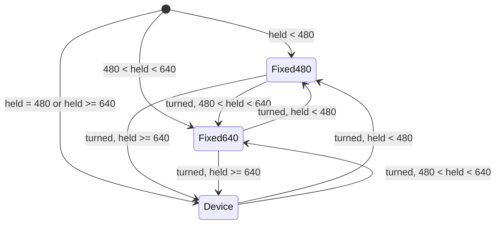

# Data Model: Fixed Width 640

Nothing is stored, on the server or in the browser. The feature has two pieces of derived state, both recomputed from
the device each time.

## Viewport state (`viewportWidth.js`)

| State | When (`heldWidth`) | Viewport meta `content` | Root inline style |
|---|---|---|---|
| `Fixed480` | `< 480` | `width=480` (iOS: `, maximum-scale=<held/480>`) | `text-size-adjust: 100%`, `-webkit-text-size-adjust: 100%` |
| `Fixed640` | `> 480` and `< 640` | `width=640` (iOS: `, maximum-scale=<held/640>`) | the same two properties |
| `Device` | `= 480` or `>= 640` | the page's own content, `width=device-width, initial-scale=1` | neither property |

`heldWidth` is the screen's shorter side in portrait and its longer side in landscape (unchanged).

**Transitions**: any state to any state, on `resize`, `pageshow` or the screen's orientation `change`. The meta and the
root style are written only when the wanted content differs from the current one. A transition between `Fixed480` and
`Fixed640` rewrites the content but leaves the root style as it is.

## Layout (CSS and `isPhoneLayout()`)

| Layout | Layout viewport width | Reached by |
|---|---|---|
| Phone | `<= 640 px` | `Fixed480` (480), `Fixed640` (640), a device exactly 480 or 640 px wide, a desktop window of 640 px or less |
| Wide | `> 640 px` | every other device and window |

`PollCard.isPhoneLayout()`, the copy in `adminCard.js` and `headerFit.js` read the same boundary through
`matchMedia("(max-width: 640px)")`. The `--single-column` marker no longer exists.

## Unchanged

`essentialChoices`, the card's view state and the history key of the phone layout redesign are not changed; they now
apply to every viewport of 640 px or less.
