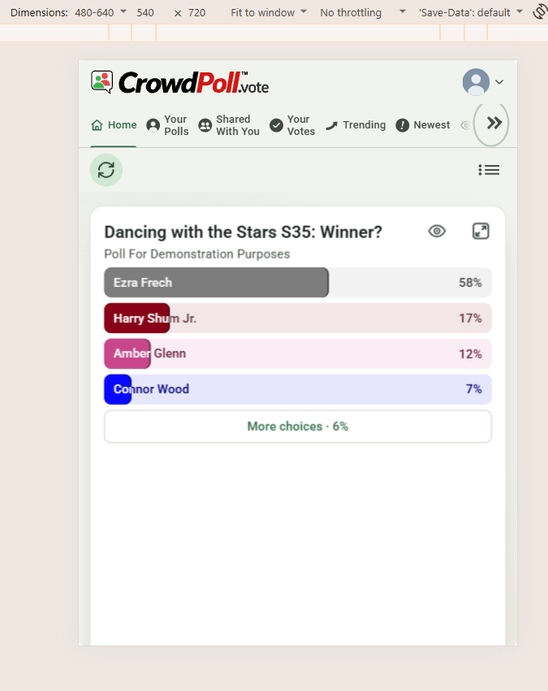
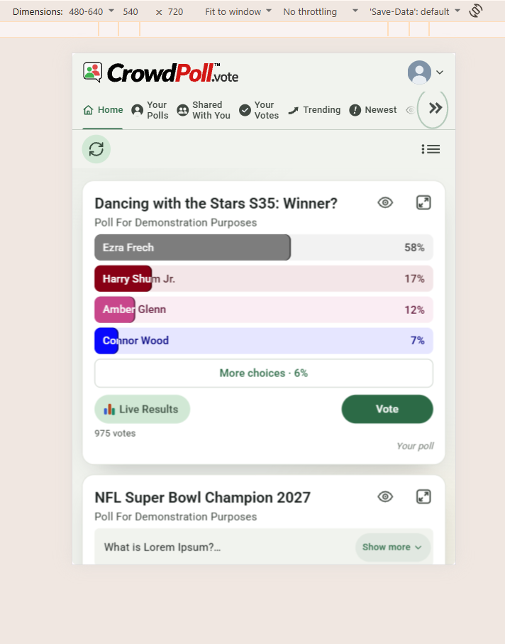
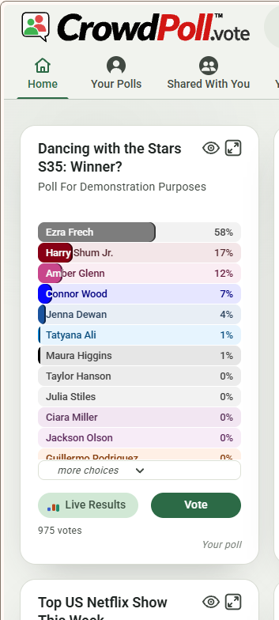
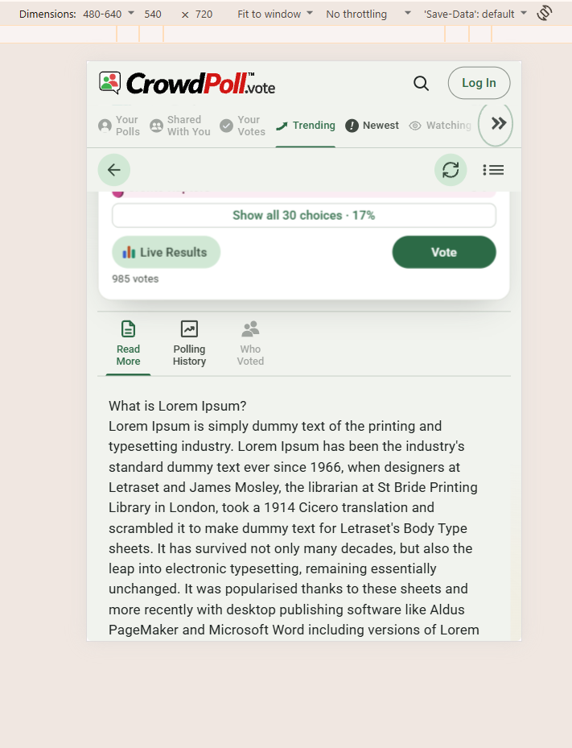
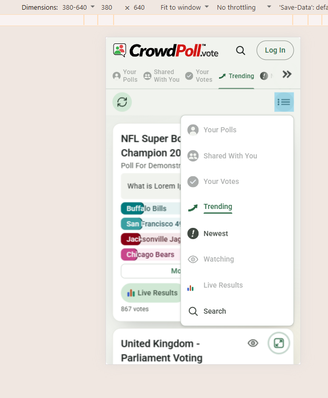

# Overview: `specs/20261117-050854-FIXED-WIDTH-640`

## Document History

| Record | Value |
|---|---|
| Feature directory | `specs/20261117-050854-FIXED-WIDTH-640` |
| Tweak file created | 2026-11-17 09:57 |
| Last updated | 2026-11-17 12:37 |

Legend: `[ ]` open · `[X]` Resolved · `[-]` Resolved (manually)  
(or accepted as-is) by the developer.
Tick `Run Tests` to have this tweak's automated tests written and run; leave it empty (the default) to postpone the run.

"Next" always returns the first `[ ]` item below.

The developer is expected to create the individual tweak requirements in this file, and then run the `/speckit-tweak` command to have the AI implement them, one at a time.  
Each tweak requirement initially carries an empty checkbox; tick it when the item is resolved or consciously accepted.  

# Tweaks

## TWEAK01 Blank Space After Voting Side Closes  
[X] Resolved  
[ ] Run Tests  

Repro:
d. [ ] A card with more than five choices shows four leaders and the "more" line; Vote opens the maximized view on its
      voting side with every choice; Back closes it.  
Then click the arrow to go back to the front of the Poll Card.

Shows blank space under "More choices - ..." bar.

### RECOMMENDATION

Cause: the compact card's two sides share one grid cell, so the card is as tall as the taller side.  
Closing the maximized view from its voting side left the card in the grid still turned to that side, with every choice listed.  
The card's own Back arrow then turned it over without redrawing, so the full ballot stayed behind the results side and held the card tall.  
This comes from the phone layout redesign and happens at 480 px too; it is not caused by the 640 px width.  

- `src/public/pollCard.js`, `setMaximized`:  
  when the view closes and the card hides choices, keep the selection in `pendingSelection` and remove `is-flipped` before `render()`, so the card returns to its results side and the ballot is emptied.  
- `src/public/pollCard.js`, the `.back-btn` handler:  
  call `renderBallot()` after removing `is-flipped`, so a card that came to hide choices while turned over (a refresh that adds choices) also leaves no ballot behind.  
- Tests to add in `tests/client-phone-card.test.ts` (written, not run, because `Run Tests` is not ticked):  
  - the card returns to the results side with no ballot rows when the view closes on its voting side;  
  - the selection made before the close is still there when the voting side is opened again;  
  - Back leaves no ballot rows on a card that came to hide choices.  
- Artifacts: `quickstart.md` step 2d (the close from the voting side), `tasks.md` (T042).  

2026-11-17 11:01

### ACCEPTED RECOMMENDATION

Applied as recommended.  

- `src/public/pollCard.js`:  
  - `setMaximized` now turns a card that hides choices back to its results side when the view closes, keeping the selection;  
  - the `.back-btn` handler calls `renderBallot()` after turning the card over.  
- `tests/client-phone-card.test.ts`, three tests added:  
  - "returns to the results side, with no ballot behind it, when the view closes on its voting side";  
  - "keeps the selection made before the view closed on its voting side";  
  - "leaves no ballot behind when Back is pressed on a card that came to hide choices".  
- Tests postponed (`Run Tests` not ticked); the three tests were written and not run, so the tweak is unverified by a run.  
  `npx tsc --noEmit` passes.  
- Artifacts: `quickstart.md` step 2d reworded; `tasks.md` T042 added.  
- Not edited: `specs/20261113-140600-PHONE-LAYOUT-REDESIGN/contracts/poll-card.md` C3, which does not say what a close from the voting side does.  

2026-11-17 11:01

## TWEAK02 Phone Bars At Desktop Minimum Height  
[X] Resolved  
[ ] Run Tests  

For 480-px and less, as well as 481-640px, set the fixed bar height on the home page Poll Card, as well as the Maximized view Poll Card:    

to the minimum height of bars at a desktop viewport at >900px.

### RECOMMENDATION

The phone layout draws every result bar at one fixed height, `PHONE_BAR_HEIGHT` (44 px), on the compact card and in the maximized view, at both fixed widths.  
The wide layout's smallest bar is `RESULTS_MIN_BAR_HEIGHT` (25 px).  

- `src/public/pollCard.js`:  
  set `PHONE_BAR_HEIGHT` to `RESULTS_MIN_BAR_HEIGHT`, so the two cannot drift apart.  
- Left as they are, because the requirement names only the bar height:  
  - the 8 px gap between bars;  
  - the label and percentage size (the `label-large` token, 18 px on a 25 px line in the phone layout), which exactly fills a 25 px bar;  
  - the 64 px voting rows and the 64 px "More choices" row.  
- Tests to update in `tests/client-phone-card.test.ts` (not run, because `Run Tests` is not ticked):  
  the two bar-height tests expect `25px` in place of `44px`.  
- Artifacts: `tasks.md` (T043), `ARCHITECTURE.md` and `CLAUDE_COMPLETE.md` (both say 44 px).  

2026-11-17 11:17

### ACCEPTED RECOMMENDATION

Applied as recommended.  

- `src/public/pollCard.js`:  
  `const PHONE_BAR_HEIGHT = RESULTS_MIN_BAR_HEIGHT;` (25 px, was 44).  
- `tests/client-phone-card.test.ts`, two tests updated and renamed:  
  - "draws 25px bars 8px apart, with the label and percentage in the label-large size";  
  - "draws 25px bars 8px apart".  
- Tests postponed (`Run Tests` not ticked); the two tests were not run, so the tweak is unverified by a run.  
  `npx tsc --noEmit` passes.  
- Artifacts: `tasks.md` T043 added; `ARCHITECTURE.md` (two sentences) and `CLAUDE_COMPLETE.md` (one bullet) now say 25 px.  
- Not looked at in a browser: how 18 px text sits in a 25 px bar.  
- Not edited: the phone layout redesign's own spec and contracts, which still say 44 px bars.  

2026-11-17 11:17

## TWEAK03 Shorter More Choices Row And 28 px Bars  
[X] Resolved  
[ ] Run Tests  

Make the following changes to the "More choices..." bar on the home page and the Maximized view  
at 480X640 and 480px and less.
In `src/public/phone-card-m3.css`,

Three declarations together give the bar its size:

| Line | Rule | Effect |
|---|---|---|
| 94 | `.more-row { min-height:48px; }` | the tappable row is 48 px tall |
| 110 | `.more-row::before { inset:8px 0; }` | the outlined box you see is drawn 8 px inside the row, so it is 32 px tall |
| 85 | `.more-item { margin-block:-8px; }` | pulls the row 8 px into the gaps above and below, so the transparent 8 px does not add space |

So the visible outlined bar is 32 px, with a 48 px touch target around it. The same rules apply to the maximized view's "Show all … choices" row (`.show-all-row`).

ALSO,  
Set the result bars' height: `pollCard.js` from 25 to 28 px.

No need to edit previous feature specs and contracts.

### RECOMMENDATION

- `src/public/phone-card-m3.css`, the rule shared by `.card-face .more-row` and `.card-face .show-all-row`:  
  `min-height:64px` becomes `min-height:48px`.  
  The `inset:8px 0` outline and the `margin-block:-8px` on `.more-item` stay, so the outlined box is 32 px inside a 48 px touch target.  
- `src/public/pollCard.js`:  
  `PHONE_BAR_HEIGHT` becomes the literal `28`, since it no longer equals `RESULTS_MIN_BAR_HEIGHT` (25).  
- Tests (written, not run, because `Run Tests` is not ticked):  
  - `tests/client-phone-card.test.ts`: the two bar-height tests expect `28px`;  
  - `tests/phone-sheets.test.ts`: the two rows leave the list of 64 px rows, and a new test per row expects `min-height:48px` with the outline 8 px inside.  
- Artifacts: `tasks.md` (T044), `ARCHITECTURE.md` and `CLAUDE_COMPLETE.md` (bar height); earlier features' specs and contracts are not edited, as asked.  

2026-11-17 11:37

### ACCEPTED RECOMMENDATION

Applied as recommended.  

- `src/public/phone-card-m3.css` line 94: `min-height:48px` (was 64 px), for the "More choices" row and the maximized view's "Show all" row.  
- `src/public/pollCard.js`: `const PHONE_BAR_HEIGHT = 28;`.  
- `tests/client-phone-card.test.ts`, two tests updated and renamed:  
  - "draws 28px bars 8px apart, with the label and percentage in the label-large size";  
  - "draws 28px bars 8px apart".  
- `tests/phone-sheets.test.ts`:  
  - `.card-face .more-row` and `.card-face .show-all-row` removed from the 64 px rows;  
  - two tests added, "phone-card-m3.css: … is a 48px row whose outline is drawn 8px inside it".  
- Tests postponed (`Run Tests` not ticked); none of these were run, so the tweak is unverified by a run.  
  `npx tsc --noEmit` passes.  
- Artifacts: `tasks.md` T044 added; `ARCHITECTURE.md` and `CLAUDE_COMPLETE.md` now say 28 px bars.  
- These two rows are now the only tappable rows of the phone layout under the 64 px target the phone layout redesign set.  

2026-11-17 11:37

## TWEAK04 More Choices Row 52 px And 30 px Bars  
[X] Resolved  
[ ] Run Tests  

Make the following changes to the "More choices..." bar on the home page and the Maximized view  
at 480X640 and 480px and less.
In `src/public/phone-card-m3.css`,

Three declarations together give the bar its size:

| Line | Rule | Effect |
|---|---|---|
| 94 | `.more-row { min-height:52px; }` | the tappable row is 52 px tall |
| 110 | `.more-row::before { inset:8px 0; }` | the outlined box you see is drawn 8 px inside the row, so it is 36 px tall |
| 85 | `.more-item { margin-block:-8px; }` | pulls the row 8 px into the gaps above and below, so the transparent 8 px does not add space |

So the visible outlined bar is 36 px, with a 52 px touch target around it. The same rules apply to the maximized view's "Show all … choices" row (`.show-all-row`).

ALSO,  
Set the result bars' height: `pollCard.js` from 28 to 30 px.

### RECOMMENDATION

- `src/public/phone-card-m3.css` line 94, the rule shared by `.card-face .more-row` and `.card-face .show-all-row`:  
  `min-height:48px` becomes `min-height:52px`;  
  the outline (`inset:8px 0`) and the `margin-block:-8px` stay, so the outlined box is 36 px inside a 52 px touch target.  
- `src/public/pollCard.js`: `PHONE_BAR_HEIGHT` becomes `30`.  
- Tests (updated, not run, because `Run Tests` is not ticked):  
  - `tests/client-phone-card.test.ts`: the two bar-height tests expect `30px`;  
  - `tests/phone-sheets.test.ts`: the two row tests expect `min-height:52px`.  
- Artifacts: `tasks.md` (T045), `ARCHITECTURE.md` and `CLAUDE_COMPLETE.md` (bar height).  

2026-11-17 11:43

### ACCEPTED RECOMMENDATION

Applied as recommended.  

- `src/public/phone-card-m3.css` line 94: `min-height:52px` (was 48 px).  
- `src/public/pollCard.js`: `const PHONE_BAR_HEIGHT = 30;` (was 28).  
- `tests/client-phone-card.test.ts`: "draws 30px bars 8px apart, with the label and percentage in the label-large size" and "draws 30px bars 8px apart".  
- `tests/phone-sheets.test.ts`: "phone-card-m3.css: … is a 52px row whose outline is drawn 8px inside it", for both rows.  
- Tests postponed (`Run Tests` not ticked); none of these were run, so the tweak is unverified by a run.  
  `npx tsc --noEmit` passes.  
- Artifacts: `tasks.md` T045 added; `ARCHITECTURE.md` and `CLAUDE_COMPLETE.md` now say 30 px bars.  

2026-11-17 11:43

## TWEAK05 Vote Rows 52 px Tall  
[X] Resolved  
[ ] Run Tests  

Make these changes to the vote side of the Poll card at 481-640px and 480px and less:  

| Part | Size | Where it is set |
|---|---|---|
| Row (touch target) | 52 px | `PHONE_VOTE_ROW_HEIGHT = 52` in `src/public/pollCard.js:243`, written on each row by the script |
| Gap between rows | 0 px | `phoneVoteLayout()` in `src/public/pollCard.js:258` |
| Visible bar | 44 px | `src/public/phone-card-m3.css:118`: a 4 px transparent border above and below, with the background clipped inside it |

This applies on the compact card (a poll of five choices or fewer, which flips in place) and in the maximized view.

### RECOMMENDATION

- `src/public/pollCard.js` line 243: `PHONE_VOTE_ROW_HEIGHT` becomes `52` (was 64).  
- Nothing else changes:  
  the 0 px gap and the 4 px transparent borders in `src/public/phone-card-m3.css` stay, so the visible bar becomes 44 px with the same 8 px between bars;  
  the 24 px radio and the label size stay.  
- Tests (updated, not run, because `Run Tests` is not ticked):  
  - `tests/client-phone-card.test.ts`: the flip test expects `52px` rows;  
  - `tests/phone-sheets.test.ts`: the script test expects `const PHONE_VOTE_ROW_HEIGHT = 52;`.  
- Artifacts: `tasks.md` (T046), `ARCHITECTURE.md` and `CLAUDE_COMPLETE.md` (the row height).  

2026-11-17 11:49

### ACCEPTED RECOMMENDATION

Applied as recommended.  

- `src/public/pollCard.js`: `const PHONE_VOTE_ROW_HEIGHT = 52;` (was 64).  
- `tests/client-phone-card.test.ts`: "flips a card that shows every choice, with 52px rows on its back".  
- `tests/phone-sheets.test.ts`: "draws vote rows 52px tall from the script".  
- Tests postponed (`Run Tests` not ticked); neither was run, so the tweak is unverified by a run.  
  `npx tsc --noEmit` passes.  
- Artifacts: `tasks.md` T046 added;  
  `ARCHITECTURE.md` now says 52 px voting rows, and its touch-target bullet names the vote row and the "more choices" row as 52 px rows;  
  `CLAUDE_COMPLETE.md` says 52 px voting rows.  

2026-11-17 11:49

## TWEAK06 Larger Footer Text  
[X] Resolved  
[ ] Run Tests  

At 481-640px and 480 and less:  
Set the font-size in the footer to be 4 px larger.

### RECOMMENDATION

The site footer takes its size from `footer-m3.css`, the `body-small` token, which is 15 px in the phone layout.  

- `src/public/phone-m3.css` line 95, the `.site-footer` rule:  
  add `font-size:calc(var(--md-sys-typescale-body-small-size) + 4px);`, which gives 19 px at both fixed widths and leaves the wide layout alone.  
  It is written from the token, because the phone sheets may not hold a literal font size.  
- Left as they are:  
  the line height (22 px, as edited by hand in the working tree) and the separator dots, whose size comes from the token and not from the footer's text.  
- Test to add in `tests/phone-sheets.test.ts` (written, not run, because `Run Tests` is not ticked):  
  "sets its text 4px larger than the small text".  
- Artifacts: `tasks.md` (T047).  

2026-11-17 12:09

### ACCEPTED RECOMMENDATION

Applied as recommended.  

- `src/public/phone-m3.css` line 95: `font-size:calc(var(--md-sys-typescale-body-small-size) + 4px);` added to `.site-footer`.  
- `tests/phone-sheets.test.ts`: test added, "sets its text 4px larger than the small text".  
- Tests postponed (`Run Tests` not ticked); the test was not run, so the tweak is unverified by a run.  
- Artifacts: `tasks.md` T047 added.  
- Not part of this tweak, and left alone:  
  two existing tests in `tests/phone-sheets.test.ts` ("the footer in the phone layout") still expect the footer's line height at `* 1.6` and the dots at `* 2`;  
  the working tree's `phone-m3.css` has `* 1.1` and `* 3` (with `vertical-align:-0.25em`), so both will fail on the next run until the tests or the sheet are changed.  

2026-11-17 12:09

## TWEAK07 Show More Opens At The Notes  
[X] Resolved  
[ ] Run Tests  

At 481-640px and 480 and less:  

When the "Show more V" button for notes on a Poll Card is clicked,  
currently the Maxximize Poll Card is shown, but the notes are not seen if the poll has many bars.  

Make a change so that the Notes tab of the Maximize Poll Card is visible,  
but with the "Vote" button above it visible so that it is clear the user is on the Maxmized view.

Here is an example:  

### RECOMMENDATION

The notes line already opens the maximized view with the Read More tab selected; the page just stays at the top of the card.  

- `src/public/tabs.js`, in the grid's `maximize`:  
  when the view is opened from the notes line in the phone layout, scroll the page so that the card's action row (Live Results and Vote) is 16 px under the fixed header, which puts the tab bar and the notes beneath it.  
  - Only when the extras tab bar would otherwise start below the middle of the screen, so a short card is not moved.  
  - After the Maximize button is focused, so the focus does not scroll the page back.  
  - Again when the notes arrive from the server, because until then the page may be too short to scroll that far.  
  - Not after the visitor picks another tab or closes the view.  
- Tests to add in `tests/client-phone-view.test.ts` (written, not run, because `Run Tests` is not ticked):  
  - a long card opened from its notes line is scrolled to its action row;  
  - a short card is not scrolled;  
  - a long card opened by its Maximize button is not scrolled.  
- Artifacts: `tasks.md` (T048), `quickstart.md` step 2e, `ARCHITECTURE.md` (the compact card's notes line).  

2026-11-17 12:16

### ACCEPTED RECOMMENDATION

Applied as recommended.  

- `src/public/tabs.js`:  
  - new `revealNotes()` beside `maximize`, called at the end of `maximize` and when the notes are put in the page;  
  - a `notesAsked` flag, set when the view is opened with Notes in the phone layout, cleared by `showExtra` and `restore`.  
- `tests/client-phone-view.test.ts`, three tests added:  
  - "scrolls a long card opened from its notes line until its action row is under the header";  
  - "does not scroll a card whose extras already start in the upper half of the screen";  
  - "does not scroll a long card opened by its Maximize button".  
- Tests postponed (`Run Tests` not ticked); the three tests were written and not run, so the tweak is unverified by a run.  
  `npx tsc --noEmit` and `node --check src/public/tabs.js` pass.  
- Not looked at in a browser: where the page actually lands.  
- Artifacts: `tasks.md` T048 added; `quickstart.md` step 2e and `ARCHITECTURE.md` say what the notes line now does.  

2026-11-17 12:16

## TWEAK08 Avatar Menu Items 36 px Minimum  
[X] Resolved  
[ ] Run Tests  

At 481-640px and 480 and less,    
set the minimum height of the Avatar menu to 36px

### RECOMMENDATION

Read as the minimum height of each item of the avatar menu, which is 64 px today.  

- `src/public/phone-m3.css`:  
  add `.avatar-menu a, .avatar-menu button{ min-height:36px; }` after the rule the avatar menu shares with the tab menu, so the tab menu's items stay 64 px.  
- The items will be 45 px tall, not 36 px:  
  each has 10 px of padding above and below and a 25 px line, which is already more than the minimum.  
  Reaching 36 px would take smaller padding, which the requirement does not ask for.  
- Tests in `tests/phone-sheets.test.ts` (written, not run, because `Run Tests` is not ticked):  
  `.avatar-menu button` leaves the list of 64 px rows, and a test per selector expects `min-height:36px` to be the last word.  
- Artifacts: `tasks.md` (T049), `ARCHITECTURE.md` (the touch-target bullet).  

2026-11-17 12:33

### ACCEPTED RECOMMENDATION

Applied as recommended.  

- `src/public/phone-m3.css`: `.avatar-menu a, .avatar-menu button{ min-height:36px; }` added after the shared 64 px rule.  
- `tests/phone-sheets.test.ts`:  
  - `.avatar-menu button` removed from the 64 px rows;  
  - two tests added, "phone-m3.css: … is a row of at least 36px".  
- Tests postponed (`Run Tests` not ticked); the tests were not run, so the tweak is unverified by a run.  
- Artifacts: `tasks.md` T049 added; `ARCHITECTURE.md` says an avatar menu item is at least 36 px tall (45 px with its padding and line height).  
- Not looked at in a browser.  

2026-11-17 12:33

## TWEAK09 Tab Menu Items 36 px Minimum  
[X] Resolved  
[ ] Run Tests  

At 481-640px and 480 and less,    
set the min height for the items in the Hamburger menu of the Tab bar to 36 px.

### RECOMMENDATION

- `src/public/phone-m3.css`:  
  the rule shared by `.avatar-menu a`, `.avatar-menu button` and `.tab-menu-item` gets `min-height:36px` (was 64 px);  
  the separate avatar rule added by TWEAK08 is then redundant and is removed.  
- The tab menu's items will be 48 px tall, not 36 px:  
  each has 10 px of padding above and below and a 28 px icon.  
- Test in `tests/phone-sheets.test.ts` (written, not run, because `Run Tests` is not ticked):  
  `.tab-menu-item` leaves the list of 64 px rows and joins the 36 px test of TWEAK08.  
- Artifacts: `tasks.md` (T050), `ARCHITECTURE.md` (the touch-target bullet).  

2026-11-17 12:37

### ACCEPTED RECOMMENDATION

Applied as recommended.  

- `src/public/phone-m3.css`: `min-height:36px` in the shared rule; the avatar-only rule of TWEAK08 removed.  
- `tests/phone-sheets.test.ts`:  
  - `.tab-menu-item` removed from the 64 px rows;  
  - "phone-m3.css: … is a row of at least 36px" now runs for `.avatar-menu a`, `.avatar-menu button` and `.tab-menu-item`.  
- Tests postponed (`Run Tests` not ticked); the tests were not run, so the tweak is unverified by a run.  
- Artifacts: `tasks.md` T050 added; `ARCHITECTURE.md` updated.  
- Not looked at in a browser.  

2026-11-17 12:37

## TWEAK10 <short title here>  
[ ] Resolved  
[ ] Run Tests  
tweak requirements...  

