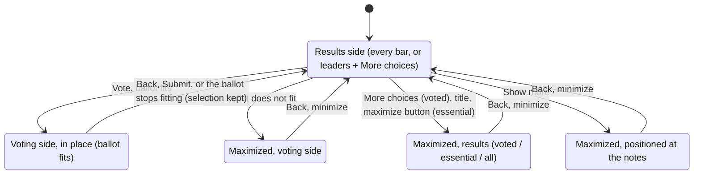

# Data Model: Wide More Choices

Nothing is stored, on the server or in the browser, and no payload changes (FR-020). Everything below is derived in
`pollCard.js` each time a card renders, or held in memory while the page is open.

## Derived on each render (wide card)

| Value | From | Rule |
|---|---|---|
| `capacity(wrap)` | `wrap.clientHeight` | `computeMaxBarsAtFloor(height)`; a height of 0 means "not laid out" and counts as room for everything (R1, R4) |
| results fit | `capacity(resultsWrap)`, `data.length` | `data.length <= capacity` |
| `places` | `capacity(resultsWrap)` | `capacity − 1`, never below 0 (R1) |
| choices shown | `data` (share order), `poll.myChoiceIds`, `places` | `fittingChoices` (R2): own choices first, up to `places`, then leaders, displayed in share order |
| last row | choices shown, `poll.choiceMode` | none when the results fit; else `more-row`, "More choices · p%" on a single-choice poll, "More choices" otherwise (FR-005) |
| `ballotFits()` | `capacity(votingWrap)`, `data.length` | `data.length <= capacity` (R5) |

## Held in memory (unchanged fields, now used at every width)

| Field | Where | Values | Notes |
|---|---|---|---|
| `isMaximized` | card | boolean | as today |
| `choiceView` | card | `'essential'`, `'all'`, `'voted'` | read at every width when maximized (R6); reset to `'essential'` or `'voted'` by `setMaximized` |
| `pendingSelection` | card | ids or `null` | kept when a flipped wide card returns to its results side because its ballot stopped fitting (R5) |
| `notesAsked` | grid (`tabs.js`) | boolean | true at every width when the view was opened by "Show more" (R8) |
| history step | `history.state.maximizedPid` | pid | unchanged: pushed when a view is opened from a card |

## States of a wide card

Inside `Max` the transitions are the phone's: `voted → all` by "Remaining choices · 0%", `essential ⇄ all` by
"Show all N choices" and "Show fewer choices".
