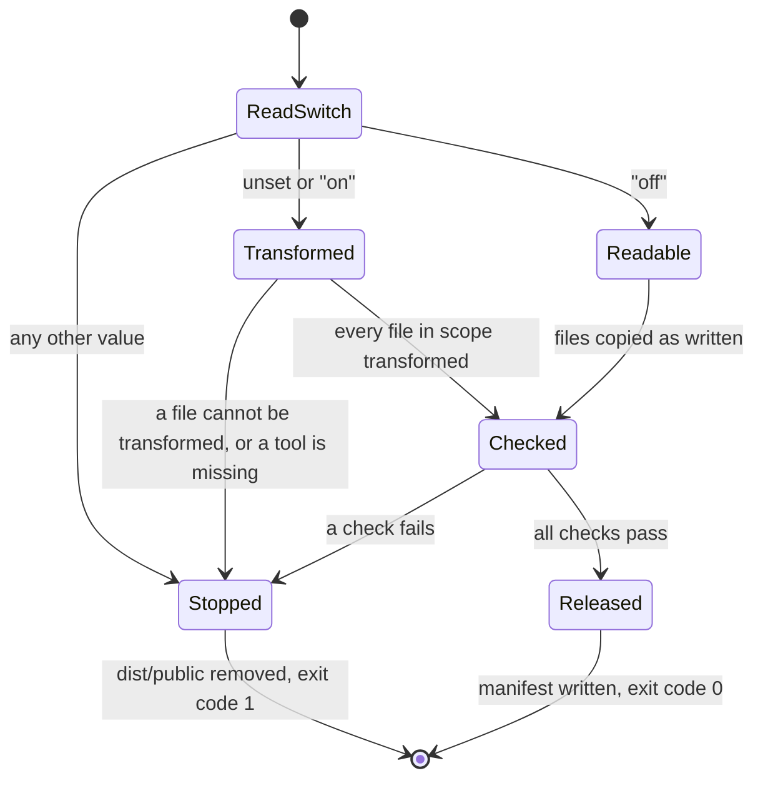

# Data Model: Client Code Obfuscation

Nothing is stored: no table, cookie, browser storage key or API field changes. The model is the build's inputs, its
decisions and its outputs.

## Build inputs

| Input | Values | Default | Source |
|---|---|---|---|
| Switch | `on`, `off` | `on` when unset | `ENV_OBFUSCATE_ASSETS` in the build's environment |
| Source maps | asked for or not | not | `--source-maps` on the build command |
| Source files | `src/public/` | — | the repository |
| Lighter scripts | a set of script names | empty | `LIGHTER_SCRIPTS` in `devScripts/assetTransform.ts` |

Any other switch value is an error (contract B3).

## Build mode

## File kinds and their treatment

| Kind | Where | Transformed build | Readable build |
|---|---|---|---|
| Own script (`.js`) | top level of `src/public/` | shortened, then strings into an encoded table (R2) | copied |
| Own script in `LIGHTER_SCRIPTS` | top level | shortened only | copied |
| Style sheet (`.css`) | top level | comments and spacing removed | copied |
| Page (`.html`) | top level | comments and spacing removed | copied |
| Image, icon, vector graphic | top level | copied | copied |
| Anything in `vendor/`, `oauth/`, `fonts/` | subfolders | copied | copied |

## Built file

| Attribute | Rule |
|---|---|
| Plain copy | `dist/public/<name>`: the bytes of the table above |
| Fingerprinted copy | `dist/public/assets/<hash>/<name>`: the same bytes; pages have none, as today |
| `<hash>` | first 16 hex digits of the SHA-256 of those bytes |
| Manifest entry | `"/<name>": "<hash>/<name>"` in `dist/public/asset-manifest.json`, as today |

## Checks (transformed build)

| Check | Rule | On failure |
|---|---|---|
| Not identical | no file in scope equals its source, unless the source is empty | stop, name the file |
| Size | gzip total of files in scope after ≤ before | stop, print both totals |
| Compiles | every built script parses | stop, name the file |
| References | every page reference to a top-level asset is in the manifest | stop, name page and reference |

The last two also run on a readable build.

## Source map (only with `--source-maps`)

| Attribute | Rule |
|---|---|
| Location | `dist-maps/<name>.js.map`, git-ignored, never under `dist/public` |
| Content | positions in the built script → positions in `src/public/<name>` |
| Effect on built files | none: the bytes are those of a build without the flag |

## Exception

A script named in `LIGHTER_SCRIPTS` because the size or the speed limit required it. Each is listed, with its
reason, in the documentation (FR-020). The set is empty at first.
