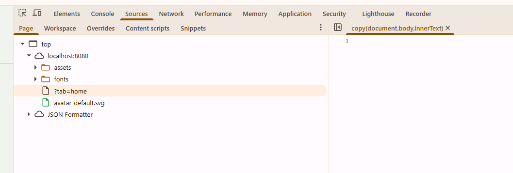
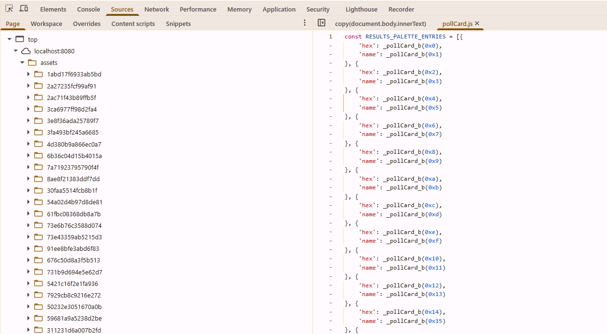
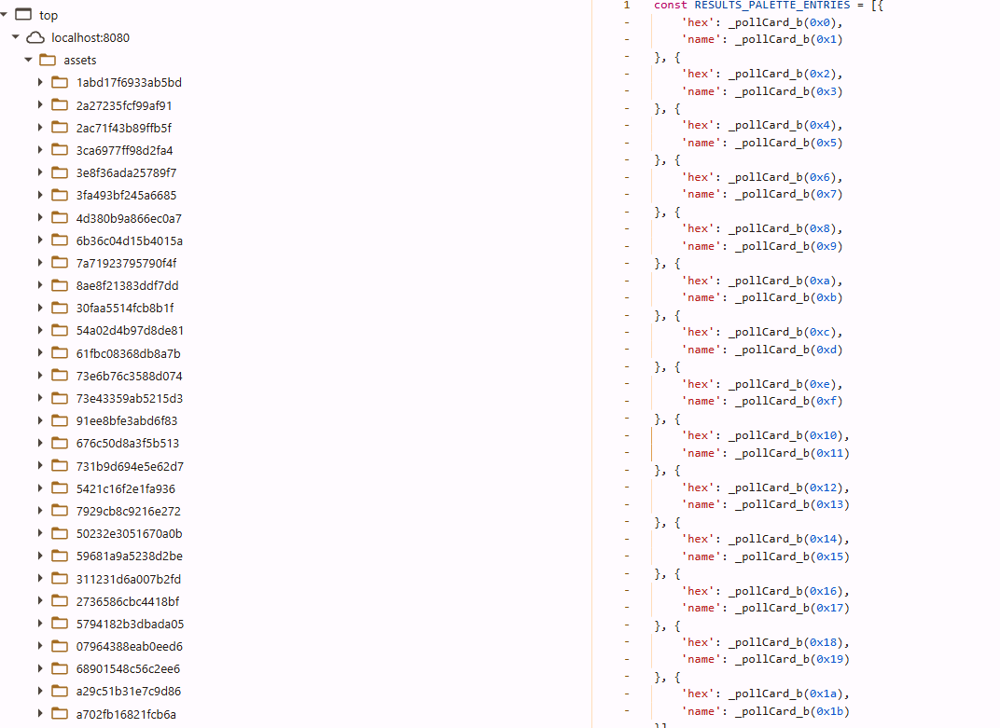

# Overview: `specs/20261118-160304-CLIENT-CODE-OBFUSCATION`

## Document History

| Record | Value |
|---|---|
| Feature directory | `specs/20261118-160304-CLIENT-CODE-OBFUSCATION` |
| Tweak file created | 2026-11-18 22:26 |
| Last updated | 2026-11-19 11:24 |

Legend: `[ ]` open · `[X]` Resolved · `[-]` Resolved (manually)  
(or accepted as-is) by the developer.
Tick `Run Tests` to have this tweak's automated tests written and run; leave it empty (the default) to postpone the run.

"Next" always returns the first `[ ]` item below.

The developer is expected to create the individual tweak requirements in this file, and then run the `/speckit-tweak` command to have the AI implement them, one at a time.  
Each tweak requirement initially carries an empty checkbox; tick it when the item is resolved or consciously accepted.  


# Tweaks

## TWEAK01 Commit And Push Before Quickstart  
[X] Resolved  
[ ] Run Tests  

From quickstart.md
```
Expected: dist-maps/pollCard.js.map exists, nothing named *.map under dist/public, and git status shows nothing new. 
```

To prepare for this, commit all and push. Run no tests until after we get through quickstart.md

### RECOMMENDATION

- Commit every change of the feature on branch `obfuscate` in one commit, and push it to `origin/obfuscate`.  
  - 14 modified files and the new ones: `devScripts/assetTransform.ts`, `tests/build-assets.test.ts`, `tests/fixtures/build-assets/`, `vitest.built.config.ts`, the `specs/` and `requirements/` folders of the feature.  
  - `dist/` and `dist-maps/` are git-ignored and stay out.  
- This tweak is recorded in the file before the commit, so the commit includes it and `git status` is clean for quickstart section 3.  
- No code changes, so there is no test to write;  
  no test is run.  

2026-11-18 22:39  

### ACCEPTED RECOMMENDATION

- Committed all changes of the feature on `obfuscate` and pushed to `origin/obfuscate`.  
- No code or artifact was edited.  
- Tests: none written (nothing a test can observe);  
  none run, as asked.  

2026-11-18 22:39  

## TWEAK02 Tracing And Local Testing Of Built Files  
[X] Resolved  
[ ] Run Tests  

From quickstart.md Step 3:  
```
To trace an error from the live site: check out the released commit, run this command,
```

Does this mean, deploy this most recent commit to production on Digital Ocean?  

Can the obfuscated client code be deployed to local development server for testing?

### RECOMMENDATION

Answers.  

- No, nothing is deployed by that step.  
  It is for later, after a release: when the live site reports an error, check out locally the commit that was released and build it with maps;  
  the build is repeatable, so the local scripts equal the live ones and the local maps fit them.  
  Section 3 itself only needs `npm run build -- --source-maps` on this machine.  
- Yes, the transformed files can be served locally: `npm start` (`node dist/server.js`) serves `dist/public`, where `npm run dev` serves `src/public`.  
  It needs the same `ENV_*` settings as the dev server, which `devScripts/launch-dev.ps1` sets before it ends with `npm run dev`.  

- **Option A** _(recommended)_: add a `-Built` switch to `devScripts.example/launch-dev.ps1` and to the local `devScripts/launch-dev.ps1`: with it the script runs `npm run build` and `npm start` in place of `npm run dev`.  
  Reword quickstart sections 3 and 4 (no deployment is meant; `./devScripts/launch-dev.ps1 -Built` to run the built app), and mention the switch in `README.md` and `CLAUDE_COMPLETE.md`.  
  - Pros: one command for the browser checklist (T022) and the speed comparison (T023), with the usual settings.  
  - Cons: edits the launcher template and the git-ignored local copy;  
    no automated test can observe it.  
- **Option B**: reword quickstart sections 3 and 4 only, giving the two commands to type after the settings are in the shell.  
  - Pros: documentation only.  
  - Cons: the settings have to be loaded by hand, since the launcher always ends in `npm run dev`.  

2026-11-18 22:46

### ACCEPTED RECOMMENDATION

Option A, accepted by "A Accept".  

- `devScripts.example/launch-dev.ps1` and the local `devScripts/launch-dev.ps1`: a `-Built` switch (`param([switch]$Built)`).  
  With it the script runs `npm run build`, stops if the build fails, and runs `npm start`;  
  without it, `npm run dev` as before.  
- `quickstart.md`: section 3 says that nothing is deployed and when the maps are used;  
  section 4 gives `./devScripts/launch-dev.ps1 -Built`.  
- `tasks.md`: T044 added, checked.  
- `README.md` and `CLAUDE_COMPLETE.md`: one command line each.  
- Tests: none written, since no suite runs the launcher;  
  both scripts were checked with the PowerShell parser (no errors).  
  Tests postponed (Run Tests not ticked): no suite run, so the tweak is unverified by a run, and the switch itself was not started.  

2026-11-18 22:48  

## TWEAK03 Obfuscation Switch In The Dev Launcher  
[X] Resolved  
[ ] Run Tests  

It seems like launch-dev.ps1 should have:
$env:ENV_OBFUSCATE_ASSETS = "on"

```
Run the built app on the development machine and keep the browser's console open. No step may log an error.

./devScripts/launch-dev.ps1 -Built

The switch runs npm run build and then npm start with the development settings, so the browser receives the transformed files of dist/public; without it the script runs npm run dev, which serves src/public as written.
```

Should it?

### RECOMMENDATION

Answer: it does not have to.  
An unset `ENV_OBFUSCATE_ASSETS` means `on`, so `-Built` already serves transformed files.  
The line is still worth having: it shows the setting, and the speed comparison of quickstart section 5 needs one readable build, which then is a one-word change.  
Only the build reads it, so it has no effect without `-Built`.  

- **Option A** _(recommended)_: add `$env:ENV_OBFUSCATE_ASSETS = "on"` under "Frequently changed" in `devScripts.example/launch-dev.ps1` and the local `devScripts/launch-dev.ps1`, with a note that only `-Built` reads it and that `off` serves the files as written.  
  Not in `launch.json.example`: the debugger runs the source and never builds.  
  Quickstart section 5 says how to get the readable build.  
  - Pros: visible, and one edit switches between the two builds.  
  - Cons: a setting in the launcher that the app itself never reads.  
- **Option B**: leave the launcher as it is.  
  - Pros: no change;  
    the default is already `on`.  
  - Cons: a readable local build needs the variable set by hand in the shell first.  

Tests: none to write for either option (no suite reads this line), none run.  

2026-11-18 22:54

### ACCEPTED RECOMMENDATION

Option A, accepted by "A Accept".  

- `devScripts.example/launch-dev.ps1` and the local `devScripts/launch-dev.ps1`: `$env:ENV_OBFUSCATE_ASSETS = "on"` under "Frequently changed", with a two-line note.  
- `launch.json.example`: unchanged, since the debugger never builds.  
- `quickstart.md`: section 5 says how to get the readable build.  
- `tasks.md`: T045 added, checked.  
- Tests: none written, since no suite reads this line;  
  both scripts were checked with the PowerShell parser (no errors).  
  Tests postponed (Run Tests not ticked): no suite run, so the tweak is unverified by a run.  

2026-11-18 22:55  

## TWEAK04 Where To See The Transformed Files  
[X] Resolved  
[ ] Run Tests  

For step 4:  where can I see the transformed files of dist/public?

```
The switch runs npm run build and then npm start with the development settings, so the browser receives the transformed files of dist/public; 
```



### RECOMMENDATION

Answer: they are in the `assets` folder of the screenshot.  
The pages ask for the fingerprinted copies, so each script is at `assets/<hash>/<name>`, one folder per fingerprint;  
the `?tab=home` entry is the page itself, also transformed.  
The same files are at `http://localhost:8080/pollCard.js` (no fingerprint) and on disk in `dist/public/`.  

- Add these three places to quickstart section 4, under the `-Built` paragraph.  
- No code changes, so no test to write, and none run.  

2026-11-19 03:59  

### ACCEPTED RECOMMENDATION

- `quickstart.md`: section 4 now lists where the transformed files can be seen (developer tools, by address, on disk).  
- No code, test or other artifact changed.  
- Tests: none written (documentation only);  
  none run.  

2026-11-19 03:59  

## TWEAK05 Attaching A Source Map In The Browser  
[X] Resolved  
[ ] Run Tests  
Where is "Add Source Maps" mentioned in the quickstart?  



### RECOMMENDATION

Answer: quickstart section 3 names "Add source map" in its last paragraph, but does not say where it is.  
In Chrome or Edge it is in the menu opened by a right-click inside the code of the open script, not on the file in the tree.  

Looking into it showed a fault: the maps named `pollCard.js` without holding its text, so the developer tools would look for that file beside the map and show nothing.  

- `devScripts/assetTransform.ts`: `sourcesContent: true`, so each map holds its script's source text.  
  The maps stay private and git-ignored;  
  the built files do not change.  
- `tests/build-assets.test.ts`: the source-map case also expects the map to hold the fixture's text (written, not run).  
- `quickstart.md` section 3: the four steps in the developer tools, and how to try them on the development machine.  
- `contracts/build.md` B13, `research.md` R11, `tasks.md` T034, `ARCHITECTURE.md`: one sentence each.  

2026-11-19 04:15  

### ACCEPTED RECOMMENDATION

- `devScripts/assetTransform.ts`: `sourcesContent: true` in the script stage that feeds the maps.  
- `tests/build-assets.test.ts`: one expectation added to "are written beside the build, which they do not change, and lead back to the source".  
- `quickstart.md` (section 3), `contracts/build.md` (B13), `research.md` (R11), `tasks.md` (T034), `ARCHITECTURE.md`.  
- Checked without a test suite: `npx tsc --noEmit` passes;  
  a build of `src/public` into a scratch folder gives the same size line as before, and its `pollCard.js.map` holds text equal to `src/public/pollCard.js`.  
- Tests postponed (Run Tests not ticked): the changed test was not run, so the tweak is unverified by a run.  
- Not checked: the four steps in a real browser.  

2026-11-19 04:15  

## TWEAK06 Record The Browser And Speed Results  
[X] Resolved  
[ ] Run Tests  

With the transformed assets in the browser:  



Using BrowserStack,
| Browser | Result |
|---|---|
| Chrome, desktop | passed |
| Edge, desktop | passed |
| Firefox, desktop | passed |
| Safari, desktop | passed |
| Safari, iPhone | passed |
| Chrome, Android | passed |

Speed difference is not noticeable. Feels quite responsive to the user.

### RECOMMENDATION

The screenshot shows the transformed `pollCard.js` as served (`_pollCard_b(0x0)` in place of the text).  

In both options:  

- `quickstart.md` section 4: the six browsers recorded as passed, on BrowserStack, 2026-11-19.  
- `tasks.md`: T022 checked.  
- No code changes, so no test to write, and none run.  

The speed result differs from what was specified: SC-004 and T023 ask for eight measured times and at most 10% slower, and the result is a judgement by use, with no numbers.  

- **Option A** _(recommended)_: record the judgement as given in quickstart section 5, say that the eight times were not measured, and check T023 with that note.  
  `spec.md` SC-004 keeps its wording.  
  - Pros: the record says exactly what was done;  
    the transformation adds one table lookup per string, and nothing suggested a slowdown.  
  - Cons: SC-004 is met by judgement, not by measurement.  
- **Option B**: record the judgement, and leave T023 open until the eight times are measured.  
  - Pros: SC-004 is met as written.  
  - Cons: an open task before the first release.  
- **Option C**: as A, and also reword SC-004 to ask for no noticeable slowdown in use, in place of the 10% measurement.  
  - Pros: spec and record agree.  
  - Cons: changes a success criterion after the fact.  

2026-11-19 11:23

### ACCEPTED RECOMMENDATION

Option C, accepted by "C Accept".  

- `quickstart.md` section 4: the six browsers recorded as passed, on BrowserStack, 2026-11-19.  
- `quickstart.md` section 5: the comparison is now by use, and the result is recorded as given, with the note that no times were measured.  
- `spec.md`: SC-004 and acceptance scenario 4 of the second story ask for nothing noticeably slower in use, in place of the 10% measurement.  
- `plan.md`: the performance goal reworded the same way.  
- `tasks.md`: T022 checked;  
  T023 reworded and checked.  
- Not edited: `requirements/20261118-160304-client-code-obfuscation/requirements.md`, whose line 92 still gives the 10% limit.  
- No code changes, so no test was written, and none run.  

2026-11-19 11:24  

## TWEAK07 <short title here>  
[ ] Resolved  
[ ] Run Tests  
tweak requirements...  
