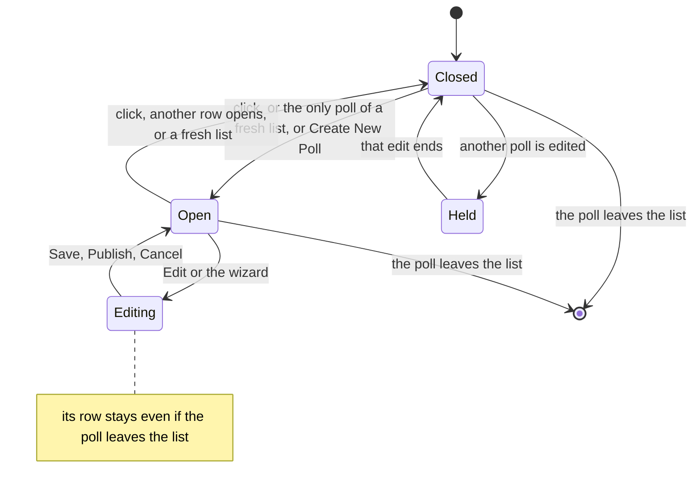
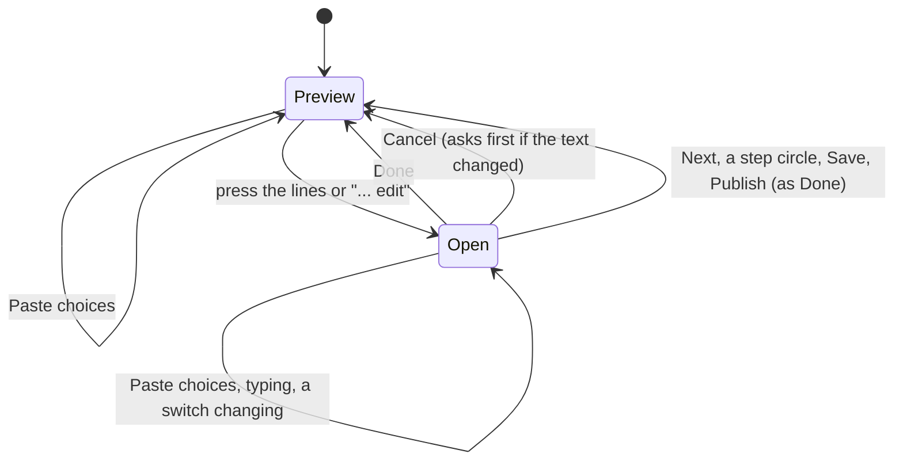

# Data Model: Poll Admin Improvements

One column is stored. Everything else is derived per request or held in memory while the page is open; no cookie and
no browser storage key is added (FR-047).

## Stored

| Table | Column | Type | Default | Meaning |
|---|---|---|---|---|
| `polls` | `choices_in_entered_order` | `boolean not null` | `false` | on: voters see the choices in `position` order; off: by share (FR-018) |

Migration `023-choices-in-entered-order.ts`; `down` drops the column. Existing rows read `false` (SC-009).

| Rule | Where |
|---|---|
| a boolean, or `400 choicesInEnteredOrder must be true or false.` | `validatePollFields` |
| any visibility, any editable state, before and after votes | `UPDATE_FIELDS`, `canChange` (FR-020) |
| a change bumps `content_version` | not in `NON_CONTENT_FIELDS` (FR-025) |
| copied by Duplicate; `false` on a new poll | `duplicatePoll`, `createPoll` (FR-026) |

A choice's `position` already exists and already records the entered order; `appendChoice` gives a voter's choice the
next one (FR-024).

## Carried in payloads

| Payload | Field | Notes |
|---|---|---|
| `PollProjection` (card, tab, delta, Live Results) | `choicesInEnteredOrder: boolean` | absent in a projection cached before the release: read as `false` |
| admin list item (`GET /api/admin/polls`, `/search`) and admin poll detail | `choicesInEnteredOrder: boolean` | the wizard's source |
| admin list item | `canWatch: boolean` | per viewer, from `mayWatchMany`; never stored (FR-012) |
| `PATCH`/save of a poll | `choicesInEnteredOrder?: boolean` | with the other wizard fields |

## Held in memory: the list (`adminList.js`)

Unchanged fields, now used by every view:

| Field | Values | Notes |
|---|---|---|
| `resultRows` | pid → `{ element, button, panel, cells, poll, shownTitle, link }` | `link` is new: the `a.admin-result-open`, or `null` |
| `openPid` | pid or `null` | one open row in the page |
| `controllers` | pid → card controller | exists while the row is open, or while it holds saved wizard progress |
| `editingPid` | pid or `null` | while set, every other row, the tabs, Search, Clear and Create are disabled |

The link is independent of these states: present while `poll.canWatch`, never disabled.

## Held in memory: the wizard (`adminCard.js`)

| Field | Values | Notes |
|---|---|---|
| `wizard.enteredOrder` | boolean | new; from `current.choicesInEnteredOrder`; in the dirty comparison and the saved-progress snapshot |
| `wizard.addChoices` | boolean | unchanged; its switch is drawn on step 3 |
| `wizard.choicesOpen` | boolean | new; `false` when the wizard opens; not part of the dirty comparison |
| `wizard.choicesAtOpen` | string | new; `wizard.choicesText` when the list was opened; what Cancel restores |
| `wizard.choicesText` | string | unchanged; the one source of the preview, the list, the counter and the errors |

The information dialog has no state beyond being on screen; at most one is open.

## Derived on each render (`pollCard.js`)

| Value | From | Rule |
|---|---|---|
| `data` | `poll.choices` | sorted by share, each item now carrying `position`; the ranking, unchanged |
| choices kept | `data`, own choices, limits or capacity | `essentialChoices` / `fittingChoices` / `votedChoices`, unchanged (FR-022) |
| choices drawn (results) | choices kept | `inDisplayOrder`: by `position` when `poll.choicesInEnteredOrder`, else as kept (FR-021) |
| choices drawn (ballot) | `ballot()` | the same function |
| last row and its share | choices kept | unchanged |
