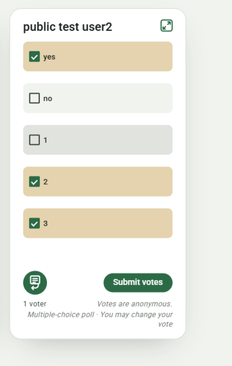
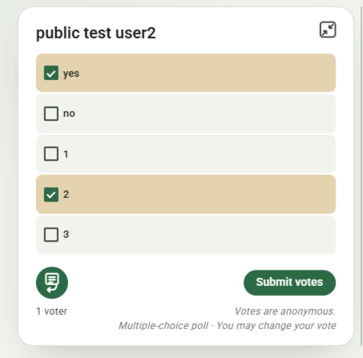
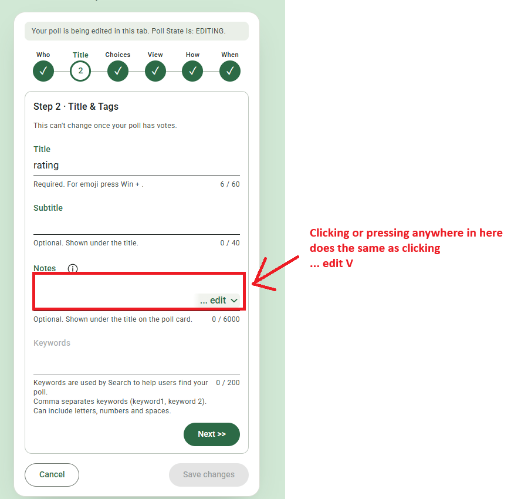
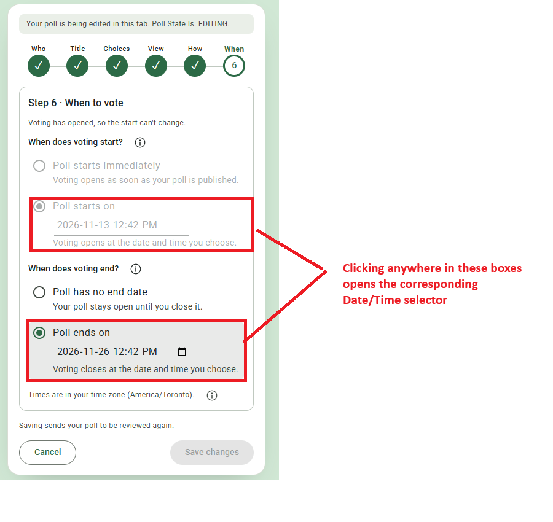
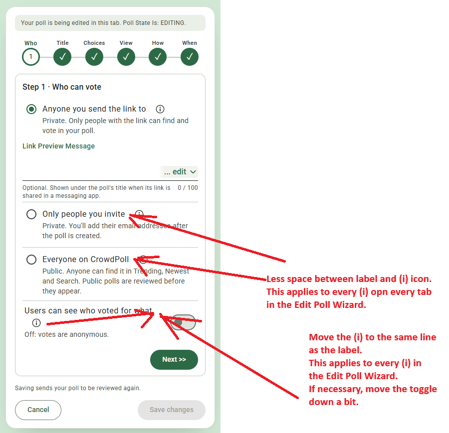

# Overview: `specs/20261119-144614-POLL-ADMIN-IMPROVEMENTS`

## Document History

| Record | Value |
|---|---|
| Feature directory | `specs/20261119-144614-POLL-ADMIN-IMPROVEMENTS` |
| Tweak file created | 2026-11-19 21:28 |
| Last updated | 2026-11-20 13:09 |

Legend: `[ ]` open · `[X]` Resolved · `[-]` Resolved (manually)  
(or accepted as-is) by the developer.
Tick `Run Tests` to have this tweak's automated tests written and run; leave it empty (the default) to postpone the run.

"Next" always returns the first `[ ]` item below.

The developer is expected to create the individual tweak requirements in this file, and then run the `/speckit-tweak` command to have the AI implement them, one at a time.  
Each tweak requirement initially carries an empty checkbox; tick it when the item is resolved or consciously accepted.  


# Tweaks

## TWEAK01 View Poll Tooltip  
[X] Resolved  
[ ] Run Tests  

Change the tooltip for the "Open Poll" icon to  
"View Poll"  since "Open Poll" already implies an action that might not be accurate for the current context.

### RECOMMENDATION

- `src/public/adminList.js` `resultOpenLink`: `link.dataset.tooltip = "View Poll"` (was "Open poll").  
- `src/public/adminList.js` `paintOpenLink`: the accessible name becomes `"View Poll: " + title` (was "Open poll: …"), so the name a screen reader announces starts with the tooltip's words (WCAG 2.5.3, label in name).  
- The CSS class `admin-result-open`, the `canWatch` field and the link's target are unchanged.  
- Tests (written, not run: Run Tests is not ticked): `tests/client-admin-rows.test.ts` lines 306, 307 and 316 expect "View Poll: Openable", "View Poll" and "View Poll: (untitled)".  
- Artifacts: `spec.md` (User Story scenario at line 97, the edge case at line 258, FR-015), `contracts/ui.md` U-entry at line 53, `research.md` R5 at line 59, `quickstart.md` line 57, `tasks.md` line 100, and `README.md`'s "Open poll" bullet and `CLAUDE_COMPLETE.md` line 21.  
- The requirements documents under `requirements/` keep "Open poll"; they are not edited unasked.  

2026-11-19 21:31

### ACCEPTED RECOMMENDATION

- `src/public/adminList.js`: the row's link now has the tooltip "View Poll"   
(`resultOpenLink`) and the accessible name "View Poll: title" (`paintOpenLink`).  
- `tests/client-admin-rows.test.ts`: the three expectations (lines 306, 307, 316) now read "View Poll: Openable", "View Poll" and "View Poll: (untitled)".  
- Tests postponed (Run Tests not ticked); the updated cases were not run, so the tweak is unverified by a run.  
  `npx tsc --noEmit` passes.  
- Artifacts: `spec.md` (User Story scenario 7, the empty-title edge case, FR-015), `research.md` (R5), `contracts/ui.md`, `quickstart.md`, `tasks.md` (T-line for the link), `README.md` (the "View Poll" bullet), `CLAUDE_COMPLETE.md`.  
- The requirement wording in `requirements/20261119-144614-poll-admin-improvements/` (requirements.md line 179, requirements-report.md line 626) still says "Open poll"; it was not edited.  

2026-11-19 21:33

## TWEAK02 Notes Help Text  
[X] Resolved  
[ ] Run Tests  

Change this text in a Modal Dialog:  
```
Notes
The first lines of your notes appear under the title on your poll's card. All of them appear on its Maximized view.
```
to
```
Notes
The first lines of your notes appear under the title on the polls card. The entire notes appear on the Maximized view.
```

### RECOMMENDATION

- `src/public/adminCard.js` `NOTES_HELP` (line 1529): the text becomes the requirement's second sentence pair, word for word, "polls card" included.  
- Tests (written, not run: Run Tests is not ticked): `tests/client-admin-info.test.ts` `NOTES_HELP` (line 45) expects the new text in the Notes dialog.  
- Artifacts: `spec.md` line 365 (the Notes row of the info-text table).  
- The requirements documents keep the old text; they are not edited unasked.  

2026-11-19 21:40

### ACCEPTED RECOMMENDATION

- `src/public/adminCard.js`: `NOTES_HELP` now reads "The first lines of your notes appear under the title on the polls card. The entire notes appear on the Maximized view."  
- `tests/client-admin-info.test.ts`: its `NOTES_HELP` constant, which the Notes dialog case compares against, holds the new text.  
- Tests postponed (Run Tests not ticked); the updated case was not run, so the tweak is unverified by a run.  
  `npx tsc --noEmit` passes.  
- Artifacts: `spec.md` (the Notes row of the info-text table).  
- `requirements/20261119-144614-poll-admin-improvements/requirements.md` line 106 keeps the old text; it was not edited.  

2026-11-19 21:41

## TWEAK03 Ballot Pick In Entered Order  
[X] Resolved  
[ ] Run Tests  
For this multiple-choice poll that has the setting "Choices are shown in the order entered",  
and has a vote for yes,2,3  

  

When clicking on 1,  
the 3 unchecks.   


### RECOMMENDATION

- Cause: `renderVotingOptions` draws the ballot from `ballot()`, which is in entered order when the setting is on, and numbers each row `data-index` in that order;  
  the click handler in `src/public/pollCard.js` then takes `data[Number(row.dataset.index)]`, and `data` stays in share order.  
  So clicking the third row drawn ("1") toggled the third choice by share ("3").  
- Fix: give each `.vote-row` `data-choice-id` and find the clicked choice by id (`data.find`), which holds in either order.  
- Tests (written, not run: Run Tests is not ticked): `tests/client-entered-order.test.ts` "a pick on the ballot in the entered order", phone and wide layouts, multiple-choice: picking A, then C, then A again leaves exactly the rows clicked selected.  
- Artifacts: `contracts/ui.md` U15 (a pick selects the row clicked), `tasks.md` T063.  

2026-11-19 21:57

### ACCEPTED RECOMMENDATION

- `src/public/pollCard.js`: `renderVotingOptions` sets `row.dataset.choiceId = item.id`;  
  the ballot's click handler finds the choice with `data.find((choice) => choice.id === row.dataset.choiceId)` instead of `data[index]`.  
  `data-index` is kept.  
- `tests/client-entered-order.test.ts`: two cases added (phone and wide).  
- Tests postponed (Run Tests not ticked); the new cases were not run, so the tweak is unverified by a run.  
  `npx tsc --noEmit` passes.  
- Artifacts: `contracts/ui.md` (U15), `tasks.md` (T063 added in the Polish phase).  
- This is a defect in the feature as built (T029 reordered the ballot without its click lookup), not a change of requirement.  

2026-11-19 21:58

## TWEAK04 Quickstart Automated Approval  
[X] Resolved  
[ ] Run Tests  
In quickstart,   
```
- Approve the poll in Awaiting Approval: at the next refresh its row is gone and the view says none are awaiting.
```
The approval process is automated.

### RECOMMENDATION

- Grounding: no admin control approves a poll.  
  `pollsAwaitingApprovalSweep` (`src/polls/sweeps.ts`) screens one poll per tick and approves or rejects it by itself, every `ENV_POLL_APPROVAL_SWEEP_INTERVAL` (5000 ms by default).  
  So a published poll usually leaves Awaiting Approval within seconds, which also makes the setup line "Have one poll in Awaiting Approval" (`quickstart.md` line 29) hard to hold.  
- **Option A** _(recommended)_: rewrite both lines around the sweep.  
  - Setup (line 29): start the app with `ENV_POLL_APPROVAL_SWEEP_INTERVAL=120000` for §1, so a poll stays in Awaiting Approval for up to two minutes, and keep none in Rejected.  
  - Line 43: publish a public poll, then open Awaiting Approval: its one row opens by itself.  
    Rejected shows "No rejected polls.".  
  - Line 44 becomes: "Leave Awaiting Approval showing: once the approval sweep screens and approves the poll (within the interval set above), at the next refresh its row is gone and the view says "No polls are awaiting approval."".  
  - Pros: the check can actually be carried out, and it still exercises spec scenario 7 (a row that leaves its view on a refresh).  
  - Cons: one more setting to set by hand for the walk-through.  
- **Option B**: change line 44 only, to "Wait for the approval sweep to approve the poll (about 5 s): at the next refresh its row is gone and the view says "No polls are awaiting approval."".  
  - Pros: smallest change.  
  - Cons: with the default interval the poll may be approved before the view is opened, so line 43's "opens it by itself" and line 44 can race.  
- No code or test changes: this is a quickstart wording change only; `spec.md` scenario 7 already says "approved while Awaiting Approval is shown" and stays correct.  

2026-11-20 12:25

### ACCEPTED RECOMMENDATION

- Option B, accepted by "Accept B".  
- `quickstart.md` §1 (line 44) now reads: "Wait for the approval sweep to approve the poll (about 5 s): at the next refresh its row is gone and the view says "No polls are awaiting approval."".  
- The setup line 29 and line 43 are unchanged;
  with the default 5000 ms interval the poll may be approved before Awaiting Approval is opened, as the option's Cons say.  
- No code or test changes, so there was nothing to run.  
- `spec.md` (scenario 7), `tasks.md` and the contracts needed no change.  

2026-11-20 12:28

## TWEAK05 Combined Who Info Dialog  
[X] Resolved  
[ ] Run Tests  
For the contents of the info (i) dialogs on 1-Who tab,  
combine all the text from the dialogs into a single dialog  
so that clicking any of the info icons opens the combined dialog instead of individual ones.

### RECOMMENDATION

- Grounding: step 1 has up to four icons in `src/public/adminCard.js`: one per `WHO_OPTIONS` entry (`buildStep1`, each titled with its label and holding its `help`), and on a private poll one on "Users can see who voted for what" (`buildVotersSwitch`, `VOTERS_SWITCH_HELP`).  
  Step 6 already does what is asked, with `WHEN_HELP`: three icons, one dialog "When to vote", `{ heading, text }` blocks.  
- **Option A** _(recommended)_: every step-1 icon, the voters switch's included, opens one dialog.  
  - A `whoHelp()` builds the blocks: each Who option's label as a heading followed by its `help`, in the present order;
    then, on a private poll only (where the switch is shown), "Users can see who voted for what" followed by `VOTERS_SWITCH_HELP`.  
  - Each icon keeps its own accessible name ("About: <label>"), so screen readers still tell the icons apart;
    the dialog's title is "Who can vote" for all of them, like "When to vote".  
  - `infoSwitchRow` gets the voters row's title from a new optional `title` field, so the step-3 switches keep their own dialogs.  
  - Pros: matches "any of the info icons" on the tab, and the step's two related choices (who votes, whether names show) read together.  
  - Cons: the voters entry sits under a "Who can vote" title, which is slightly broader than its subject.  
- **Option B**: only the three Who option icons share the combined dialog (three entries);
  the voters switch keeps its own "Users can see who voted for what" dialog.  
  - Pros: the dialog's title matches every entry in it.  
  - Cons: one icon on the tab still opens a separate dialog, which the requirement asks to avoid.  
- Tests (written, not run: Run Tests is not ticked):  
  - `tests/client-admin-info.test.ts` U12 "shows each Who entry under its label" becomes "gives every Who icon one dialog": on a private poll each of the four icons opens "Who can vote" with the headed entries;
    a public poll's dialog has the three option entries only.  
  - `tests/client-admin-wizard.test.ts` "explains each answer to Who can vote from its info icon" expects the combined title and text from every icon.  
- Artifacts: `spec.md` (US scenario 8 gains the Who step; FR-031's four Who rows become one row like When's), `contracts/ui.md` U12, `research.md` (the R-entry for the When dialog), `quickstart.md` (the step-1 dialog check), `tasks.md` (T064), `README.md` ("Info icons").  

2026-11-20 12:32

### ACCEPTED RECOMMENDATION

- Option A, accepted by "Accept A".  
- `src/public/adminCard.js`:  
  - `WHO_TITLE` ("Who can vote") and `whoHelp()`: each `WHO_OPTIONS` label as a heading over its `help`, then "Users can see who voted for what" over `VOTERS_SWITCH_HELP` when the poll is not public.  
  - `buildStep1`'s three icons and `buildVotersSwitch`'s icon open that dialog;
    each icon keeps "About: <label>".  
  - `infoSwitchRow` takes an optional `title`; the step-3 switches pass none and keep their own dialogs.  
- Tests:  
  - `tests/client-admin-info.test.ts`: "gives every Who icon one dialog, the voters entry included on a private poll" and "leaves the voters entry out of a public poll's Who dialog" replace "shows each Who entry under its label".  
  - `tests/client-admin-wizard.test.ts`: "explains every answer to Who can vote in one dialog, from any of its info icons".  
- Tests postponed (Run Tests not ticked); the new cases were not run, so the tweak is unverified by a run.  
  `npx tsc --noEmit` passes.  
- Artifacts: `spec.md` (US4 scenario 8, FR-031's Who row), `contracts/ui.md` (U12), `research.md` (the When-dialog decision gains the Who dialog), `quickstart.md` (§6), `tasks.md` (T064), `README.md` ("Info icons").  

2026-11-20 12:36

## TWEAK06 Whole Field Opens Editor Or Picker  
[X] Resolved  
[ ] Run Tests  

  

This also applies to:  
- Custom Email Message
- Choices
- Link Preview message

Also for the Poll starts on and Poll ends on fields:  


### RECOMMENDATION

- Grounding, `src/public/adminCard.js`:  
  - Notes, Custom Email Message and Link Preview Message are all `m3RichTextField`: its `div.wizard-notes-preview` holds the text and the "... edit" button, and only the button opens the editor (`openEditor`).  
  - Choices (`buildChoicesPreview`) already opens from its lines, but not from the rest of the box (its padding and the space beside a short list).  
  - "Poll starts on" and "Poll ends on" are `label.m3-radio-item` rows (`m3RadioRow`) holding the radio and a `datetime-local` input;
    a click anywhere selects the option (`pickStart`/`pickEnd`, which redraw step 6), but nothing opens the browser's date/time picker except its own calendar icon.  
- Text fields: one click handler on the whole preview box (`.wizard-notes-preview`, `.wizard-choices-preview`) that does what "... edit" does.  
  - It does nothing while "... edit" is disabled (a field locked by votes), so locking stays one rule.  
  - A click on a link inside a notes preview still follows the link instead of opening the editor.  
  - The keyboard path is unchanged: "... edit" stays the one focusable control, so no second tab stop or duplicate name is added.  
  - `admin-card-m3.css`: `cursor: pointer` on both boxes, `default` when their button is disabled (no font sizes, so the M3-token rule holds).  
- Date rows: a click anywhere in the "on" row selects it as today and then opens that row's picker.  
  - The row's click handler runs `pickStart`/`pickEnd` (which redraws), then calls `showPicker()` on the redrawn input, found by its `aria-label` ("Start date and time", "End date and time"), still inside the same click, so the browser allows it.  
  - A click on the input itself opens the picker too;
    typing into the input from the keyboard is unchanged.  
  - A disabled row (the start, once voting has opened, as in the screenshot) does nothing.  
  - `showPicker` is guarded (`typeof … === "function"`, inside `try`): a browser without it, or one that refuses, simply keeps today's behavior.  
- Tests (written, not run: Run Tests is not ticked):  
  - `tests/client-admin-choices-field.test.ts`: a click on the Choices box outside the lines and the button opens the list; on a poll with votes it does not.  
  - a new `tests/client-admin-field-click.test.ts`: a click on the Notes, Custom Email Message and Link Preview Message boxes opens their editor; a click on a link in the notes preview does not; on step 6, with `HTMLInputElement.prototype.showPicker` stubbed, a click on the "Poll ends on" support line selects it and opens the picker of "End date and time" once, and a click on the disabled start row of an opened poll opens nothing.  
- Artifacts: `contracts/ui.md` (U13 for Choices; the rich-text preview and step 6 entries), `spec.md` (an FR beside FR-035–FR-040 for the box, and step 6), `quickstart.md` (§ for the Choices field and step 6), `tasks.md` (T065), `README.md` ("Choices" bullet and the wizard's When step).  

2026-11-20 12:46

### ACCEPTED RECOMMENDATION

- Accepted by "Accept".  
- `src/public/adminCard.js`:  
  - `openFromBox(box, edit, open)`: a click anywhere in the box opens it, unless "... edit" is disabled or was itself clicked;
    used by `m3RichTextField` (Notes, Custom Email Message, Link Preview Message) and `buildChoicesPreview`, whose old click handler on the lines alone is gone.  
  - `opensPicker(row, ariaLabel, onPick)` on the "Poll starts on" and "Poll ends on" rows: a disabled radio does nothing;
    a click on the date box opens its picker; elsewhere, an unselected row is selected (`pickStart`/`pickEnd`, the label's own activation prevented) and the redrawn input's picker opens.  
  - `showDatePicker(input)` calls `showPicker()` only where it exists, inside `try` (MDN link, the one comment).  
- One departure from the recommendation: notes, email and link-preview text only support bold, italic and underline (`src/polls/notes.ts`), so a preview never holds a link, and the link exception and its test were dropped.  
- `src/public/admin-card-m3.css`: the rich-text and Choices previews show `cursor: pointer`, and `default` while their "... edit" is disabled (replaces the lines-only rule).  
- Tests:  
  - `tests/client-admin-choices-field.test.ts`: the list opens from "the box around them" too; with "... edit" disabled, neither the box nor the lines open it.  
    The box cannot be locked by votes (FR-041 keeps choices editable), so the case disables the button directly.  
  - new `tests/client-admin-field-click.test.ts`: the three rich-text boxes open their editor;
    "... edit" opens one editor;
    "Poll ends on" opens its picker from the support line, and again once selected;
    "Poll starts on" opens its picker from its label, and the end date box from itself;
    the disabled start row of an open poll opens nothing.  
- Tests postponed (Run Tests not ticked); the new cases were not run, so the tweak is unverified by a run.  
  `npx tsc --noEmit` passes.  
- Artifacts: `spec.md` (FR-036 widened, FR-036a added), `contracts/ui.md` (U13 table, and a TWEAK06 paragraph for the rich-text boxes and step 6), `quickstart.md` (§7), `tasks.md` (T065), `README.md` ("Choices").  
  The README's When step was not changed: it has no bullet describing the date rows.  

2026-11-20 12:56

## TWEAK07 Info Icon Beside Its Label  
[X] Resolved  
[ ] Run Tests  

Less space between every (i) info icon and the label before it.  
Every (i) info icon should be on the same line as the label. If necessary, move the control to the right down a bit to make room. If the (i) icon still won't fit, let me know and I will likely shorten the label.

See this image:  


### RECOMMENDATION

- Grounding:  
  - The gap: `.wizard-info` (`admin-card-m3.css`) is a 48 px wide button around a 20 px icon whose circle is about 15 px, so about 16 px of empty button sits on each side;
    with the 4 px `gap` of `.m3-row-heading`, the circle starts about 20 px after the label.  
  - The wrap: `.m3-row-heading` is `inline-flex` with `flex-wrap:wrap`, so when the label and the icon do not fit on one line the icon drops to a line of its own.  
    In a switch row (`admin.css` `.m3-switch-row`, a flex row with the switch at its right), the text column is narrowed by the switch, which is why "Users can see who voted for what" pushes its icon down.  
- Less space:  
  - `.wizard-info` 24 px wide (still 48 px tall, so its vertical hit area is unchanged), and the heading's gap stays 4 px: the circle starts about 8 px after the label instead of about 20.  
  - The same width for the icons after "When does voting start?", "When does voting end?" and the time-zone line.  
  - Phone layout (`phone-admin-m3.css`): its `::after` halo becomes `inset:-8px -20px`, so the target stays 64 × 64 px while the drawn button is narrower.  
- Same line:  
  - `.m3-row-heading`: `flex-wrap:nowrap` and `align-items:flex-start`, with the label allowed to shrink (`min-width:0`).  
    The icon never goes to a line of its own: a label too long for the line wraps inside its own box, and the icon stays to its right, on the label's first line.  
  - Switch rows ("Users can see who voted for what", "Display Choices in the order above", "Voters may add choices"): the row becomes a two-line grid;
    the label and its icon take the full width on the first line, and the support line and the switch share the second, so the switch moves down a little, as the requirement allows.  
- Labels that may still wrap (estimated from the font sizes, not measured in a browser):  
  - "Yes, as often as they like while the poll is open" (step 5) is about 50 characters, wider than its row at either width;
    its icon will sit on its first line, with the rest of the label wrapping below.  
  - At 400 px (phone fonts are 1.25 × larger), "Users can see who voted for what" and "Display Choices in the order above" are close to the row's width and may wrap the same way.  
  - These are the labels to consider shortening; I will check them in the walk-through (`quickstart.md` §6) and report which actually wrap.  
- Tests (written, not run: Run Tests is not ticked):  
  - `tests/admin-search-assets.test.ts` (the style cases of T057): `.m3-row-heading` does not wrap;
    `.wizard-info` is 24 px wide;
    the phone halo keeps a 64 px target;
    `.m3-switch-row` puts the switch on the second line.  
  - `tests/m3-assets.test.ts` and `tests/phone-sheets.test.ts` hold the existing rules (tokens only, the 640 px query) with no change.  
- Artifacts: `research.md` R10 (where the icon sits), `contracts/ui.md` U11 (one line: the icon on the label's first line, about 8 px after it), `quickstart.md` §6 (check that no icon is on a line of its own, at 1280 and at 400 px), `tasks.md` (T066).  
- No script change: the markup stays as built (R10: the icon is never inside a `<label>`).  

2026-11-20 12:59

### ACCEPTED RECOMMENDATION

- Accepted by "Accept".  
- `src/public/admin-card-m3.css`:  
  - `.wizard-info` is drawn 24 × 24 px (not 24 × 48 as recommended, so its hover layer and focus ring stay a circle);
    its vertical margin centers it on a `body-large` line (the token, so the phone's larger line follows);
    a transparent `::after` (`inset:-12px 0`) keeps a 24 × 48 px target, and `overflow:visible` (after the state-layer rule) lets it work.  
  - `.m3-row-heading`: `flex-wrap:nowrap`, `align-items:flex-start`; its label `min-width:0`.  
  - A switch row holding a `.m3-row-heading` (`:has`) is a grid: the label and icon across the first line, the support line and the switch on the second.  
- `src/public/phone-admin-m3.css`: `.wizard-info::after{ inset:-20px; }` after the halo list, a 64 × 64 px target.  
  On phones this target reaches about 16 px over the end of the label, so a tap there opens the dialog instead of selecting the option.  
- Tests: `tests/admin-search-assets.test.ts` gains three cases (the heading and icon rules, the switch-row grid, the phone target).  
- Tests postponed (Run Tests not ticked); the new cases were not run, and the layout was not seen in a browser, so which labels still wrap is not yet known (`quickstart.md` §6 lists the likely ones).  
  `npx tsc --noEmit` passes.  
- Artifacts: `research.md` (R10), `contracts/ui.md` (U11), `quickstart.md` (§6), `tasks.md` (T066).  

2026-11-20 13:02

## TWEAK08 Combined Choices And How Info Dialogs  
[X] Resolved  
[ ] Run Tests  
Same as Tweak05 for the
3-Choices tab
5-How tab

### RECOMMENDATION

- Grounding, `src/public/adminCard.js`:  
  - Step 3 has up to two icons: "Display Choices in the order above" (`buildEnteredOrderSwitch`, `ENTERED_ORDER_HELP`, two paragraphs) and, on a private poll, "Voters may add choices" (`buildAddChoicesSwitch`, `ADD_CHOICES_HELP`).  
  - Step 5 has four icons, through `howInfo(label)`, each opening its own `HOW_HELP` entry.  
- Follow TWEAK05's pattern, with the step's name as the dialog's title, as "Who can vote" and "When to vote" are:  
  - Step 3: every icon opens "Choices": "Display Choices in the order above" as a heading over its two paragraphs, then, on a private poll (where the switch is shown), "Voters may add choices" over its text.  
  - Step 5: every icon opens "How to vote": the four option labels as headings over their texts, in the step's order ("One choice", "More than one", "Yes, as often as they like while the poll is open", "No, their first vote is final").  
  - Each icon keeps its own name ("About: <label>");
    the step-3 switches pass `title` to `infoSwitchRow`, as the voters switch does since TWEAK05.  
  - Step 2's Notes keeps its own dialog: it is the only icon on that step.  
- Tests (written, not run: Run Tests is not ticked):  
  - `tests/client-admin-info.test.ts`: "shows the Notes, display order, How and add-choices texts" is split:
    Notes as today;
    every step-3 icon opens "Choices" with both entries on a private poll, and the order entry only on a public one;
    every step-5 icon opens "How to vote" with the four headed entries.  
- Artifacts: `spec.md` (US4 scenario 8, FR-031's Choices and How rows become one row each), `contracts/ui.md` U12, `research.md` (the TWEAK05 note), `quickstart.md` §6, `tasks.md` (T067), `README.md` ("Info icons": every step but Title has one dialog).  

2026-11-20 13:03

### ACCEPTED RECOMMENDATION

- Accepted by "Accept".  
- `src/public/adminCard.js`:  
  - `CHOICES_TITLE` ("Choices") and `choicesHelp()`: "Display Choices in the order above" as a heading over the first `ENTERED_ORDER_HELP` paragraph, then the second;
    then "Voters may add choices" over `ADD_CHOICES_HELP` when the poll is not public, the same condition that shows that switch.  
  - `buildEnteredOrderSwitch` and `buildAddChoicesSwitch` pass that title and help to `infoSwitchRow`.  
  - `howInfo(label)` opens "How to vote" with the four `HOW_HELP` entries as headed blocks; each icon keeps "About: <label>".  
- Tests: `tests/client-admin-info.test.ts` replaces "shows the Notes, display order, How and add-choices texts" with four cases:
  the Notes text;
  every Choices icon on a private poll;
  a public poll's Choices dialog;
  every How icon.  
- Tests postponed (Run Tests not ticked); the new cases were not run, so the tweak is unverified by a run.  
  `npx tsc --noEmit` passes.  
- Artifacts: `spec.md` (US4 scenario 8, FR-031's Choices and How rows), `contracts/ui.md` (U12), `research.md` (TWEAK08 note), `quickstart.md` (§6), `tasks.md` (T067), `README.md` ("Info icons").  

2026-11-20 13:05

## TWEAK09 Editing Row Click Cancels  
[X] Resolved  
[ ] Run Tests  

CLicking the row in the zebra-striped list of polls, does the same as clicking "Cancel", if the poll is being edited.  
The "Discard" dialog will be displayed, prompting the user to confirm whether they want to discard their changes. 

### RECOMMENDATION

- Grounding:  
  - `src/public/adminList.js`: while a poll is edited, `refreshCreateButton` → `holdResult` disables every row's button, the edited poll's own row included, titled "Finish editing the open poll first";
    `toggleResult` also returns at once while `editingPid` is set.  
  - `src/public/adminCard.js`: both footers' Cancel run the same two lines, `if (dirty && !(await confirmDiscard())) return; void cancelWizard();`, so the "Discard changes?" dialog shows only when something changed.  
- Read as: the **edited poll's own row** answers a click as Cancel does;
  every other row, the tabs, Search, Clear and Create New Poll stay held as today (U5), since the draft lives only in that one card.  
- **Option A** _(recommended)_: exactly Cancel.  
  - `adminCard.js`: the two Cancel handlers call one `requestCancel()` (the two lines above), and the controller returns it.  
  - `adminList.js`: `holdResult` leaves the edited poll's own row enabled, titled "Cancel editing", and `toggleResult` calls `controller.requestCancel()` for that row while it is edited.  
  - With no change, the edit ends at once;
    with changes, "Discard changes?" asks, and "Keep editing" leaves everything as it was.  
    After the edit ends the row stays open on the card's read-only face, as after Cancel; a second click closes it.  
  - Pros: one behavior to learn (the row is Cancel), and nothing closes unexpectedly.  
  - Cons: the row's usual job, closing, takes a second click after an edit.  
- **Option B**: Cancel, then close the row.  
  - The same, but once the edit has ended (no change, or "Discard" chosen) the row also closes.  
  - Pros: the click does what a row click does otherwise, once the draft is safe to drop.  
  - Cons: it is more than Cancel, which the requirement names.  
- Tests (written, not run: Run Tests is not ticked): `tests/client-admin-rows.test.ts` (U5):
  the edited row is enabled and titled "Cancel editing" while the others stay disabled;
  a click with no change ends the edit with no dialog;
  a click after a change shows "Discard changes?", "Keep editing" keeps the draft, and "Discard" ends the edit (Option B: and closes the row).  
- Artifacts: `spec.md` (US1 scenario 8 and FR-007), `contracts/ui.md` U5, `research.md` (the held-list decision), `quickstart.md` §1 (the Start Edit line), `tasks.md` (T068), `README.md` (the held-list sentence), `CLAUDE.md` (the ADMIN-SEARCH "Held during an edit" line).  

2026-11-20 13:06

### ACCEPTED RECOMMENDATION

- Option B, accepted by "Accept B".  
- `src/public/adminCard.js`: `requestCancel()` holds the footer Cancel's logic ("Discard changes?" only when dirty) and returns whether the edit ended;
  both footers' Cancel call it, and the controller returns it.  
- `src/public/adminList.js`:  
  - `holdResult` leaves the edited poll's own row enabled, with the title "Cancel editing" (`CANCEL_TITLE`); every other row stays held.  
  - `toggleResult` sends a click on that row to `cancelFromRow`, which awaits `requestCancel()`, then closes the row and focuses its button;
    "Keep editing" leaves the draft and the open row as they were.  
- Tests:  
  - `tests/client-admin-rows.test.ts` (U5): the edited row is enabled and titled "Cancel editing";
    an unchanged edit ends with no dialog and the row closes, focused;
    a changed edit asks, Keep editing keeps the change, Discard ends it and closes the row.  
  - `tests/client-admin-search.test.ts`: the held case now expects four held controls, the edited row enabled with "Cancel editing", and no longer clicks the edited row.  
- Tests postponed (Run Tests not ticked); the new and changed cases were not run, so the tweak is unverified by a run.  
  `npx tsc --noEmit` passes.  
- Artifacts: `spec.md` (US1 scenario 8, FR-007), `contracts/ui.md` (U5), `research.md` (R2, TWEAK09 note), `quickstart.md` (§1), `tasks.md` (T068), `README.md`, `CLAUDE.md` (the ADMIN-SEARCH "Held during an edit" line).  

2026-11-20 13:09

## TWEAK10 <short title here>  
[ ] Resolved  
[ ] Run Tests  
tweak requirements...  
