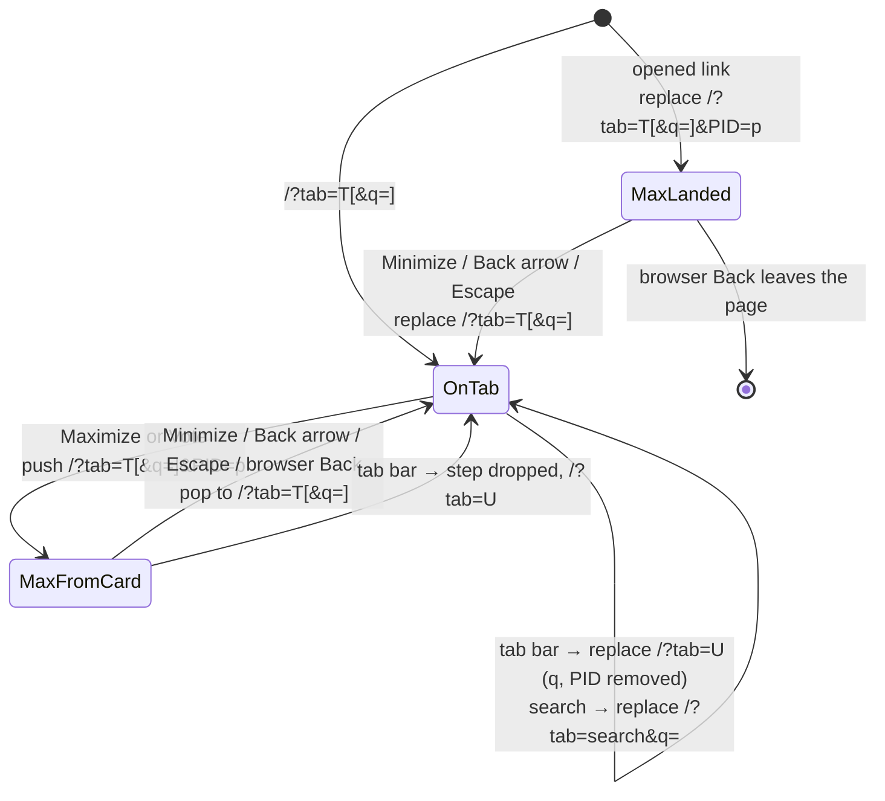

# Data Model: Deep Links

Nothing is stored: no table, column, cache key, cookie or browser storage key is added. The feature works on values read for
one request and on the address.

## Tab name

One of `home`, `your-polls`, `shared-with-you`, `your-votes`, `trending`, `newest`, `watching`, `live`, `search`
(`TAB_NAMES` in `tabs.js`; `LANDING_TABS` in `sharedLink.ts`, tested equal). Anything else in an address is treated as absent.

## Link request (read from the address, server side)

| Field | Source | Rule |
|---|---|---|
| `pid` | `PID` | `parsePid`: a UUID, else the request is a plain page load |
| `tab` | `tab` | `parseTab`: a tab name, else absent |
| `hasTerms` | `q` | non-empty after trimming |

## Poll facts for the caller (read once per opened link)

| Fact | Read from |
|---|---|
| `created` | `polls.created_by_id === caller.id` |
| `private` | `polls.poll_visibility === "Private Poll"` |
| `published` | `isPublished(polls row)` |
| `voted` | a `user_polls` row (`email`, `poll_id`, `relation = 'voted'`) |
| `watching` | a `user_polls` row (`relation = 'bookmarked'`) |

Who may see the poll (`decideSharedLink`'s existing rules: permission, archived, ban, invitation) is decided first and is
unchanged; the facts above only choose the tab of a poll already shown.

## Choosing the tab (`chooseTab(facts, request)`)

| Requested tab | Kept when |
|---|---|
| `your-polls` | `created` |
| `shared-with-you` | `private && !created` |
| `your-votes` | `voted` |
| `watching` | `watching` |
| `home`, `trending`, `newest` | `!private && published` |
| `search` | `hasTerms` |
| `live`, absent | never |

Otherwise the first of: `created` → `your-polls`; `private` → `shared-with-you`; `voted` → `your-votes`; `watching` →
`watching`; → `home`.

## Landing (server → browser)

`{ open?: pid, tab?: TabName, notice?: "unavailable" | "unpublished", q?: terms }`, written by `landingUrl` as
`/?open=&tab=[&q=][&notice=]`. `q` is carried only when `tab` is `search`.

## Address states (browser)

## Share button visibility

Shown when the card's `pollState` is `WAITING TO OPEN`, `OPEN` or `CLOSED` (the published states, `PUBLIC_STATES`); hidden
otherwise (`INITIALIZED`, `AWAITING APPROVAL`, `REJECTED`, `ARCHIVED`, `EDITING`, or no poll yet). Voters of a poll being edited
see its state from before the edit (`projectPoll`), so they keep Share; only the creator's own card hides it while editing.
