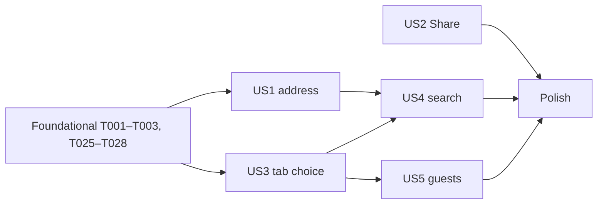

---

description: "Task list for Deep Links"
---

# Tasks: Deep Links

**Input**: Design documents from `specs/20261119-182343-DEEP-LINKS/`

**Prerequisites**: plan.md, spec.md, research.md (R1–R10), data-model.md, contracts/links.md (L1–L12), contracts/share.md (S1–S9), quickstart.md

**Tests**: included: the plan's research R10 and constitution IV require each contract rule to have a test.

**Organization**: by user story (spec.md US1–US5), after a short foundational phase.

## Format: `[ID] [P?] [Story] Description`

- **[P]**: can run in parallel (different files, no dependency on an unfinished task)
- **[Story]**: US1–US5 from spec.md

---

## Phase 1: Setup

**Purpose**: none needed: no package, migration, setting or folder is added. The one new client file is created in US2 (T013).

---

## Phase 2: Foundational (blocks US1, US3, US4, US5): tab names and the server's tab choice

- [X] T001 [P] In `src/polls/sharedLink.ts`, add `LANDING_TABS` (the nine tab names, same order as `TAB_NAMES`), `type TabName`, and `parseTab(value: unknown): TabName | null`; widen `LandingTab` to `TabName` (research R2, data-model "Tab name")
- [X] T002 [P] In `src/public/tabs.js`, add `addressWithPoll(pid)` and `addressWithoutPoll()`: from `location`, set or delete `PID` and keep every other parameter and the hash (research R1)
- [X] T003 Create `tests/shared-link-tab.test.ts` with the first case: `LANDING_TABS` equals the `TAB_NAMES` array read from `src/public/tabs.js`, and `parseTab` accepts each name and rejects `""`, `"Home"`, `"x"` and non-strings (contract L5)
- [X] T025 In `src/polls/sharedLink.ts`, add `chooseTab(facts, request)` as a pure function implementing data-model "Choosing the tab", with `facts = { created, private, published, voted, watching }` and `request = { tab?: TabName, hasTerms?: boolean }`
- [X] T026 In `src/polls/sharedLink.ts`, give `decideSharedLink` an optional fourth argument `request`; for every shown poll (creator, public published, private shown) read the caller's `voted`/`bookmarked` `user_polls` rows for this poll in one select and set `landing.tab = chooseTab(facts, request ?? {})`; leave the refused and unpublished results unchanged; pass `request` through `resolveSharedLink`
- [X] T027 In `src/polls/sharedLink.ts`, extend `Landing` with `q?: string` and make `landingUrl` write `q` after `tab` when present
- [X] T028 In `src/routes/pages.ts` `GET /`, read `tab` with `parseTab` and `q` (trimmed), call `resolveSharedLink(…, { tab, hasTerms: q !== "" })`, set `landing.q = q` when the chosen tab is `search`, and log `[link] Poll link opened: <tab or notice> (asked <tab or none>)` (L4, L12)

**Checkpoint**: tab names exist on both sides and are tested equal; `GET /?PID=` keeps or chooses the tab (the tests are in US3, T021–T023).

---

## Phase 3: User Story 1 — The address names the poll being viewed (P1) 🎯 MVP

**Goal**: a maximized poll's address is `/?tab=<tab>&PID=<pid>`; closing removes `PID`; reload shows the same poll (FR-001–FR-004).

**Independent Test**: maximize a poll on any tab, read the address, reload, close, read again (quickstart step 1).

### Tests

- [X] T004 [P] [US1] In `tests/client-maximized-history.test.ts`, add cases: maximize from a card pushes one entry whose address holds `PID` and keeps `tab`/`q`; browser Back returns to the address without `PID`; a second maximize while one is held replaces, not pushes; the tab bar while maximized leaves `/?tab=<new>` with no `PID`; a dropped step (`dropMaximizedStep`) leaves no `PID` (contracts L1–L3)
- [X] T005 [P] [US1] In `tests/client-landing.test.ts`, add: after a landing the address is `/?tab=<tab>&PID=<pid>` with no history entry added; Minimize, the Back arrow and Escape leave `/?tab=<tab>` (L1–L3)

### Implementation

- [X] T006 [US1] In `src/public/tabs.js` `setMaximizedStep(pid, replace)`, pass `addressWithPoll(pid)` as the URL of `pushState`/`replaceState` (research R1)
- [X] T007 [US1] In `src/public/tabs.js` `dropMaximizedStep`/`onHistoryStep`, store `addressAfterDrop` without `PID` (parse `location.href`, delete `PID`) so a same-turn tab change is carried and the poll is not (R1)
- [X] T008 [US1] In `src/public/tabs.js` `maximize`, when no step is pushed (landing or retained poll, i.e. not `how.fromCard` and not `viaHistory`), `replaceState(history.state, "", addressWithPoll(pid))`; skip it when `document.body.dataset.pollPage` is set (FR-005, R3)
- [X] T009 [US1] In `src/public/tabs.js` `restore`, when no step was held (no `maximizedPid` in `history.state`), `replaceState(history.state, "", addressWithoutPoll())` (R1)
- [X] T010 [US1] In `src/public/tabs.js` `showTabInAddress`, also delete `PID` (L2)

**Checkpoint**: US1 tests pass; the address follows every maximize and close.

---

## Phase 4: User Story 2 — Share a poll from its card (P1)

**Goal**: a Share button on every published poll's card offering `/?PID=<pid>` by share sheet or clipboard (FR-020–FR-025).

**Independent Test**: quickstart step 7.

### Tests

- [X] T011 [P] [US2] Create `tests/client-share-button.test.ts` covering contract S1–S9: the button on both faces, grid and maximized, for a guest; shown for `WAITING TO OPEN`/`OPEN`/`CLOSED`, hidden for `INITIALIZED`/`AWAITING APPROVAL`/`REJECTED`/`ARCHIVED`/`EDITING`; name `Share poll: <title>`; with a stubbed `navigator.share` it is called with `{ title, url: origin + "/?PID=" + pid }`; `AbortError` shows no snackbar; another rejection falls back to the clipboard; without `navigator.share` the clipboard gets the link and the snackbar says `Link copied`, or `Could not copy the link` when `writeText` rejects; pressing Share does not maximize or flip the card
- [X] T012 [P] [US2] In `tests/client-admin-wizard.test.ts`, assert the copied link equals `SharePoll.link(pid)` (S4)

### Implementation

- [X] T013 [P] [US2] Create `src/public/sharePoll.js` (`window.SharePoll`): `link(pid)` = `location.origin + "/?PID=" + encodeURIComponent(pid)`; `copy(pid)` writes it with `navigator.clipboard.writeText` and shows `Link copied` / `Could not copy the link` in the `.m3-snackbar` element (created on first use, `role="status"`, hidden after 3 s, as `adminCard.js` `snackbar`); `share(pid, title)` calls `navigator.share({ title, url })` first when it exists, ignores an `AbortError`, falls back to `copy(pid)` on any other rejection, and calls `copy(pid)` when `navigator.share` is absent; one comment line linking MDN Web Share API (research R8)
- [X] T014 [US2] Load `sharePoll.js` with `defer` before `pollCard.js` in `src/public/index.html`, and before `adminCard.js` in `src/public/admin.html`
- [X] T015 [US2] In `src/public/adminCard.js`, make `pollLink()` return `window.SharePoll.link(current.pid)` and `copyPollLink()` call `window.SharePoll.copy(current.pid)`; remove the now-unused local snackbar code only if nothing else in the file calls it (S4)
- [X] T016 [US2] In `src/public/pollCard.js` template, add `<button class="share-btn" type="button" title="Share poll" hidden>` with an inline 24×24 share icon (three circles joined by two lines, `stroke="currentColor"`, `aria-hidden="true"`, `focusable="false"`) before the Watch button on the front face and before Maximize on the back face (S1, S3)
- [X] T017 [US2] In `src/public/pollCard.js`, when the poll is applied: set each `.share-btn`'s `aria-label` to `Share poll: <title>` and `hidden` unless `pollState` is `WAITING TO OPEN`, `OPEN` or `CLOSED`; toggle `.has-share` on each `.question-row`; on click call `window.SharePoll.share(pid, title)` and stop the event from reaching the card's own click handlers (S2, S5, S9)
- [X] T018 [P] [US2] In `src/public/pollCard-m3.css`, add `.card-face .share-btn` to the header-button rules beside `.bookmark-btn`/`.maximize-btn` (32 px, transparent, `on-surface-variant`, the same negative margin) (S8)
- [X] T019 [P] [US2] In `src/public/phone-card-m3.css`, add `.share-btn` to the 48 px rules and the halo (`::after`) beside `.bookmark-btn`; place it one button left of Watch (or of Maximize when Watch is absent); widen the title's `.question::before` reserve by 64 px under `.has-share` (S8)
- [X] T020 [US2] Check the wide card layout in `src/public/pollCard.css` positions `.share-btn` in the question row without overlapping the title; add only the rule needed if it does not (S8)

**Checkpoint**: US2 tests pass; quickstart step 7 by hand on a phone and desktop Firefox.

---

## Phase 5: User Story 3 — An opened link shows the poll over a tab that fits (P1)

**Goal**: the server keeps a fitting `tab` or chooses one; nothing is written; the closed poll stays on the tab (FR-007–FR-013, FR-026).

**Independent Test**: quickstart steps 2–4 and 8.

### Tests

- [X] T021 [P] [US3] In `tests/shared-link-tab.test.ts`, test `chooseTab` as a table: each requested tab (nine names and none) × facts `{created, private, published, voted, watching}` for the six visitor kinds of SC-002, against data-model "Choosing the tab"; assert no result puts a private poll on `home`/`trending`/`newest`, and a creator asking for `shared-with-you` gets `your-polls` (SC-003)
- [X] T022 [P] [US3] In `tests/shared-link-tab.test.ts`, with supertest and a signed-in session: `GET /?PID=<pid>&tab=<t>` redirects to `/?open=<pid>&tab=<chosen>` for a creator, an invited and a linked visitor, a voter, a watcher and an unrelated visitor; a refused poll still gives `/?notice=unavailable`; an unpublished private poll still gives `/?tab=shared-with-you&notice=unpublished`; a malformed `tab` behaves as none; `/?PID=<pid>` with no tab gives today's landing except a public poll lands on `home` (L4, L5, L11)
- [X] T023 [P] [US3] In `tests/shared-link-tab.test.ts`, assert opening a link adds no `bookmarked` row and, for an "Anyone with the link" poll, only today's `linked` row (L6, SC-006)
- [X] T024 [P] [US3] In `tests/client-landing.test.ts`, replace the case "closing removes it without adding it to the list" with: closing a retained poll leaves its card first in the grid with focus on its Maximize button; a Watch, a Remove or returning to the tab keeps it; the tab's next server answer removes it unless the server lists it; closing by switching tab removes it (L10, research R4)

### Implementation

- [X] T029 [US3] In `src/public/tabs.js` `restore`, when a retained card closes without `options.left`, insert it first in the grid, call `card.setMaximized(false)`, clear `retainedDetail` and `pinnedPid`, and record it as the grid's `keptPid` instead of unmounting it; compute `leftTheTab` from `options.left` only, so focus returns to the card; in `render`, skip unmounting `keptPid` and keep it first; add `grid.releaseKept()` (clears `keptPid`) and call it in the delta tabs' `request` just before it renders the server's answer, not in `placeFirst`, `remove` or `activate` (research R4)
- [X] T047 [US3] Call `grid.releaseKept()` just before each render of a server answer in `src/public/trending.js` (the refresh answer, line ~67), `src/public/newest.js` (line ~67) and `src/public/searchTab.js` (the search answer, line ~37); leave the local re-renders alone (`trending.js` ~156, `newest.js` ~146, `searchTab.js` ~57 and ~143); extend T024 with a Trending case: a Watch elsewhere keeps the card, the next refresh removes it (research R4)
- [X] T048 [US3] TWEAK01: in `src/public/tabs.js` `createGrid`, note a landing's poll as `linkedPid` in `maximize` and put it first as `keptPid` in `restore` whether or not the list holds it (`keptCard()` drops the not-listed condition, `render` leaves `keptPid` out of the ordering); in `tests/client-landing.test.ts`, a landing on Newest's second poll closes to first, a Watch keeps it, the next refresh puts it back; a card maximized from the grid returns to its place (L10, research R4)

**Checkpoint**: US3 tests pass; quickstart steps 2–4 and 8.

---

## Phase 6: User Story 4 — The address names a search (P2)

**Goal**: a search writes `q`; a search address and a maximized result survive reload and sharing (FR-017–FR-019).

**Independent Test**: quickstart step 5.

### Tests

- [X] T030 [P] [US4] Create `tests/client-search-address.test.ts`: submitting terms leaves `/?tab=search&q=<terms>` with no history entry added; Clear removes `q`; maximizing a result keeps `q` beside `PID`; a landing `/?open=<pid>&tab=search&q=<terms>` runs the search and maximizes the poll over the Search grid, retained when the results lack it (L9, L1)
- [X] T031 [P] [US4] In `tests/shared-link-tab.test.ts`, assert `GET /?PID=<pid>&tab=search&q=x` keeps `search` and passes `q` on, and `tab=search` with an empty `q` falls back (L4)

### Implementation

- [X] T032 [US4] In `src/public/tabs.js`, add `showSearchTerms(terms)` (`replaceState` of the address with `tab=search` and `q` set, or `q` deleted when empty) and expose it on `window.Tabs`; make `showTabInAddress("search")` keep `q`
- [X] T033 [US4] In `src/public/searchTab.js`, call `window.Tabs.showSearchTerms(q)` in `submit` after `Tabs.select(TAB)`, and `window.Tabs.showSearchTerms("")` in `clear`
- [X] T034 [US4] In `src/public/tabs.js` `init`, for a landing with `tab === "search"` and terms, confirm `controllers.search.grid` exists after `searchFromAddress(terms)` (the Search grid is created lazily by `ensureGrid`) before `showLandingPoll("search", pid)`, so `mountLinkedPoll` can mount a result the search lacks; T030 covers it (research R3)

**Checkpoint**: US4 tests pass; quickstart step 5.

---

## Phase 7: User Story 5 — Guests follow links as before (P2)

**Goal**: guests keep today's routes; the tab rides through login (FR-014–FR-016).

**Independent Test**: quickstart step 6.

### Tests

- [X] T035 [P] [US5] In `tests/shared-link-tab.test.ts`, without a session: `GET /?PID=<public open>&tab=x` → `/poll/<pid>`; `GET /?PID=<private>&tab=shared-with-you` → `/login?PID=<pid>&tab=shared-with-you`; a malformed `tab` is dropped; `/login?PID=&tab=` when signed in redirects to `/?PID=&tab=`; for a guest, `/login?PID=<open poll>&tab=trending` still renders the poll's preview in the page head (L7, L8, FR-027)
- [X] T036 [P] [US5] In `tests/client-login-pid.test.ts`, assert the provider `callbackURL` and the magic-link request body carry `tab` beside `PID` when `/login` has both, and neither when `tab` is invalid; in the auth test that reads the emailed link, assert the verify link and its redirect carry `tab` (L8)

### Implementation

- [X] T037 [US5] In `src/polls/sharedLink.ts`, add `sharedLinkQuery(pid, tab)` returning `PID=<pid>` plus `&tab=<tab>` when `tab` is valid; use it in `src/routes/pages.ts` for the guest `/login?…` redirect, `/login` and `/create-account` when already signed in
- [X] T038 [US5] In `src/routes/api.ts` and `src/auth/auth.ts`, carry `tab` (via `parseTab` / `sharedLinkQuery`) wherever `PID` is carried in the login flow: the emailed verify link, the `/api/auth/verify` redirect, the not-launched and invalid-link login addresses, the create-account link and its final redirect; accept an optional `tab` in the magic-link request body beside `pid`; leave invitation routes unchanged (research R6)
- [X] T039 [US5] In `src/public/cardShell.js`, add `sharedTab()` (the address's `tab` when it is one of the nine names) and `sharedLinkQuery()`; in `src/public/loginCard.js` use them for `callbackURL` and the magic-link body; in `src/public/confirmSigninCard.js` for `loginHref`
- [X] T040 [US5] In `postman/openapi.json`, document the optional `tab` on the magic-link request body and on `GET /api/auth/verify`

**Checkpoint**: US5 tests pass; quickstart step 6.

---

## Phase 8: Polish & Cross-Cutting

- [X] T041 Run `npx tsc --noEmit` and `npm test`; fix failures in the touched suites
- [X] T042 Run `npm run build` then `npm run test:built` to confirm `sharePoll.js` is transformed and the client suites pass on `dist/public`
- [X] T043 Walk `quickstart.md` steps 1–8 by hand on a phone and a desktop browser
- [X] T044 [P] Update `README.md`: sharing a poll (the Share button, copying the address of a maximized poll or a search) and where an opened link lands
- [X] T045 [P] Update `ARCHITECTURE.md`: the link landing sequence (server `chooseTab`, `/?open=&tab=`, the address while maximized) with a Mermaid diagram
- [X] T046 [P] Update `CLAUDE_COMPLETE.md` with this feature's decisions (research R1–R8)

---

## Dependencies & Execution Order

- **Foundational (T001–T003, T025–T028)** blocks US1, US3, US4, US5. US2 depends on nothing and can start at once.
- **US1** (T004–T010) before **US3**'s browser part (T029, T047) and **US4** (T032–T034): they all write the address through T002's helpers.
- The server's tab choice (T025–T028) is foundational, so US1's reload test and US3's tests both run against it; **US4**'s T031 and **US5**'s T035–T038 extend the same route and module.
- **US5** after US3.
- **Polish** last.

## Parallel Opportunities

- T001 and T002 (different files).
- US2 entirely in parallel with US1/US3: T011, T012, T013, T018, T019 together; then T014–T017, T020.
- Foundational: T001 → T025 → T026 → T027 → T028; T002 and T003 in parallel with them.
- Within US3: tests T021–T024 together; T029 in parallel with them (browser file); T047 after T029.
- Polish documentation T044–T046 together.

## Implementation Strategy

1. **MVP**: Foundational + US1 (the address) + US2 (Share): every poll can be shared, from the button or the address bar.
2. **US3**: opened links land on a fitting tab: the problem the requirements set out to fix.
3. **US4** then **US5**: search addresses, and guests carrying the tab through login.
4. Polish and the documentation deliverables.
