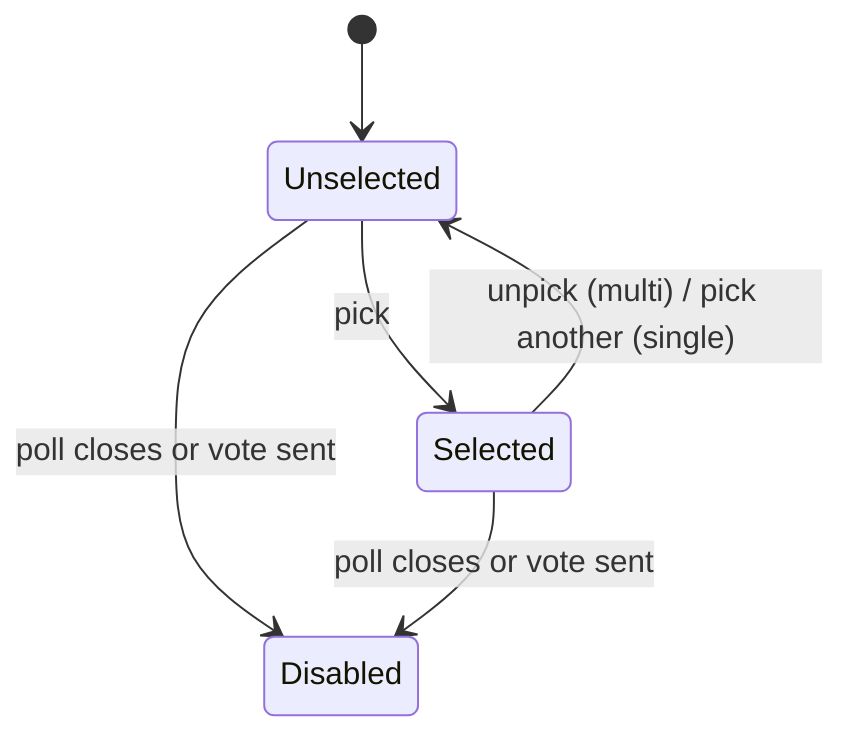

# Data Model: Color Contrast

**Feature**: [spec.md](spec.md) | **Research**: [research.md](research.md)

Nothing is stored: no table, column, payload field, setting, cookie or browser-storage key changes. The "data" is the set
of colour roles per scheme, the contrast pairs over them, and the shades derived for result colours.

## Scheme

`light` (no `data-theme` on `<html>`) or `dark` (`data-theme="dark"`), chosen as today by `colorScheme.js`.

## Colour role

A named custom property with one `#RRGGBB` value per scheme, set in `m3-tokens.css`.

| Field | Meaning |
|---|---|
| name | the custom property, e.g. `--md-sys-color-primary`, `--choice-edge` |
| light, dark | its value in each scheme, a literal or `var()` of another role |
| frozen | true for the FR-012 list; a frozen role's two values never change |

**Frozen roles** (both schemes, values as today): `--md-sys-color-primary`, `--md-sys-color-on-primary`,
`--md-sys-color-primary-container`, `--md-sys-color-on-primary-container`, `--md-sys-color-inverse-primary`, `--moss`,
`--moss-dark`; plus the semantic Yes colour `#006120` (a constant in `pollCard.js`, not a role).

**Alias roles** (set per scheme in `m3-tokens.css`, research R1–R4):

| Alias | Light | Dark |
|---|---|---|
| `--ink` | `on-surface` `#1E2422` | `on-surface` `#DFE4DD` |
| `--paper` | `#E5EAE2` | `#0A0E0B` |
| `--paper-raised` | `#FFFFFF` | `surface-container` `#1C211D` |
| `--line` | `#A3ABA2` | `#4A524B` |
| `--muted` | `on-surface-variant` `#414942` | `on-surface-variant` `#C0C9C0` |
| `--track` | `surface-container-highest` `#DFE4DD` | `surface-container-highest` `#313631` |
| `--choice-unselected` | `surface-container` `#EAEFE8` | `surface-container-highest` `#313631` |
| `--choice-edge` | `outline` `#717971` | `outline` `#8A938B` |
| `--choice-selected` | `#643F00` | `tertiary` `#FFB956` |
| `--on-choice-selected` | `#FFFFFF` | `on-tertiary` `#462B00` |

## Contrast pair

| Field | Meaning |
|---|---|
| foreground, background | two roles drawn one on the other |
| minimum | 4.5, 3 (text large / UI), 7 (row and track labels), 1.5 (decorative house targets) |
| maximum | only for the card border: below 3 |
| schemes | light, dark or both |

The full list is the **Required pairs** table of `COLOR-CONTRAST.md` ([contracts/guardrail.md](contracts/guardrail.md)
G2).

## Result colour

| Field | Derivation |
|---|---|
| source | semantic Yes/No (`#006120`/`#F91010`), creator-stored `#RRGGBB`, or the palette entry at the poll's offset |
| stored | the source value; never changed by this feature |
| card | `#FFFFFF` (light) or `#1C211D` (dark) |
| fill | `lineColorOn(stored, card)`: the stored colour, or the nearest shade of its hue reaching 3:1 against the card |
| track | `fill` mixed with `card` at the largest tint ≤ 0.9 (light) / 0.8 (dark), in 0.05 steps, reaching 1.5:1 |
| inkOnTrack | `darkShadeOf(track)` (light) / `lightShadeFor(track)` (dark): ≥ 7:1 |
| inkOnFill | the override if listed and ≥ 4.5:1 against `fill`, else black or white, whichever contrasts more (≥ 4.58:1) |

Per scheme, `fill`, `track`, `inkOnTrack` and `inkOnFill` are set on each result row as custom properties.

## Palette

Fourteen base entries, repeated per poll (unchanged mechanism). Three entries change (research R6):

| Index | Before | After |
|---|---|---|
| 6 | `#404040` darkslategray | `#8B4513` saddlebrown |
| 7 | `#7D7D7D` gray | `#6B8E23` olivedrab |
| 11 | `#FC8E45` coral | `#B8860B` darkgoldenrod |

**Rule**: after the lift, in each scheme, no two base entries are closer than CIE76 ΔE 13 (one below today's closest
intended pair, teal/lightseagreen at 14.0).

## Vote row states

| State | Fill | Edge | Label / radio / check |
|---|---|---|---|
| Unselected | `--choice-unselected` | 1 px `--choice-edge` | `on-surface` / ring `on-surface-variant` |
| Selected | `--choice-selected` | 2 px `--choice-selected` | `--on-choice-selected` (ring, dot, check, label) |
| Disabled | as its state | as its state | as today (dimmed) |
