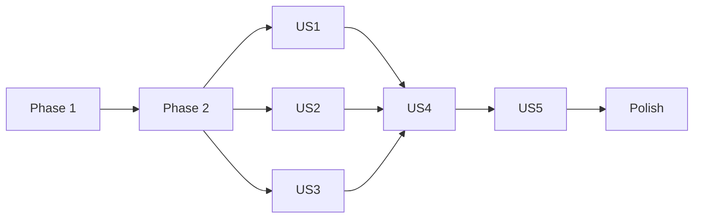

---

description: "Task list for Color Contrast"
---

# Tasks: Color Contrast

**Input**: Design documents from `specs/20261120-175903-COLOR-CONTRAST/`

**Prerequisites**: plan.md, spec.md, research.md (R1–R12), data-model.md, contracts/colors.md (C1–C14),
contracts/guardrail.md (G1–G8), quickstart.md

**Tests**: requested by the spec (FR-020, FR-021, User Story 5): each story first adds its rows to the guideline, which
`tests/color-contrast.test.ts` reads, and sees them fail before the colours change.

**Organization**: tasks are grouped by user story; each story can be implemented and tested on its own once Phase 2 is
done.

## Format: `[ID] [P?] [Story] Description`

- **[P]**: can run in parallel (different files, no dependency on an unfinished task)
- **[Story]**: US1–US5 from spec.md
- Ratios are WCAG 2.2 contrast ratios; values come from data-model.md's alias table unless a task names them

---

## Phase 1: Setup

**Purpose**: a green baseline to compare against.

- [X] T001 Run `npx tsc --noEmit` and `npm test` on the unchanged branch and note any failure that predates this feature
  (none expected), so later failures are attributable (no file changes)

---

## Phase 2: Foundational (Blocking Prerequisites)

**Purpose**: one place that sets both schemes' colours (R1), the card surface the bars and the graph lift against (R5),
and the guideline/test pair every story adds rows to (R10, R11).

**⚠️ CRITICAL**: no user story can start until this phase is complete.

- [X] T002 In `src/public/m3-tokens.css`, add a Light alias block `:root:not([data-theme="dark"]){…}` after the Light
  roles block, setting `--ink`, `--paper`, `--paper-raised`, `--line`, `--track`, `--choice-unselected`,
  `--choice-selected`, `--muted` to **today's Light values** (`#1E2422`, `#F1F3EE`, `#FFFFFF`, `#D8DCD3`, `#DDE1D6`,
  `#F1F3EE`, `#E4D3AE`, `#6B7268`) so Light is now set here with no visible change; leave the legacy `:root` blocks in
  `src/public/tabs.css`, `src/public/pollCard.css`, `src/public/site.css` untouched (C1)
- [X] T003 In `src/public/m3-tokens.css`, declare the two new aliases in both alias blocks: `--choice-edge` and
  `--on-choice-selected`, Light `var(--md-sys-color-outline)` / `#FFFFFF`, Dark `var(--md-sys-color-outline)` /
  `var(--md-sys-color-on-tertiary)` (data model); nothing reads them yet
- [X] T004 In `src/public/m3-tokens.css`, set the Dark `--paper-raised` to `var(--md-sys-color-surface-container)`
  (`#1C211D`), and in `src/public/pollCard.js` set `RESULTS_DARK_SURFACE` to `'#1C211D'`, so cards, bars and the line
  graph share one dark card colour (R2, R5)
- [X] T005 Create `COLOR-CONTRAST.md` at the project root with the G1 section headings, the **Frozen colours** table
  (G3: `Role | Light | Dark` for `--md-sys-color-primary`, `--md-sys-color-on-primary`,
  `--md-sys-color-primary-container`, `--md-sys-color-on-primary-container`, `--md-sys-color-inverse-primary`, `--moss`,
  `--moss-dark` with today's values, and a row for the Yes colour `#006120`), and an empty **Required pairs** table with
  the G2 header `Foreground | Background | Minimum | Schemes | Why`
- [X] T006 Create `tests/color-contrast.test.ts`: read `COLOR-CONTRAST.md` and `src/public/m3-tokens.css`; parse the two
  tables (G2, G3); resolve a role per scheme from the Light roles `:root{…}`, the Light alias block and the Dark block,
  following `var(--x)` one level at a time (R11), plus `--moss`/`--moss-dark` from `src/public/site.css`; compute the
  WCAG contrast ratio (comment linking https://www.w3.org/TR/WCAG22/#dfn-contrast-ratio); emit one `it` per frozen row
  and scheme (value equals the table) and one per pair row and scheme, named `<scheme>: <fg> on <bg> ≥ <min>`; a role
  that does not resolve fails its test (G5, G6); the Yes colour row is checked against `SEMANTIC_AFFIRMATIVE_COLOR` in
  `src/public/pollCard.js`
- [X] T007 Run `npx vitest run tests/color-contrast.test.ts tests/m3-assets.test.ts` and `npm test`: frozen rows pass,
  no pair rows yet, nothing else changed; confirm `tests/m3-assets.test.ts` accepts M3 layers reading the aliases of
  `m3-tokens.css` and `--bar-*` properties (C3), and if it rejects them, record that before US1/US2 add such reads

**Checkpoint**: both schemes' aliases live in `m3-tokens.css`; the guideline drives a passing test.

---

## Phase 3: User Story 1 - A voter can see every choice and which one is picked (Priority: P1) 🎯 MVP

**Goal**: vote rows have a 3:1 edge on the card; a selected row is an amber fill ≥ 3:1 from an unselected one with a
2 px edge and its mark in the row's text colour (FR-004–FR-006, C5–C8).

**Independent Test**: quickstart "By eye" steps 2–3 in both schemes; the US1 pair rows pass.

### Tests for User Story 1

- [X] T008 [US1] Add Required-pairs rows to `COLOR-CONTRAST.md` (both schemes): `--choice-edge` on `--paper-raised` ≥ 3;
  `--choice-selected` on `--choice-unselected` ≥ 3; `--ink` on `--choice-unselected` ≥ 7;
  `--on-choice-selected` on `--choice-selected` ≥ 7; `--md-sys-color-on-surface-variant` on `--choice-unselected` ≥ 3
  (the unselected radio ring); run `npx vitest run tests/color-contrast.test.ts` and confirm the selected-fill and
  selected-label rows fail on today's values

### Implementation for User Story 1

- [X] T009 [US1] In `src/public/m3-tokens.css`, set `--choice-unselected` (Light `var(--md-sys-color-surface-container)`,
  Dark `var(--md-sys-color-surface-container-highest)`) and `--choice-selected` (Light `#643F00`, Dark
  `var(--md-sys-color-tertiary)`) in the two alias blocks (R4)
- [X] T010 [US1] In `src/public/pollCard.css`, give `.vote-row` a `box-shadow:inset 0 0 0 1px var(--choice-edge)` edge
  (inset, so row height and label position do not move, C8), kept for `.vote-row.is-compact`
- [X] T011 [US1] In `src/public/pollCard-m3.css`, for `.card-face .vote-row.is-selected` draw the edge as
  `inset 0 0 0 2px var(--choice-selected)` and set the label colour to `var(--on-choice-selected)`; for
  `.card-face .vote-row.is-selected .vote-radio` set the ring to `var(--on-choice-selected)`, its dot (`::after`) to
  `var(--on-choice-selected)`, and in multi-select the box background to `var(--on-choice-selected)` with the check
  stroke `var(--choice-selected)` (R4, C6); unselected rows keep today's `on-surface-variant` ring
- [X] T012 [US1] Confirm no vote-row rule reads a result colour or a `primary` role on a selected row (C7) by searching
  `src/public/pollCard.css`, `src/public/pollCard-m3.css`, `src/public/phone-card-m3.css` for `.vote-` rules; fix any
  phone-layout override in `src/public/phone-card-m3.css` that would hide the edge; check that a disabled vote row
  (poll closed, vote sent) keeps its edge and selected look and that its label still meets 4.5:1, or that the row is
  marked disabled to assistive technology; check whether a vote row can take keyboard focus (today it has no
  `tabindex` and no `:focus-visible` rule): if it can, add a Required-pairs row for its focus outline on
  `--choice-unselected` and on `--choice-selected` ≥ 3 to `COLOR-CONTRAST.md`
- [X] T013 [US1] Run `npx vitest run tests/color-contrast.test.ts` (US1 rows pass) and the client tests that render
  vote rows: `npx vitest run tests/client-home.test.ts tests/client-maximized.test.ts tests/client-phone-card.test.ts
  tests/client-wide-card.test.ts tests/client-remove-vote.test.ts tests/client-add-choice.test.ts
  tests/client-entered-order.test.ts`; then quickstart steps 2–3 by eye in both schemes

**Checkpoint**: voting is fixed on its own (MVP).

---

## Phase 4: User Story 2 - A reader can read every result bar in both schemes (Priority: P1)

**Goal**: every fill ≥ 3:1 on the card in both schemes by the graph's lift, tracks ≥ 1.5:1, ink 7:1 on tracks and
4.5:1 on fills, three palette entries replaced, bars and lines in the same shade (FR-007–FR-010, C9–C12).

**Independent Test**: quickstart "By eye" step 4; the G7 bar tests pass.

### Tests for User Story 2

- [X] T014 [US2] In `tests/color-contrast.test.ts`, add the G7 section: load `src/public/pollCard.js` through
  `tests/helpers/browser.ts` as `tests/client-bar-colours.test.ts` does, and for every base palette entry, Yes
  `#006120`, No `#F91010` and the creator swatches `#FFFFFF`, `#000000`, `#FFFF00`, `#E0E0E0`, `#E3E335`, in Light (card
  `#FFFFFF`) and Dark (card `#1C211D`), assert fill ≥ 3, track ≥ 1.5, ink on track ≥ 7, ink on fill ≥ 4.5, and that the
  lifted base palette has no pair closer than CIE76 ΔE 13 (data model, Palette rule); run it and confirm it fails today

### Implementation for User Story 2

- [X] T015 [US2] In `src/public/pollCard.js`, replace three `RESULTS_PALETTE_ENTRIES`: `#404040` darkslategray →
  `#8B4513` saddlebrown, `#7D7D7D` gray → `#6B8E23` olivedrab, `#FC8E45` coral → `#B8860B` darkgoldenrod, same
  positions (R6)
- [X] T016 [US2] In `src/public/pollCard.js`, derive each scheme's drawn fill with `lineColorOn(stored, card)`
  (`#FFFFFF` Light, `RESULTS_DARK_SURFACE` Dark) inside the per-colour derivation (`barColorsFor`,
  `darkBarColorsFor`), and expose it per row as `--bar-fill` / `--bar-fill-dark` set in `renderPollResults` next to
  `--bar-track`; the stored colour, the offset and Yes/No detection stay as they are (R5, C11)
- [X] T017 [US2] In `src/public/pollCard.js`, compute each track as the drawn fill mixed with the card at the largest
  tint ≤ `RESULTS_TRACK_TINT` (Light, mixed with white) / `RESULTS_DARK_TRACK_TINT` (Dark, mixed with the dark card),
  stepping down by 0.05, that reaches 1.5:1 against the card; keep `darkShadeOf` / `lightShadeFor` for its ink (R8)
- [X] T018 [US2] In `src/public/pollCard.js`, change `inkOnFillFor` to take the drawn fill and return the
  `TEXT_ON_FILL_OVERRIDES` entry only when it contrasts ≥ 4.5:1 with that fill, else black or white by higher contrast;
  update the override keys for the replaced entries (remove `#7D7D7D`, `#404040`, `#FC8E45`; add none) (R7)
- [X] T019 [US2] Today `src/public/pollCard.js` sets `fill.style.background = color` (the stored colour, both schemes;
  in the rebuild and the in-place update) and `copy.style.color = inkOnFill` in `syncInkOnFill` (Light ink, both
  schemes). Replace both inline colours with row custom properties set in `applyBarColors` — `--bar-fill`,
  `--bar-fill-dark`, `--bar-ink-on-fill`, `--bar-ink-on-fill-dark` — and in `src/public/pollCard-m3.css` draw
  `.result-fill` with `var(--bar-fill)` and `.result-ink-on-fill > *` with `var(--bar-ink-on-fill)`, each switched to its
  `-dark` twin under `:root[data-theme="dark"]`, as `.result-row` already does for the track (C9)
- [X] T020 [US2] Check that `src/public/lineGraph.js` gives each line `lineColorOn(stored, surface)` with the computed card
  colour `#1C211D` in Dark and `#FFFFFF` in Light, matching `--bar-fill` / `--bar-fill-dark` for the same choice (C10):
  check the surface `surfaceHex()` finds in the grid card, the maximized card and the phone layout, in both schemes; if
  any differs from the card colour, pass the card colour (`#FFFFFF` / `RESULTS_DARK_SURFACE`) to `lineColorOn`
  explicitly instead of the computed background
- [X] T021 [P] [US2] Update `tests/client-bar-colours.test.ts` to the new derivation: per-fill tints, the dark card
  `#1C211D`, the on-fill ink rule, the three palette entries and their names (FR-021)
- [X] T022 [P] [US2] Update `tests/client-line-colors.test.ts` to the new palette entries and dark card `#1C211D`, and add
  a test that a choice's line colour equals its bar's drawn fill in each scheme (C10)
- [X] T023 [P] [US2] Update the palette block expectations in `tests/poll-card-assets.test.ts` to the new entries
- [X] T024 [US2] Run `npx vitest run tests/color-contrast.test.ts tests/client-bar-colours.test.ts
  tests/client-line-colors.test.ts tests/poll-card-assets.test.ts`; then quickstart step 4 by eye in both schemes

**Checkpoint**: results are legible in both schemes on their own.

---

## Phase 5: User Story 3 - Cards and other options stand out on every page (Priority: P2)

**Goal**: page/card tone step, card border in `[1.5, 3)` against both, muted text ≥ 4.5:1, other controls listed and
passing (FR-011, FR-016, C4, C13).

**Independent Test**: quickstart "By eye" steps 1 and 5; the US3 pair rows pass.

### Tests for User Story 3

- [X] T025 [US3] Add Required-pairs rows to `COLOR-CONTRAST.md` (both schemes): `--line` on `--paper-raised` `1.5–<3`;
  `--line` on `--paper` `1.5–<3`; `--ink` on `--paper` ≥ 4.5; `--muted` on `--paper` ≥ 4.5; `--muted` on
  `--paper-raised` ≥ 4.5; `--md-sys-color-on-surface-variant` on `--paper` ≥ 4.5 (inactive tab text);
  `--md-sys-color-primary` on `--paper` ≥ 3 (active tab text and indicator); `--md-sys-color-on-surface-variant` on
  `--paper-raised` ≥ 3 (radio and checkbox rings); `--md-sys-color-outline` on `--paper-raised` ≥ 3 (admin search
  border); for the admin list rows (research R9): `--md-sys-color-on-surface-variant` on `--paper-raised` and on
  `--md-sys-color-surface-container` ≥ 4.5, `--md-sys-color-on-secondary-container` on
  `--md-sys-color-secondary-container` ≥ 4.5, `--md-sys-color-primary` on `--paper-raised` and on
  `--md-sys-color-surface-container` ≥ 3 (focus outline); teach the parser the `1.5–<3` range (G2); run and confirm the
  `--line` rows fail today

### Implementation for User Story 3

- [X] T026 [US3] In `src/public/m3-tokens.css`, set `--paper` (Light `#E5EAE2`, Dark `#0A0E0B`), `--line` (Light
  `#A3ABA2`, Dark `#4A524B`), the Light `--muted` to `var(--md-sys-color-on-surface-variant)` and the Light `--track` to
  `var(--md-sys-color-surface-container-highest)` (R2, R3, data model)
- [X] T027 [US3] Search `src/public/*.css` for page backgrounds that use `--md-sys-color-surface` instead of `--paper`
  (body, header, tab bar, footer) and point them at `--paper` where they draw the page, so the page tone is uniform
  (C4); leave dialogs and menus on their roles
- [X] T028 [US3] Run `npx vitest run tests/color-contrast.test.ts`; then quickstart steps 1 and 5 by eye on the home
  grid, search, Settings, Profile, admin, login, Privacy and Terms in both schemes, and add a pair row for any control
  found below its minimum, fixing its rule in its M3 layer

**Checkpoint**: every page has the new tones.

---

## Phase 6: User Story 4 - The brand stays the same (Priority: P2)

**Goal**: greens, green icons and logo unchanged (FR-012–FR-014, C2, C14).

**Independent Test**: frozen-colour tests pass; quickstart step 6.

- [X] T029 [US4] Add Required-pairs rows to `COLOR-CONTRAST.md`: `--md-sys-color-primary` on `--paper-raised` ≥ 3 (both
  schemes: icons stay legible on the new card) and confirm the frozen rows from T005 still pass
- [X] T030 [US4] Confirm with `git diff main -- src/public/header-tab-bar-m3.css src/public/*.svg` that the logo artwork
  and its Dark substitution rules are unchanged, and that no `--md-sys-color-primary*` or `--moss*` value changed in
  `src/public/m3-tokens.css`, `src/public/site.css`, `src/public/tabs.css`, `src/public/pollCard.css`; confirm with
  `git diff main -- src/public/colorScheme.js` that the scheme logic is unchanged (no device appearance read, no third
  scheme; FR-017); quickstart step 6 by eye

**Checkpoint**: brand unchanged, proven by the tests.

---

## Phase 7: User Story 5 - A future change cannot silently undo the contrast (Priority: P3)

**Goal**: the guideline is complete and referenced; the test catches a regression (FR-018–FR-020, G1–G8).

**Independent Test**: quickstart "Guardrail proof".

- [X] T031 [US5] Complete `COLOR-CONTRAST.md`: purpose and standard (WCAG 2.2 AA, house rules 7:1 on tracks and vote
  rows, 4.5:1 on fills, 1.5:1 tracks and card border), **Result colours** (the data model's derivation in prose),
  **Techniques** (the five levers), **Change log** (before → after for every changed alias and the three palette
  entries) (G1)
- [X] T032 [US5] Add the G4 line to `CLAUDE.md` under *Cross-feature invariants*: a colour change keeps every pair and
  frozen colour of `COLOR-CONTRAST.md`, checked by `tests/color-contrast.test.ts`
- [X] T033 [US5] Run the quickstart Guardrail proof (three temporary edits to `src/public/m3-tokens.css`), confirm each
  fails with the pair or colour named, and revert each

**Checkpoint**: the level reached is protected.

---

## Phase 8: Polish & Cross-Cutting Concerns

- [X] T034 [P] Update `ARCHITECTURE.md`: where the scheme colours are set (`m3-tokens.css` alias blocks), the result-colour
  derivation (lift, track, ink), and a pointer to `COLOR-CONTRAST.md` (constitution, Documentation Deliverables)
- [X] T035 [P] Add this feature's decisions to `CLAUDE_COMPLETE.md` (the CLAUDE.md plan block's "easy to get wrong"
  list) 
- [X] T036 Run `npx tsc --noEmit`, `npm test` and `npm run build` then `npm run test:built` (the obfuscated client must
  pass the same client suites)
- [ ] T037 Run the whole of `quickstart.md`, including step 7 (show the tester), and record the outcome in
  `specs/20261120-175903-COLOR-CONTRAST/quickstart.md` under a "Results" heading
- [X] T038 (TWEAK02) A grid card lifts while a mouse is over it or a finger presses it: `is-lifted` on `.card-viewport`
  from pointer handlers in `src/public/pollCard.js`, styled in `src/public/pollCard-m3.css` (4 px, elevation 3, the
  outline border in Dark); tests in `tests/client-maximized.test.ts`
- [X] T039 (TWEAK03) A lifted card's edge grows from 1 px to 4 px in `--card-lift-edge` with a `--card-lift-glow` glow,
  then fades (`.card-face::after`, `cardEdgeGrow` in `src/public/pollCard-m3.css`; aliases in `src/public/m3-tokens.css`;
  a Required pair in `COLOR-CONTRAST.md`); tests in `tests/client-maximized.test.ts`
- [X] T040 (TWEAK04) The lifted card's edge, once at 4 px, steps down through 3, 2 and 1 px and goes, its glow
  following (`cardEdgeGrow`, 1.5s ease-in-out, in `src/public/pollCard-m3.css`); test in `tests/client-maximized.test.ts`
- [X] T041 (TWEAK05) A card returned from the maximized view to its own tab's grid is scrolled into view
  (`revealCard` in `src/public/tabs.js` `restore`; `scroll-margin-top` in `src/public/pollCard-m3.css`) and plays the
  lift once (`replayLift` in `src/public/pollCard.js`); tests in `tests/client-maximized.test.ts`
- [X] T042 (TWEAK06) The page background's two glows take their colour and strength per scheme, and their size and
  centre, from `--page-glow-*` tokens in `src/public/m3-tokens.css` (`:root .page-decor`), at today's values; test in
  `tests/m3-assets.test.ts`
- [X] T043 (TWEAK07) The header and the Tab Bar take their colours from `--header-*` and `--tab-*` tokens set per
  scheme in `src/public/m3-tokens.css`, starting as the roles they replaced; wired in `header-fixed-m3.css`,
  `header-tab-bar-m3.css` and `single-column-m3.css`; the Tab Bar's Required pairs in `COLOR-CONTRAST.md` move to the
  tokens; tests in `tests/m3-assets.test.ts`, `tests/header-fixed-sheet.test.ts`, `tests/phone-sheets.test.ts`
- [X] T044 (TWEAK08) Two horizontal glows over the header, one from each edge of the window, drawn by
  `#site-header::before` in `src/public/header-fixed-m3.css` from `--header-glow-left-*` and `--header-glow-right-*`
  (colour and strength per scheme, `at` and `size` shared, in `src/public/m3-tokens.css`); test in
  `tests/m3-assets.test.ts`
- [X] T045 (TWEAK09) The header's glows run through the Tab Bar and the narrow-screen strip under it as one band:
  `--header-glows` in `src/public/m3-tokens.css`, drawn by `#site-header::before`, `.tab-bar-wrap::after` (with the Tab
  Bar's line on top) and `.tab-bar-wrap::before` in `src/public/header-fixed-m3.css`; tests in `tests/m3-assets.test.ts`
  and `tests/header-fixed-sheet.test.ts`
- [X] T046 (TWEAK10) The header's glow layer is `position:fixed`, the window's width and the header's height
  (`--fixed-chrome-height-header`), so it no longer widens the header's scroll width and `headerFit.js` stops hiding the
  Search field; `src/public/header-fixed-m3.css`; tests in `tests/header-fixed-sheet.test.ts` and `tests/m3-assets.test.ts`
- [X] T047 (TWEAK11) The header's wordmark has a transparent ground in both schemes (its light fills, already
  transparent in Dark, made transparent in `src/public/header-tab-bar-m3.css`); the Home, Watching and Search tab icons
  sit in the same `#8093a7` circle as the others in `src/public/index.html`, their glyph in `color="#e8edf2"` mapped to
  `--paper` / `--tab-bar-background`; tests in `tests/tab-bar-assets.test.ts`
- [X] T048 (TWEAK12) The Home tab icon's house is a solid shape in the circle's light colour, with its door cut
  through, 25% larger (scale 0.75); `src/public/index.html`; test in `tests/tab-bar-assets.test.ts`
- [X] T049 (TWEAK13) The header's Search field and the Search tab's field take a poll card's border,
  `1px solid var(--line)`, in `src/public/header-tab-bar-m3.css` and `src/public/single-column-m3.css`; test in
  `tests/m3-assets.test.ts`
- [X] T050 (TWEAK14) A result bar's track tint is a lever: `--bar-track-tint` (90%) and `--bar-track-tint-dark`
  (80%) in the shared `:root` of `src/public/m3-tokens.css`, read once by `src/public/pollCard.js` (`trackTintFromCss`,
  the constants as fallback) as the most card colour a track may hold; `tests/color-contrast.test.ts` derives the bars
  with the tokens' values and checks `pollCard.js` read them
- [X] T051 (TWEAK15) A result bar's track contrast with the card is a lever: `--bar-track-contrast` and
  `--bar-track-contrast-dark` (1.5) in `src/public/m3-tokens.css`, read once by `src/public/pollCard.js`
  (`trackContrastFromCss`, `RESULTS_TRACK_TARGET_CONTRAST` as fallback); `tests/color-contrast.test.ts` checks each track
  against the token's ratio
- [X] T052 (TWEAK16) On phones the card title runs under the Share, Watch and Maximize icons from its second line:
  `src/public/phone-card-m3.css` no longer sets the title float's `height:36px` (one phone title line is 35px), so the
  shared one-line `1lh` applies; `tests/phone-sheets.test.ts` checks the phone float sets no height of its own
- [X] T053 (TWEAK17) A poll card's title, subtitle and top-right icons are a section of their own, closed by a 2px
  `var(--line)` rule from edge to edge (`.question-wrap` in `src/public/pollCard-m3.css`, reaching over the face's 22px
  side padding; not on card-shell pages); the phone sheet's own `.question-wrap` margin is removed;
  `tests/m3-assets.test.ts` checks the rule and the padding it matches
- [X] T054 (TWEAK18) The header's Search field and the Search tab's field are filled from one token,
  `--search-field-background` (was `--header-search-background`; the Search tab's field took `--md-sys-color-surface`), set
  per scheme in `src/public/m3-tokens.css` and used by `header-tab-bar-m3.css` and `single-column-m3.css`;
  `tests/m3-assets.test.ts` checks both uses; `COLOR-CONTRAST.md` Techniques item 8 and the Change log
- [X] T055 (TWEAK19) The Search tab's field matches the header's Search field: the header's magnifier as a submit button
  (`.search-icon-btn`) first in `#searchTabForm` (`src/public/index.html`), fully rounded with the header's padding and gap
  (`single-column-m3.css`), 48px magnifier in the phone layout (`phone-m3.css`); tests in
  `tests/client-search-tab-field.test.ts` and `tests/m3-assets.test.ts`
- [X] T056 (TWEAK20) The page glows no longer tint the footer: `.site-footer` in `src/public/footer-m3.css` is
  `position:relative; z-index:1`, above `.page-decor` (fixed, z-index 0) as `.page` is; `tests/client-footer.test.ts`
  checks it; `COLOR-CONTRAST.md` Techniques item 7
- [X] T057 (TWEAK21) The filled icon buttons share `--icon-button-background` in `src/public/m3-tokens.css` (`#C0D2C8` in
  Light, `var(--md-sys-color-secondary-container)` in Dark): `--tab-refresh-background` (Refresh), `.back-arrow`
  (`back-arrow-m3.css`) and `.vote-bar .icon-btn` (`phone-card-m3.css`); `--md-sys-color-secondary-container` keeps
  `#D1E8D5` for chips, tonal buttons and pressed segments; a Required pair for the glyph on it (3:1) in
  `COLOR-CONTRAST.md`, with Techniques item 8 and a Change log row; tests in `tests/m3-assets.test.ts` and
  `tests/back-arrow-sheet.test.ts`
- [X] T058 (TWEAK22) The base palette is the reviewed original again (darkslategray `#404040`, gray `#7D7D7D`, coral
  `#FC8E45` back in their places) in `src/public/pollCard.js`, and `src/polls/barPalette.ts` holds it as `RESULTS_PALETTE`
  with `BAR_PALETTE` = Yes (`#006120`) and No (`#F91010`) followed by it; `tests/bar-palette.test.ts` keeps the two files
  in step; the admin, poll-save and wizard tests follow the new creator palette; `COLOR-CONTRAST.md` Result colours and
  Change log. Open: the replacements for coral, darkslategray and gray (TWEAK22's options)
- [X] T059 (TWEAK25) The palette tests follow the list instead of pinning it: `tests/bar-palette.test.ts` checks the
  automatic colours are unique and not Yes or No, `BAR_PALETTE` is Yes, No and the list, and `pollCard.js` holds the same
  list in the same order however its entries are written; `tests/color-contrast.test.ts` reads the base palette against
  `RESULTS_PALETTE`; `tests/client-admin-wizard.test.ts` takes the swatches from `BAR_PALETTE`; the `pollCard.js` comment
  and `COLOR-CONTRAST.md` no longer give a count
- [X] T060 (TWEAK26) Palette names are the nearest CSS named colours (maroon, mediumvioletred, darkcyan, mediumorchid,
  olive), in `src/public/pollCard.js` and `src/polls/barPalette.ts`, now in the same order; a Dark palette,
  `RESULTS_PALETTE_ENTRIES_DARK` (a copy of the Light list), with `darkTwinOf` used by `darkBarColorsFor` and by
  `lineGraph.js` in Dark; tests in `tests/bar-palette.test.ts` and `tests/color-contrast.test.ts`; `COLOR-CONTRAST.md`
  Result colours
- [X] T061 (TWEAK27, temporary) Every bar is drawn half filled while the palettes are chosen: `PALETTE_PREVIEW_HALF_FILL`
  in `src/public/pollCard.js` (`setFillWidth`); remove it, and this task, once the palettes are final;
  `tests/bar-palette.test.ts` fails while it is on. Turned off 2026-11-24 (`false`): bars show their real share again;
  the switch stays in the code, off, until it is removed
- [X] T062 (TWEAK28) The Dark palette is paired with the Light one by position, the stored Light hex naming the position:
  Yes and No get Dark twins (`SEMANTIC_AFFIRMATIVE_COLOR_DARK`, `SEMANTIC_NEGATIVE_COLOR_DARK` in `src/public/pollCard.js`);
  the Dark list gets CSS names; `src/polls/barPalette.ts` holds the same Dark list (`RESULTS_PALETTE_DARK`,
  `BAR_PALETTE_DARK`) and `/api/config` serves each picker colour with its `darkHex` (`SERVED_BAR_PALETTE`,
  `postman/openapi.json`); the admin swatches show `--swatch-dark` in Dark (`adminCard.js` `paintSwatch`,
  `admin-card-m3.css`); tests in `tests/bar-palette.test.ts`, `tests/color-contrast.test.ts`,
  `tests/client-admin-wizard.test.ts`
- [X] T063 (TWEAK29) White text on seven Dark colours: Yes `#00872C`, No `#EC0606`, mediumvioletred `#D900B6`, royalblue
  `#006EFE`, mediumorchid `#C434C4`, chocolate `#C84F00`, olivedrab `#4F8400` (darkened until white reaches 4.5:1) in
  `src/public/pollCard.js` and `src/polls/barPalette.ts`, each listed with white in `TEXT_ON_FILL_OVERRIDES`;
  mediumspringgreen `#02F2A4` left as it was, with black text; test in `tests/color-contrast.test.ts`
- [X] T064 (TWEAK30) A selected vote row is drawn in its choice's bar colours from the front face: `renderVotingOptions`
  in `src/public/pollCard.js` sets `--bar-fill`, `--bar-ink-on-fill` and their `-dark` twins from `resultColors()`;
  `src/public/pollCard-m3.css` `--vote-selected-fill` / `--vote-selected-ink` (amber when a row has no bar colour);
  test in `tests/client-wide-card.test.ts`; `COLOR-CONTRAST.md` house rules
- [X] T065 (TWEAK31) White text on No and olive in Light: No `#F91010` → `#EC0606`, olive `#817F26` → `#7B7924` in
  `src/public/pollCard.js` and `src/polls/barPalette.ts`, listed with white in `TEXT_ON_FILL_OVERRIDES`; the tests'
  `#F91010` became `#EC0606`; test in `tests/color-contrast.test.ts`
- [X] T066 (TWEAK33) A card's notes and their Read more button are filled with `--poll-notes-background` (`#E0E0E0` in
  Light, `--md-sys-color-surface-container-low` in Dark) in `src/public/m3-tokens.css` and `src/public/pollCard-m3.css`;
  Read more keeps its previous fill on hover; the button reads "Read more..." without the chevron (`src/public/pollCard.js`);
  two Required pairs in `COLOR-CONTRAST.md`; test in `tests/client-poll-notes.test.ts`
- [X] T067 (TWEAK34) A wide card's notes show up to two and a half lines: three clamped lines, the last cut to half
  its width when the notes overflow (`is-clipped`, the `.poll-notes-cut` float in `src/public/pollCard-m3.css`; the
  phone keeps one full line); the notes HTML moves into `.poll-notes-body`; a click anywhere in the notes opens the
  maximized notes, as Read more does (`src/public/pollCard.js`); tests in `tests/client-poll-notes.test.ts` and
  `tests/client-wide-card.test.ts`
- [X] T068 (TWEAK35, TWEAK36) The CrowdPoll green shades, 5% to 100% of `#2C6A46`, are written once as
  `--crowdpoll-green-*-percent` in `src/public/m3-tokens.css` and once as `CROWDPOLL_GREEN_*_PERCENT` in
  `src/brandColors.ts` (the emails); the roles and rules that used a nearby green name the chosen shade by `var()`
  (`m3-tokens.css`, `site.css`, `pollCard.css`), the email's header, button and footer rule use the server constants
  (`src/email/templates.ts`, fixture updated), `#F7F8F5` button text becomes white; the Google borders, the email's
  grey text and the legacy palettes keep theirs; `COLOR-CONTRAST.md` CrowdPoll green shades and Change log; tests in
  `tests/color-contrast.test.ts` and `tests/m3-assets.test.ts`

---

## Dependencies & Execution Order

- **Phase 1 → Phase 2 → stories.** Phase 2 blocks every story (aliases, dark card, guideline and test).
- **US1** (vote rows) and **US2** (bars) are independent of each other and of US3; both are P1.
- **US3** changes `--paper`, `--line`, `--muted`; it does not change the card, so US1/US2 results hold.
- **US4** checks after US1–US3 have changed colours (its value is in proving nothing frozen moved).
- **US5** completes the guideline once the rows of US1–US4 exist.
- **Polish** last.



### Within each story

The story's guideline rows / tests first (they fail), then tokens, then rules, then the run.

## Parallel Opportunities

- After Phase 2, US1 (T008–T013) and US2 (T014–T024) can run side by side: US1 touches `m3-tokens.css` alias values for
  `--choice-*` and the vote-row rules; US2 touches `pollCard.js`, the result rules and the bar tests. Both add to
  `COLOR-CONTRAST.md` / `tests/color-contrast.test.ts` in different sections — merge those two files with care.
- Within US2: T021, T022, T023 (three different test files) in parallel after T015–T019.
- Polish: T034 and T035 in parallel.

### Parallel example: User Story 2

```text
Task: "Update tests/client-bar-colours.test.ts to the new derivation"        (T021)
Task: "Update tests/client-line-colors.test.ts to the new palette and card"  (T022)
Task: "Update the palette block in tests/poll-card-assets.test.ts"           (T023)
```

## Implementation Strategy

### MVP first (User Story 1)

Phases 1–2, then US1: voting — the core action and the tester's main complaint — is fixed and demonstrable alone.

### Incremental delivery

1. Setup + Foundational → aliases in one place, test harness green.
2. US1 → voting distinct (MVP).
3. US2 → results legible in Dark.
4. US3 → pages and cards.
5. US4 → brand proven unchanged.
6. US5 → guideline complete; regression proof.
7. Polish → docs, built-client run, tester review.

## Notes

- Values in tasks are from data-model.md and research.md; if a ratio test fails on a listed value, adjust the value in
  `src/public/m3-tokens.css` (never a frozen role) and record the change in the guideline's Change log.
- No comment in code cites a task, a requirement or the spec; comments only link to WCAG or `COLOR-CONTRAST.md`.
