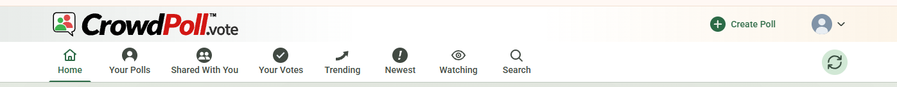
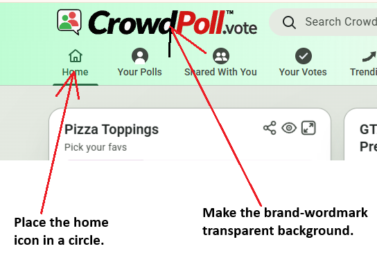
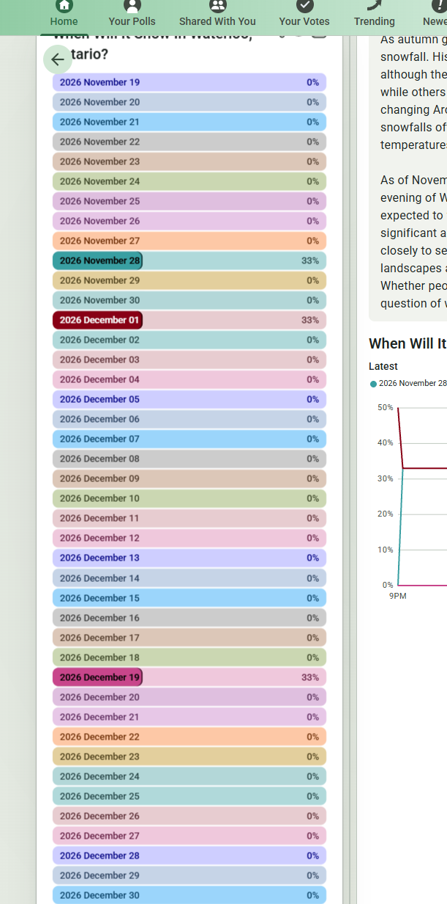
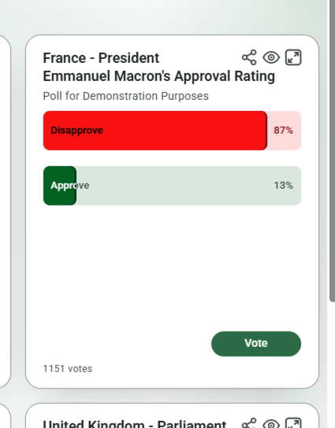
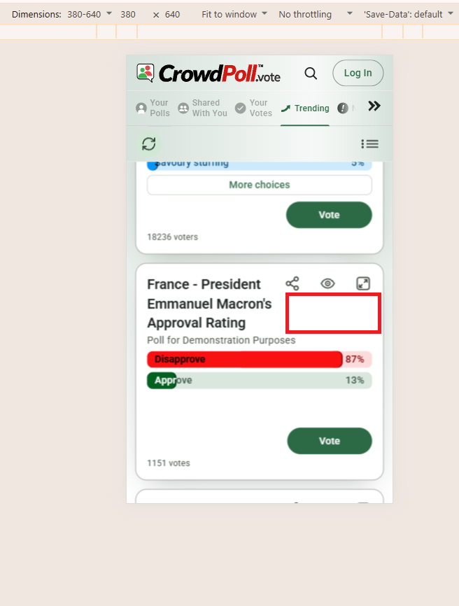
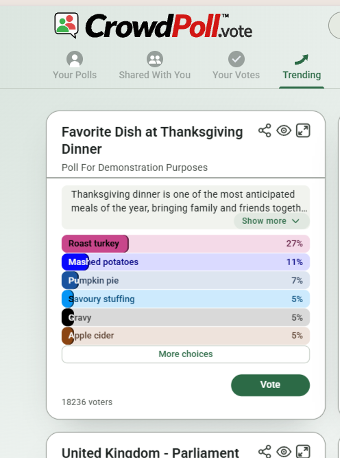
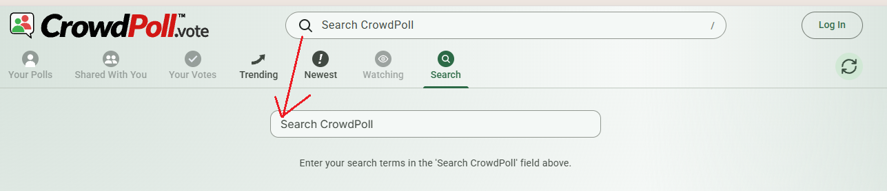
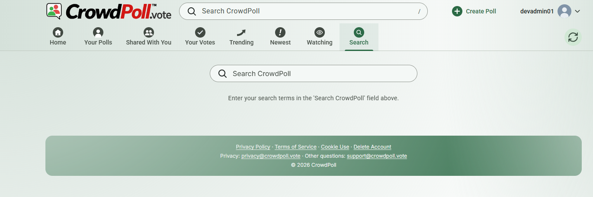
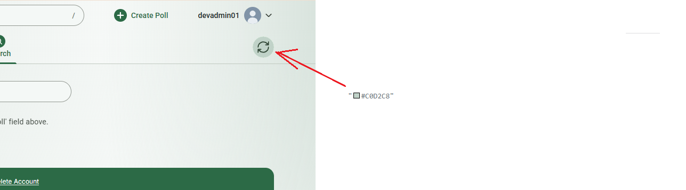
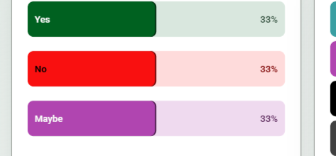

# Overview: `specs/20261120-175903-COLOR-CONTRAST`

## Document History

| Record | Value |
|---|---|
| Feature directory | `specs/20261120-175903-COLOR-CONTRAST` |
| Tweak file created | 2026-11-21 01:05 |
| Last updated | 2026-11-24 09:32 |

Legend: `[ ]` open · `[X]` Resolved · `[-]` Resolved (manually)  
(or accepted as-is) by the developer.
Tick `Run Tests` to have this tweak's automated tests written and run; leave it empty (the default) to postpone the run.

"Next" always returns the first `[ ]` item below.

The developer is expected to create the individual tweak requirements in this file, and then run the `/speckit-tweak` command to have the AI implement them, one at a time.  
Each tweak requirement initially carries an empty checkbox; tick it when the item is resolved or consciously accepted.  


# Tweaks

## TWEAK01 Snapshot Each Tweak For Comparison  
[X] Resolved  

**Trial and Error with no intermediate tests**  
This feature is going to require many iterating through many tweaks of trial-and-error with color adjustments and may even redesigning soem UI controls and placement.  
As we do this T&E process will postpone the tests until we deem the feature complete.  
There is no point runn ing tests on something that may change.  
Lately, the time spent on tests is growing significantly.  
Before running any tests, asks the developer. We will soon put this principal in the constitution.md file.  

----------------------------------------

To help with comparing the appearance of TweakN with the previous TweakN-1,  
implement a way to select a Tweak by number (n) so that the developer can easily switch between different iterations for comparison.  
It can be done with switches in the code, but that cold get confusing.  
Or it could be done using commits to record a specific Tweak iteration.  
In this case the commits could be pushed to a remote repository, allowing the agent to easily switch between different Tweak iterations by checking out the corresponding commit that the developer has requrested.  
But those are just ideas we had.  
It is definitely better if you pursue whichever method you feel is the best overall.  

Before we start the iterating, we can record the current state as TWEAK01. It is the result of the /speckit-implement skill applied to the current feature state.  

### RECOMMENDATION

Record each iteration as a git commit with a tag, and look at any two side by side in two local servers.  
No switches in the code.  

- **`devScripts/tweak.ps1 save <n>`**: commits the whole working tree on `color-scheme` as `TWEAK<nn>: <title>` and tags it `color-contrast-TWEAK<nn>` (local tag; pushing is left to the developer).  
- **`devScripts/tweak.ps1 show <n> [-Port 8081]`**: checks the tag out into its own worktree `C:\crowdPoll\color-scheme-TWEAK<nn>` (detached, read-only use), links `node_modules` to this one, copies the local `launch-dev.ps1` with the port changed, and starts that copy.  
  The current iteration keeps running on 8080 and the chosen one opens on 8081, against the same development database.  
  The sign-in cookie is per host, not per port, so both are signed in.  
- **`devScripts/tweak.ps1 list`** and **`stop <n>`**: list the saved iterations; remove a worktree when done.  
- `.gitignore` gains `!devScripts/tweak.ps1`.  
- TWEAK01 is recorded with `save 1` once this tweak is applied: the state `/speckit-implement` delivered, plus this script.  

Tests: none; a dev script for the developer's eyes has nothing the suite observes, and the tweak asks that no test run without asking.  
Artifacts: `quickstart.md` gains a short "Comparing tweak iterations" section;  
no spec, plan or task change, since nothing the site does changes.  

2026-11-22 00:13

### ACCEPTED RECOMMENDATION

- `devScripts/tweak.ps1` (new): `save <n> "<title>"`, `list`, `show <n> [-Port 8081]`, `stop <n>`, as recommended;  
  tags are `color-contrast-TWEAK<nn>` (`-Prefix` changes it for a later feature).  
- `.gitignore`: `!devScripts/tweak.ps1`.  
- `quickstart.md`: new section "Comparing tweak iterations".  
- TWEAK01 recorded: one commit of the state `/speckit-implement` delivered plus this script, tagged `color-contrast-TWEAK01`.  
  Nothing was pushed.  

Tests: none written, since a developer script has nothing the suite observes;  
none run, as this tweak asks (no `Run Tests` line).  
The script was checked by the PowerShell parser (0 errors) and `list` ran;  
`show` and `stop` are unverified until first used.  
This tweak had no resolution checkbox line, so `[X] Resolved` was added under its heading.  

2026-11-22 00:14

## TWEAK02 Card Lifts On Hover And Touch  
[X] Resolved  
[ ] Run Tests  

To help Poll Card visibility and contrast, there will be an animation that makes it appear the card is elevating slightly, with a handler for:  

Desktop	 
- Mouse enters card → card elevates slightly	    
- Mouse leaves card → card returns to normal

Mobile
- Finger touches card → card elevates slightly
- Finger releases → card returns to normal

### RECOMMENDATION

Lift a grid card (never the maximized one) with one class, set by pointer handlers in `initPollCard` (`src/public/pollCard.js`):  

- a mouse: `pointerenter` adds `is-lifted` to the card's `.card-viewport`, `pointerleave` removes it;  
- a finger or pen: `pointerdown` adds it, `pointerup` and `pointercancel` remove it, so a card the finger starts scrolling drops back at once.  

`src/public/pollCard-m3.css`:  

- `.card-viewport:not(.maximized-card-viewport).is-lifted{ top:-4px; }` (the viewport is already `position:relative`;  
  `top` rather than a transform, so nothing inside the card gets a new containing block);  
- its faces take `box-shadow:var(--md-sys-elevation-3)`;  
  in Dark, where a shadow does not show on the near-black page, the face's border also takes `--md-sys-color-outline`;  
- `transition:top 0.15s ease, box-shadow 0.15s ease`, none under `prefers-reduced-motion: reduce` (the lift itself stays).  

Tests (written, not run): in `tests/client-maximized.test.ts`, a grid card gains `is-lifted` on a mouse `pointerenter` and loses it on `pointerleave`;  
gains it on a touch `pointerdown` and loses it on `pointerup` and on `pointercancel`;  
a maximized card never gains it.  
Artifacts: `COLOR-CONTRAST.md` Techniques gains "a lifted card on hover or touch";  
`tasks.md` gains a Polish task for this tweak.  

2026-11-22 01:54


### ACCEPTED RECOMMENDATION

Applied as recommended.  

- `src/public/pollCard.js` (`initPollCard`, "Lift"): pointer handlers toggle `is-lifted` on the card's `.card-viewport`;  
  a mouse lifts it on enter and drops it on leave;  
  a finger or pen lifts it on press and drops it on release or cancel;  
  a maximized card never lifts.  
- `src/public/pollCard-m3.css` (end of file): `top:-4px`, `box-shadow:var(--md-sys-elevation-3)`, the `outline` border in Dark, 0.15s transitions, none under reduced motion.  
- `tests/client-maximized.test.ts`: new block "a grid card lifts while pointed at or pressed", 4 tests (mouse, touch with release and cancel, maximized card, the CSS rules).  
  Tests postponed (Run Tests not ticked);  
  the 4 tests were written and not run, so the tweak is unverified by a run.  
  `npx tsc --noEmit` passes.  
- Artifacts: `COLOR-CONTRAST.md` Techniques item 6;  
  `tasks.md` T038 added.  

2026-11-22 01:55

## TWEAK03 Blue Border Grows With A Glow  
[X] Resolved  
[ ] Run Tests  
As a followup to TWEAK03, 
add the animation that is implemented in the file "specs\20261120-175903-COLOR-CONTRAST\poll-card-hover-demo-full-border-grow.html".
On a Poll Card it is a blue border that grows up to 4 pixkels and the line has a "glow". 

### RECOMMENDATION

Read as a follow-up to TWEAK02 (the lift), since this is TWEAK03.  
Play the demo's border animation whenever a grid card is lifted (`is-lifted`, so mouse and touch alike), on top of the 4 px lift.  

- `src/public/m3-tokens.css`: two new aliases in both scheme blocks, `--card-lift-edge:#2178F5` and `--card-lift-glow:#55A6FF` (the demo's blues);  
  `#2178F5` is 4.1:1 on the Light card and 4.0:1 on the Dark one.  
- `src/public/pollCard-m3.css`: a `::after` on each `.card-face` (the faces are already transformed, so it is placed on the face and turns with it), `inset:-1px` over the card's own border, `border-radius:20px`, no pointer events;  
  on a lifted card it runs `cardEdgeGrow` 1.1s ease-out once: the edge goes from 1 px to 4 px by 70%, holds, and fades by 100%, with a `--card-lift-glow` box-shadow growing from 4 px to 12 px blur and fading with it, as in the demo;  
  under reduced motion, no animation: a steady 4 px edge with a faint glow while lifted.  
- The demo uses an SVG rectangle resized by script;  
  a pseudo-element with a border and a box-shadow draws the same rounded edge with no script or resize observer.  
- All cards animate, open or closed (the demo animates only open ones), as all cards lift in TWEAK02.  

Tests (written, not run): `tests/client-maximized.test.ts` checks the `::after` rule, the keyframes' 1 px and 4 px widths and the reduced-motion rule;  
`COLOR-CONTRAST.md` gains the Required pair `--card-lift-edge` on `--paper-raised` ≥ 3 in both schemes, which `tests/color-contrast.test.ts` then checks.  
Artifacts: `COLOR-CONTRAST.md` Techniques item 6 and its Change log;  
`tasks.md` T039.  

2026-11-22 02:41


### ACCEPTED RECOMMENDATION

Applied as recommended.  

- `src/public/m3-tokens.css`: `--card-lift-edge:#2178F5` and `--card-lift-glow:#55A6FF` in the Light and Dark alias blocks.  
- `src/public/pollCard-m3.css` (end of file): `.card-viewport .card-face::after` and `@keyframes cardEdgeGrow` (1 px → 4 px by 70%, held, faded by 100%, with a glow growing to 12 px);  
  it runs once each time a grid card lifts;  
  under reduced motion, a steady 4 px edge and faint glow while lifted.  
- `tests/client-maximized.test.ts`: new block "a lifted card's edge grows with a glow", 3 tests.  
  `COLOR-CONTRAST.md`: new Required pair `--card-lift-edge` on `--paper-raised` ≥ 3, both schemes, which adds 2 checks to `tests/color-contrast.test.ts`.  
  Tests postponed (Run Tests not ticked);  
  all were written and not run, so the tweak is unverified by a run.  
  `npx tsc --noEmit` passes.  
- Artifacts: `COLOR-CONTRAST.md` (Required pair, Techniques item 6, Change log row);  
  `tasks.md` T039 added.  

2026-11-22 02:42

## TWEAK04 Border Steps Down After Growing  
[X] Resolved  
[ ] Run Tests  
This new HTML file:
"specs\20261120-175903-COLOR-CONTRAST\poll-card-hover-demo-step-down.html"  
has an update where the line thickness goes from 4,3,2,1,0 after it reaches the max width of 4.

### RECOMMENDATION

Take the new demo's timing and keyframes into `cardEdgeGrow` (`src/public/pollCard-m3.css`), replacing TWEAK03's:  

- 1.5s `ease-in-out` (was 1.1s `ease-out`);  
- the edge grows from 1 px to 4 px by 40%, holds to 55%, then steps to 3 px (55%–69%), 2 px (69%–83%) and 1 px (83%–97%), and disappears by 100%;  
- the glow follows the steps: 12 px at 50% strength, then 10 px at 42%, 7 px at 32% and 4 px at 18%, and fades with the edge.  

The steps are hard (each width starts at the demo's `.01%` keyframe), as in the demo.  
Reduced motion is unchanged: a steady 4 px edge while lifted.  

Tests (written, not run): `tests/client-maximized.test.ts`, the keyframe test now expects 1.5s `ease-in-out`, 4 px at 40% and 55%, 3 px at 55.01%, 2 px at 69.01%, 1 px at 83.01% and `opacity:0` at 100%.  
Artifacts: `COLOR-CONTRAST.md` Techniques item 6 (the steps);  
`tasks.md` T040.  

2026-11-22 02:48


### ACCEPTED RECOMMENDATION

Applied as recommended.  

- `src/public/pollCard-m3.css`: `cardEdgeGrow` now runs 1.5s `ease-in-out`;  
  4 px at 40%–55%, then hard steps to 3 px, 2 px and 1 px, gone at 100%;  
  the glow steps down with it (12/10/7/4 px at 50/42/32/18%).  
  Reduced motion unchanged.  
- `tests/client-maximized.test.ts`: the keyframe test now expects 1.5s `ease-in-out` and the 4, 3, 2 and 1 px steps.  
  Tests postponed (Run Tests not ticked);  
  the updated test was not run, so the tweak is unverified by a run.  
  `npx tsc --noEmit` passes.  
- Artifacts: `COLOR-CONTRAST.md` Techniques item 6;  
  `tasks.md` T040 added.  

2026-11-22 02:49

## TWEAK05 Closed Poll Card Comes Into View And Lifts  
[X] Resolved  
[ ] Run Tests  
When a Poll is in Maximized view and the user clicks  
and button or icon that brings htme back to a Home Page tab that has the the same Poll on it,  
the card will be scrolled into view and the Poll Card animation will play for that Poll.


### RECOMMENDATION

- **Recommendation**: when a maximized poll goes back to its tab's grid, bring its card into view and replay the lift.  
  - Which closes: every one that returns to the same tab, all through `restore` in `src/public/tabs.js`: the card's Minimize icon, the back arrow, Escape, the browser's Back, and choosing the tab that is already showing.  
    Choosing a different tab is not included: that tab's grid loads its own list later, and the card there is another card.  
  - Into view: after the page goes back to where it was, the card is scrolled only as far as needed to show it whole (`scrollIntoView({ block: "nearest" })`), below the fixed header and tab bar (`scroll-margin-top` on `.card-viewport` in `src/public/pollCard-m3.css`).  
    It matters most for a linked or kept card, which returns first in the grid, away from where the page was.  
  - The animation: a new `replayLift()` on the card (`src/public/pollCard.js`) lifts it and restarts the blue edge, then drops it after 1.5 s, when the edge has gone, unless a mouse is over it.  
    Under reduced motion the card lifts with its steady 4 px edge for those 1.5 s.  
  - Tests in `tests/client-maximized.test.ts`: the Minimize icon and the back arrow each bring the card into view and lift it, it drops after 1.5 s, and choosing another tab does neither; written, not run.  
  - Artifacts: `COLOR-CONTRAST.md` Techniques item 6 and `tasks.md` T041.  

### ACCEPTED RECOMMENDATION

Accepted automatically 2026-11-22 09:25 (the only recommendation).  

- `src/public/pollCard.js`: `replayLift()` lifts the card and restarts its edge, then drops it after 1.5 s unless a mouse is over it;
  it is on the card's API.  
- `src/public/tabs.js`: `restore`, when the card returns to its own tab's grid, calls `revealCard` (`scrollIntoView({ block: "nearest" })`) and `replayLift()` before focusing the card;
  a quiet close (another tab chosen, a sign-in change) does neither.  
- `src/public/pollCard-m3.css`: `.card-viewport` takes `scroll-margin-top:calc(var(--fixed-chrome-height, 0px) + 8px)`, so a revealed card sits below the fixed header.  
- `tests/client-maximized.test.ts`: new describe "a card closed from the maximized view comes into view and lifts", 5 tests;
  written, not run (Run Tests not ticked); `npx tsc --noEmit` passes.  
- `COLOR-CONTRAST.md` Techniques item 6 and `tasks.md` T041 updated.  

## TWEAK06 Describe The Background Gradient  
[X] Resolved  
[ ] Run Tests  
Please describe the gradient that is used on the background of the site from left to right edge.  
What variables do we have to work with for customizing the gradient?  


### RECOMMENDATION

The background is not a left-to-right gradient.  
It is the flat page colour `--paper` with two faint radial glows over it, drawn by `.page-decor` (`src/public/tabs.css` lines 33–38; a copy for the card demo page is in `src/public/pollCard.css`).  
`.page-decor` is `position:fixed`, so the glows stay put while the page scrolls.  

- **Glow 1, top left**: `radial-gradient(600px 400px at 12% 8%, rgba(61,90,70,0.06), transparent 60%)`.  
  - Moss green `#3D5A46` at 6% opacity, centred 12% from the left edge and 8% from the top.  
  - It fades to nothing 360 px to each side of that centre and 240 px above and below it.  
- **Glow 2, bottom right**: `radial-gradient(500px 380px at 90% 95%, rgba(232,163,61,0.08), transparent 60%)`.  
  - Amber `#E8A33D` at 8% opacity, centred 90% from the left edge and 95% from the top.  
  - It fades to nothing 300 px to each side and 228 px above and below.  
- **Left to right**: a faint green tint near the top left, plain `--paper` across the middle, and a faint amber tint near the bottom right.  
  The fixed header and tab bar are painted flat `--paper` (`header-fixed-m3.css`), so they cover the top of the green glow.  
- **Dark**: the same two rules apply; on the near-black `--paper` (`#0A0E0B`) at 6% and 8% they are close to invisible.  

**Variables to work with**:  
only `--paper`, the base colour, set per scheme in the alias blocks of `src/public/m3-tokens.css` (`#E5EAE2` Light, `#0A0E0B` Dark).  
The glows' colours, strengths, sizes and positions are literal values; there are no custom properties for them.  

- **Recommendation**: leave the code as it is; this tweak is a question, answered above.  
  To make the gradient adjustable, add a tweak asking for it.  
  For example, give it variables such as `--page-glow-1`, `--page-glow-2` and their strengths, set per scheme in `m3-tokens.css`.  

### ACCEPTED RECOMMENDATION

Accepted by "Tweak" 2026-11-22 10:50.  
Taken as the variables the recommendation offered, rather than leaving the code as it is, since "Tweak" asks for an implementation.  
Today's values are kept, so the page looks the same.  

- `src/public/m3-tokens.css`:
  - in both alias blocks, 
`--page-glow-1-color:#3D5A46`
`--page-glow-1-strength:6%`
`--page-glow-2-color:#E8A33D`
`--page-glow-2-strength:8%`
    change these per scheme;  
  
  - in a shared `:root`, 
`--page-glow-1-size:600px 400px`
`--page-glow-1-at:12% 8%`
`--page-glow-2-size:500px 380px`
`--page-glow-2-at:90% 95%`

  - `:root .page-decor` 
  draws the two radial gradients from them 
  (`color-mix` for the strength).  

It needs `:root` to beat the legacy 
`.page-decor` in `tabs.css`, 
which loads after 
`m3-tokens.css` 
and is left unedited.  

- `tests/m3-assets.test.ts`: 
one test for the tokens in both schemes and the rule;
written, not run (Run Tests not ticked); `npx tsc --noEmit` passes.  

- `COLOR-CONTRAST.md`: Techniques item 7 and a Change log row; `tasks.md` T042.  

## TWEAK07 Header And Tab Bar Colour Levers  
[X] Resolved  
[ ] Run Tests  
We are using the implementation from TWEAK06 to experiment with the background. 
Thanks
Can you offer similar "buttons a levers" to experiment wiith the colors in the header of the Home page, including the Tab Bar?


### RECOMMENDATION

- **Recommendation**: give the header and the Tab Bar their own colour tokens, the same way TWEAK06 did for the background.  
  - Each token is set in both alias blocks of `src/public/m3-tokens.css`, 
  so Light and Dark can be tuned apart.  
    Each starts as today's colour (a `var()` to the role it uses now), so nothing changes until a value is edited.  
  - Header: 
`--header-background`, 
`--header-divider` (the line under the header on pages without a Tab Bar), 
`--header-text` (search icon, typed search text, the user's name), 
`--header-link` (the nav link and the outlined button), 
`--header-button` / `--on-header-button` (the filled button) and 
`--header-search-background`.  

   - Tab Bar: 
`--tab-bar-background`, 
`--tab-bar-divider`, 
`--tab-text`, 
`--tab-active-text`, 
`--tab-indicator`, 
`--tab-refresh-background` and 
`--tab-refresh-icon`.  

- Wired in 
`src/public/header-fixed-m3.css` and 
`src/public/header-tab-bar-m3.css`.  
    The header applies to every page, so the header tokens change it everywhere; the Tab Bar is on Home only.  
  - Colours only (`#RRGGBB` or a `var()`), so `tests/color-contrast.test.ts` can keep checking them.  
    The two Tab Bar rows of `COLOR-CONTRAST.md` 
move to the new tokens (
    `--tab-text` and 
    `--tab-active-text` 
on 
    `--tab-bar-background`  ), 
and a `--header-text` row is added.  

  - The tests that pin today's declarations (`tests/header-fixed-sheet.test.ts`, `tests/phone-sheets.test.ts`) follow, and a new one checks the tokens in both schemes; written, not run.  

### ACCEPTED RECOMMENDATION

Accepted automatically 2026-11-23 04:29 (the only recommendation).  
Every token starts as the role it replaced, so the header and Tab Bar look the same until a value is edited.  

- `src/public/m3-tokens.css`: the fourteen `--header-*` and `--tab-*` tokens in both alias blocks, after the page-glow tokens, each with a comment naming what it colours.  
- `src/public/header-fixed-m3.css`: the header and the Tab Bar each paint their own background (`--header-background`, `--tab-bar-background`), out to both edges;
  the line under the header takes `--header-divider`, and the strip under the Tab Bar on narrow screens takes `--tab-bar-background`.  
- `src/public/header-tab-bar-m3.css`: tabs, underline, divider, Refresh button, search field, search icon and text, nav link, both header buttons and the user's name read the tokens;
  a tab icon's inner fill takes `--tab-bar-background` in the Tab Bar only.  
- `src/public/single-column-m3.css`: the narrow-screen tab menu button takes `--tab-text`.  
- The maximized card's extras tabs keep their own roles: they sit on the card, not the Tab Bar.  
- `COLOR-CONTRAST.md`: the two Tab Bar Required pairs now name the tokens, with rows added for the underline and the header's text, link and filled button;
  Techniques item 8 and a Change log row.  
- Tests: one new in `tests/m3-assets.test.ts`;
  `tests/header-fixed-sheet.test.ts` and `tests/phone-sheets.test.ts` now expect the tokens;
  written, not run (Run Tests not ticked); `npx tsc --noEmit` passes.  
- `tasks.md` T043.  

## TWEAK08 Two Horizontal Header Glows  
[X] Resolved  
[ ] Run Tests  
We want to add 2 horizontal linear gradients to the header.

The levers and knows should be:

--header-glow-left-size
--header-glow-left-at
--header-glow-left-color
--header-glow-left-strength

--header-glow-right-size
--header-glow-right-at
--header-glow-right-color
--header-glow-right-strength

### RECOMMENDATION

- **Recommendation**: paint two horizontal glows over the header's background, one from each edge of the window, drawn from the eight tokens named.  
  - Per scheme, in both alias blocks of `src/public/m3-tokens.css`:
`--header-glow-left-color`, `--header-glow-left-strength`, `--header-glow-right-color`, `--header-glow-right-strength`, as the page glows do.  
  - Shared, in the `:root` block beside the page-glow sizes:
`--header-glow-left-at`, `--header-glow-left-size`, `--header-glow-right-at`, `--header-glow-right-size`.  
  - Each glow is a `linear-gradient` running inward from its own edge:
full strength from that edge to `at`, then fading to nothing over `size` (both lengths or percentages of the window's width).  
    `strength` is how much of `color` is mixed in (`color-mix`, as the page glows do);
`0%` turns that glow off.  
  - Starting values: moss on the left and amber on the right, as the page glows, at `0%` and fading over `40%`, `12%` strong in Light and `10%` in Dark.  
- Drawn in `src/public/header-fixed-m3.css` by a `#site-header::before` layer the width of the window, beneath the header's content and above its background, so `--header-background` still sets the colour under it.  
  - It ignores the pointer, and it is in the header only, not the Tab Bar.  
  - It is decoration, not a Required pair: `--header-text` and the others are still checked against `--header-background`.  
- A new test in `tests/m3-assets.test.ts` checks the tokens in both schemes and the rule;
written, not run.  

### ACCEPTED RECOMMENDATION

Accepted automatically 2026-11-23 11:45 (the only recommendation).  

- `src/public/m3-tokens.css`: `--header-glow-left-color`, `-strength` and `--header-glow-right-color`, `-strength` in both alias blocks (Light moss `#3D5A46` and amber `#E8A33D` at 12%;
  Dark `#94D5A8` and `#FFB956` at 10%);
  `--header-glow-left-at`, `-size` and `--header-glow-right-at`, `-size` (`0%`, `40%`) in the shared `:root` block beside the page-glow sizes, each with a comment.  
- `src/public/header-fixed-m3.css`: `#site-header::before`, the width of the window, beneath the header's content and above `--header-background`, ignoring the pointer, draws the two `linear-gradient`s.  
- The Tab Bar is untouched;
  the glows are not a Required pair.  
- `COLOR-CONTRAST.md`: Techniques item 9 and a Change log row;
  `tasks.md` T044.  
- Test: one new in `tests/m3-assets.test.ts`;
  written, not run (Run Tests not ticked);
  `npx tsc --noEmit` passes.  

## TWEAK09 Header Glows Span The Tab Bar  
[X] Resolved  
[ ] Run Tests  

In TWEAK08, we requested the linear gradients in the header.  
It was our mistake to consider the tab bar as not part of the header.  
Please make the gradient apply to the entire header, including the tab bar.  

See this screenshot to see how the tab bar does not have the gradient:

### RECOMMENDATION

- **Recommendation**: draw the same two glows over the Tab Bar, so header and Tab Bar read as one band.  
  - The header and the Tab Bar are separate fixed bars, the header above;
    a layer reaching down from the header would cover the tabs, so each bar draws the glows itself.  
    The glows run across the window's width only, so the two halves meet without a seam.  
  - Both gradients become one token, `--header-glows`, in the shared `:root` block of `src/public/m3-tokens.css`;
    the eight TWEAK08 levers are unchanged and still drive it.  
  - In `src/public/header-fixed-m3.css`: the header's layer reads `--header-glows`;
    the Tab Bar's full-width line (`.tab-bar-wrap::after`) grows to the bar's full height beneath the tabs, drawing the glows with the line on top at its foot;
    the strip under the Tab Bar on narrow screens draws them over `--tab-bar-background`.  
  - Tests in `tests/m3-assets.test.ts` and `tests/header-fixed-sheet.test.ts` follow;
    written, not run.  

### ACCEPTED RECOMMENDATION

Accepted automatically 2026-11-23 11:55 (the only recommendation).  

- `src/public/m3-tokens.css`: `--header-glows`, both gradients, after the header-glow sizes.  
- `src/public/header-fixed-m3.css`: `#site-header::before` reads `--header-glows`;
  a new `.tab-bar-wrap::after` rule (top to bottom, beneath the tabs, ignoring the pointer) draws the Tab Bar's line over the glows;
  the narrow-screen strip draws the glows over `--tab-bar-background`.  
- Tests: `tests/m3-assets.test.ts` (the TWEAK08 test now follows the glows through the Tab Bar);
  `tests/header-fixed-sheet.test.ts` (a new test for the two layers, the strip's background, and two assertions left behind by TWEAK07 brought up to date);
  written, not run (Run Tests not ticked);
  `npx tsc --noEmit` passes.  
- `COLOR-CONTRAST.md` Techniques item 9;
  `tasks.md` T045.  

## TWEAK10 Header Search Field Missing  
[X] Resolved  
[ ] Run Tests  

We just noticed that the Search field in the header no longer appears.  


### RECOMMENDATION

- **Recommendation**: keep the header's glow layer inside the header's measured width.  
  - Cause: `src/public/headerFit.js` hides the Search field (`data-header-fit="no-search"`) whenever the header's `scrollWidth` exceeds its `clientWidth`.  
    TWEAK08's glow layer, `#site-header::before`, was absolutely positioned and `100vw` wide, wider than the header's column, so every header measured as overflowing.  
  - Fix, in `src/public/header-fixed-m3.css`: the layer becomes `position:fixed`, from the window's left edge to its right, as tall as the header (`--fixed-chrome-height-header`, which `fixedChrome.js` sets on every page).  
    A fixed layer belongs to the window, so it no longer adds to the header's scroll width;
    it is drawn exactly as before, beneath the header's content.  
  - `headerFit.js` is unchanged.  
  - Tests in `tests/header-fixed-sheet.test.ts` and `tests/m3-assets.test.ts` follow;
    written, not run.  

### ACCEPTED RECOMMENDATION

Accepted automatically 2026-11-23 12:07 (the only recommendation).  

- `src/public/header-fixed-m3.css`: `#site-header::before` is `position:fixed; top:0; left:0; right:0; height:var(--fixed-chrome-height-header,0px)`, replacing `left:50%; width:100vw; transform`.  
- Tests: `tests/header-fixed-sheet.test.ts` pins the new rule and adds a test that the layer stays fixed and never `100vw` wide;
  `tests/m3-assets.test.ts` expects `position:fixed`;
  written, not run (Run Tests not ticked);
  `npx tsc --noEmit` passes.  
- `COLOR-CONTRAST.md` Techniques item 9;
  `tasks.md` T046.  

## TWEAK11 Transparent Wordmark And Circled Tab Icons  
[X] Resolved  
[ ] Run Tests  

Make the brand-wordmark in the header have a transparent background.  

Tweak the Home icon inthe tab bar so that it is in a circle, just like most of the other icons in the tab bar.  

The other two icons that aren't in a circle are the "watching" and "search" icons.  
Please place them in a circle as well.



### RECOMMENDATION

- **Recommendation**: hide the wordmark's white ground with one CSS rule, and draw the three icons in the same circle as the others.  
  - Wordmark: the logo SVG in `src/public/app.js` is a trace whose letters already have their holes cut out;
    a white shape behind them and white shapes over the holes paint the ground.  
    The Dark scheme already makes those light fills transparent;
    a new rule in `src/public/header-tab-bar-m3.css` does the same for `.brand-wordmark` in both schemes, so the header's background and glows show through.  
    The SVG itself, and the square logo beside it, are unchanged.  
  - Icons, in `src/public/index.html`: Home, Watching and Search each get the `#8093a7` disc the other tab icons use (drawn in the tab's text colour), with their own glyph scaled to about 60% inside it.  
    The glyph is drawn in `color="#e8edf2"`, which new rules map to `--tab-bar-background` in the Tab Bar (and `--paper` elsewhere), as the other icons' light fills are;
    the Watching eye is still the shared `#watching-eye` symbol, so the cards' eye is unchanged.  
  - Trending's arrow is the only tab icon left without a circle (not named in this tweak).  
  - Tests in `tests/tab-bar-assets.test.ts`;
    written, not run.  

### ACCEPTED RECOMMENDATION

Accepted automatically 2026-11-23 12:18 (the only recommendation).  

- `src/public/header-tab-bar-m3.css`: `.brand-wordmark`'s six light fills are `transparent`;
  `[color="#e8edf2"]` maps to `--paper`, and to `--tab-bar-background` in the Tab Bar;
  the section 8 comment names the change.  
- `src/public/index.html`: the Home, Watching and Search icons are each a `#8093a7` circle with the glyph in a scaled group (Home and Search strokes 2.6 before scaling, the eye at 66%).  
- Tests: two new in `tests/tab-bar-assets.test.ts`;
  the existing Search and Watching tests still hold (same glass parts, `stroke="currentColor"`, `#watching-eye`);
  written, not run (Run Tests not ticked);
  `npx tsc --noEmit` passes.  
- `COLOR-CONTRAST.md` Techniques item 8;
  `tasks.md` T047.  

## TWEAK12 Solid Larger Home House  
[X] Resolved  
[ ] Run Tests  
A further change to the Home icon.  
Please make the "Housee" solid white. And make the House 25% larger within the circle.


### RECOMMENDATION

- **Recommendation**: redraw the Home icon's house as one solid shape, 25% larger, in `src/public/index.html`.  
  - The outline strokes become a single filled house (roof and walls) with the door cut through, so the circle shows in the doorway.  
  - Scale goes from `0.6` to `0.75` of the circle (25% larger);
    the house's corners stay inside the circle.  
  - "White" is the circle icons' light colour, `#e8edf2` in the markup, which the Tab Bar draws in `--tab-bar-background` (white in Light today), as the other icons' glyphs are;
    in Dark it is the dark Tab Bar colour, like theirs.  
  - The test in `tests/tab-bar-assets.test.ts` follows;
    written, not run.  

### ACCEPTED RECOMMENDATION

Accepted automatically 2026-11-23 12:28 (the only recommendation).  

- `src/public/index.html`: the Home icon's glyph is `<path fill-rule="evenodd" d="M12 3 21 10.5H19V20H5V10.5H3ZM10 20V14H14V20Z">`, filled and edged (`stroke-width` 1, round joins) in `currentColor` from `color="#e8edf2"`, at `scale(0.75)`.  
- `tests/tab-bar-assets.test.ts`: the circled-icons test checks the solid house and its scale;
  written, not run (Run Tests not ticked);
  `npx tsc --noEmit` passes.  
- `tasks.md` T048.  

## TWEAK13 Search Fields Bordered Like Cards  
[X] Resolved  
[ ] Run Tests  

Add a border to the Search field, both in the header and in the Search tab. 
Make the border the same a that on the Poll Card on the Home page.   

### RECOMMENDATION

- **Recommendation**: give both Search fields the poll card's border, `1px solid var(--line)`.  
  - A card's border is `1px solid var(--line)` (`.card-face` in `src/public/pollCard.css`);
    `--line` is set per scheme in `src/public/m3-tokens.css` (`#A3ABA2` Light, `#4A524B` Dark), so the fields follow it in both schemes and with any later change to it.  
  - Header: `.header-search` in `src/public/header-tab-bar-m3.css` has `border:0`, focused or not;
    both become `1px solid var(--line)`.  
    Its height stays 40px (`border-box`).  
  - Search tab: `.search-tab-form` in `src/public/single-column-m3.css` has `1px solid var(--md-sys-color-outline-variant)`;
    it becomes `var(--line)`.  
  - Each keeps its own shape (the header's pill, the tab's rounded field);
    only the border matches.  
  - A test in `tests/m3-assets.test.ts`;
    written, not run.  

### ACCEPTED RECOMMENDATION

Accepted automatically 2026-11-23 12:33 (the only recommendation).  

- `src/public/header-tab-bar-m3.css`: `.header-search, .header-search:focus-within` take `border:1px solid var(--line)`.  
- `src/public/single-column-m3.css`: `.search-tab-form` takes `border:1px solid var(--line)`.  
- `tests/m3-assets.test.ts`: one new test that both fields carry the card's border;
  written, not run (Run Tests not ticked);
  `npx tsc --noEmit` passes.  
- `COLOR-CONTRAST.md` Techniques item 8;
  `tasks.md` T049.  

## TWEAK14 Bar Track Colour Relative To Its Fill  
[X] Resolved  
[ ] Run Tests  

Regarding the background color of a bar on the Poll Card:  
is there CSS percentage value that defines the background color relative to the foreground color?

### RECOMMENDATION

**Answer**: no, not in CSS.  
The track (the bar's background) is worked out in `src/public/pollCard.js` and handed to the CSS as a finished colour.  

- `trackOn()` mixes the bar's fill colour into the card colour (`#FFFFFF` in Light, `#1C211D` in Dark).  
  - It starts at 90% card and 10% fill in Light (`RESULTS_TRACK_TINT = 0.9`), and 80% card and 20% fill in Dark (`RESULTS_DARK_TRACK_TINT = 0.8`).  
  - If that track does not stand 1.5:1 apart from the card (`RESULTS_TRACK_TARGET_CONTRAST`), it takes 5% less card (`RESULTS_TRACK_TINT_STEP`) and tries again, until it does.  
- The result is set on each row as `--bar-track` and `--bar-track-dark`;
  `src/public/pollCard-m3.css` only uses it (`.result-row{ background:var(--bar-track, var(--track)); }`).  
- So the percentage lives in those two JavaScript constants, as a maximum share of card colour, and the 1.5:1 rule can lower it per colour.  

- **Recommendation** (only if you want a lever, as for the background and header): add two tokens to `src/public/m3-tokens.css`, `--bar-track-tint` per scheme (`90%` Light, `80%` Dark), which `pollCard.js` reads as its starting share of card colour in place of the two constants.  
  - The 1.5:1 rule stays, so a track never fades into the card;
    lowering the value makes every track deeper.  
  - Tests in `tests/client-*` and `tests/color-contrast.test.ts` follow;
    written, not run.  

Type or Say "Tweak" to add the lever;
"I resolved it" (or "Accept as-is") to close this tweak with the answer only.  

### ACCEPTED RECOMMENDATION

Accepted by "Tweak" 2026-11-23 12:46 (the lever).  
Light and Dark are set as two tokens in the shared `:root`, not one per scheme, because `pollCard.js` works out both schemes' bar colours together, once, when the page loads.  

- `src/public/m3-tokens.css`: 

`--bar-track-tint:90%` (Light) and 
`--bar-track-tint-dark:80%` (Dark), 
after the header-glow sizes, with a comment.   

- `src/public/pollCard.js`: `trackTintFromCss()` reads them as the most card colour a track may hold;
  a missing or out-of-range value falls back to `RESULTS_TRACK_TINT` / `RESULTS_DARK_TRACK_TINT`, unchanged;
  `barTrackTints()` reports what was read.  
  - The 1.5:1 rule still lowers the share per colour, 5% at a time.  
  - The value is read once per page load: edit the file and reload, a live change in the browser's tools is not picked up.  
- `tests/color-contrast.test.ts`: the bars are derived with the tokens' values (and the test stops if `pollCard.js` did not read them), so a lower or higher tint is checked for every colour, track 1.5:1 and its text 7:1;
  written, not run (Run Tests not ticked);
  `npx tsc --noEmit` passes.  
- The client suites load no tokens, so they keep the default 90% and 80% they expect.  
- `COLOR-CONTRAST.md` Result colours, Track;
  `tasks.md` T050.  

## TWEAK15 Bar Fill Stands Out From Its Track  
[X] Resolved  
[ ] Run Tests  

A further clarification to the previous TWEAK14...
The issue is that the color of bars that have 0%, and the right portion of a bar that has a bar greater than 0%,  
isn't different enought from the main bar color,   
so that it isn't visually obvious which bars have a vote percentage.  
Particuilarly when the poll has many bars.  

See this screenshot for an example:  


What would I tweak to try to get the main bar color to stand out more?
### RECOMMENDATION

**Why TWEAK14's lever does not help here**: the track is as pale as `--bar-track-tint` allows only while it still stands 1.5:1 from the card (`RESULTS_TRACK_TARGET_CONTRAST` in `src/public/pollCard.js`, a house rule in `COLOR-CONTRAST.md`).  
For all 14 palette colours that 1.5:1 floor is what decides the track: computed at 90%, 95% and 100% the tracks are identical (e.g. `#0695F5` → `#9BD5FB`, `#000000` → `#CCCCCC`).  
So the track's depth is set by the 1.5:1 rule, and raising the tint changes nothing.  
Today the fill stands only about 2:1 from its own track (lowest 2.01 in Light, 1.91 in Dark).  

- **Recommendation A** _(recommended)_: make the track's contrast with the card a lever, `--bar-track-contrast` (and `--bar-track-contrast-dark`) in `src/public/m3-tokens.css`, read once by `pollCard.js` like the tint, default `1.5`.  
  - Lower it to make tracks paler and fills stand out;
    computed for the palette in Light (fill against its own track, lowest):  
    - `1.5` → 2.01 (today), tracks like `#9BD5FB`, `#CCCCCC`;  
    - `1.3` → 2.30, tracks like `#C1E5FD`, `#D9D9D9`;  
    - `1.2` → 2.45, tracks like `#CDEAFD`, `#E6E6E6`;  
    - `1.1` → 2.74, tracks like `#E6F4FE`, `#E6E6E6`;
      at this level several tracks reach the 90% tint cap, so `--bar-track-tint` starts to matter again.  
  - Tracks keep their colour, so the card stays colourful, only paler.  
  - `COLOR-CONTRAST.md`'s house rule "1.5:1 for a bar's track against the card" becomes "the `--bar-track-contrast` value", and `tests/color-contrast.test.ts` checks each track against that value;
    the 7:1 text on the track still holds (paler tracks make it easier).  

- **Recommendation B**: one neutral track for every bar (`--track`, grey), so only the fill carries colour.  
  - A 0% bar is a plain grey row, and a voted bar's colour stands out most.  
  - The card loses the colourful rows that Techniques item 5 asks for, and a bar no longer shows its colour until it has votes.  

- **Recommendation C**: both: A's lever, plus a token to switch to B's neutral tracks, to compare them in the browser.  

Type or Say "Tweak" for A, or "Tweak B" / "Tweak C".  

### ACCEPTED RECOMMENDATION

Accepted by "Tweak A" 2026-11-23 12:57: Recommendation A, the track-contrast lever.  

- `src/public/m3-tokens.css`: `--bar-track-contrast:1.5` (Light) and `--bar-track-contrast-dark:1.5` (Dark), after the track tints, with a comment;
  a ratio above 1 and at most 3, lower for paler tracks.  
- `src/public/pollCard.js`: `trackContrastFromCss()` reads them once on load;
  a missing or out-of-range value falls back to `RESULTS_TRACK_TARGET_CONTRAST` (1.5);
  `trackOn()` takes the scheme's target;
  `barTrackTints()` also reports the two ratios.  
  - At `1.5` the bars look as before;
    try `1.3` or `1.2` and reload.  
  - Below about `1.2`, some tracks reach the `--bar-track-tint` cap (90% card in Light), so raise that too for paler still.  
- `tests/color-contrast.test.ts`: each track is checked against the token's ratio, not a fixed 1.5, and the bars are derived with both tokens' values;
  the 7:1 text on the track and the 3:1 fill are checked as before;
  written, not run (Run Tests not ticked);
  `npx tsc --noEmit` passes.  
- The client suites load no tokens, so they keep 1.5.  
- `COLOR-CONTRAST.md`: the house rule and Result colours, Track, name the lever;
  `tasks.md` T051.  

## TWEAK16 Phone Card Title Wraps Under The Icons  
[X] Resolved  
[ ] Run Tests  

Regarding the Poll Card Title and Subtitle, word wrapping:  

At 800px viewport, the title wraps correctly around the icons in the top right of the card:  
  

However,  at480 and below, the wrapping isn't correct:  
 

### RECOMMENDATION

The title keeps the icons' corner clear with an empty float (`.question::before`) one title line tall.  
On phones (640px and narrower) `phone-card-m3.css` sets that float to `height:36px`, but the phone type scale makes a title line 35px (`--md-sys-typescale-title-large-line-height`).  
The float therefore reaches 1px into the second line, so line 2 is shortened as well and the space under the icons stays empty.  

- **Recommendation**: remove `height:36px` from the phone rule `.card-face .question-row .question::before`, keeping `width:48px`.  
  The float then takes the shared rule's height, one title line (`1lh`, with its `1.27em` fallback), on phones as on wider screens, and lines 2 and 3 run under the icons.  
  - `src/public/phone-card-m3.css`: the one declaration.  
  - `tests/phone-sheets.test.ts`: a test that the phone float sets no height of its own.  
  - `tasks.md` T052 (`COLOR-CONTRAST.md` covers colours only, so it does not change).  
  - The icons' 48px tap targets still overlap the top 5px of line 2, as they overlap line 1 now; a tap there opens the icon, as before.  

### ACCEPTED RECOMMENDATION

Accepted automatically (the only recommendation) 2026-11-23 15:51.  

- `src/public/phone-card-m3.css`: the phone rule `.card-face .question-row .question::before` is now `{ width:48px; }`;
  the float takes the shared one-line height from `pollCard-m3.css`.  
- `tests/phone-sheets.test.ts`: "the card title beside the icons in the phone layout" checks the phone float sets width only, and the shared rule sets `height:1lh`.  
  Written, not run (Run Tests is empty); `npx tsc --noEmit` passes.  
- `tasks.md` T052.  

## TWEAK17 Poll Card Title Section With A Bottom Rule  
[X] Resolved  
[ ] Run Tests  

On the Poll Card on the Home Page and in Maximized view,  
render the title, subtitle and top right icons in a section of its own,  
with a 2px border on the bottom.  

As shown in this mockup:  


### RECOMMENDATION

The title, subtitle and icons are already one block in the card's markup, `.question-wrap`, on both faces of the card (results and voting), in the grid and maximized.  
So the section needs only CSS, no markup change.  

- **Recommendation**: give `.question-wrap` a bottom border of `2px solid var(--line)` (the card's own border colour, so it reads in Light and Dark), running from edge to edge of the card as in the mockup.  
  - The card face has 22px side padding (`pollCard.css`); the section takes `margin:0 -22px 12px` and `padding:0 22px 8px`, so the rule reaches both edges and nothing inside moves sideways.  
  - 8px between the subtitle and the rule, 12px between the rule and the notes or bars.  
  - Scoped to `.card-viewport:not(.card-shell-viewport)`, the Home Page and Maximized cards, as asked.  
  - The phone sheet's own `.question-wrap{ margin-bottom:6px; }` would be overridden, so it is removed.  
  - `src/public/pollCard-m3.css`, `src/public/phone-card-m3.css`, a test in `tests/m3-assets.test.ts`, `tasks.md` T053.  

### ACCEPTED RECOMMENDATION

Accepted automatically (the only recommendation) 2026-11-23 16:01.  

- `src/public/pollCard-m3.css`: `.card-viewport:not(.card-shell-viewport) .card-face .question-wrap{ margin:0 -22px 12px; padding:0 22px 8px; border-bottom:2px solid var(--line); }`.  
- `src/public/phone-card-m3.css`: `.card-face .question-wrap{ margin-bottom:6px; }` removed.  
- `tests/m3-assets.test.ts`: "closes the card's title section with a 2px rule from edge to edge, matching the face's side padding" checks the rule, the face's `18px 22px 16px` padding it matches, and that the phone sheet no longer sets `.question-wrap`.  
  Written, not run (Run Tests is empty); `npx tsc --noEmit` passes.  
- `tasks.md` T053.  

## TWEAK18 One Fill For Both Search Fields  
[X] Resolved  
[ ] Run Tests  

Currently the fill color of the Search field in the header is set to 
--header-search-background  
which ultimately comes from  
--md-sys-color-surface-container-high

Where does the color for the Search field on the Search tab come from?  
We would like both to be set by the same CSS variable so that they both change consistently when the theme changes.

### RECOMMENDATION

**Answer**: the Search tab's field is filled in `src/public/single-column-m3.css`, `.search-tab-form{ … background:var(--md-sys-color-surface); }`, the M3 role directly, with no lever of its own.  
In Light that is `--md-sys-color-surface`, not the header field's `--md-sys-color-surface-container-high` (`#F4F8F6`), so the two can differ and change separately.  

- **Recommendation**: one token for both fields, `--search-field-background`, replacing `--header-search-background` in both alias blocks of `m3-tokens.css`, with the same value, `var(--md-sys-color-surface-container-high)`.  
  - `header-tab-bar-m3.css` (`.header-search`) and `single-column-m3.css` (`.search-tab-form`) both take `background:var(--search-field-background)`.  
  - The header field is unchanged; the Search tab's field takes the header field's colour.  
  - The name drops "header", since the token is no longer the header's alone.  
  - Tests in `tests/m3-assets.test.ts`; `COLOR-CONTRAST.md` Techniques item 8 and the Change log; `tasks.md` T054.  

### ACCEPTED RECOMMENDATION

Accepted automatically (the only recommendation) 2026-11-23 16:16.  

- `src/public/m3-tokens.css`: `--search-field-background:var(--md-sys-color-surface-container-high);` in the Light and the Dark alias block, in place of `--header-search-background`.  
- `src/public/header-tab-bar-m3.css`: `.header-search` fills from `var(--search-field-background)`.  
- `src/public/single-column-m3.css`: `.search-tab-form` fills from `var(--search-field-background)` (was `var(--md-sys-color-surface)`).  
- `tests/m3-assets.test.ts`: the header levers test names the new token;
  "fills the header's Search field and the Search tab's field from one token, in both schemes" checks both uses, the token in both alias blocks, and that the old name is gone.  
  Written, not run (Run Tests is empty); `npx tsc --noEmit` passes.  
- `COLOR-CONTRAST.md`: Techniques item 8 and a Change log row; `tasks.md` T054.  

## TWEAK19 Search Tab Field Matches The Header's  
[X] Resolved  
[ ] Run Tests  

Update the Search field in the Search Tab page so that is has a search icon and rounded corners the same as the header's Search field.  



### RECOMMENDATION

The header's field is a form whose first child is a submit button, `.search-icon-btn`, holding the magnifier; it is fully rounded (`--md-sys-shape-corner-full`) with `padding:0 16px 0 8px` and `gap:4px`.  
The magnifier's look (size, colour, hover and press layers) is set on `.search-icon-btn` for the whole page, not only in the header.  

- **Recommendation**: give the Search tab's form the same button and shape.  
  - `src/public/index.html`: the header's magnifier button, same glass, as the first child of `#searchTabForm`; it submits the form, which `searchTab.js` already handles, so no script changes.  
  - `src/public/single-column-m3.css`: `.search-tab-form` takes `border-radius:var(--md-sys-shape-corner-full)`, `padding:0 16px 0 8px` and `gap:4px`, the header field's values (it was `corner-medium`, `0 14px`, `10px`).  
  - `src/public/phone-m3.css`: in the phone layout the field's padding becomes `0 8px`, and the magnifier is a 48px target like the clear button beside it.  
  - Tests in `tests/client-search-tab-field.test.ts` and `tests/m3-assets.test.ts`; `COLOR-CONTRAST.md` Techniques item 8; `tasks.md` T055.  
  - The "/" key hint stays in the header only; the Search tab's field already takes "/" when it is on screen.  

### ACCEPTED RECOMMENDATION

Accepted automatically (the only recommendation) 2026-11-23 16:22.  

- `src/public/index.html`: `<button class="search-icon-btn" type="submit" aria-label="Search" title="Search">` with the header's glass, before `#searchTabBox`.  
- `src/public/single-column-m3.css`: `.search-tab-form` fully rounded, `padding:0 16px 0 8px`, `gap:4px`.  
- `src/public/phone-m3.css`: `.search-tab-form{ height:64px; padding:0 8px; }`;
  `.search-tab-form .search-icon-btn, .search-tab-form .header-search-clear{ width:48px; height:48px; }`.  
- `tests/client-search-tab-field.test.ts`: "starts with the header's magnifier, a submit button drawn with the same glass".  
- `tests/m3-assets.test.ts`: "rounds the Search tab's field fully, as the header's Search field is, with the same padding around its magnifier".  
  Written, not run (Run Tests is empty); `npx tsc --noEmit` passes.  
- `COLOR-CONTRAST.md` Techniques item 8; `tasks.md` T055.  

## TWEAK20 Footer Above The Page Glows  
[X] Resolved  
[ ] Run Tests  

Prevent the footer from being altered by the page background gradients.  



### RECOMMENDATION

The page glows are one layer, `.page-decor`, fixed to the window at `z-index:0` (`tabs.css`).  
The page's content (`.page`) sits above it at `z-index:1`, but the footer is appended to `<body>` after `.page` (`app.js`) with no position of its own;
a positioned layer paints over unpositioned blocks, so the glows are drawn on top of the footer and wash out its green.  

- **Recommendation**: give `.site-footer` `position:relative; z-index:1` in `src/public/footer-m3.css`, as `.page` has.  
  - The footer then paints above the glows on every page that has it, and keeps `--md-sys-color-primary` exactly.  
  - It stays below the fixed header, the Tab Bar and the cookie banner, which sit higher.  
  - A test in `tests/client-footer.test.ts`; `COLOR-CONTRAST.md` Techniques item 7; `tasks.md` T056.  

### ACCEPTED RECOMMENDATION

Accepted automatically (the only recommendation) 2026-11-23 16:25.  

- `src/public/footer-m3.css`: `.site-footer` gains `position:relative; z-index:1;`, with a comment saying why.  
- `tests/client-footer.test.ts`: "is drawn above the page glows, as the page itself is, so they never tint it" checks the footer's position and z-index, and that `.page-decor` is still fixed at `z-index:0`.  
  Written, not run (Run Tests is empty); `npx tsc --noEmit` passes.  
- `COLOR-CONTRAST.md` Techniques item 7; `tasks.md` T056.  

## TWEAK21 Icon Button Fill #C0D2C8  
[X] Resolved  
[ ] Run Tests  

Set the fill color of the refresh icon on the home page to 
#C0D2C8  
  

Also, any other icon that is currently has the fill of  
#D1E8D5  
change it to #C0D2C8

### RECOMMENDATION

`#D1E8D5` is Light's `--md-sys-color-secondary-container`.  
Changing that role would also recolour things that are not icons: the Live Results chip, tonal buttons, the pressed notes-editor marks, invitee chips, the open admin search row and toggle, and the pressed graph and voter segments.  
The icons filled with it are three filled icon buttons: Refresh (`--tab-refresh-background`), the back arrow (`.back-arrow`) and, on phones, the vote bar's icon button (`.vote-bar .icon-btn`).  

- **Recommendation**: a new per-scheme token, `--icon-button-background`, `#C0D2C8` in Light, used by those three buttons.  
  - `--tab-refresh-background` becomes `var(--icon-button-background)`;
    `back-arrow-m3.css` and `phone-card-m3.css` fill from it too.  
  - Dark keeps `var(--md-sys-color-secondary-container)` (`#374B3D`): in Dark, `#D1E8D5` is the icon's glyph colour, not its fill.  
  - `--md-sys-color-secondary-container` keeps `#D1E8D5` for everything else.  
  - The glyph (`#374B3D`) on `#C0D2C8` is about 5.9:1; a new Required pair keeps it at 3:1 or more in both schemes.  
  - Tests in `tests/m3-assets.test.ts` and `tests/back-arrow-sheet.test.ts`; `COLOR-CONTRAST.md` (Required pair, Techniques item 8, Change log); `tasks.md` T057.  

### ACCEPTED RECOMMENDATION

Accepted automatically (the only recommendation) 2026-11-23 16:50.  

- `src/public/m3-tokens.css`: `--icon-button-background:#C0D2C8;` (Light) and `var(--md-sys-color-secondary-container)` (Dark);
  `--tab-refresh-background:var(--icon-button-background);` in both.  
- `src/public/back-arrow-m3.css` (`.back-arrow`) and `src/public/phone-card-m3.css` (`.vote-bar .icon-btn`): `background:var(--icon-button-background);`.  
- `tests/m3-assets.test.ts`: the header levers test expects the new `--tab-refresh-background`;
  "fills the filled icon buttons (Refresh, back arrow, phone vote bar) from one token, #C0D2C8 in Light" checks the token, its three uses and that the M3 role is unchanged.  
- `tests/back-arrow-sheet.test.ts`: the back arrow fills from the token.  
  Written, not run (Run Tests is empty); the test files parse (esbuild), and `npx tsc --noEmit` passes (it covers `src/` only).  
- `COLOR-CONTRAST.md`: Required pair `--md-sys-color-on-secondary-container` on `--icon-button-background`, 3:1, both schemes;
  Techniques item 8; a Change log row.  
- `tasks.md` T057.  

## TWEAK22 One Palette For Automatic And Creator Colours  
[-] Resolved (will not be resolved)  
[ ] Run Tests  

The existence of two different palettes for automatic assignement and creator's choice,  
wasn't something unintentional, and likely a result of me changing the automatic palette but not changing the creator's choice palette accordingly.  

export const BAR_PALETTE: readonly BarPaletteColor[] = [];
const RESULTS_PALETTE_ENTRIES = []

We are going to go back to using this palette:   
const RESULTS_PALETTE_ENTRIES = [
  { hex: '#880015', name: 'darkred' },
  { hex: '#C8468B', name: 'palevioletred' },
  { hex: '#0808FD', name: 'blue' },
  { hex: '#1A539E', name: 'darkslateblue' },
  { hex: '#0695F5', name: 'dodgerblue' },
  { hex: '#000000', name: 'black' },
  { hex: '#404040', name: 'darkslategray' },
  { hex: '#7D7D7D', name: 'gray' },
  { hex: '#800080', name: 'purple' },
  { hex: '#B045B0', name: 'darkorchid' },
  { hex: '#FF6601', name: 'orangered' },
  { hex: '#FC8E45', name: 'coral' },
  { hex: '#007A7E', name: 'teal' },
  { hex: '#399FA2', name: 'lightseagreen' }
];

And then the creator's palette we be derived from that with these two colors prepended:  
const SEMANTIC_AFFIRMATIVE_COLOR = '#006120';
const SEMANTIC_NEGATIVE_COLOR = '#F91010';

Then after implementing that change,  
let us know which individual colors in the palette:
- are not suitable
- why they are not suitable
- what your recommendation is to make it suitable or replace it

The reason we are going back to that original palette is because it has received favorable reviews  
particularly because of the order where bars beside each otther don't clash visually.  

### RECOMMENDATION

**Implemented** (2026-11-23 17:47).  

- `src/public/pollCard.js`: `RESULTS_PALETTE_ENTRIES` is the reviewed original again: darkslategray `#404040`, gray `#7D7D7D` and coral `#FC8E45` are back in their places.  
- `src/polls/barPalette.ts`: `RESULTS_PALETTE` holds the same fourteen colours;
  `BAR_PALETTE`, the creator's palette, is `AFFIRMATIVE_COLOR` (darkgreen `#006120`) and `NEGATIVE_COLOR` (red `#F91010`) followed by `RESULTS_PALETTE`, sixteen colours.  
  The server accepts only these when a colour is chosen, and still keeps any colour a poll already has (yellow, plum and the rest of the old list stay drawable).  
- `tests/bar-palette.test.ts` checks both lists and that `pollCard.js` holds the same palette, in the same order, and the same Yes and No colours.  
- Tests that used a colour no longer offered now use one that is: `tests/polls-colors.test.ts` (`#06D400` → `#880015`), `tests/polls-admin-wizard.test.ts` (`#FF91CB` → `#C8468B`), and `tests/client-admin-wizard.test.ts` (the swatch list, its count, and the keyboard test's first and last swatches).  
- `COLOR-CONTRAST.md` Result colours and Change log; `tasks.md` T058.  
- Written, not run (Run Tests is empty).  
  `tests/color-contrast.test.ts` will fail its ΔE 13 check for the pairs below until they are resolved.  

**How each colour is drawn.**  
`pollCard.js` draws a fill that stands 3:1 from the card: a colour too pale on the white card is darkened, and one too dark on the dark card is lightened.  
Distances are ΔE (CIE76) between the colours as drawn; below 13 the house rule fails, and below about 10 two bars read as the same colour.  

**Not suitable:**  

- **coral `#FC8E45`, in Light.**  
  It stands only 2.3:1 on the white card, so it is darkened to `#F66404`, which is the drawn orangered (`#FA6300`) to within ΔE 2.3.  
  The two are neighbours (orangered → coral), so two bars side by side look identical.  
  In Dark it is fine (ΔE 25.6 from orangered).  
  Any orange dark enough for 3:1 on white lands near orangered; a pale coral cannot be kept on a white card.  
- **black `#000000` and darkslategray `#404040`, in Dark.**  
  Both are too dark on the dark card, so both are lifted to the same `#6B6B6B`: ΔE 0, and they are neighbours (black → darkslategray).  
- **gray `#7D7D7D`, in Dark.**  
  It is drawn as is, but only ΔE 7.2 from that `#6B6B6B`, and it follows darkslategray: three bars in a row read as one grey.  
  In Light all three greys are distinct (ΔE 25–27).  

**Close but passing** (no change needed): teal and lightseagreen, neighbours, ΔE 14.0 in both schemes;
purple and darkorchid, neighbours, 18.1 in Light;
darkslateblue and dodgerblue, neighbours, 18.2 in Dark;
red (No) and darkred 18.9 in Dark.  

- **Recommendation A** _(recommended)_: replace the three, each in its own place, so the order and the colour families stay.  
  - coral `#FC8E45` → peru `#CD853F`: the nearest soft orange that stands 3:1 on white (drawn `#CC843D`); ΔE 39.7 from orangered in Light, 40.9 in Dark.  
  - darkslategray `#404040` → saddlebrown `#8B4513`: a dark, quiet colour after black, with a hue, so Dark cannot collapse it; ΔE 61.5 (Light) and 57.5 (Dark) from black.  
  - gray `#7D7D7D` → darkgray `#9E9E9E`: a lighter grey, drawn `#949494` in Light; ΔE 19.9 from black's `#6B6B6B` in Dark, 54 and more from saddlebrown.  
  - With all three, the closest pair in either scheme is teal and lightseagreen (14.0), and the ΔE 13 check passes.  
- **Recommendation B**: replace coral only (A's first item).  
  - Light passes; Dark still draws black and darkslategray alike and gray 7.2 from them, so the check fails for Dark.  
- **Recommendation C**: keep the palette as it is and accept the clashes.  
  - The ΔE check would need these pairs listed as exceptions, and on a dark card two neighbouring bars would be the same grey.  

### ACCEPTED RECOMMENDATION

Closed by the developer as "will not be resolved" 2026-11-23 18:31.  

- The palette change is kept as implemented: the reviewed original palette in `pollCard.js` and `barPalette.ts`, and the creator's palette derived from it.  
- None of Recommendations A, B or C was applied: coral, darkslategray and gray stay as they are.  
- `tests/color-contrast.test.ts` will still fail its ΔE 13 check for coral and orangered (Light) and for black, darkslategray and gray (Dark), until the palette is changed or the check is.  
- No further files changed.  

## TWEAK23 Light Mode Palette Suitability  
[-] Resolved (manually)  
[ ] Run Tests  
Test the palette in pollCard.js for suitabality in light mode.

### RECOMMENDATION

**Tested** (`RESULTS_PALETTE_ENTRIES` in `pollCard.js` as it stands, with Yes `#006120` and No `#F91010`, on the Light card `#FFFFFF`, through `pollCard.js`'s own `barColorsOf` and the track levers in `m3-tokens.css`).  
A scratch script, not a test file; no project file changed.  

**Contrast: all pass.**  

- Every fill stands 3:1 or more on the card as drawn.  
  Only two are shifted to get there: orangered (2.94:1 → `#FA6300`, a change too small to see) and coral (2.31:1 → `#F66404`).  
- Text on every fill is 4.5:1 or more (lowest: palevioletred, black text, 4.70:1).  
- Text on every track is 7:1 or more (lowest: teal, 7.07:1).  

**Distinctness, as drawn (ΔE CIE76; the house rule is 13):**  

- **coral is not suitable**: drawn `#F66404`, ΔE 2.3 from orangered (`#FA6300`), and the two are neighbours.  
  Side by side they are one colour; under red-green colour blindness the gap is 0.3–0.8.  
  This is the only failure in Light.  
- Close but passing, both neighbours: teal / lightseagreen 14.0, purple / darkorchid 18.1.  
- The three greys are distinct in Light: black / darkslategray 27.1, darkslategray / gray 25.3.  
- Every other neighbour pair is 25 or more apart, and stays 13 or more apart under protan and deutan colour blindness (Machado 2009, full severity), apart from orangered / coral.  

**Under colour blindness, pairs that are not neighbours** (they meet only when the palette wraps, or with Yes/No):  

- deutan: palevioletred / gray 4.9, No / coral 8.3, No / orangered 9.1, Yes / darkred 9.2, palevioletred / lightseagreen 9.6;  
- protan: darkslateblue / darkorchid 6.0, gray / teal 7.4.  
- These are noted only: no palette of fourteen saturated colours keeps every pair apart for every viewer, and bar labels carry the meaning.  

- **Recommendation A** _(recommended)_: replace coral `#FC8E45` with peru `#CD853F` in its place, in `pollCard.js` and `barPalette.ts`.  
  - Peru stands 3:1 on white (drawn `#CC843D`), ΔE 39.7 from orangered, and fixes the only Light failure.  
- **Recommendation B**: no change; TWEAK22 left the palette as it is.  

### ACCEPTED RECOMMENDATION

Resolved manually by the developer, recorded 2026-11-23 18:38.  

**What changed**: only `src/polls/barPalette.ts`.  
`RESULTS_PALETTE` now has sixteen entries: coral moved to after lightseagreen and recoloured `#817F26`, and peru `#db9044` and yellow `#FFFB4B` added at the end.  
`src/public/pollCard.js` is unchanged (coral `#FC8E45` in its old place, no peru or yellow).  

**The new colours in Light** (through `pollCard.js`'s `barColorsOf`): all pass contrast;
`#817F26` drawn as is, `#DB9044` darkened to `#D68029`, `#FFFB4B` darkened to `#999600` (an olive, no longer yellow on the white card);
closest new pair `#817F26` / `#FFFB4B`, ΔE 19.7.  
Under red-green colour blindness, `#DB9044` and `#FFFB4B` come within ΔE 4–8 of orangered, No and each other.  

**Open issues found in verification** (not changed, the developer's edit is kept as written):  

- `peru` is `#db9044` in lower case; `isPaletteColor` compares upper-case hex, so saving a choice in peru is refused (400).  
- The automatic palette (`pollCard.js`) and `RESULTS_PALETTE` differ, so `tests/bar-palette.test.ts` fails, and the creator's palette is no longer the automatic palette with Yes and No in front.  
- `#817F26` is an olive but keeps the name "coral", which the picker shows as its label and tooltip.  
- `tests/bar-palette.test.ts` (fourteen entries, sixteen in `BAR_PALETTE`) and `tests/color-contrast.test.ts` (fourteen base colours) expect the old counts; the wizard tests expect the old swatch list.  

## TWEAK24 One Source Of Truth For The Palette  
[X] Resolved  
[ ] Run Tests  

In the previous TWEAK, I made the changes in barPalette.ts by mistake instead of pollCard.js.  
Having two palettes that should be identical is going to cause problems.  
Is there a way to maintain just one source of truth for the palette?  

### RECOMMENDATION

**Answer**: yes.  
Today the palette is written twice because `pollCard.js` is a plain browser script that cannot import `src/polls/barPalette.ts`;
`tests/bar-palette.test.ts` only catches the two drifting apart.  
The server's list can be the only one: on the Home page (the only page that loads `pollCard.js`) every card is built by `tabs.js` after it has `/api/config`, which already carries `barPalette` and the choice limits (`choiceBounds`).  

- **Recommendation A** _(recommended)_: `src/polls/barPalette.ts` is the source; the browser takes the palette from `/api/config`.  
  - `/api/config` adds `resultsPalette` (`RESULTS_PALETTE`) and `yesNoColors` (`AFFIRMATIVE_COLOR`, `NEGATIVE_COLOR`) beside `barPalette`.  
  - `tabs.js` hands them to each card with `choiceBounds`; `pollCard.js` draws from what it is handed, and `RESULTS_PALETTE_ENTRIES`, `SEMANTIC_AFFIRMATIVE_COLOR` and `SEMANTIC_NEGATIVE_COLOR` lose their literal lists.  
  - If `/api/config` fails, cards fall back to one neutral grey for every unset choice (and Yes/No keep no special colour), rather than a second copy of the palette.  
  - Tests that read the palette from `pollCard.js`'s text (`tests/color-contrast.test.ts`, `tests/client-bar-colours.test.ts`) import it from `barPalette.ts` instead; `tests/bar-palette.test.ts` drops its in-step check.  
  - A palette edit then means one file and a server restart; `/api/config` is cached for up to 5 minutes, so an open page sees it after that.  
  - About a dozen files, client and server; the cards' colour logic is unchanged.  
- **Recommendation B**: `pollCard.js` is the source; the server reads the list from it.  
  - `barPalette.ts` would parse `RESULTS_PALETTE_ENTRIES` out of `src/public/pollCard.js` at start-up.  
  - Fragile: production serves a build-transformed copy in `dist/public`, and a server that parses a browser script breaks on any change to how the list is written.  
- **Recommendation C**: keep two copies, kept in step by the test (as now).  
  - No code change; an edit to one file alone still fails `tests/bar-palette.test.ts`, but only when the tests are run.  

### ACCEPTED RECOMMENDATION

Recommendation C accepted by "tweak c" 2026-11-23 18:57.  

- The palette stays in two places, `RESULTS_PALETTE_ENTRIES` in `src/public/pollCard.js` and `RESULTS_PALETTE` in `src/polls/barPalette.ts`, each with a comment naming the other;
  `tests/bar-palette.test.ts` fails when they differ.  
- Files unchanged (no edit needed).  
- As left by TWEAK23 the two differ (sixteen colours in `barPalette.ts`, fourteen in `pollCard.js`), so that test fails until one is copied into the other.  

## TWEAK25 Light Mode Check Of The Sixteen-Colour Palette  
[X] Resolved  
[ ] Run Tests  

Test the palette in pollCard.js for suitability in light mode.  

The color names will not be correct. 

### RECOMMENDATION

**Tested** (`RESULTS_PALETTE_ENTRIES` in `pollCard.js` as it stands, sixteen colours, with Yes `#006120` and No `#F91010`, on the Light card `#FFFFFF`, through `pollCard.js`'s own `barColorsOf` and the track levers in `m3-tokens.css`).  
A scratch script, not a test file; no project file changed.  
Names are ignored, as the requirement says; colours are named by their hex where it matters.  

**Contrast: all pass.**  

- Every fill stands 3:1 or more on the card as drawn.  
  Three are shifted to get there: orangered (2.94:1 → `#FA6300`, too small a change to see), `#DB9044` (2.60:1 → `#D68029`) and `#FFFB4B` (1.10:1 → `#999600`).  
- `#FFFB4B` is drawn as `#999600`, a dark olive-yellow: on the white card it will not look like the yellow chosen.  
- Text on every fill is 4.5:1 or more (lowest: palevioletred, 4.70:1); text on every track 7:1 or more (lowest: teal, 7.07:1).  

**Distinctness, as drawn (ΔE CIE76; the house rule is 13): all pass.**  

- The closest pairs are teal / lightseagreen 14.0 (neighbours), purple / darkorchid 18.1 (neighbours) and `#817F26` / `#FFFB4B` 19.7 (two olives, not neighbours).  
- The coral / orangered clash of TWEAK23 is gone; every neighbour pair is 14 or more apart.  

**Under red-green colour blindness (Machado 2009, full severity), neighbours:**  

- `#DB9044` → `#FFFB4B`: 3.9 (deutan), 8.1 (protan): these two bars look alike to many colour-blind viewers.  
- `#817F26` → `#DB9044`: 7.8 (protan).  
- Every other neighbour pair stays 13 or more apart.  
- Pairs that are not neighbours and come within 10: No / `#FFFB4B` 3.4 and No / `#DB9044` 7.2 (deutan); orangered / `#DB9044` 4.6 (protan); palevioletred / gray 4.9 (deutan); darkslateblue / darkorchid 6.0 (protan); and a few between 7 and 10.  

**The code around the palette** (found while testing):  

- `src/polls/barPalette.ts` holds the same sixteen colours in the same order: the two lists are in step.  
- The list in `pollCard.js` is now written `{ name: "…", hex: "…" }`; the comment under it still says equal colours are "14 entries apart" (now 16).  
- Tests still expect the fourteen-colour list:
  `tests/bar-palette.test.ts` (the fourteen-colour list, its in-step check, which reads the old `{ hex: '…', name: '…' }` form and so finds nothing, and sixteen in `BAR_PALETTE`, now eighteen);
  `tests/color-contrast.test.ts:252` (`toHaveLength(14)`);
  `tests/client-admin-wizard.test.ts` (the swatch list, its count of seventeen, and the last swatch, now "yellow").  

- **Recommendation A** _(recommended)_: bring the tests and the comment in line with the sixteen-colour palette.  
  - `tests/bar-palette.test.ts`: the sixteen colours in order, eighteen in `BAR_PALETTE`, and an in-step check that reads either way of writing an entry.  
  - `tests/color-contrast.test.ts`: sixteen base colours.  
  - `tests/client-admin-wizard.test.ts`: the swatch list from `BAR_PALETTE`, nineteen swatches with Automatic, "yellow" as the last.  
  - The comment in `pollCard.js`: "16 entries apart".  
  - No colour changes.  
- **Recommendation B**: also swap `#DB9044` and `#817F26`, or move `#FFFB4B` elsewhere in the order, so no two neighbours merge under colour blindness, then do A.  
  - Changes the order you chose; the order is what reviewers liked, so only if colour-blind viewers matter here.  
- **Recommendation C**: report only, no change.  

### ACCEPTED RECOMMENDATION

Recommendation A accepted by "tweak a" 2026-11-23 19:18, adjusted while implementing it.  

While the tests were being updated the palette changed again (fifteen colours in `pollCard.js`, reordered, `#FFFB4B` gone; the same fifteen in `barPalette.ts` in the old order).  
So instead of pinning a list that is still being chosen, the tests now follow whatever the list holds; only the check that the two files agree stays strict.  

- `tests/bar-palette.test.ts`:
  the automatic colours are unique in name and hex, and neither is the Yes or No colour;
  `BAR_PALETTE` is Yes, No, then `RESULTS_PALETTE`, with list-length-plus-two unique names and hexes;
  `pollCard.js` holds the same list in the same order, whether an entry is written name first or hex first, with either quote.  
- `tests/color-contrast.test.ts`: the base palette read from `pollCard.js` must equal `RESULTS_PALETTE` (was a count of fourteen).  
- `tests/client-admin-wizard.test.ts`: the swatch list, its count and the last swatch come from `BAR_PALETTE`.  
- `src/public/pollCard.js`: the comment says equal colours repeat a list length apart (was "14 entries apart").  
- `COLOR-CONTRAST.md` gives no count for the palette; `tasks.md` T059.  
- Written, not run (Run Tests is empty); the three test files parse (esbuild), `npx tsc --noEmit` passes.  

As the files stand at 2026-11-23 19:18:  

- the two lists hold the same fifteen colours in different orders, so the in-step check fails until one order is copied to the other;
- in Dark, black and darkslategray are drawn alike (ΔE 0) and gray 7.2 from both, and they are now neighbours (black → darkslategray → gray), so the ΔE 13 check fails for Dark.  

## TWEAK26 Proper Colour Names And A Dark Palette  
[X] Resolved  
[ ] Run Tests  

I removed yellow for the light palette.  
Please assign the proper name to the colors in pollCard.js.  

We are going to need a different palette for the dark theme.  
Please add the arrays for that, initialized to the current palette and we will start tweaking it for dark theme from there.

### RECOMMENDATION

**Names.** Each name becomes the nearest CSS named colour to its hex (ΔE CIE76; the current comment cites the xkcd survey, but the names in use are CSS ones).  
Five change; the rest are already the nearest:  

- `#880015` darkred → **maroon** (ΔE 8.0, was 10.6);  
- `#C8468B` palevioletred → **mediumvioletred** (14.8, was 19.6);  
- `#399FA2` lightseagreen → **darkcyan** (8.5, was 11.9);  
- `#B045B0` darkorchid → **mediumorchid** (12.5, was 25.2);  
- `#817F26` coral → **olive** (10.6, was 58.1).  

The same names go into `src/polls/barPalette.ts`, whose list is also brought into `pollCard.js`'s order (they differed after TWEAK25), so the creator's picker shows the new names.  

**Dark palette.** `RESULTS_PALETTE_ENTRIES_DARK` in `pollCard.js`, a copy of the Light list, same length and order:
in Dark, wherever Light entry *i* would be drawn (an automatic colour, or the same colour chosen by the creator), Dark entry *i* is drawn instead, through the same 3:1 fill, track and text rules.  

- `darkTwinOf(hex)` looks the twin up; Yes, No and any colour in neither list (older creators' colours) map to themselves.  
- The bars' Dark colours (`darkBarColorsFor`) and the results graph's lines in Dark (`lineGraph.js`) both use it.  
- Nothing looks different until the Dark list is edited.  
- The server needs no Dark list: it stores and checks the Light colour, and Dark is only how it is drawn.  
- Tests in `tests/bar-palette.test.ts` and `tests/color-contrast.test.ts`; `COLOR-CONTRAST.md` Result colours; `tasks.md` T060.  

### ACCEPTED RECOMMENDATION

Accepted automatically (the only recommendation) 2026-11-23 19:28.  

- `src/public/pollCard.js`:
  the five names above; the source comment now cites CSS named colours;
  `RESULTS_PALETTE_ENTRIES_DARK` (a copy of the Light list);
  `DARK_TWINS` and `darkTwinOf`, used by `darkBarColorsFor` for the fill, track and text, and exported as `PollCard.darkTwinOf`.  
- `src/public/lineGraph.js`: `lineColorOf` draws from `PollCard.darkTwinOf(stored)` when `<html data-theme="dark">`.  
- `src/polls/barPalette.ts`: `RESULTS_PALETTE` with the new names, in `pollCard.js`'s order.  
- `tests/bar-palette.test.ts`: the Dark list has one six-digit colour for each Light entry, none repeated.  
- `tests/color-contrast.test.ts`: `darkTwinOf` maps Light entry *i* to Dark entry *i* in either letter case and leaves Yes, No and other colours alone;
  `lineGraph.js` uses it.  
  The Dark ΔE 13 check now judges the Dark list as drawn, so it is where Dark tweaking shows; it still fails for black, darkslategray and gray.  
- Written, not run (Run Tests is empty); the test files parse (esbuild), both scripts parse, `npx tsc --noEmit` passes.  
- `COLOR-CONTRAST.md` Result colours; `tasks.md` T060.  

## TWEAK27 Temporary Half-Filled Bars For Palette Testing  
[X] Resolved  
[ ] Run Tests  

As a temporary testing technique, we need every bar on every poll to be rendered 50% filled.  

Then it will be removed after finalizing the palettes.

### RECOMMENDATION

Every bar's fill width is set in one place, `setFillWidth` in `src/public/pollCard.js` (the fill and the clipped text over it).  

- **Recommendation**: one switch there, `const PALETTE_PREVIEW_HALF_FILL = true;`, that draws every bar at 50% whatever its share.  
  - The percentage and the vote counts shown stay the real ones; only the fill's length changes, in every poll, on every face, in Light and Dark.  
  - The results graph is not affected.  
  - Removing it later: delete the constant and use `pct` again (two lines), or set it to `false`.  
  - A reminder test in `tests/bar-palette.test.ts` fails while it is `true`, so it cannot ship by accident.  
  - `tests/client-bar-colours.test.ts` (fill width equals the share) also fails while it is on.  
  - `tasks.md` T061, left open until the switch is removed.  

### ACCEPTED RECOMMENDATION

Accepted automatically (the only recommendation) 2026-11-23 19:36.  

- `src/public/pollCard.js`: `PALETTE_PREVIEW_HALF_FILL = true` above `setFillWidth`, with a comment saying it is temporary;
  `setFillWidth` draws `50%` while it is on.  
- `tests/bar-palette.test.ts`: "draws bars at their real share: the temporary half-filled palette preview is switched off", failing on purpose while the switch is on.  
- `tasks.md` T061 (open).  
- Written, not run (Run Tests is empty); the script and the test parse.  

## TWEAK28 Dark Palette Paired With The Light Palette By Index  
[X] Resolved  
[ ] Run Tests  
I created a dark palette for testing the colour contrast.
Also, I created corresponding dark versions of the affirmative and negative colors.
export const AFFIRMATIVE_COLOR_DARK: BarPaletteColor = { name: "", hex: "#009932" };
export const NEGATIVE_COLOR_DARK: BarPaletteColor = { name: "red", hex: "#F91010" };  

Here's the idea:  
when colors are automatically assigned to bars, it will be the index of the color that is assigned.  
The semantic colors will need some special value.  
And then when the creator selects a color, the palette they select from will be the light version.  
The dark palette has a corresponding color to the light palette for each index, so that the visual contrast can be tested consistently across both schemes.  

I haven't thought this scheme through completely.  
Please advise if this approach is possible.  

The reason we need to do this is because the dark colors can't be automatically derived from the light palette.  

### RECOMMENDATION

**Yes, the approach works, and most of it is already in place.**  
Pairing by index is what TWEAK26 built:

- Automatic colours are never stored.  
  The card hands them out by position from the Light list (`assignResultColors`), so an automatic bar already is "palette index *i*".  
- A creator's choice is stored as the Light hex.  
  Every Light hex is unique, so it names one index; `darkTwinOf` turns it into Dark entry *i* (`DARK_TWINS`).  
- In other words, the stored Light hex already acts as the index, and your new Dark list is already used by bars and the results graph in Dark.  

What is missing is the semantic colours, and the "special value" for them can simply be their Light hex too:

- Yes `#006120` → `AFFIRMATIVE_COLOR_DARK` `#009932`, and No `#F91010` → `NEGATIVE_COLOR_DARK` `#F91010`, added to the same twin map.  
- The Dark constants belong in `pollCard.js` (beside `SEMANTIC_AFFIRMATIVE_COLOR`), since only the browser draws Dark.  
  `barPalette.ts` stores and checks Light colours only, so `AFFIRMATIVE_COLOR_DARK` and `NEGATIVE_COLOR_DARK` there would be unused (they can stay as notes, or move).  

**Options**

- **A** _(recommended)_: keep the Light hex as the stored key; add Yes and No to the twin map.  
  - `pollCard.js`: `SEMANTIC_AFFIRMATIVE_COLOR_DARK = '#009932'`, `SEMANTIC_NEGATIVE_COLOR_DARK = '#F91010'`, both added to `DARK_TWINS`;  
    the Dark list gets the nearest CSS names, as the Light list has;  
    the Dark constants move out of `barPalette.ts`.  
  - The admin colour picker, in Dark, shows each swatch's Dark twin, so the creator sees what Dark voters will see; it still stores the Light hex.  
  - Tests: Yes and No map to their Dark twins; every Dark entry, Yes and No, are unique; the Dark ΔE check covers them.  
  - <u>Pros</u>: no database change, no migration, no server change; stored colours keep their meaning ("stored colours never change", R5).  
  - <u>Cons</u>: if a Light hex is later edited, polls that stored the old hex lose their Dark twin and are drawn from the old hex in Dark (rare: only creators' explicit choices are stored).  
- **B**: store the index instead of the hex (`choices.color` becomes `0`–`14`, `yes`, `no`).  
  - <u>Pros</u>: editing a Light hex later re-colours every poll consistently in both schemes.  
  - <u>Cons</u>: a migration of every stored colour, API, OpenAPI and server-check changes;
    reordering the palette (done for neighbour contrast) would silently re-colour every poll that chose a colour;
    older colours outside the palette need yet another value.  
- **A + guard**: A, plus a test that fails when a Light hex is changed or removed while stored polls might use it (a list of retired hexes kept as twins).  
  Worth adding only once the palettes are final.  

Type or Say "tweak a" (or b) to have one implemented.  

### ACCEPTED RECOMMENDATION

Option A, accepted by "tweak a" 2026-11-23 20:43.  
The stored Light hex stays the key that names a palette position; Yes and No join the Dark lookup.  

- `src/public/pollCard.js`:
  - `SEMANTIC_AFFIRMATIVE_COLOR_DARK = '#009932'` and `SEMANTIC_NEGATIVE_COLOR_DARK = '#F91010'`, added to `DARK_TWINS`, so Yes and No bars and graph lines use them in Dark;  
  - the Dark list's names filled in with the nearest CSS names (fuchsia, hotpink, dodgerblue, blueviolet, deepskyblue, darkturquoise, mediumorchid, darkgray, gainsboro, yellow, plum, orangered, mediumspringgreen, greenyellow, gold).  
- `src/polls/barPalette.ts`:
  - the developer's `AFFIRMATIVE_COLOR_DARK` and `NEGATIVE_COLOR_DARK` stay there after all (Yes named forestgreen), because the creator's picker needs them;  
  - `RESULTS_PALETTE_DARK` (the same Dark list as `pollCard.js`), `BAR_PALETTE_DARK`, and `SERVED_BAR_PALETTE`, the picker palette with each colour's `darkHex`.  
- `src/routes/api.ts`: `/api/config` serves `SERVED_BAR_PALETTE`; `postman/openapi.json` documents `darkHex`.  
- `src/public/adminCard.js`: `paintSwatch` sets `--swatch` and `--swatch-dark` on the picker swatches, the colour dots and the Summary swatches;
  `src/public/admin-card-m3.css` shows `--swatch-dark` in Dark.  
  The colour saved is still the Light hex.  
- Tests:
  - `tests/bar-palette.test.ts`: the Dark list and Dark Yes and No match `pollCard.js`; every Dark colour is valid and unique; the served palette carries the Dark twins;  
  - `tests/color-contrast.test.ts`: Yes and No map to their Dark twins; other colours map to themselves;  
  - `tests/client-admin-wizard.test.ts`: each swatch carries its Dark twin, and the Dark rule is in the sheet.  
- Written, not run (Run Tests is empty); the tests and scripts parse, `npx tsc --noEmit` passes, and `darkTwinOf` maps Yes, No and the palette as expected.  
- `COLOR-CONTRAST.md` Result colours; `tasks.md` T062.  

## TWEAK29 White Text On Some Dark Bars  
[X] Resolved  
[ ] Run Tests  

We tested the font color for some of the colors in the dark palette.  

For the following colors, a white font shows up better:   
export const AFFIRMATIVE_COLOR_DARK: BarPaletteColor = { name: "forestgreen", hex: "#009932" };
export const NEGATIVE_COLOR_DARK: BarPaletteColor = { name: "red", hex: "#F91010" };

  { name: "fuchsia", hex: "#FF03D6" },
  { name: "dodgerblue", hex: "#2A86FF" },
  { name: "mediumorchid", hex: "#D152D1" },
  { name: "orangered", hex: "#FF6601" },
  { name: "mediumspringgreen", hex: "#02F2A4" },
  { name: "greenyellow", hex: "#82DB00" },

### RECOMMENDATION

**White cannot be used on these colours as they are: none of them reaches the 4.5:1 that text on a bar's fill must have (R7, WCAG AA).**  
That is why the card picks black for them today (black on each is 5.1:1 or more); the white overrides already listed for `#F91010` and `#FF6601` are refused for the same reason.  

| Dark colour | White on it | Black on it | A darker shade where white reaches 4.5:1 | White on the shade | Shade on the card |
|---|---|---|---|---|---|
| Yes "#009932" | 3.75 | 5.60 | "#00872C" | 4.66 | 3.50 |
| No "#F91010" | 4.11 | 5.11 | "#EC0606" | 4.57 | 3.58 |
| fuchsia "#FF03D6" | 3.37 | 6.24 | "#D900B6" | 4.54 | 3.60 |
| dodgerblue "#2A86FF" | 3.53 | 5.95 | "#006EFE" | 4.50 | 3.63 |
| mediumorchid "#D152D1" | 3.60 | 5.84 | "#C434C4" | 4.53 | 3.61 |
| orangered "#FF6601" | 2.94 | 7.15 | "#C84F00" | 4.59 | 3.56 |
| mediumspringgreen "#02F2A4" | 1.47 | 14.24 | "#01855A" | 4.66 | 3.51 |
| greenyellow "#82DB00" | 1.74 | 12.08 | "#4F8400" | 4.53 | 3.61 |

Each shade keeps the colour's hue and saturation and only lowers its lightness until white reaches 4.5:1; every shade still stands out from the Dark card at 3:1 or more.  
With the shades, no two Dark palette colours are closer than ΔE 13, and Dark Yes and No stay at least ΔE 20 from every palette colour.  

**Options**

- **A** _(recommended)_: use the darker shades, with white text.  
  - `pollCard.js` and `barPalette.ts`: the eight Dark colours above replaced by their shades (both copies, Yes and No included), each renamed to its nearest CSS name.  
  - `TEXT_ON_FILL_OVERRIDES`: the eight shades listed with white, because at 4.5–4.7:1 white is only just below black, and without the override the card would still pick black.  
  - Tests: those eight Dark bars draw white text; the existing checks (text ≥ 4.5:1, fill ≥ 3:1, ΔE 13) cover the rest.  
  - <u>Pros</u>: white text, readable, and still AA.  
  - <u>Cons</u>: the eight bars are noticeably darker in Dark, mediumspringgreen and greenyellow most of all (to sea green and olive green).  
- **B**: keep the colours and force white anyway, by relaxing the 4.5:1 rule for these overrides.  
  - <u>Pros</u>: the colours stay as you chose them.  
  - <u>Cons</u>: fails WCAG AA for text on these bars (down to 1.5:1 on mediumspringgreen), and breaks R7 and the Required checks of `tests/color-contrast.test.ts`; not recommended.  
- **C**: change nothing; these bars keep black text, which is the higher-contrast choice on all eight.  

Type or Say "tweak a" (or b, c) to have one implemented.  

### ACCEPTED RECOMMENDATION

Option A, accepted by "tweak a, for all the suggested darker colors except leave "#02F2A4" as it is" 2026-11-23 21:06.  

- `src/public/pollCard.js` and `src/polls/barPalette.ts` (both copies), each darkened colour renamed to its nearest CSS name:
  - Yes forestgreen `#009932` → `#00872C`; No red `#F91010` → `#EC0606`;  
  - fuchsia `#FF03D6` → mediumvioletred `#D900B6`;  
  - dodgerblue `#2A86FF` → royalblue `#006EFE`;  
  - mediumorchid `#D152D1` → mediumorchid `#C434C4`;  
  - orangered `#FF6601` → chocolate `#C84F00`;  
  - greenyellow `#82DB00` → olivedrab `#4F8400`;  
  - mediumspringgreen `#02F2A4` left as it is, so its bars keep black text (white on it is 1.47:1).  
- `TEXT_ON_FILL_OVERRIDES` in `pollCard.js`: the seven new colours listed with white; checked in a browser copy of the script, each Dark bar now draws white text.  
  The closest pair in the Dark palette is now mediumvioletred and mediumorchid, ΔE 13.6 (the minimum is 13).  
- `tests/color-contrast.test.ts`: the seven Dark bars draw their new colour with white text, and mediumspringgreen keeps black.  
- Written, not run (Run Tests is empty); the test parses and `npx tsc --noEmit` passes.  
- `COLOR-CONTRAST.md` Result colours; `tasks.md` T063.  

## TWEAK30 Selected Vote Row In Its Bar Colour  
[X] Resolved  
[ ] Run Tests  

On the Voting face,  
when a choice is selecrted, render the entire bar using the color that appears on the front face.  

When a choice is not selected, keep it as it now.

### RECOMMENDATION

The voting face builds its rows in `renderVotingOptions` (`src/public/pollCard.js`); a selected row today is amber (`--choice-selected`) with an amber ring.  
The front face's bar colours come from one assignment, `resultColors()`, which the results graph already reads.  

- **Recommendation**: hand each ballot row its choice's colour from `resultColors()` and draw a selected row exactly as its bar's fill.  
  - Each row gets `--bar-fill`, `--bar-ink-on-fill` and their `-dark` twins, worked out by the same `barColorsOf` as the bars, so the selected row matches the bar in Light and in Dark (including the Dark twins).  
  - `pollCard-m3.css`: a selected row's background is the bar's fill; its label, radio dot and checkbox take the bar's text-on-fill colour (black or white); the amber ring goes.  
  - A row with no bar colour falls back to today's amber, so nothing breaks if a colour is missing.  
  - Unselected rows are unchanged.  
  - Contrast: the label on the selected row is now ≥ 4.5:1 (the bar's text-on-fill rule, WCAG AA) instead of the 7:1 house rule for the amber row; `COLOR-CONTRAST.md`'s house rules say so.  
    The selected fill against an unselected row can be as low as 2.58:1 (Light) and 2.37:1 (Dark), below 3:1, so the selection is also carried by the filled radio dot or check mark, which is ≥ 4.5:1 on the fill.  
  - Test in `tests/client-wide-card.test.ts`; `tasks.md` T064.  

### ACCEPTED RECOMMENDATION

Accepted automatically (the only recommendation) 2026-11-23 21:13.  

- `src/public/pollCard.js`: `renderVotingOptions` takes `colorOf(item)` and sets the four bar properties on each row; `renderBallot` passes the hex for each choice id from `resultColors()`.  
- `src/public/pollCard-m3.css`: `--vote-selected-fill` and `--vote-selected-ink` on every vote row (the bar's colours, or amber without one; the `-dark` ones under `<html data-theme="dark">`);
  the selected row, its label, radio and checkbox use them; the amber ring is removed.  
- `tests/client-wide-card.test.ts`: "a selected choice on the voting side is drawn in the colours of its bar on the results side, in both schemes".  
- `COLOR-CONTRAST.md` house rules; `tasks.md` T064.  
- Written, not run (Run Tests is empty); the script and the test parse.  

## TWEAK31 White Text On No And Olive In Light  
[X] Resolved  
[ ] Run Tests  

In the light color scheme, the 
NEGATIVE_COLOR
gets black text. 
The following screenshot shows that white text is much easier to read:  

  

Same for:  
  { name: "olive", hex: "#817F26" },

### RECOMMENDATION

**The same limit as TWEAK29, in Light: white on these two colours is below the 4.5:1 that text on a bar's fill must have, so the card picks black.**  
`#F91010` is already listed with white in `TEXT_ON_FILL_OVERRIDES`, and the override is refused for that reason.  

| Light colour | White on it | Black on it | Shade where white reaches 4.5:1 | White on the shade |
|---|---|---|---|---|
| No red `#F91010` | 4.11 | 5.11 | "#EC0606" (the Dark No) | 4.57 |
| olive `#817F26` | 4.20 | 5.00 | "#7B7924" | 4.56 |

Both shades are barely different to the eye (same hue, slightly darker), and stand out from the white card at 4.5:1.  
Other Light colours that are listed with white but fall short (`#C8468B` 4.46, `#0695F5`, `#399FA2`, `#FF6601`) are left as they are.  

**Options**

- **A** _(recommended)_: draw the two colours in Light from the darker shade, keeping the stored colour.  
  - `pollCard.js`: a small Light "drawn as" map, `#F91010` → `#EC0606` and `#817F26` → `#7B7924`, used by the bars in Light before the usual fill, track and text rules (as `DARK_TWINS` is in Dark); both shades listed with white.  
  - The palette, the stored colours, the server and the colour picker are untouched; polls that chose either colour get the change too.  
  - The results graph's Light line stays the stored colour (a line needs only 3:1, and the two differ by very little).  
  - Test in `tests/color-contrast.test.ts`: No and olive draw the shade with white text in Light.  
  - <u>Pros</u>: no hex changes anywhere; about 10 lines.  
  - <u>Cons</u>: one more mapping between a stored colour and what is drawn.  
- **B**: change the Light palette itself: No `#F91010` → `#EC0606`, olive `#817F26` → `#7B7924`, in `pollCard.js` and `barPalette.ts`, with white overrides.  
  - <u>Pros</u>: what is stored is what is drawn; the picker and the graph match exactly.  
  - <u>Cons</u>: polls that already stored `#F91010` or `#817F26` keep them, drawn with black text and no Dark twin; about 50 test references to `#F91010` change.  
- **C**: change nothing; black stays, the higher-contrast choice on both.  

Type or Say "tweak a" (or b, c) to have one implemented.  

### ACCEPTED RECOMMENDATION

Option B, accepted by "tweak b" 2026-11-23 21:24.  

- `src/public/pollCard.js` and `src/polls/barPalette.ts`: No (`SEMANTIC_NEGATIVE_COLOR`, `NEGATIVE_COLOR`) `#F91010` → `#EC0606`, now the same as Dark No;
  olive `#817F26` → `#7B7924` (still nearest to olive; its Dark twin stays olivedrab `#4F8400`).  
- `TEXT_ON_FILL_OVERRIDES`: `#F91010` removed (`#EC0606` was already listed with white), `#7B7924` added with white.  
  Checked in a browser copy of the script: both draw white text in Light and Dark; the Light palette's closest pair is unchanged (ΔE 14.0).  
- Polls that already stored `#F91010` or `#817F26` keep them (the server accepts a poll's own stored colours); they are drawn from themselves, with black text and no Dark twin.  
- Tests: every `#F91010` in `tests/` became `#EC0606` (11 files); `tests/client-bar-colours.test.ts`'s white-text list follows the overrides; `tests/color-contrast.test.ts` keys olive's Dark twin on `#7B7924` and checks that No and olive draw white text in Light.  
- Written, not run (Run Tests is empty); the tests parse, the script parses, `npx tsc --noEmit` passes.  
- `COLOR-CONTRAST.md` Result colours; `tasks.md` T065.  

## TWEAK32 Old Red Still Draws Black Text  
[X] Resolved  
[ ] Run Tests  

The new semantic red color 
`#EC0606` 
is still rendering black text.  
Hard to read. 


### RECOMMENDATION

**`#EC0606` itself draws white text: a semantic No (a choice labelled No, Disagree, Nope, …) gets `#EC0606` and white, in Light and Dark (checked in a browser copy of `pollCard.js`).**  
The black text comes from a poll that stored the old red: the local database has one choice with a colour of `#F91010`, poll `123` (choice "No", id `44aa70d8-…`).  
A colour the creator picked is stored and wins over the semantic colour, so that bar is still drawn from `#F91010`, with black text and no Dark twin.  
This is the cost of TWEAK31's option B; the same happens to any poll that stored olive `#817F26`, and to production polls that stored either colour.  

**Options**

- **A** _(recommended)_: draw a retired colour as its replacement.  
  - `pollCard.js`: a small `RETIRED_COLORS` map, `#F91010` → `#EC0606` and `#817F26` → `#7B7924`, applied where a stored colour is read (`manualColorOf`), so bars, the voting face, the results graph and the Dark twin all follow.  
  - Nothing stored changes; the server still accepts the old colour for polls that have it.  
  - The admin card's colour dot for such a choice still shows the old hex (its page does not load `pollCard.js`); re-picking red there stores the new one.  
  - The list is where future palette changes add their old colours too.  
  - Test in `tests/color-contrast.test.ts`: a stored `#F91010` and `#817F26` draw as the new colours with white text, and map to the new colours' Dark twins.  
- **B**: rewrite the stored colours with a migration (`#F91010` → `#EC0606`, `#817F26` → `#7B7924` in `choices` and `pending_update`).  
  - <u>Pros</u>: stored is drawn; the admin card shows the right swatch.  
  - <u>Cons</u>: a migration for a colour change; each changed poll's cached projection (`poll:<pid>`) must be forgotten as well, or it keeps the old colour until it expires.  
- **C**: fix poll `123` by hand: open it in the admin wizard and pick red again (stores `#EC0606`).  
  - <u>Pros</u>: no code.  
  - <u>Cons</u>: covers only this one poll in this database.  

Type or Say "tweak a" (or b, c) to have one implemented.  

### ACCEPTED RECOMMENDATION

Option C, accepted by "tweak c" 2026-11-23 21:37.  

- No code, test or artifact changes.  
- The developer fixes poll `123` in the admin wizard: Colors, choice "No", pick red again (stores `#EC0606`), then Save or Publish.  
- Any other poll, here or in production, that stored `#F91010` or `#817F26` keeps black text until its colour is picked again.  

## TWEAK33 Grey Notes And Read More Button  
[X] Resolved  
[ ] Run Tests  

When a Poll Card has notes,  
and the front face of the card shows the first two lines of the notes,  
change the fill of class="poll-notes" to  
#E0E0E0

Also, render the poll-notes-more button with the same fill color (#E0E0E0)  
when not mouseover.  

When mouseover, keep the same color as now.  

Finally, change the poll-notes-more button's text to:  
"Read more..."  
(without the "V" chevron)

### RECOMMENDATION

The notes box (`.poll-notes`) and its button (`.poll-notes-more`) are styled in `src/public/pollCard-m3.css`, and the button is written in `src/public/pollCard.js`.  

- **Recommendation**: a new token, `--poll-notes-background`, in both alias blocks of `m3-tokens.css`, used by both the notes and Read more.  
  - Light: `#E0E0E0`, as asked.  
  - Dark: unchanged (`--md-sys-color-surface-container-low`, `#181D19`); `#E0E0E0` behind Dark's light text would be unreadable.  
  - Read more's fill is the same token, so it blends into the notes until hovered.  
  - On hover it keeps exactly the fill it has today: 16% primary over `--md-sys-color-surface-container-low` (`#D1DDD3` in Light).  
    Mixing over the new grey instead would drop its green text to 3.95:1; the old fill keeps 4.60:1.  
  - The button reads "Read more..." with no chevron, on the wide and the phone card.  
  - Contrast in Light: the notes' text 12:1 or more on `#E0E0E0`, Read more's green text 4.88:1; two Required pairs added to `COLOR-CONTRAST.md` so the guideline test checks them in both schemes.  
  - The grey box is close to the white card (1.32:1); it is a background, not a boundary, so no 3:1 rule applies.  

### ACCEPTED RECOMMENDATION

Accepted automatically (the only recommendation) 2026-11-23 21:50.  

- `src/public/m3-tokens.css`: `--poll-notes-background` (`#E0E0E0` Light; `var(--md-sys-color-surface-container-low)` Dark).  
- `src/public/pollCard-m3.css`: `.poll-notes` and `.poll-notes-more` use it; `.poll-notes-more:hover` is `color-mix(in srgb, var(--md-sys-color-primary) 16%, var(--md-sys-color-surface-container-low))`; the chevron's rule is removed.  
- `src/public/pollCard.js`: the button's text is "Read more..." and its chevron is removed.  
- `COLOR-CONTRAST.md`: Required pairs `--md-sys-color-on-surface` and `--md-sys-color-primary` on `--poll-notes-background` (4.5, both); the Change log row.  
- `tests/client-poll-notes.test.ts`: the button's text, no chevron, the fills, the hover and the token.  
- Written, not run (Run Tests is empty); the script and the test parse.  
- `tasks.md` T066.  

## TWEAK34 Two And A Half Lines Of Notes  
[X] Resolved  
[ ] Run Tests  
Looks good.

Now I would like to try rendering up to two and a half lines of text.  
In other words, the third line of text would stop halfway and then render the three dots ("...") to indicate truncation if there is more text in the notes.  

Also, clicking anywhere in poll-notes will behave just as if "Read more..." was clicked.  

### RECOMMENDATION

The notes are clamped by `-webkit-line-clamp:2` on `.poll-notes-text` (`src/public/pollCard-m3.css`); the browser's clamp can only end a full line, so the half line needs a known layout technique.  

- **Recommendation**: clamp to three lines and, only when the notes overflow, take the right half of the third line away with a float, so the clamp's ellipsis falls halfway along it, at a word boundary.  
  - A zero-width spacer floats right at the full height minus one line (`.poll-notes-text::before`), and a half-width float (`.poll-notes-cut`) clears it, landing on the last line; the text wraps around it.  
    The spacer's 100% height needs the text box to be a flex item, hence a `.poll-notes-frame` wrapper.  
  - The cut applies only to notes that overflow (`is-clipped`, measured without the cut), so short notes keep full-width lines.  
  - The ellipsis is the browser's "…" character (what the clamp draws), not three full stops.  
  - The notes HTML moves into a child, `.poll-notes-body`, beside the cut.  
  - The phone card keeps its one full line, with Read more beside it, and no cut.  
  - A click anywhere in the notes opens the maximized view at the notes, as Read more does (the phone already did this; now the wide card does too).  
  - Tests in `tests/client-poll-notes.test.ts` and `tests/client-wide-card.test.ts`; `tasks.md` T067.  

### ACCEPTED RECOMMENDATION

Accepted automatically (the only recommendation) 2026-11-23 21:56.  

- `src/public/pollCard.js`: the notes markup is `.poll-notes-frame` > `.poll-notes-text` > `.poll-notes-cut` and `.poll-notes-body`; `setNotes` fills `.poll-notes-body`; `decideNotesMore` measures without the cut and sets `is-clipped`; a click on the notes always opens the maximized notes.  
- `src/public/pollCard-m3.css`: three lines; the spacer and the half-width cut while `is-clipped`; the notes show a pointer.  
- `src/public/phone-card-m3.css`: the frame takes the text's flex place; one line; no cut.  
- `tests/client-poll-notes.test.ts`: the notes HTML is read from `.poll-notes-body`; `is-clipped` follows overflow; the sheets' three lines, spacer, cut and phone rule.  
- `tests/client-wide-card.test.ts`: a click in the notes opens the maximized notes (it used to open nothing).  
- Written, not run (Run Tests is empty); the script and the tests parse.  
  The half line depends on the browser's layout, which the jsdom tests cannot see: worth a look in Chrome, Firefox and Safari.  

## TWEAK35 CrowdPoll Green Shade Constants  
[-] Resolved in next TWEAK  
[ ] Run Tests  

As we work towards much greater consistency in the use of color branding across the application,  
we have identified 12 color shades that we will use.  
They are all percentage-based lightened versions of the base color `#2C6A46`.  

This tweak will define 12 constants: 
CROWDPOLL_GREEN_0_PERCENT = "#FFFFFF"
CROWDPOLL_GREEN_5_PERCENT = "#F4F8F6"
CROWDPOLL_GREEN_10_PERCENT = "#EAF0ED"
CROWDPOLL_GREEN_20_PERCENT = "#D5E1DA"
CROWDPOLL_GREEN_30_PERCENT = "#C0D2C8"
CROWDPOLL_GREEN_40_PERCENT = "#ABC3B5"
CROWDPOLL_GREEN_50_PERCENT = "#96B5A3"
CROWDPOLL_GREEN_60_PERCENT = "#80A690"
CROWDPOLL_GREEN_70_PERCENT = "#6B977E"
CROWDPOLL_GREEN_80_PERCENT = "#56886B"
CROWDPOLL_GREEN_90_PERCENT = "#417959"
CROWDPOLL_GREEN_100_PERCENT = "#2C6A46"

First, find all uses of the colors above, and replace with the corresponding constant.  

Second, identify all uses of green shades that are between 
#FAFBFA     (2.5% of CROWDPOLL_GREEN_100_PERCENT)
and
#2C6A46     (100% of CROWDPOLL_GREEN_100_PERCENT)
I will then decide if those other green shades should be replaced with the closest defined constant.

### RECOMMENDATION

Recommended 2026-11-24 07:44.  

**First part — the constants and their exact uses.**  
Both options define the twelve shades once, in two places:  

- `src/public/m3-tokens.css`, plain `:root` block: `--crowdpoll-green-0-percent:#FFFFFF;` … `--crowdpoll-green-100-percent:#2C6A46;`.  
  CSS has no constants, so they are custom properties, named as CSS names are (lower case, hyphens).  
  The contrast test already follows `var()` chains, so Frozen colours and Required pairs keep being checked.  
- A new `src/brandColors.ts` exporting `CROWDPOLL_GREEN_0_PERCENT` … `CROWDPOLL_GREEN_100_PERCENT`, for the emails, which can't read CSS custom properties.  

The exact uses of 5% to 100% today, all replaced in both options:  

- `m3-tokens.css`: `--md-sys-color-primary` (100%), `--md-sys-color-surface-container-high` (5%), `--icon-button-background`, `--page-glow-1/2/3-colorNEW`, `--header-glow-left-color` and `--header-glow-right-color` (30%), and Dark's `--md-sys-color-inverse-primary` (100%).  
- `src/email/templates.ts`: `PRIMARY` (100%).  
- `tests/m3-assets.test.ts` pins `--icon-button-background:#C0D2C8;`, so that test changes to the `var()`.  

The emails' HTML stays byte for byte the same (same values), so their fixtures don't change.  

The choice is what to do with white (`#FFFFFF`, 0%), which is used 50 times, mostly as plain white rather than as a green shade:  

- **Option A** _(recommended)_: use the 0% constant only where white is a CrowdPoll surface: `--md-sys-color-surface`, `--paper`, `--paper-raised`, `--header-paper-raised` and `--header-paperNEW` in `m3-tokens.css`, and the email's card background.  
  Leave white as `#FFFFFF` where it is text on a fill or a third party's brand:  
  - the `on-*` text roles (`on-primary`, `on-secondary`, `on-tertiary`, `on-error`, `--on-choice-selected`) and the email's `ON_PRIMARY`;  
  - the bar text colours in `pollCard.js` (`TEXT_ON_FILL_OVERRIDES`, the black or white choice);  
  - the Google, Microsoft and Apple sign-in buttons (their brand rules fix the white);  
  - the SVG icon fills in `index.html`;  
  - the legacy palettes in `tabs.css`, `pollCard.css` and `site.css`, which are shadowed by `m3-tokens.css` and not edited (R1).  
  - Pros: the constant marks where the brand green family is meant, and "white text for contrast" stays readable as such.  
  - Cons: not every `#FFFFFF` in the code becomes the constant.  
- **Option B**: replace every `#FFFFFF` and `#fff` with the 0% constant, as the requirement reads literally.  
  - Pros: no literal white left anywhere.  
  - Cons: the third-party sign-in buttons and the black or white text choice would name a green shade for what is really "white".  
    `pollCard.js` would need its own JS copy of the constant, kept in step with the CSS by a test.  

Either option adds a test in `tests/color-contrast.test.ts`.  
It checks that the twelve custom properties hold the listed values, and that no `src/public` sheet spells out a 5%–100% shade except where it is defined.  
It also adds a "CrowdPoll green shades" table and a Change log row to `COLOR-CONTRAST.md`, and a task to `tasks.md`.  

**Second part — the other green shades, for your decision (nothing is changed yet).**  
Found by a scan of `src/` (vendor scripts and fonts left out).  
A "green shade" here means green is the strongest channel, the hue is 80°–170°, and the brightness lies between `#2C6A46` and `#FAFBFA`.  
They are listed nearest first, with the CIE76 distance (ΔE) to the closest constant.  
A ΔE below about 2 is hard to see, and above about 10 it is a clearly different colour.  
Chroma near 0 is a grey with a green tint (Material's neutral tones), and a high chroma is a real green.  

| Shade | Chroma | Nearest constant (ΔE) | Where (scheme) | Note |
|---|---|---|---|---|
| `#F7F8F5` | 2 | 5% (1.2) | `pollCard.css:391`, `site.css:180` | text on a dark fill |
| `#EAEFE8` | 4 | 10% (2.1) | `m3-tokens.css:25` `surface-container` (Light) | vote rows' unselected fill |
| `#F1F3EE` | 3 | 10% (2.2) | `m3-tokens.css:24` `surface-container-low` (Light); legacy `--paper` in `pollCard.css`, `site.css`, `tabs.css` | the legacy copies are shadowed |
| `#EDF2EB` | 4 | 10% (2.2) | `m3-tokens.css:32` `inverse-on-surface` (Light) | text on the inverse surface |
| `#DFE4DD` | 4 | 20% (2.9) | `m3-tokens.css:27` `surface-container-highest` (Light); `:123` `on-surface` and `:132` `inverse-surface` (Dark) | Light's bar track; Dark's body text |
| `#D8DCD3` | 5 | 20% (3.3) | legacy `--line` in `pollCard.css`, `site.css`, `tabs.css` | shadowed |
| `#E5EAE2` | 5 | 10% (3.4) | `m3-tokens.css:85` `--header-paper` (Light) | not drawn while `--header-paperNEW` wins |
| `#E0E3DB` | 4 | 20% (3.5) | `src/email/templates.ts:82` | email footer rule |
| `#DDE1D6` | 6 | 20% (3.5) | legacy `--track` in `pollCard.css` | shadowed |
| `#C0C9C0` | 6 | 30% (4.1) | `m3-tokens.css:29` `outline-variant` (Light); `:124` `on-surface-variant` (Dark) | Dark's muted text |
| `#B6CCB9` | 13 | 40% (4.2) | `m3-tokens.css:112` `secondary` (Dark) |  |
| `#C3C8BC` | 7 | 30% (5.5) | `site.css:162` | text colour |
| `#B7BDB5` | 5 | 40% (7.4) | `pollCard.css:358`, `site.css:90` | borders |
| `#D1E8D5` | 13 | 20% (7.6) | `m3-tokens.css:13` `secondary-container` (Light); `:115` `on-secondary-container` (Dark) |  |
| `#9AA197` | 6 | 50% (11.3) | `site.css:276`, `site.css:761`; `header-tab-bar-m3.css:110` | the last is a selector matching an icon's stroke, not a colour: it must stay |
| `#1F8A6B` | 38 | 90% (12.4) | `pollCard.css:452` | the Live bars' third bar |
| `#3A8C5D` | 40 | 90% (13.0) | `back-to-top-m3.css:13` | Back to top button fill, white icon |
| `#8A938B` | 6 | 60% (14.2) | `m3-tokens.css:129` `outline` (Dark) |  |
| `#919790` | 5 | 50% (14.3) | `m3-tokens.css:45` `--line` (Light) |  |
| `#8E918F` | 2 | 50% (17.6) | `card-shell-m3.css:278` (Dark) | Google button border: brand, leave |
| `#717971` | 6 | 70% (18.8) | `m3-tokens.css:28` `outline` (Light) | needs 3:1 on the card |
| `#6B7268` | 7 | 70% (19.9) | legacy `--muted` in `pollCard.css`, `site.css`, `tabs.css` | shadowed |
| `#94D5A8` | 34 | 50% (20.7) | `m3-tokens.css:33`, `:108`, `:184` | **Frozen** brand colour (Dark primary) |
| `#747775` | 2 | 70% (22.3) | `card-shell-m3.css:247` | Google button border: brand, leave |
| `#5C6058` | 5 | 80% (24.6) | `src/email/templates.ts:8` `MUTED` | email small text |
| `#AFF1C3` | 34 | 40% (25.7) | `m3-tokens.css:9`, `:111` | **Frozen** brand colour (primary container) |
| `#00872C` | 64 | 100% (34.0) | `barPalette.ts:56`, `pollCard.js:130`, `:438` | result palette: Dark Yes |
| `#4F8400` | 65 | 100% (40.9) | `barPalette.ts:51`, `pollCard.js:59`, `:445` | result palette: olivedrab (Dark) |
| `#3FB34F` | 67 | 100% (43.8) | `app.js:220`, `app.js:221` | default avatar figure |
| `#02F2A4` | 70 | 70% (54.9) | `barPalette.ts:50`, `pollCard.js:58` | result palette: mediumspringgreen |
| `#06D400` | 104 | 100% (81.4) | `pollCard.js:433` | text override for a palette colour |

Notes for the decision:  

- The Frozen rows ("#94D5A8", "#AFF1C3") can't change unless the Frozen colours table of `COLOR-CONTRAST.md` changes too.  
- The result palette rows must stay at least ΔE 13 apart from each other, with readable text; replacing them is a palette decision, not a shade one.  
- The text and outline roles (`on-surface`, `on-surface-variant`, `outline`, `--line`, `MUTED`) carry contrast minimums; the contrast test would flag a replacement that falls short.  
- The legacy rows are shadowed by `m3-tokens.css` and never drawn, so replacing them changes nothing on screen.  


### ACCEPTED RECOMMENDATION

Marked resolved by the developer 2026-11-24 07:59: resolved in the next TWEAK.  

- No code, test or artifact was changed for this tweak; neither option was applied.  
- The recommendation and the Part 2 table above stay as the record for the next tweak.  

## TWEAK36 Apply The CrowdPoll Green Shades  
[X] Resolved  
[ ] Run Tests  

**RESPONSE 1. **  
Regarding this:  
```
The exact uses of 5% to 100% today, all replaced in both options:  

- `m3-tokens.css`
`--md-sys-color-primary` (100%)
`--md-sys-color-surface-container-high` (5%)
`--icon-button-background`
`--page-glow-1/2/3-colorNEW`
`--header-glow-left-color`
`--header-glow-right-color` (30%)
 Dark's `--md-sys-color-inverse-primary` (100%).  
- `src/email/templates.ts`: `PRIMARY` (100%).  
- `tests/m3-assets.test.ts` pins `--icon-button-background:#C0D2C8;`, so that test changes to the `var()`.  
```

These color definitions use hex values. Can they be changed to use a variable defined in one place (or 2 places since client and server code need their own copies)? 
For example, in `m3-tokens.css`, currently it isn't clear that `--md-sys-color-primary` corresponds to the 100% green constant:
```css
--md-sys-color-primary:#2C6A46;
```

If that is not practical, then a comment on the line would be great:  
```
--md-sys-color-primary:#2C6A46;   /* CROWDPOLL_GREEN_100_PERCENT */
```
and then use `var(--md-sys-color-primary)` wherever the primary color is needed, instead of repeating the hex value.

**RESPONSE 2.**  
Please explain this more:
```
The emails' HTML stays byte for byte the same (same values), so their fixtures don't change.  
```

**RESPONSE 3.**  
My mistake.   
Ignore white.   

**RESPONSE 4.**  

**Second part — the other green shades, for your decision (nothing is changed yet).**  
Found by a scan of `src/` (vendor scripts and fonts left out).  
A "green shade" here means green is the strongest channel, the hue is 80°–170°, and the brightness lies between `#2C6A46` and `#FAFBFA`.  
They are listed nearest first, with the CIE76 distance (ΔE) to the closest constant.  
A ΔE below about 2 is hard to see, and above about 10 it is a clearly different colour.  
Chroma near 0 is a grey with a green tint (Material's neutral tones), and a high chroma is a real green.  

| Shade | Chroma | Nearest constant (ΔE) | Where (scheme) | Note |
|---|---|---|---|---|
```
| "#F7F8F5" | 2 | 5% (1.2) | `pollCard.css:391`, `site.css:180` | text on a dark fill |
```
Set to #ffffff

```
| "#EAEFE8" | 4 | 10% (2.1) | `m3-tokens.css:25` `surface-container` (Light) | vote rows' unselected fill |
```
set to CROWDPOLL_GREEN_10_PERCENT

```
| "#F1F3EE" | 3 | 10% (2.2) | `m3-tokens.css:24` `surface-container-low` (Light); legacy `--paper` in `pollCard.css`, `site.css`, `tabs.css` | the legacy copies are shadowed |
| "#EDF2EB" | 4 | 10% (2.2) | `m3-tokens.css:32` `inverse-on-surface` (Light) | text on the inverse surface |
| "#E5EAE2"  | 5 | 10% (3.4) | `m3-tokens.css:85` `--header-paper` (Light) | not drawn while `--header-paperNEW` wins |
```
set to CROWDPOLL_GREEN_10_PERCENT

```
| "#DFE4DD" | 4 | 20% (2.9) | `m3-tokens.css:27` `surface-container-highest` (Light); `:123` `on-surface` and `:132` `inverse-surface` (Dark) | Light's bar track; Dark's body text |
| "#D8DCD3" | 5 | 20% (3.3) | legacy `--line` in `pollCard.css`, `site.css`, `tabs.css` | shadowed |
| "#E0E3DB" | 4 | 20% (3.5) | `src/email/templates.ts:82` | email footer rule |
| "#DDE1D6" | 6 | 20% (3.5) | legacy `--track` in `pollCard.css` | shadowed |
| "#D1E8D5" | 13 | 20% (7.6) | `m3-tokens.css:13` `secondary-container` (Light); `:115` `on-secondary-container` (Dark) |  |
```
Set to CROWDPOLL_GREEN_20_PERCENT

```
| "#C0C9C0" | 6 | 30% (4.1) | `m3-tokens.css:29` `outline-variant` (Light); `:124` `on-surface-variant` (Dark) | Dark's muted text |
| "#C3C8BC" | 7 | 30% (5.5) | `site.css:162` | text colour |
```
Set to CROWDPOLL_GREEN_30_PERCENT


```
| "#B6CCB9" | 13 | 40% (4.2) | `m3-tokens.css:112` `secondary` (Dark) |  |
| "#B7BDB5" | 5 | 40% (7.4) | `pollCard.css:358`, `site.css:90` | borders |
```
Set to CROWDPOLL_GREEN_40_PERCENT


```
| "#9AA197" | 6 | 50% (11.3) | `site.css:276`, `site.css:761`; `header-tab-bar-m3.css:110` | the last is a selector matching an icon's stroke, not a colour: it must stay |
| "#919790" | 5 | 50% (14.3) | `m3-tokens.css:45` `--line` (Light) |  |
| "#8E918F" | 2 | 50% (17.6) | `card-shell-m3.css:278` (Dark) | Google button border: brand, leave |
```
Set to CROWDPOLL_GREEN_50_PERCENT

```
| "#8A938B" | 6 | 60% (14.2) | `m3-tokens.css:129` `outline` (Dark) |  |
| "#717971" | 6 | 70% (18.8) | `m3-tokens.css:28` `outline` (Light) | needs 3:1 on the card |
| "#6B7268" | 7 | 70% (19.9) | legacy `--muted` in `pollCard.css`, `site.css`, `tabs.css` | shadowed |
| "#747775" | 2 | 70% (22.3) | `card-shell-m3.css:247` | Google button border: brand, leave |
| "#5C6058" | 5 | 80% (24.6) | `src/email/templates.ts:8` `MUTED` | email small text |
```
Set to CROWDPOLL_GREEN_70_PERCENT

```
| "#1F8A6B" | 38 | 90% (12.4) | `pollCard.css:452` | the Live bars' third bar |
| "#3A8C5D" | 40 | 90% (13.0) | `back-to-top-m3.css:13` | Back to top button fill, white icon |
```

**RESPONSE 5.**

```
Notes for the decision:  

- The Frozen rows ("#94D5A8", "#AFF1C3") can't change unless the Frozen colours table of `COLOR-CONTRAST.md` changes too.  
```
I will deal with this in a subsequent TWEAK.  


```
| "#3FB34F" | 67 | 100% (43.8) | `app.js:220`, `app.js:221` | default avatar figure |
```
I will address the colors in the logo in a subsequent TWEAK.

### RECOMMENDATION

Recommended 2026-11-24 09:15.  

**Answer to RESPONSE 1 — yes, each hex is written in one place per side.**  

- `m3-tokens.css` defines the shades once, in its plain `:root` block, e.g. `--crowdpoll-green-100-percent:#2C6A46;`.  
- Every role then names the shade instead of repeating the hex, so it is clear which shade it is:  
  `--md-sys-color-primary:var(--crowdpoll-green-100-percent);`  
- The rest of the site already reads `var(--md-sys-color-primary)` and is unchanged; `#2C6A46` is not repeated anywhere else in the browser code.  
- The server's copy is a new `src/brandColors.ts` (`CROWDPOLL_GREEN_5_PERCENT` … `CROWDPOLL_GREEN_100_PERCENT`), used by the emails: an email can't read CSS custom properties, so its styles need the hex itself.  
- A new test checks that the two copies hold the same values, as `tests/bar-palette.test.ts` does for the result palette.  
- With white ignored (RESPONSE 3), there are eleven shades, 5% to 100%, and no 0% constant.  

**Answer to RESPONSE 2 — the email fixture.**  

- `tests/email-layout.test.ts` has a test, "leaves every existing message exactly as it was before the change", that compares every email's full HTML with a saved copy, `tests/fixtures/email-messages-before-heading-line-2.json`.  
- Writing `PRIMARY = CROWDPOLL_GREEN_100_PERCENT` instead of `"#2C6A46"` gives the same HTML, so that saved copy would still match.  
- RESPONSE 4 does change two email colours (the footer rule `#E0E3DB` and possibly `MUTED`), so the saved copy is updated: the same hex strings replaced in it, nothing else.  

**The replacements (RESPONSE 4), checked against the Required pairs of `COLOR-CONTRAST.md`.**  
A scratch script recomputed every Required pair with the new values: all 25 pairs that change still pass.  
The closest calls are both Light `outline` roles (`--md-sys-color-outline`, `--choice-edge`), 4.49 → 3.31:1 against a minimum of 3, and Light `--line`, 2.99 → 2.23:1 within its 1.5–3 band.  

Applied in both options:  

- `#F7F8F5` → `#FFFFFF` (white, written as is): `site.css:180`, `pollCard.css:391`.  
- 10%: Light `surface-container`, `surface-container-low`, `inverse-on-surface`, `--header-paper`.  
- 20%: Light `surface-container-highest`, `secondary-container`; Dark `on-surface`, `inverse-surface`, `on-secondary-container`; the email footer rule.  
- 30%: Light `outline-variant`; Dark `on-surface-variant`; `site.css:162` (`.search-kbd`).  
- 40%: Dark `secondary`; the borders at `pollCard.css:358` and `site.css:90`.  
- 50%: Light `--line`; the text at `site.css:276` and `site.css:761`.  
- 70%: Light and Dark `outline` (Dark's `#8A938B` was nearest 60%; set to 70% as you grouped it).  
- `tests/m3-assets.test.ts`: the pin on `--secondary-container:#D1E8D5;` and `--icon-button-background:#C0D2C8;` follow the `var()`s.  
- `COLOR-CONTRAST.md`: a "CrowdPoll green shades" table, the changed role values, and a Change log row.  
- Left alone, as you said: the Frozen colours (`#94D5A8`, `#AFF1C3`), the logo and avatar greens, white.  
- Left alone because RESPONSE 4 gives no shade for them: `#1F8A6B` (the Live bars) and `#3A8C5D` (Back to top).  

The two options differ only on five rows of your list that I'd keep:  

- **Option A** _(recommended)_: apply the list above and keep these five as they are:  
  - `#8E918F` and `#747775`, the Google sign-in button's borders: Google's brand rules set them.  
  - `#9AA197` in `header-tab-bar-m3.css:110`: it is a selector that finds an icon by its stroke colour, not a colour that is drawn, and `tests/tab-bar-assets.test.ts` pins it.  
    The two `site.css` uses of `#9AA197` do change to 50%.  
  - The email's `MUTED` (`#5C6058`, 13px text): at 70% it falls from 6.42 to 3.31:1 on white, below the 4.5:1 that small text needs.  
    If you want it green, 90% (`#417959`) gives 5.12:1; 80% gives 4.09:1, also too low.  
  - The legacy palettes in `pollCard.css`, `site.css` and `tabs.css` (`--paper`, `--line`, `--track`, `--muted`): `m3-tokens.css` shadows them, so changing them shows nothing, and the plan keeps them unedited (R1).  
  - Pros: every change is visible and keeps its contrast.  
  - Cons: five rows of your list stay as they are.  
- **Option B**: apply your list exactly, those five included.  
  - Pros: every shade you grouped becomes a constant.  
  - Cons: the Google button departs from its brand rules; the email's small grey text drops below 4.5:1; R1 would need rewording; the stroke selector would no longer find its icon unless the icon changes too.  

Noted, not changed in either option: the two `site.css` `#9AA197` text colours are already 2.65:1 on white and become 2.23:1 at 50%.  
`.poll-ballot-rules` (the ballot's small italic rule line) is one of them, drawn with no M3 sheet over it.  

Tests: written, not run (Run Tests is empty); `tasks.md` gets T068.  


### ACCEPTED RECOMMENDATION

Option A accepted by "tweak a" 2026-11-24 09:32.  

- `src/public/m3-tokens.css`: the eleven shades are defined once, `--crowdpoll-green-5-percent` … `--crowdpoll-green-100-percent`, in the plain `:root` block.  
  Every role you grouped now names its shade with `var()`.  
  - Light: `primary` (100%), `surface-container-high` (5%), `surface-container`, `surface-container-low`, `inverse-on-surface` and `--header-paper` (10%), `surface-container-highest` and `secondary-container` (20%), `outline-variant`, `--icon-button-background` and the page and header glows (30%), `--line` (50%), `outline` (70%).  
  - Dark: `inverse-primary` (100%), `on-surface`, `inverse-surface` and `on-secondary-container` (20%), `on-surface-variant` (30%), `secondary` (40%), `outline` (70%).  
- `src/public/site.css` and `src/public/pollCard.css`: the search hint (30%), the focus and vote radio borders (40%), the ballot rules and bookmark icon (50%); the filled pill buttons' text `#F7F8F5` → `#FFFFFF`.  
- `src/brandColors.ts` (new): `CROWDPOLL_GREEN_5_PERCENT` … `CROWDPOLL_GREEN_100_PERCENT`.  
- `src/email/templates.ts`: `PRIMARY` is the 100% constant, and the footer rule is the 20% constant (`#E0E3DB` → `#D5E1DA`).  
  `tests/fixtures/email-messages-before-heading-line-2.json`: that one colour updated in its six messages.  
- Kept, as Option A says: the Google button borders, the `#9AA197` stroke selector, the email's `MUTED`, the legacy palettes, white, the Frozen colours, `#1F8A6B` and `#3A8C5D`.  
- `tests/color-contrast.test.ts`: each shade is defined once and matches `src/brandColors.ts`; no sheet or the email template spells a shade's hex elsewhere; the roles name their shades.  
- `tests/m3-assets.test.ts`: `--icon-button-background` and `--md-sys-color-secondary-container` are pinned to their `var()`.  
- `COLOR-CONTRAST.md`: a "CrowdPoll green shades" section and a Change log entry.  
- `tasks.md` T068.  
- Written, not run (Run Tests is empty); `npx tsc --noEmit` passes and the tests parse.  
  A scratch recomputation of the Required pairs with the new values found all of them passing.  

## TWEAK37 <short title here>  
[ ] Resolved  
[ ] Run Tests  
tweak requirements...  
