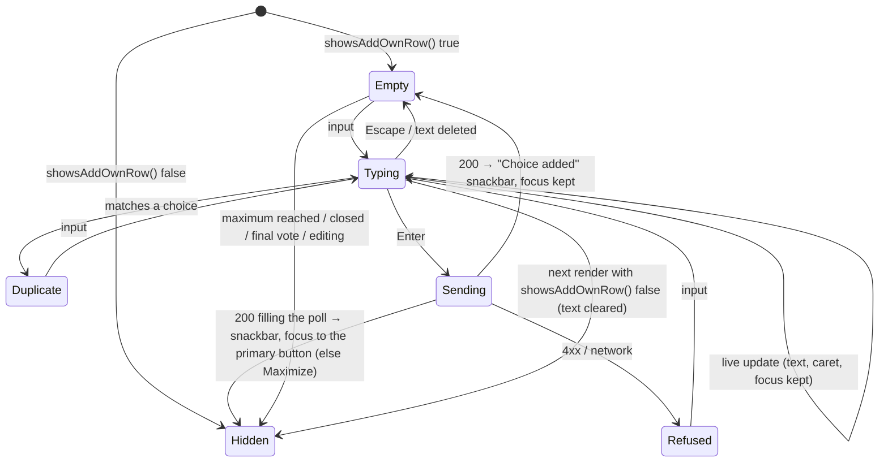

# Data Model: Voting Center

**Feature**: [spec.md](spec.md) | **Research**: [research.md](research.md)

Nothing is stored or sent that is not stored or sent today (R1, R20). This page describes the client-side state a
poll card holds for the feature, and the rules that drive it.

## Inputs (unchanged)

| Source | Field | Used for |
|---|---|---|
| PollDetail (`applyPoll`) | `choices[]` (`id`, `label`, `position`, `color`, `pct`, `count`) | bars, duplicate check, the 10-choice rule, the maximum |
| PollDetail | `pollVisibility`, `votersAddChoices`, `pollState`, `canVote`, `voteMutability`, `myChoiceIds`, `ownPoll`, `notPublished` | `mayAddChoice()`, `showsAddOwnRow()` |
| PollDetail | `choiceMode` | Cast label, help line |
| PollDetail | `bookmarked`, `mayWatch` | Follow buttons (both faces) |
| `opts.choiceBounds` | `maxChoices`, `choiceLabelMax` | row visibility, `maxlength`, counter |
| Session (`/api/me`) | `permissions` | `mayAddChoice()` (unchanged) |
| `POST /api/polls/:pid/choices` answer | `choices`, `contentVersion` / `error` + status | `applyAddedChoices`, support line |

## Add-your-own row (one per face of a card; not stored)

| Field | Type | Rule |
|---|---|---|
| `face` | `'results' \| 'vote'` | which list it ends |
| `element` | `li.add-own-item` | built once, never removed while the card is mounted (R2) |
| `input.value` | string | ≤ `choiceLabelMax`; pasted line breaks become spaces; kept across live updates and grid reorders (FR-025, R18); cleared on success, Escape, a flip, maximize, minimize or when the row is hidden |
| `busy` | boolean | true while the request is in flight; Enter is ignored |
| `refusal` | string | the last refusal's message; cleared on input |
| `support` | `p.add-own-support` text | duplicate message while typing, else `refusal`, else empty (hidden) |
| `counter` | text | `value.length + " / " + choiceLabelMax`, shown while the field has text |
| `hint` | placeholder | touch-only → "Enter your own choice, then press ↵."; else "… then press Enter." (R8) |

### Validation

- **Empty**: `value.trim() === ""` → Enter ignored, no message.
- **Duplicate**: `keyOf(value)` (trim, collapse spaces, lower case) equals `keyOf` of an existing choice → the message
  "This poll already has that choice.", and Enter ignored.
- **Server refusals** (the server is the authority): 429 → "Please wait a moment and try again."; a known `error` text →
  that text (for example the maximum number of choices); anything else → "Your choice could not be added. Please try
  again."

### States

## Visibility and layout rules

| Rule | Definition |
|---|---|
| `showsAddOwnRow()` | `mayAddChoice() && poll.choices.length < maxChoices && !isEditing() && !poll.notPublished` (R3) |
| bar count for sizing | shown rows + (More/Show-all row ? 1 : 0) + (add-own row ? 1 : 0) (R4) |
| compact results fit | places for results = capacity − (More row needed ? 1 : 0) − (add-own ? 1 : 0) |
| `ballotOpensMaximized()` | desktop: `data.length + addOwn > capacity(votingWrap)`; phone: unchanged; `render()` does not turn a flipped compact card back while its voting row has focus or text (R4) |
| top action row | `isMaximized && !isPhoneLayout() && poll.choices.length >= 10 && !submitBtn.hidden` (R13) |
| help line | `poll.choiceMode === 'Multiple-Choice Poll'` and that row's Cast button shown; never in the phone `#voteBar` (R14) |
| Cast label | removal → "Remove vote"; else ≥ 2 ticked → "Cast these votes"; else "Cast this vote" (R11) |
| back-face Follow | shown only in a maximized card, when the front's is (R15) |
