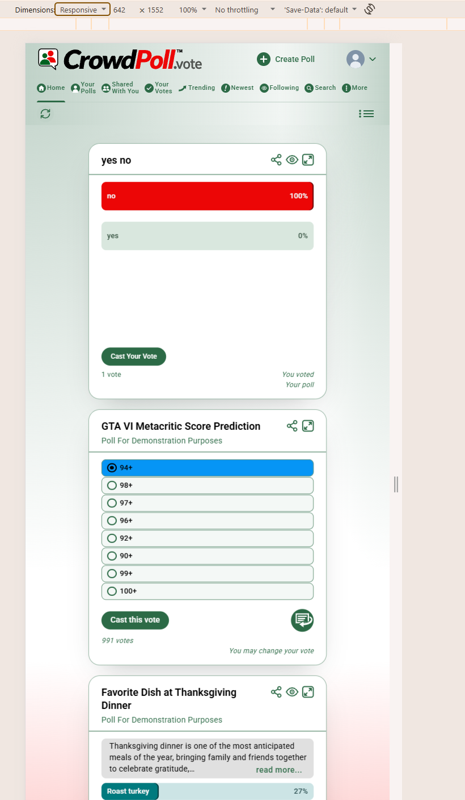
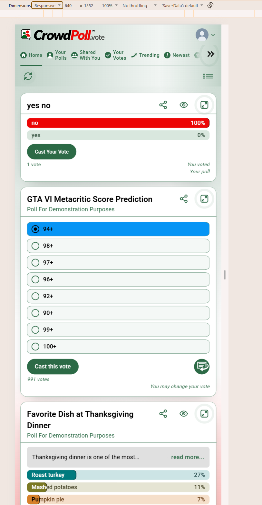

# Overview: `specs/20261122-012539-VOTING-CENTER-UI`

## Document History

| Record | Value |
|---|---|
| Feature directory | `specs/20261122-012539-VOTING-CENTER-UI` |
| Tweak file created | 2026-11-24 07:43 |
| Last updated | 2026-11-24 18:44 |

Legend: `[ ]` open · `[X]` Resolved · `[-]` Resolved (manually)  
(or accepted as-is) by the developer.
Tick `Run Tests` to have this tweak's automated tests written and run; leave it empty (the default) to postpone the run.

"Next" always returns the first `[ ]` item below.

The developer is expected to create the individual tweak requirements in this file, and then run the `/speckit-tweak` command to have the AI implement them, one at a time.  
Each tweak requirement initially carries an empty checkbox; tick it when the item is resolved or consciously accepted.  

# Tweaks

## TWEAK01 Results Button Reads Cast Your Vote  
[X] Resolved  
[ ] Run Tests  

Please change the label from "Voting Center" to "Cast Your Vote".

### RECOMMENDATION

Change only the results face's button label; the ballot face keeps its name, the Voting Center.  
- `src/public/pollCard.js:1929`: the `.vote-btn` label becomes "Cast Your Vote".  
  The sizers keep "Submit vote(s)", so `fitLabel` shrinks the longer label to fit (FR-005 unchanged).  
- Tests (written, not run: Run Tests not ticked):  
  - `tests/client-remove-vote.test.ts:98` expects "Cast Your Vote";  
  - `tests/poll-card-assets.test.ts:137` expects the new template label, and the two test titles at lines 140 and 150 name the button "Cast Your Vote".  
- Artifacts: `spec.md` (FR-001, FR-005, User Story 1 text and scenarios 1 and 7, the Enter-key edge case), `contracts/ui.md` V1, `quickstart.md` scenarios 1, 2 and 10;
  `README.md` where it names the button;
  the `CLAUDE.md` label-width line.  
- This changes what FR-001 requires; `requirements/20261122-012539-voting-center-ui/requirements.md` may need the same change (not edited).  

2026-11-24 07:50  

### ACCEPTED RECOMMENDATION

The results face's `.vote-btn` now reads "Cast Your Vote"; the ballot face is still called the Voting Center.  
- Code: `src/public/pollCard.js:1929` (template label only;
  the sizers and `fitLabel` are unchanged).  
- Tests updated: `tests/client-remove-vote.test.ts:98`;
  `tests/poll-card-assets.test.ts:137` and the titles at lines 140 and 150.  
- Tests postponed (Run Tests not ticked); the updated cases were not run, so the tweak is unverified by a run.  
- Artifacts: `spec.md` (User Story 1, scenarios 1 and 7, the edge case at line 235, FR-001, FR-005), `plan.md` (Buttons), `research.md` (Labels), `tasks.md` (US1 goal, T007, T008), `contracts/ui.md` V1, `quickstart.md` scenarios 1, 2 and 10;
  `README.md` (the button's name in Voting Center, Long polls, A bar opens the poll and Voting on a phone);
  `CLAUDE.md` (the label-width line).  
- FR-001's wording changed; `requirements/20261122-012539-voting-center-ui/requirements.md` may need the same change (not edited).  

2026-11-24 07:54  

## TWEAK02 Desktop Layout Down To 481px  
[-] Resolved (accepted as-is)  
[ ] Run Tests  

I'm not sure exactly how to describe this,  
but when the viewport is 642 pixels wide,  the layout is good.  
  

But at 640px everything is scaled up too much.  
  

I would prefer the layout remained the same all the way down to 481px.  

### RECOMMENDATION

What you see at 640px is the phone layout.  
It starts at `max-width: 640px`, and about 25 sheets and scripts use that query: `m3-tokens.css` (the larger type scale), `phone-*.css`, `single-column-m3.css`, the `header-*` sheets, `pollCard.js` `PHONE_LAYOUT_QUERY`, `headerFit.js` and `adminCard.js`.  
That boundary was decided by the FIXED-WIDTH-640 feature (`CLAUDE_COMPLETE.md`, "One boundary, 640 px inclusive").  
`viewportWidth.js` lays a device held 481–639px wide out at `width=640`, so phones in landscape and small tablets get the phone layout.  
`phone-sheets.test.ts` refuses `max-width: 480px`.  
So this tweak reverses an earlier requirement.  

- **Option A** _(recommended)_: keep the phone layout to 640px on touch screens, and use it only up to 480px with a mouse.  
  Every phone query becomes `(max-width: 480px), (max-width: 640px) and (pointer: coarse)`, and every wide-side query its negation, in CSS and JS alike.  
  `viewportWidth.js` is unchanged.  
  - Pros: a desktop window 481–640px wide keeps the layout you like;
    phones and tablets keep the touch-sized layout FIXED-WIDTH-640 was built for.  
  - Cons: about 25 queries and the suites that pin them change (`phone-sheets`, `single-column-sheets`, `tab-bar-assets`, `m3-assets`, `header-fixed-sheet`, `single-row-header-sheet`, `legal-pages`, `admin-search-assets`, `poll-card-assets`, `tests/helpers/phone-page.ts`);
    DevTools' responsive mode without touch emulation shows the desktop layout down to 481px, while a real phone shows the phone layout.  

- **Option B**: move the boundary to 480px for every device.  
  Every `max-width: 640px` becomes `max-width: 480px`, the wide side `480.02px`.  
  `viewportWidth.js` lays a device held 481–639px wide out at its own width instead of 640.  
  - Pros: one simple boundary, the same on every device.  
  - Cons: phones in landscape and small tablets get the desktop layout, with smaller touch targets and type;
    it undoes FIXED-WIDTH-640's R1 and R3 and its device checklist;
    the desktop header and tab bar must still fit at 481px, which is unverified.  

- **Option C**: keep the phone layout from 640px down, but use the larger phone type scale only at 480px and below.  
  - Pros: one block in `m3-tokens.css` changes.  
  - Cons: the cards still go full width and the header still changes at 640px, so the layout is not "the same down to 481px".  

Whichever option is taken, the tests are written but not run (Run Tests not ticked).  
The artifacts updated are: this feature's `spec.md` (a new assumption), `plan.md` and `tasks.md` (a new task);
`CLAUDE.md` and `CLAUDE_COMPLETE.md` (the boundary rule);
`README.md` where it describes the phone layout.  
The FIXED-WIDTH-640 requirements document may need the same change (not edited).  

2026-11-24 17:45  

### ACCEPTED RECOMMENDATION

Resolution: accepted as-is by the developer (2026-11-24 18:44)  

## TWEAK03 <short title here>  
[ ] Resolved  
[ ] Run Tests  
tweak requirements...  

